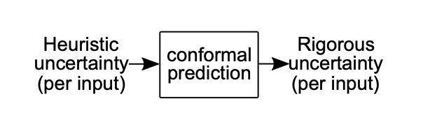
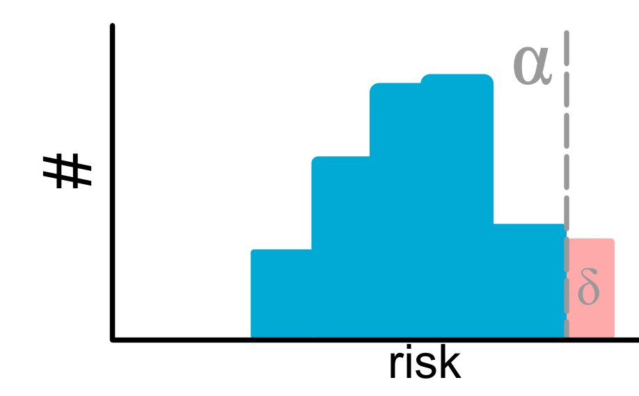

> 본 포스트는 **Anastasios N. Angelopoulos**와 **Stephen Bates**의 튜토리얼 논문 *A Gentle Introduction to Conformal Prediction and Distribution-Free Uncertainty Quantification*(arXiv:2107.07511v6, 2022년 12월 판)을 바탕으로, 본문 1–7절과 부록 A–D를 원문의 절 순서 그대로 따라가며 재구성한 것입니다. 원문은 Python 코드 예시마다 실데이터로 구현한 Jupyter 노트북을 함께 제공하며, 본문에 실린 코드 그림은 원문에서 그대로 가져왔습니다.

## 논문 정보 (Paper Information)

* **제목**: A Gentle Introduction to Conformal Prediction and Distribution-Free Uncertainty Quantification
* **저자**: Anastasios N. Angelopoulos, Stephen Bates
* **소속**: 원문 표지에 기재되어 있지 않음
* **출처**: arXiv:2107.07511v6 [cs.LG], 2022년 12월 7일 등록 (표지 날짜 2022년 12월 8일). 본문과 참고문헌이 1–38쪽, 부록 A–D가 39–51쪽입니다.
* **키워드**: conformal prediction, distribution-free uncertainty quantification, split conformal prediction, conditional coverage, conformal risk control, covariate shift / distribution drift, Learn then Test, familywise-error rate

## 한 줄 요약 (TL;DR)

> **"보정 데이터에서 계산한 점수의 보정 분위수 $\hat{q}$ 하나만으로, 어떤 사전학습 모형의 휴리스틱한 불확실성이든 분포 가정 없이 $1-\alpha$ 커버리지가 보장되는 예측 집합으로 바꿀 수 있습니다."**
>
> 분류 모형의 softmax, 분위수 회귀, 표준편차 추정, 베이즈 사후 밀도처럼 서로 다른 불확실성 신호도 점수 함수 $s(x, y)$ 하나로 표현하면 같은 보정 절차가 적용되며, 보장은 교환 가능성(i.i.d.)만으로 유한 표본에서 성립합니다. 보장 자체는 언제나 성립하므로 집합이 얼마나 쓸모 있는지는 점수 함수가 결정하고, 그래서 논문은 적응성(adaptivity)과 커버리지 변동을 점검하는 평가 도구를 함께 제시합니다. 이어서 그룹·클래스 조건부 커버리지, 단조 손실의 기댓값 제어(conformal risk control), 이상치 탐지, 공변량 이동과 분포 표류로 틀을 넓히고, 부록에서는 단조성이 없는 일반 위험까지 다루는 Learn then Test와 커버리지 정리의 증명을 제공합니다.

## 1. 컨포멀 예측 (Conformal Prediction)

### Introduction
* 딥러닝 모델과 같은 Black-box 머신러닝 모델들은 의료 진단이나 자율 주행과 같은 High-risk 환경에서 일상적으로 사용되고 있습니다. 
* 하지만 이러한 모델들은 종종 잘못된 예측을 내놓으면서도 높은 확신(Overconfidence)을 보이는 문제가 있습니다.

* **Conformal Prediction(CP)**는 이러한 모델의 예측에 대해 통계적으로 엄밀한 불확실성 구간(Uncertainty Sets/Intervals)을 생성하는 방법론입니다. 
* CP의 가장 큰 장점은 다음과 같습니다:
  1.  **Distribution-free**: 데이터의 분포에 대한 가정(가우시안 분포 등)이 필요하지 않습니다.
  2.  **Model-agnostic**: 뉴럴 네트워크를 포함한 어떤 학습된 모델(Pre-trained model)에도 적용 가능합니다.
  3.  **Finite-sample guarantee**: 무한한 데이터가 아닌, 유한한 샘플 수에서도 통계적 커버리지($1-\alpha$)를 보장합니다.

* 이 글에서는 논문 *"A Gentle Introduction to Conformal Prediction and Distribution-Free Uncertainty Quantification"*의 핵심 내용을 바탕으로 CP의 원리와 구현 방법을 정리합니다.

### The Intuition: Classification Example

* CP를 이해하기 위해 가장 간단한 이미지 분류(Classification) 문제를 예로 들어보겠습니다.
* $K$개의 클래스를 분류하는 모델 $\hat{f}$가 있다고 가정합시다. 
* 이 모델은 입력 이미지 $x$에 대해 각 클래스에 속할 확률(Softmax score)을 출력합니다.

* 우리의 목표는 단순히 가장 높은 확률을 가진 하나의 라벨을 뱉는 것이 아니라, **정답 라벨 $Y$를 $1-\alpha$(예: 90%)의 확률로 포함하는 후보 라벨들의 집합(Set) $\mathcal{C}(X)$**를 만드는 것입니다.
$$
1-\alpha \le \mathbb{P}(Y_{test} \in \mathcal{C}(X_{test})) \le 1-\alpha + \frac{1}{n+1}
$$

* 위 식은 **Marginal Coverage**라고 불리며, Calibration 데이터와 테스트 데이터의 무작위성을 평균했을 때 예측 집합이 정답을 포함할 확률이 $1-\alpha$ 이상임을 의미합니다. 

### The Conformal Prediction Algorithm

* CP는 복잡한 최적화 과정 없이 **Calibration Step**이라고 불리는 간단한 절차를 통해 수행됩니다.
* 핵심은 모델이 학습 과정에서 보지 못한 **Calibration Data** (약 500개 정도의 소규모 데이터)를 사용하는 것입니다.

#### Step 1: Calibration Data 준비
* 학습에 사용되지 않은 $n$개의 데이터 쌍 $(X_1, Y_1), \dots, (X_n, Y_n)$을 준비합니다. 
* 이 데이터는 교환 가능(Exchangeable), 일반적으로는 i.i.d. 가정만 만족하면 됩니다.

#### Step 2: Conformal Score 계산
* 각 Calibration 데이터에 대해 모델이 얼마나 "잘못" 예측했는지를 나타내는 **Conformal Score** $s_i$를 계산합니다.
* 분류 문제에서 가장 일반적인 점수 함수는 다음과 같습니다:

$$
s_i = 1 - \hat{f}(X_i)_{Y_i}
$$

* 여기서 $\hat{f}(X_i)_{Y_i}$는 정답 클래스 $Y_i$에 대한 모델의 Softmax 확률입니다.
* 모델이 정답을 확신할수록 $\hat{f}(X_i)_{Y_i} \approx 1$이므로 점수 $s_i$는 0에 가까워집니다.
* 모델이 틀렸거나 불확실할수록 점수 $s_i$는 커집니다.

#### Step 3: Quantile 구하기
* 우리는 새로운 데이터가 들어왔을 때, 모델의 불확실성(Score)이 어느 수준 이하이어야 안심할 수 있는지를 결정해야 합니다. 
* 이를 위해 계산된 점수들 $s_1, \dots, s_n$의 분포에서 **$\hat{q}$ (Quantile)** 값을 찾습니다.

* 엄밀한 커버리지를 보장하기 위해 다음과 같은 보정된 분위수(Adjusted Quantile)를 사용합니다:

$$
\hat{q} = \text{Quantile}\left( \frac{\lceil (n+1)(1-\alpha) \rceil}{n} ; \{s_1, \dots, s_n\} \right)
$$

* 이 $\hat{q}$ 값은 "전체 데이터의 $(1-\alpha)$ 비율이 이 점수보다 낮다"는 경계선 역할을 합니다.

#### Step 4: Prediction Set 구성 (Inference)
* 이제 새로운 테스트 데이터 $X_{test}$가 들어오면, 예측 집합 $\mathcal{C}(X_{test})$를 다음과 같이 구성합니다:

$$
\mathcal{C}(X_{test}) = \{ y : 1 - \hat{f}(X_{test})_y \le \hat{q} \} = \{ y : \hat{f}(X_{test})_y \ge 1 - \hat{q} \}
$$

* 즉, 모델의 예측 확률이 $1-\hat{q}$ 이상인 모든 클래스를 후보로 포함시킵니다.

### Remarks

* 원문은 알고리즘을 제시한 직후 집합 함수 $\mathcal{C}$를 어떻게 해석해야 하는지 정리합니다.
  * $\mathcal{C}$는 **집합값(set-valued) 함수**입니다. 이미지를 받아 클래스의 집합을 내놓으며, 입력마다 다른 집합을 적응적으로 만듭니다.
  * 모델이 불확실하거나 이미지 자체가 어려우면 집합이 커지므로, **집합의 크기가 모델 확신도의 지표**가 됩니다.
  * $\mathcal{C}(X_{test})$는 이미지 $X_{test}$가 속할 법한 **그럴듯한 클래스들의 집합**으로 읽을 수 있고, 무엇보다 식 (1)을 만족하는 **유효한(valid)** 집합입니다.
* 일반화를 위해 무엇이 일어났는지 되짚어 보면 다음과 같습니다.
  * 출발점은 softmax라는 **내장되어 있지만 휴리스틱한 불확실성**이었습니다. softmax 벡터의 $j$번째 성분은 $\mathbb{P}(Y = j \mid X = x)$를 추정하려 하지만, 그 값이 쓸 만하다는 보장은 전혀 없습니다. 임의로 과적합되었거나 달리 믿을 수 없는 값일 수도 있습니다.
  * 그래서 softmax를 액면 그대로 쓰지 않고, 모델이 학습 중 보지 못한 약 $n \approx 500$개의 홀드아웃 데이터로 그 결함을 **보정**했습니다. 컨포멀 점수는 모델이 불확실할수록 커지지만 **점수 자체가 유효한 예측 구간은 아닙니다.**
  * $\hat{q}$는 대략 점수의 $1-\alpha$ 분위수입니다. $\alpha = 0.1$이면 정답 클래스 softmax 출력의 **최소 90%가 $1-\hat{q}$ 위에 놓인다는 것이 보장**되며(증명은 부록 D), 새 이미지의 정답 softmax도 최소 90% 확률로 $1-\hat{q}$ 위에 있으므로 식 (1)의 보장이 따라 나옵니다.
* 식 (1)의 **상한**까지 만족시키려면 $Y$가 이산적이어서 생기는 동점(tie)을 무작위로 처리하는 작은 수정이 필요합니다. 실무에서는 이 무작위화를 대개 무시하며, 이 글도 이후로는 동점 처리를 생략합니다 (원문 각주 1).

### 1.1. Instructions for Conformal Prediction

* 앞서 설명한 분류 문제는 CP의 특수한 사례일 뿐입니다. 
* CP는 Regression, Segmentation 등 어떤 문제에도 적용할 수 있는 일반적인 프레임워크입니다.

일반화된 CP 알고리즘은 다음과 같습니다:

1.  **Heuristic Notion of Uncertainty 식별**: Pre-trained 모델을 사용하여 불확실성을 나타내는 지표를 정의합니다.

2.  **Score Function 정의**: $s(x, y) \in \mathbb{R}$. 점수가 클수록 모델의 예측 $x$와 실제값 $y$ 사이의 불일치(Error)가 큼을 의미해야 합니다.
3.  **Quantile $\hat{q}$ 계산**: Calibration 데이터셋에 대해 Score를 계산하고, $\frac{\lceil(n+1)(1-\alpha)\rceil}{n}$ 분위수를 구합니다.
4.  **Prediction Set 생성**:
    $$ \mathcal{C}(X_{test}) = \{ y : s(X_{test}, y) \le \hat{q} \} $$
    이 집합은 Score가 $\hat{q}$보다 작거나 같은 모든 $y$를 포함합니다.

#### Theoretical Guarantee

* Conformal Prediction이 강력한 이유는 다음의 정리에 의해 **수학적으로 증명된 커버리지**를 제공하기 때문입니다.

::: {.callout-note}
## Theorem 1 (Conformal coverage guarantee; Vovk, Gammerman, and Saunders)

Calibration 데이터 $(X_i, Y_i)_{i=1}^n$와 테스트 데이터 $(X_{test}, Y_{test})$가 i.i.d.라고 가정하자.
위에서 정의한 절차(3단계)에 따라 $\hat{q}$를 계산하고 (4단계의) 집합 $\mathcal{C}(X_{test})$를 구성하면, 다음이 성립한다:

$$ P(Y_{test} \in \mathcal{C}(X_{test})) \ge 1 - \alpha $$
:::

* 증명과 식 (1)의 상한까지 포함한 진술은 부록 D에서 다룹니다.
* 지금까지 설명한 절차는 사실 컨포멀 예측의 특수한 경우로, **split conformal prediction**이라고 부릅니다. 가장 널리 쓰이는 형태이며 이 글의 주된 대상입니다. 일반적인 형태(full conformal prediction)는 6절에서, 문헌의 흐름은 7절에서 다룹니다.

* 이 정리는 모델이 아무리 엉터리(Bad)여도 성립합니다.
* 하지만 **"유용한(Useful)"** 예측 집합을 얻기 위해서는 Score Function의 설계가 중요합니다.
  * Score Function이 불확실성을 잘 반영한다면: 쉬운 입력에는 집합 크기가 작고, 어려운 입력에는 커집니다 (Adaptive).
  * Score Function이 랜덤하다면: 집합 크기가 불필요하게 커지지만, 여전히 $1-\alpha$ 커버리지는 만족합니다.

* 따라서 CP의 성패는 **"좋은 Score Function을 어떻게 정의하느냐"**에 달려 있습니다.
  * 점수 함수에는 기반 모델을 포함해 문제와 데이터에 관해 아는 정보가 거의 다 담깁니다. 분류에 적용하느냐 회귀에 적용하느냐의 주된 차이도 결국 점수의 선택이며, 같은 모델에도 성질이 다른 점수를 여럿 정의할 수 있습니다.

## 2. 컨포멀 절차의 예시 (Examples of Conformal Procedures)

* 이 절은 실무에 바로 쓸 수 있는 기법들을 모아 둔 **예시 모음**입니다. 네 가지 예시 모두 다음 약속을 따릅니다.
  * $Y$는 **1차원**으로 한정합니다.
  * 점수가 **작을수록 모델이 더 확신**하는 방향으로 정의하며, 이런 점수를 **비순응 점수(nonconformity score)**라고 부릅니다.
* 고차원 $Y$, 복잡하거나 여러 개인 오류 개념, 실수마다 비용이 다른 상황처럼 더 풍부한 설정은 위험 제어(risk control)의 언어가 필요하며, 이는 부록 A에서 다룹니다.

### 2.1. Classification with Adaptive Prediction Sets

#### Introduction: Why Adaptive?

* 앞의 1절에서 다룬 기본적인 Conformal Prediction 방법은 단순하고 강력하지만 한 가지 단점이 있습니다.
* 원문에 따르면 이 방법은 **평균 집합 크기가 가장 작은** 예측 집합을 만들지만(Sadinle, Lei & Wasserman), 어려운 부분집단은 덜 덮고(undercover) 쉬운 부분집단은 과하게 덮는(overcover) 경향이 있습니다. 이를 피하기 위해 Romano 등과 Angelopoulos 등을 따라 **APS**를 도입합니다.
* 기존 방식(Naive method)은 단순히 $1 - \hat{f}(x)_y$를 점수로 사용하기 때문에, 모든 클래스에 대해 고정된 임계값(Threshold)을 적용하는 경향이 있습니다.

* 이로 인해 다음과 같은 문제가 발생합니다:
  * 1.  **Hard Inputs (어려운 이미지)**: 모델이 헷갈려하는 경우에도 예측 집합이 충분히 커지지 않아 정답을 놓칠 수 있습니다 (Under-coverage).
  * 2.  **Easy Inputs (쉬운 이미지)**: 모델이 확신하는 경우에도 예측 집합이 불필요하게 클 수 있습니다 (Over-coverage).

* 우리는 입력 이미지의 난이도에 따라 **어려우면 집합을 크게, 쉬우면 집합을 작게** 만드는 **Adaptive Prediction Sets (APS)** 기법을 도입하여 이 문제를 해결할 것입니다.

#### The Intuition: "Water-filling" Approach

* APS의 핵심 아이디어는 직관적입니다.
* 만약 모델의 예측 확률 $\hat{f}(x)$가 완벽하다면, 우리는 확률이 높은 클래스부터 순서대로 골라 담으면서 그 **확률의 합(Cumulative Sum)이 $1-\alpha$ (예: 90%)를 넘기는 순간** 멈추면 됩니다.

$$
\sum_{j=1}^{k} \hat{f}(x)_{\pi_j(x)} \ge 1 - \alpha
$$

* 여기서 $\pi(x)$는 확률이 높은 순서대로 정렬된 클래스의 순열(Permutation)입니다.
* 이 방식은 "컵에 물(확률)을 $90\%$가 찰 때까지 붓는 것"과 유사합니다.
* **쉬운 문제**: 확률 분포가 뾰족(Peaked)하므로, 1~2개만 담아도 금방 $90\%$가 찹니다. $\rightarrow$ **Small Set**
* **어려운 문제**: 확률 분포가 평평(Flat)하므로, 여러 개를 담아야 $90\%$가 찹니다. $\rightarrow$ **Large Set**

* 하지만 실제 모델의 확률 $\hat{f}(x)$는 완벽하지 않으므로(Overconfident/Underconfident), 단순히 $1-\alpha$에서 끊으면 커버리지를 보장할 수 없습니다. 
* 따라서 **Conformal Prediction을 사용하여 이 "멈추는 지점(Threshold)"을 보정**해야 합니다.

#### Mathematical Formulation

* 이제 이를 수학적으로 엄밀하게 정의해보겠습니다.

##### 1. Defining the Score Function
* APS를 위한 Score Function $s(x, y)$는 **"정답 클래스 $y$를 포함시키기 위해, 확률 상위 몇 번째 클래스까지 내려가야 하는가?"**를 누적 확률로 나타냅니다.

* 먼저, 입력 $x$에 대해 모델이 예측한 확률을 내림차순으로 정렬하는 순열 함수 $\pi(x)$를 정의합니다.
$$ \hat{f}(x)_{\pi_1(x)} \ge \hat{f}(x)_{\pi_2(x)} \ge \dots \ge \hat{f}(x)_{\pi_K(x)} $$

* 이때, 정답 클래스 $y$가 정렬된 순서상 $k$번째에 위치한다고 가정합시다 ($y = \pi_k(x)$).
* Score $s(x, y)$는 $y$까지의 누적 확률 질량(Cumulative Probability Mass)으로 정의됩니다:

$$
s(x,y) = \sum_{j=1}^{k} \hat{f}(x)_{\pi_j(x)}
$$

* **의미**: "모델이 가장 가능성 높다고 생각하는 것부터 정답 $y$가 나올 때까지 확률을 다 더한 값"입니다.
  * 만약 모델이 정답을 1순위로 예측했다면, $s(x,y)$는 작을 것입니다.
  * 만약 모델이 정답을 하위권으로 예측했다면, $s(x,y)$는 1에 가까워질 것입니다.

##### 2. Calibration (Finding $\hat{q}$)
* 이제 Calibration 데이터셋 $(X_1, Y_1), \dots, (X_n, Y_n)$에 대해 위 점수들을 계산합니다.
* 그리고 다음 식을 만족하는 분위수(Quantile) $\hat{q}$를 찾습니다.

$$
\hat{q} = \text{Quantile}\left( \frac{\lceil (n+1)(1-\alpha) \rceil}{n} ; \{s_1, \dots, s_n\} \right)
$$

* 이 $\hat{q}$는 "정답을 포함하기 위해 누적 확률을 어디까지 허용해야 하는가?"에 대한 통계적 임계값입니다.

##### 3. Constructing the Prediction Set
* 새로운 테스트 데이터 $X_{test}$에 대해 예측 집합 $\mathcal{C}(X_{test})$는 누적 확률이 $\hat{q}$를 넘어서는 지점까지의 모든 클래스를 포함하여 구성됩니다.

$$
\mathcal{C}(x) = \{ \pi_1(x), \dots, \pi_k(x) \}
$$

* 여기서 $k$는 다음과 같이 정의됩니다 (원문 식 (3)):
$$
k = \text{sup} \left\{ k' : \sum_{j=1}^{k'} \hat{f}(x)_{\pi_j(x)} < \hat{q} \right\} + 1
$$
* 즉, 누적 합이 $\hat{q}$를 초과하는 순간까지 포함합니다. 원래의 규칙 $\{y : s(x, y) \le \hat{q}\}$에 마지막 $+1$을 더한 것은 크기가 0인 집합이 나오지 않게 하려는 작은 수정입니다.
* 1절의 점수가 정답 클래스의 softmax 하나만 보는 것과 달리, 이 점수는 **모든 클래스의 softmax**를 사용합니다. 동점 처리를 포함하면 이 집합도 식 (1)을 만족하며, 실무적 개선은 Angelopoulos 등의 논문에 정리되어 있습니다.

#### Implementation Steps

* Python 코드로 구현할 때의 핵심 로직은 다음과 같습니다.

1.  **Softmax & Sort**: 모델 출력값(Softmax)을 구하고 `argsort`를 이용해 내림차순 정렬합니다.
2.  **Cumulative Sum**: 정렬된 확률값들의 누적 합(`cumsum`)을 계산합니다.
3.  **Calculate Scores (Calibration)**: 정답 라벨 위치에서의 누적 합을 가져와 $s_i$를 구하고, Quantile $\hat{q}$를 계산합니다.
4.  **Prediction (Test)**: 테스트 데이터의 누적 합이 $\hat{q}$보다 작거나 같은 클래스들을 선택합니다. (엄밀하게는 $\hat{q}$를 넘는 첫 번째 클래스까지 포함해야 함)

#### Summary

* **Adaptive Prediction Sets (APS)**는 불확실성을 더 지능적으로 다루는 방법입니다.
* 단순히 모델의 Softmax 값 하나만 보는 것이 아니라, **전체 확률 분포의 형상(Shape)**을 고려합니다.
* 그 결과, **쉬운 샘플에는 작은 집합**을, **어려운 샘플에는 큰 집합**을 할당하여 사용자가 모델의 신뢰도를 직관적으로 파악할 수 있게 해줍니다.
* 이 모든 과정에서도 $1-\alpha$라는 통계적 커버리지는 엄격하게 보장됩니다.

---

### 2.2. Conformalized Quantile Regression

#### Introduction

* 앞 절에서는 분류(Classification) 문제에 대한 Conformal Prediction을 다루었습니다.
* 이번에는 **연속적인 값(Continuous Output)을 예측하는 회귀(Regression)** 문제로 넘어가 보겠습니다.

* 회귀 문제에서 우리의 목표는 입력 $x$에 대해 단순히 하나의 예측값 $\hat{y}$를 내놓는 것이 아니라, 정답 $y$가 포함될 확률이 $1-\alpha$ (예: 90%)인 **예측 구간(Prediction Interval)**을 생성하는 것입니다.

$$
\mathcal{C}(x) = [\text{Lower Bound}, \text{Upper Bound}]
$$

* 이를 위해 가장 효과적인 베이스 모델 중 하나인 **Quantile Regression**을 사용하고, CP를 통해 이를 보정하는 **Conformalized Quantile Regression (CQR)** 기법을 알아보겠습니다.

#### Base Model: Quantile Regression

##### Concept
* 일반적인 회귀 모델은 평균(Mean)을 예측(MSE Loss 사용)하지만, **Quantile Regression**은 조건부 분포의 특정 분위수(Quantile)를 예측합니다.

* 90%의 커버리지를 목표로 한다면, 우리는 양쪽 꼬리에서 5%씩을 제외한 구간을 알고 싶을 것입니다. 즉, 다음 두 가지 분위수를 학습합니다:
    * **Lower Quantile**: $\alpha/2 = 0.05$ (5% 지점)
    * **Upper Quantile**: $1 - \alpha/2 = 0.95$ (95% 지점)

* 모델이 완벽하다면, 정답 $y$는 90%의 확률로 이 구간 $[\hat{t}_{\alpha/2}(x), \hat{t}_{1-\alpha/2}(x)]$ 사이에 존재해야 합니다.

##### Quantile Loss (Pinball Loss)
* 이러한 분위수를 학습하기 위해 **Quantile Loss (Pinball Loss)**를 사용합니다.

$$
L_{\gamma}(\hat{t}_{\gamma}, y) = (y - \hat{t}_{\gamma})\gamma \mathbb{1}\{y > \hat{t}_{\gamma}\} + (\hat{t}_{\gamma} - y)(1-\gamma)\mathbb{1}\{y \le \hat{t}_{\gamma}\}
$$

* $\gamma$: 타겟 분위수 (예: 0.05 또는 0.95)
* 이 손실 함수를 사용하여 뉴럴 네트워크 등 어떤 모델이든 특정 분위수를 예측하도록 학습시킬 수 있습니다.

* 분위수 회귀는 **L1 노름 회귀의 일반화**로 볼 수 있습니다.
  * $\gamma = 0.5$이면 두 항의 가중치 $\gamma$와 $1-\gamma$가 모두 $0.5$가 되어 손실이 $L_{0.5} = |\hat{t}_{\gamma}(x) - y|/2$로 줄어들고, 이 손실은 $\hat{t}_{0.5}(x)$를 **조건부 중앙값**으로 수렴하게 만듭니다.
  * $\gamma$를 바꾸는 것은 위 그림처럼 L1 손실의 양쪽 기울기를 바꿔 다른 분위수를 겨냥하는 것입니다. 실무에서는 신경망 같은 알고리즘의 마지막 MSE 손실을 분위수 손실로 바꾸기만 하면 됩니다.

#### The Problem: Why Conformalize?

* Quantile Regression으로 구한 구간 $[\hat{t}_{0.05}(x), \hat{t}_{0.95}(x)]$는 꽤 훌륭한 불확실성 추정치입니다.
* 하지만 문제는 **"Finite Sample"에서 90% 커버리지를 보장하지 못한다**는 점입니다.
* 모델이 과적합(Overfitting)되거나 학습이 덜 되면, 실제 정답이 이 구간을 벗어나는 비율이 10%보다 훨씬 클 수도, 작을 수도 있습니다.

* 따라서 우리는 Conformal Prediction을 사용하여 이 구간을 **보정(Calibrate)**해야 합니다.

#### Conformalized Quantile Regression Algorithm

* CQR의 핵심 아이디어는 학습된 분위수 구간을 **$\hat{q}$만큼 늘리거나 줄여서** 엄밀한 커버리지를 맞추는 것입니다.

##### Step 1: Define Score Function
* Calibration 데이터 $(X_i, Y_i)$에 대해, 정답 $Y_i$가 학습된 구간 $[\hat{t}_{\alpha/2}(X_i), \hat{t}_{1-\alpha/2}(X_i)]$ 밖으로 얼마나 나갔는지를 측정하는 Score를 정의합니다.

$$
s(x, y) = \max \{ \hat{t}_{\alpha/2}(x) - y, \quad y - \hat{t}_{1-\alpha/2}(x) \}
$$

* 이 식의 의미를 직관적으로 살펴봅시다:
    * **Case 1: $y$가 구간 안에 있을 때**:
        * $\hat{t}_{\text{lower}} < y < \hat{t}_{\text{upper}}$ 이므로, 두 항 모두 음수가 됩니다.
        * $s(x, y) < 0$ (즉, 안전함)
    * **Case 2: $y$가 구간 밖(위쪽)에 있을 때**:
        * $y > \hat{t}_{\text{upper}}$ 이므로 $y - \hat{t}_{\text{upper}}$ 가 양수가 됩니다.
        * $s(x, y) > 0$ (즉, 위험함/에러)

* 즉, 점수 $s$가 클수록 정답이 예측 구간을 크게 벗어났음을 의미합니다.

##### Step 2: Calibration (Get $\hat{q}$)
* 계산된 점수들 $s_1, \dots, s_n$의 분포에서 $1-\alpha$ 분위수 $\hat{q}$를 찾습니다.

$$
\hat{q} = \text{Quantile}\left( \frac{\lceil (n+1)(1-\alpha) \rceil}{n} ; \{s_1, \dots, s_n\} \right)
$$

* 만약 모델이 불확실성을 과소평가했다면(구간이 너무 좁으면), 많은 $y$가 구간 밖에 있을 것이고 $s$값들이 커져서 **양수의 $\hat{q}$**가 나옵니다.
* 만약 모델이 불확실성을 과대평가했다면(구간이 너무 넓으면), $s$값들이 대부분 음수일 것이고 **음수의 $\hat{q}$**가 나옵니다.

##### Step 3: Construct Prediction Interval
* 최종적으로 새로운 입력 $X_{test}$에 대한 예측 구간을 생성할 때, 원래 구간을 $\hat{q}$만큼 조정합니다.

$$
\mathcal{C}(X_{test}) = [\hat{t}_{\alpha/2}(X_{test}) - \hat{q}, \quad \hat{t}_{1-\alpha/2}(X_{test}) + \hat{q}]
$$

* $\hat{q} > 0$: 원래 구간이 너무 좁았으므로, 양쪽으로 $\hat{q}$만큼 **넓힙니다**.
* $\hat{q} < 0$: 원래 구간이 너무 넓었으므로, 양쪽으로 $|\hat{q}|$만큼 **좁힙니다**.

#### Implementation

Python으로 CQR을 구현하는 것은 매우 간단합니다.

* 1.  **Get Scores**: Calibration 데이터에 대해 `max(lower - y, y - upper)`를 계산합니다.
* 2.  **Get Quantile**: 위 점수들의 $(1-\alpha)$ 분위수 $\hat{q}$를 계산합니다.
* 3.  **Deploy**: 새로운 데이터의 Lower/Upper 예측값에 각각 $-\hat{q}, +\hat{q}$를 더해줍니다.

#### Conclusion

* **Conformalized Quantile Regression (CQR)**은 회귀 문제에서 가장 널리 사용되는 최신 기법 중 하나입니다.
* **Adaptivity**: 입력값 $x$에 따라 구간의 길이(불확실성 크기)가 달라지는 Quantile Regression의 장점을 그대로 가집니다. (어려운 입력은 구간이 넓고, 쉬운 입력은 구간이 좁음)
* **Validity**: Conformal Prediction을 통해 통계적 커버리지를 엄밀하게 보장합니다.
* 1절과 달리 $\mathcal{C}$는 더 이상 클래스의 집합이 아니라 $\mathbb{R}$ 위의 **연속 구간**입니다. 연속 구간을 얻는 방법이 분위수 회귀만 있는 것은 아니지만, 원문은 특히 $\alpha$를 미리 알고 있을 때 이것이 **가장 좋은 방법인 경우가 많다**고 말합니다.
  * 컨포멀 보정 전의 구간 $[\hat{t}_{\alpha/2}(x), \hat{t}_{1-\alpha/2}(x)]$부터 이미 커버리지가 좋습니다.
  * 게다가 이 구간은 **점근적으로 유효한 조건부 커버리지**(3절에서 설명)를 가지며, 이런 성질이 컨포멀 절차를 거쳐서도 그대로 전달됩니다.

* 이 방법은 단순한 MSE 기반 회귀보다 훨씬 풍부한 정보를 제공하며, 의료나 금융과 같이 리스크 관리가 중요한 분야에서 필수적인 도구입니다.

---

### 2.3. Conformalizing Scalar Uncertainty Estimates

#### Introduction

* 앞 절에서 다룬 **Conformalized Quantile Regression (CQR)**은 매우 강력하지만, 두 개의 Quantile을 학습시켜야 한다는 조건이 있습니다.
* 하지만 실무에서는 종종 **평균($\mu$)과 분산($\sigma^2$)**만을 예측하는 더 단순한 모델을 사용하거나, 혹은 모델 앙상블의 분산 등을 불확실성 지표로 삼기도 합니다.

* 이 절에서는 이러한 **단일 스칼라 불확실성 지표(Scalar Uncertainty Estimate)**를 활용하여 통계적으로 유효한 예측 구간을 생성하는 방법을 알아봅니다.

#### 2.3.1. The Estimated Standard Deviation

가장 흔한 시나리오는 데이터가 정규분포(Gaussian)를 따른다고 가정하고 모델을 학습시키는 것입니다.

$$ Y | X = x \sim \mathcal{N}(\mu(x), \sigma(x)) $$

* 딥러닝 프레임워크(PyTorch 등)에서는 `GaussianNLLLoss`와 같은 손실 함수를 제공하여, 모델이 평균 예측값 $\hat{f}(x)$와 불확실성 예측값 $\hat{\sigma}(x)$를 동시에 학습하도록 돕습니다.

* 하지만 실제 데이터는 **정규분포를 따르지 않는 경우가 대부분**입니다.
* 따라서 모델이 예측한 $\hat{\sigma}(x)$를 그대로 사용하여 $\hat{f}(x) \pm 1.96\hat{\sigma}(x)$와 같은 구간을 만들면, 실제로는 95% 커버리지를 보장할 수 없습니다.

* 우리는 Conformal Prediction을 사용하여 이 부정확한(Heuristic) $\hat{\sigma}(x)$를 **보정(Calibrate)**할 것입니다.

#### 2.3.2. Other 1-D Uncertainty Estimates

* 이 방법은 비단 표준편차뿐만 아니라, **"값이 클수록 불확실하다"**는 의미를 가진 어떤 함수 $u(x)$에도 적용 가능합니다.

* 논문에서는 $u(x)$로 사용할 수 있는 다양한 예시를 제시합니다:
    * 1.  **Residual Prediction**: $|y - \hat{f}(x)|$를 예측하는 별도의 모델 학습.
    * 2.  **Ensemble Variance**: 여러 모델 예측값들의 분산 측정.
    * 3.  **Dropout Variance**: 추론 시 Dropout을 켜고 여러 번 예측했을 때의 분산.
    * 4.  **Input Perturbation**: 입력에 작은 노이즈를 주었을 때 출력의 변화량.
    * 5.  **Generative Noise Variance**: 생성 모델에 서로 다른 노이즈 표본을 넣었을 때 $\hat{f}(x)$의 분산.
    * 6.  **Adversarial Perturbation**: 적대적 섭동(adversarial perturbation)을 가했을 때 $\hat{f}(x)$가 변하는 크기.

* 첫 번째 잔차 모델은 이렇게 만듭니다. 먼저 $x$로 $y$를 예측하는 $\hat{f}$를 적합하고, 이어서 $|y - \hat{f}(x)|$를 예측하는 두 번째 모델 $\hat{r}$(같은 신경망이어도 됨)를 적합합니다.
  * $\hat{r}$가 완벽하다면 $[\hat{f}(x) - \hat{r}(x), \hat{f}(x) + \hat{r}(x)]$가 완벽한 커버리지를 갖겠지만, 실제로 학습된 오차 모델은 부정확한 경우가 많습니다.
  * 어떤 경우든 표기는 같습니다. 잔차 설정에서는 $u(x) := \hat{r}(x)$, 가우시안 설정에서는 $u(x) := \hat{\sigma}(x)$로 두면 됩니다.

* 우리는 이 $u(x)$를 "불확실성의 크기(Magnitude)"로 간주하고, 이를 스케일링하는 방식(Multiplicative Correction)을 사용합니다.

#### The Algorithm

* 알고리즘의 핵심은 **"실제 에러가 불확실성 지표 $u(x)$ 대비 몇 배나 큰가?"**를 측정하는 것입니다.

##### Step 1: Define Score Function
* Calibration 데이터 $(X_i, Y_i)$에 대해 다음과 같은 Score를 정의합니다.

$$
s(x, y) = \frac{|y - \hat{f}(x)|}{u(x)}
$$

* **분자 $|y - \hat{f}(x)|$**: 실제 모델의 예측 오차(절대값)입니다.
* **분모 $u(x)$**: 모델이 스스로 추정한 불확실성입니다.
* **의미**: "모델이 예상한 불확실성 대비 실제 오차의 비율"입니다.
    * 만약 모델이 불확실하다고 판단($u(x)$ 큼)했는데 오차도 크다면, $s$는 적절한 값을 가집니다.
    * 만약 모델이 확실하다고 판단($u(x)$ 작음)했는데 오차가 크다면, $s$는 매우 커집니다 (Penalty).

##### Step 2: Calibration (Get $\hat{q}$)
* 계산된 점수들 $s_1, \dots, s_n$에 대해 $1-\alpha$ 분위수(Quantile) $\hat{q}$를 구합니다.

$$
\hat{q} = \text{Quantile}\left( \frac{\lceil (n+1)(1-\alpha) \rceil}{n} ; \{s_1, \dots, s_n\} \right)
$$

* 여기서 구해진 $\hat{q}$는 **"불확실성 지표 $u(x)$에 곱해야 할 보정 계수(Multiplier)"** 역할을 합니다.

##### Step 3: Construct Prediction Interval
* 새로운 입력 $X_{test}$에 대한 예측 구간은 중심 예측값 $\hat{f}(x)$에서 불확실성 지표 $u(x)$의 $\hat{q}$배만큼 벌려준 구간이 됩니다.

$$
\mathcal{C}(x) = [\hat{f}(x) - \hat{q}u(x), \quad \hat{f}(x) + \hat{q}u(x)]
$$

###### 유도 과정 (Derivation of Validity)
* 이 구간이 왜 $1-\alpha$ 커버리지를 보장하는지 살펴보겠습니다.

1.  Calibration 단계에서 $\hat{q}$를 구했으므로, 새로운 데이터에 대해 다음 확률이 성립합니다.
    $$ \mathbb{P}[s(X_{test}, Y_{test}) \le \hat{q}] \ge 1 - \alpha $$
2.  Score $s$의 정의를 대입합니다.
    $$ \mathbb{P}\left[ \frac{|Y_{test} - \hat{f}(X_{test})|}{u(X_{test})} \le \hat{q} \right] \ge 1 - \alpha $$
3.  양변에 $u(X_{test})$를 곱합니다 (불확실성은 항상 양수이므로 부등호 유지).
    $$ \mathbb{P}\left[ |Y_{test} - \hat{f}(X_{test})| \le \hat{q}u(X_{test}) \right] \ge 1 - \alpha $$
4.  절대값을 풉니다.
    $$ \mathbb{P}\left[ -\hat{q}u(X_{test}) \le Y_{test} - \hat{f}(X_{test}) \le \hat{q}u(X_{test}) \right] \ge 1 - \alpha $$
5.  $Y_{test}$에 대해 정리하면 최종 구간이 도출됩니다.
    $$ \mathbb{P}\left[ \hat{f}(X_{test}) - \hat{q}u(X_{test}) \le Y_{test} \le \hat{f}(X_{test}) + \hat{q}u(X_{test}) \right] \ge 1 - \alpha $$

#### Implementation

* 이 방법은 구현이 매우 간단하며, PyTorch 등의 라이브러리와 쉽게 결합됩니다.

1.  **Get Scores**: 에러의 절대값을 예측된 표준편차(또는 불확실성 지표)로 나눕니다.
2.  **Get Quantile**: 점수들의 분위수 $\hat{q}$를 계산합니다.
3.  **Deploy**: 예측값 $\pm (\text{불확실성} \times \hat{q})$를 통해 구간을 생성합니다.

#### Discussion

* 이 방법은 **Symmetric(대칭적)**인 구간을 생성한다는 특징이 있습니다.
    * **장점**: 구현이 쉽고 직관적입니다. 이미 학습된 모델(Gaussian Output 등)을 그대로 재활용하기 좋습니다.
    * **단점**: CQR과 달리 구간이 항상 예측값을 중심으로 대칭입니다. 실제 데이터 분포가 비대칭(Skewed)이라면 효율적이지 않을 수 있습니다. 또한, $u(x)$가 실제 분위수와 비례하지 않는다면 CQR보다 성능(구간의 평균 길이 등)이 떨어질 수 있습니다.

* 따라서 가능하다면 **Quantile Regression (CQR)**을 사용하는 것이 더 좋지만, 상황이 여의치 않거나 빠른 배포가 필요할 때 이 방법은 훌륭한 대안이 됩니다.

---

### 2.4. Conformalizing Bayes

#### Introduction

* Bayesian Neural Network와 같은 베이지안 모델들은 불확실성 정량화(Uncertainty Quantification) 분야에서 매우 매력적인 도구입니다. 
* 이들은 사전 지식(Prior)을 반영할 수 있고, 예측의 결과물로 단일 값이 아닌 분포(Posterior Predictive Density)를 제공하기 때문입니다.

* 하지만 베이지안 모델에는 치명적인 약점이 있습니다.
* **"모델의 가정(Prior, Likelihood function 등)이 완벽하게 맞아야만"** 예측된 불확실성이 정확하다는 점입니다. 
* 현실의 복잡한 데이터에서 이러한 가정이 완벽히 들어맞기는 어렵습니다.

* **Conformalizing Bayes**는 베이지안 모델의 정보량을 그대로 활용하되, **Conformal Prediction을 통해 "가정이 틀렸더라도" 통계적 커버리지를 보장**하는 강력한 방법론입니다.
* 이 절차는 사후 예측 밀도가 높은 라벨을 고르는 것으로 귀결되므로, Python 코드는 **Figure 2와 완전히 같습니다.** 달라지는 것은 해석뿐으로, softmax가 범주형 분포가 아니라 연속 분포의 근사를 나타낸다고 보면 됩니다.

#### The Bayesian Ideal vs. Reality

##### Ideal Scenario
* 만약 우리가 만든 베이지안 모델 $\hat{f}(y|x)$ (입력 $x$가 주어졌을 때 $y$의 사후 확률 밀도)가 완벽하다면, 최적의 예측 집합 $S(x)$는 단순히 밀도 함수(Density)가 높은 영역을 잘라내어 만들 수 있습니다.

$$
S(x) = \{ y : \hat{f}(y|x) > t \}
$$

* 여기서 임계값 $t$는 해당 영역의 적분값이 $1-\alpha$가 되도록 설정합니다.
$$\int_{y \in S(x)} \hat{f}(y|x) dy = 1-\alpha$$
* 이를 **Highest Posterior Density (HPD) Region**이라고도 합니다.

##### Reality
* 하지만 우리는 모델 $\hat{f}$가 완벽하다고 보장할 수 없습니다. 
* 따라서 위 방식으로 구한 집합은 실제로는 90%를 커버하지 못할 수도(Under-coverage), 너무 넓을 수도(Over-coverage) 있습니다.

* 우리는 베이지안 모델의 $\hat{f}(y|x)$를 **"진짜 확률"이 아니라 "유용한 불확실성 점수(Heuristic Score)"로 간주**하고, CP를 적용하여 올바른 임계값(Threshold)을 찾을 것입니다.

#### The Algorithm

* Conformalizing Bayes의 절차는 우리가 익숙한 CP의 흐름을 그대로 따릅니다.

##### Step 1: Define Score Function
* 우리는 모델이 예측한 **사후 확률 밀도(Posterior Predictive Density)**가 높을수록 에러가 작다(확실하다)고 봅니다.
* Conformal Score는 "불확실한 정도"를 나타내야 하므로, 밀도 함수의 **음수(Negative)**를 취합니다.
$$
s(x, y) = - \hat{f}(y|x)
$$
    * $\hat{f}(y|x)$가 높음 (모델이 정답을 확신함) $\rightarrow$ Score $s$는 매우 작은 음수.
    * $\hat{f}(y|x)$가 낮음 (모델이 정답을 예측 못함) $\rightarrow$ Score $s$는 큰 값(0에 가까운 값 혹은 양수).

##### Step 2: Calibration (Finding $\hat{q}$)
* Calibration 데이터 $(X_1, Y_1), \dots, (X_n, Y_n)$에 대해 점수들을 계산하고, $1-\alpha$ 분위수 $\hat{q}$를 찾습니다.

$$
\hat{q} = \text{Quantile}\left( \frac{\lceil (n+1)(1-\alpha) \rceil}{n} ; \{s_1, \dots, s_n\} \right)
$$

* 여기서 구한 $\hat{q}$는 **"밀도 함수를 어디서 잘라야(Thresholding) 하는가?"**에 대한 보정된 기준선이 됩니다.

##### Step 3: Construct Prediction Set
* 새로운 입력 $X_{test}$에 대해, Score가 $\hat{q}$ 이하인(즉, 밀도가 $-\hat{q}$ 이상인) 모든 $y$를 포함합니다.

$$
\mathcal{C}(x) = \{ y : s(x, y) \le \hat{q} \} = \{ y : -\hat{f}(y|x) \le \hat{q} \}
$$

* 이를 정리하면 최종 예측 집합은 다음과 같습니다:

$$
\mathcal{C}(x) = \{ y : \hat{f}(y|x) \ge -\hat{q} \}
$$

* 즉, **보정된 임계값 $-\hat{q}$보다 확률 밀도가 높은 모든 $y$의 집합(Superlevel Set)**을 구성합니다.

#### Mathematical Derivation & Validity

* 이 집합이 왜 유효한지(Valid) 수학적으로 살펴보겠습니다.

* 1.  **Calibration Guarantee**:
    * Calibration 단계에서 $\hat{q}$를 구했으므로, 새로운 i.i.d. 샘플에 대해 다음이 성립합니다.
    $$ \mathbb{P}[s(X_{test}, Y_{test}) \le \hat{q}] \ge 1 - \alpha $$

* 2.  **Substitution**:
    * Score의 정의 $s(x,y) = -\hat{f}(y|x)$를 대입합니다.
    $$ \mathbb{P}[-\hat{f}(Y_{test} | X_{test}) \le \hat{q}] \ge 1 - \alpha $$

* 3.  **Inequality Rearrangement**:
    * 부등식의 양변에 -1을 곱하여 부등호 방향을 바꿉니다.
    $$ \mathbb{P}[\hat{f}(Y_{test} | X_{test}) \ge -\hat{q}] \ge 1 - \alpha $$

* 4.  **Conclusion**:
    * 따라서, 예측 집합 $\mathcal{C}(X_{test}) = \{ y : \hat{f}(y|X_{test}) \ge -\hat{q} \}$는 정답 $Y_{test}$를 $1-\alpha$ 확률로 포함합니다.

#### Why is this useful? (Bayes Optimality)

* 이 방법은 단순히 유효할(Valid) 뿐만 아니라, 특정 조건 하에서 **효율적(Efficient)**입니다.
* 논문에 따르면, 특정한 기술적 가정(Hoff의 논문에 제시된 가정)이 성립할 때 이 집합은 **$1-\alpha$ 커버리지를 갖는 모든 예측 집합 중 베이즈 위험(Bayes risk)이 가장 작습니다.** 더 정확히는, $\mathcal{C}(X_{test})$는 **$1-\alpha$ 커버리지를 갖는 컨포멀 절차 가운데 평균 크기(Average Size)가 가장 작으며**, 이때 평균은 데이터와 **파라미터** 모두에 대해 취한 것입니다 (Bayes Optimal). 이 최적성은 Hoff가 처음 증명했고, 그 전에 Wasserman과 Melluish 등이 다룬 바 있습니다.

* 이는 Neyman-Pearson Lemma와 유사한 논리로, "가장 확률 밀도가 높은 곳부터 담는 것"이 주어진 확률 질량을 채우면서 집합의 크기(Volume)를 최소화하는 전략이기 때문입니다.

#### Summary

* **Conformalizing Bayes**는 베이지안 모델의 확률 밀도 함수를 Score로 사용하여 CP를 적용하는 기법입니다.
* 결과적으로 **"Superlevel Set of Density"** 형태의 예측 집합을 얻게 됩니다.
* 이 방법은 베이지안 모델의 가정이 틀려도 **Coverage를 보장**하며, 동시에 베이지안 모델의 정보량을 활용하여 **집합의 크기를 최적화**할 수 있습니다.

---

### Discussion

* 네 가지 예시가 보여 주듯 컨포멀 예측은 구현이 쉽고 계산량도 사소한, 쓰임새 많은 기법입니다.
* 네 예시는 각각 **평균 크기**(1절), **적응성**(APS·CQR), **베이즈 위험**(Conformalizing Bayes)처럼 서로 다른 최적성 개념을 겨냥해 점수 함수를 설계하는 길잡이 역할을 합니다.
* 이상치 탐지, 영상 분할, 순차적 시계열 예측 같은 다른 과제로의 확장은 4절에서 다루고, 그 전에 3절에서 표준 설정에서의 진단 도구, 특히 **조건부 커버리지**를 깊이 살펴봅니다.

---

## 3. 컨포멀 예측의 평가 (Evaluating Conformal Prediction)

* 앞의 두 절에서 유효한 예측 집합을 만드는 법을 배웠으니, 이제 그것을 **평가**하는 법을 다룹니다. 평가는 두 범주로 나뉩니다.
  1. **적응성 평가(Evaluating adaptivity)**: 평균 집합 크기가 가장 작은 절차가 반드시 가장 좋은 것은 아닙니다. 좋은 절차는 모델의 불확실성을 충실히 반영해 쉬운 입력에는 작은 집합을, 어려운 입력에는 큰 집합을 냅니다. 이 **적응성**은 커버리지 보장에서 따라 나오지 않지만, 실제 배포에서는 **타협할 수 없는(non-negotiable)** 요건입니다.
  2. **정확성 점검(Correctness checks)**: 구현이 올바른지 확인하기 위해 커버리지가 Theorem 1을 만족하는지 경험적으로 확인합니다. 실데이터의 유한 표본 변동을 정확히 계산해야 하므로, 원문은 **무해한 변동(benign fluctuations)**의 크기를 명시적인 공식으로 제공합니다. 관측된 편차가 그 공식이 허용하는 것보다 크면 구현에 문제가 있는 것입니다.
* 제안된 평가의 상당수는 데이터를 서로 다르게 나눠 전체 절차를 **최소 100번** 반복해야 할 만큼 계산이 무겁습니다. 점수 계산이 오래 걸리면 단순 구현은 느리지만, 간단한 계산 요령과 **캐싱**으로 몇 자릿수(orders of magnitude)만큼 빠르게 만들 수 있어 원문은 수식 설명 사이사이에 효율적인 코드를 끼워 넣습니다.

### 3.1. Evaluating Adaptivity

#### Introduction

* 지금까지 우리는 Conformal Prediction(CP)을 통해 $1-\alpha$의 커버리지를 보장하는 예측 집합을 만드는 법을 배웠습니다.
* 하지만 **"평균적으로 90% 정답을 포함한다(Marginal Coverage)"**는 사실만으로는 충분하지 않습니다.

* 예를 들어, 어떤 의사가 쉬운 환자에게는 100% 정확한 진단을 내리지만, 어려운 희귀병 환자에게는 0%의 정확도를 보인다면 어떨까요?
* 전체 평균으로는 90% 정확도일지 몰라도, 이는 좋은 시스템이라 할 수 없습니다.

* 좋은 CP 알고리즘은 **쉬운 입력에는 작은 집합(Small Sets)**을, **어려운 입력에는 큰 집합(Large Sets)**을 출력해야 합니다. 이를 **Adaptivity(적응성)**라고 합니다.
* 이 절에서는 내 모델이 얼마나 "적응적(Adaptive)"인지 평가하는 구체적인 지표들을 알아봅니다.

#### Metric 1: Set Size Distribution

* 가장 먼저 확인해야 할 지표는 예측 집합 크기(Set Size)의 분포입니다.
* 단순히 평균 크기만 보는 것이 아니라, **히스토그램**을 그려봐야 합니다.

* 1.  **Average Set Size**: 
    * 작을수록 좋습니다. (단, $1-\alpha$ 커버리지를 만족하는 전제하에)
    * 평균이 너무 크다면? $\rightarrow$ 모델 성능이 나쁘거나, Score Function이 효율적이지 않음을 의미합니다.
* 2.  **Spread of Set Sizes**: 
    * 분포가 넓을수록(Dynamic Range가 클수록) 좋습니다.
    * 분포가 넓다는 것은 모델이 "확실한 것(크기 1)"과 "불확실한 것(크기 5 이상)"을 잘 구분하고 있다는 뜻입니다.
    * 다만 넓은 퍼짐이 곧 **집합이 $X$의 난이도에 맞게 적응한다는 증거는 아닙니다.** 집합 크기에 동적 범위가 있다는 것을 넘어, 큰 집합이 실제로 어려운 표본에서 나오는지 확인해야 하며, 이를 형식화한 것이 아래의 조건부 커버리지입니다.

#### Metric 2: Conditional Coverage

* 우리가 궁극적으로 원하는 것은 모든 개별 입력 $X$에 대해 커버리지를 보장하는 **Conditional Coverage**입니다.

$$
\mathbb{P}[Y_{test} \in \mathcal{C}(X_{test}) | X_{test}] \ge 1 - \alpha
$$

* 이는 컨포멀 예측이 보장하는 식 (1)의 Marginal Coverage보다 훨씬 강한 성질이며, 가장 일반적인 경우에는 **조건부 커버리지를 달성하는 것 자체가 불가능합니다** (Vovk, 2012). 컨포멀 절차는 이 식을 보장하지 않으므로, 우리 절차가 이것에 얼마나 근접하는지를 점검해야 합니다.
* 대신 우리는 데이터를 의미 있는 **그룹(Group)**으로 나누어, 각 그룹별로 커버리지가 잘 지켜지는지 확인해야 합니다.
* 원문의 예시로 차이를 보면 다음과 같습니다.
  * 빈도가 각각 90%, 10%인 두 집단 A, B가 있고, 예측 집합이 A에서는 언제나 $Y$를 덮지만 B에서는 한 번도 덮지 못한다고 합시다. 전체 커버리지는 90%이지만 조건부 커버리지는 아닙니다.
  * 조건부 커버리지라면 두 집단 모두에서 최소 90%를 덮어야 합니다. 그러나 이것은 필요조건일 뿐 충분조건이 아닙니다. 조건부 커버리지는 **특정한 한 사람**에 대해서도 커버 확률이 90% 이상이어야 한다는, 즉 **모집단의 어떤 부분집합에서도** 90% 이상이어야 한다는 매우 강한 성질입니다.

* 위 그림의 중앙(Marginal) 케이스를 봅시다.
    * **Group 1 (Easy)**: 100% 커버리지 (과잉)
    * **Group 2 (Hard)**: 80% 커버리지 (부족)
    * **전체 평균**: 90% 커버리지 (만족)

* 이런 경우 "Marginal Coverage는 만족하지만, Conditional Coverage는 실패했다"고 합니다.
* 이를 잡아내기 위해 다음 두 가지 지표를 사용합니다.

##### 2.1 Feature-stratified Coverage (FSC)

* 데이터의 특성(Feature)에 따라 그룹을 나누어 커버리지를 측정하는 방법입니다.
* 예를 들어 인종(Race), 나이대(Age), 혹은 이미지의 밝기 등으로 데이터를 그룹화($g=1, \dots, G$)합니다.

* 각 그룹 $\mathcal{I}_g$에 속한 데이터들의 커버리지를 계산하고, **가장 성능이 안 좋은 그룹(Minimum Coverage)**을 찾습니다.

$$
\text{FSC metric} = \min_{g \in \{1, \dots, G\}} \frac{1}{|\mathcal{I}_g|} \sum_{i \in \mathcal{I}_g} \mathbb{I}\{ Y_i \in \mathcal{C}(X_i) \}
$$

* 만약 완벽한 Conditional Coverage라면, 이 값은 $1-\alpha$에 근접해야 합니다.
* 이 값이 $1-\alpha$보다 현저히 낮다면, 특정 그룹(예: 야간 주행 이미지)에서 모델이 실패하고 있음을 의미합니다.

##### 2.2 Size-stratified Coverage (SSC)

* 하지만 어떤 Feature가 중요한지 모를 때는 어떻게 할까요?
* 이때 사용할 수 있는 아주 일반적이고 강력한 방법이 **"예측 집합의 크기"**로 그룹을 나누는 것입니다 (Angelopoulos 등이 도입한 지표).
    * 그룹 1: 집합 크기가 1인 데이터들 ($|\mathcal{C}(x)| = 1$)
    * 그룹 2: 집합 크기가 2인 데이터들
    * ...
* 정확히는 가능한 집합 크기를 $G$개의 구간 $B_1, \dots, B_G$로 이산화하고, 크기가 구간 $g$에 들어가는 관측들의 인덱스를 $\mathcal{I}_g$로 둡니다. 예컨대 분류에서는 원소가 1개, 2개, 3개 이상인 세 그룹으로 나눌 수 있습니다.

* 모델이 "이건 정말 어려워서 후보를 10개나 뽑았어"라고 말한 경우(집합 크기 10), 실제로도 그 안에 정답이 90% 확률로 들어 있어야 합니다.

$$
\text{SSC metric} = \min_{g \in \{ \text{set sizes} \}} \frac{1}{|\mathcal{I}_g|} \sum_{i \in \mathcal{I}_g} \mathbb{I}\{ Y_i \in \mathcal{C}(X_i) \}
$$

* 이 지표는 사용자가 사전에 그룹을 정의할 필요가 없으므로(Feature-agnostic), 어떤 상황에서도 바로 적용해볼 수 있는 훌륭한 진단 도구입니다.

#### Summary

* Conformal Prediction을 평가할 때는 단순히 전체 커버리지만 보지 말고, 다음을 꼭 확인해야합니다:
    * 1.  **Histogram of Set Sizes**: 쉬운 건 작게, 어려운 건 크게 잘 구분하고 있는가?
    * 2.  **Stratified Coverage (FSC / SSC)**: 특정 그룹(인종, 나이, 혹은 모델이 불확실해하는 그룹)에서만 커버리지가 깨지고 있지는 않은가?

* 이러한 **Adaptivity** 체크는 실험실 환경을 넘어 실제 서비스(Production)에 CP를 적용할 때 "Non-negotiable(타협할 수 없는)" 필수 검증 단계입니다.

---

### 3.2. The Effect of the Size of the Calibration Set

#### Introduction

* Conformal Prediction(CP)을 실제 서비스에 배포할 때, 엔지니어가 가장 먼저 마주하는 실무적인 질문은 이것입니다.

> **"Calibration Set($n$)의 크기는 얼마나 커야 할까요? 100개면 충분한가요, 아니면 1,000개가 필요한가요?"**

* 이론적으로 CP의 커버리지 보장($1-\alpha$)은 $n$의 크기와 상관없이 성립합니다(Finite-sample guarantee). 
* 하지만 직관적으로 생각했을 때, 데이터가 많을수록 더 안정적일 것이라 예상할 수 있습니다.

* 이 절에서는 **Calibration Set의 크기 $n$이 예측 구간의 안정성(Stability)에 미치는 영향**을 수학적으로 분석하고, 실무적인 가이드라인($n \approx 1000$)을 제시합니다.

#### Validity vs. Stability

##### The Theoretical Guarantee (Validity)
* 놀랍게도, CP의 커버리지 보장 정리(Theorem 1)는 **모든 $n$에 대해 성립**합니다.
* Calibration 데이터가 단 10개뿐이라도, 새로운 데이터에 대한 평균 커버리지는 $1-\alpha$를 만족합니다.

##### The Catch (Stability)
* 하지만 여기에는 중요한 디테일이 숨어 있습니다. 
* 우리가 보장하는 것은 **"Calibration Set을 무한히 새로 뽑았을 때의 평균"**입니다.

* 하지만 현실에서 우리는 **단 하나의 고정된 Calibration Set**을 사용합니다.
* 만약 우리가 운이 나빠서 이상한(Bias된) 데이터가 섞인 Calibration Set을 뽑았다면 어떨까요?
* 이 고정된 데이터셋으로 학습된 CP 모델을 무한한 테스트 데이터에 적용했을 때의 실제 커버리지는 $1-\alpha$와 정확히 일치하지 않을 수 있습니다.

* 즉, **Calibration Set 자체의 무작위성(Randomness)** 때문에 실제 커버리지는 **확률 변수(Random Quantity)**가 됩니다.

#### Mathematical Derivation: Beta Distribution

* Vladimir Vovk는 고정된 Calibration Set이 주어졌을 때, 무한한 검증 데이터에 대한 커버리지 확률 분포가 **베타 분포(Beta Distribution)**를 따른다는 것을 증명했습니다.

$$
\mathbb{P}(Y_{test} \in \mathcal{C}(X_{test}) \mid \{(X_i, Y_i)\}_{i=1}^n) \sim \text{Beta}(n+1-l, l)
$$

* 여기서 파라미터 $l$은 다음과 같이 정의됩니다:
$$
l = \lfloor (n+1)\alpha \rfloor
$$
  * **의미**: 이 식은 $n$이 커질수록 커버리지 확률 분포가 $1-\alpha$를 중심으로 얼마나 뾰족하게(Sharp) 모이는지를 설명합니다. 좌변의 조건부 확률은 보정 데이터를 고정한 채 무한한 검증 데이터로 잰 커버리지입니다.
  * **평균**: $\text{Beta}(a, b)$의 기댓값은 $a/(a+b)$이므로, $a = n+1-l$, $b = l$을 대입하면 기댓값은 다음과 같습니다 (부록 C의 $\mathbb{E}[\overline{C}]$와 같은 값).
$$
\frac{n+1-l}{n+1} = 1 - \frac{l}{n+1} \ge 1-\alpha
$$
    * 부등호는 $l = \lfloor (n+1)\alpha \rfloor \le (n+1)\alpha$에서 나옵니다. 즉 기댓값은 **정확히 $1-\alpha$가 아니라 $1-\alpha$ 이상**이며 (Validity), $(n+1)\alpha$가 정수일 때만 등호가 성립합니다. 예컨대 $n = 1000$, $\alpha = 0.1$이면 $l = 100$이고 기댓값은 $1 - 100/1001 \approx 0.9001$입니다.
  * **분산**: $n$이 작을수록 분산이 커져서, 실제 커버리지가 목표치 $1-\alpha$에서 크게 벗어날 확률이 높아집니다.

#### Visualizing the Effect of $n$

* 이 현상을 시각적으로 확인해보겠습니다. 
* 아래 그래프는 Calibration Set의 크기 $n$에 따른 커버리지 확률의 밀도 함수를 보여줍니다.

* **$n=100$ (파란색)**: 그래프가 넓게 퍼져 있습니다. 운이 나쁘면 실제 커버리지가 85%나 95%가 될 수도 있습니다.
* **$n=1,000$ (주황색)**: 그래프가 훨씬 좁아졌습니다. 대부분의 경우 커버리지가 **88% ~ 92%** 사이로 유지됩니다.
* **$n=10,000$ (초록색)**: 매우 뾰족합니다. 거의 정확하게 90%를 맞춥니다.

#### Practical Guideline: The "n=1000" Rule

* 그렇다면 실무에서는 몇 개를 써야 할까요?
* 논문에서는 **$n=1000$ 정도면 대부분의 목적에 충분하다**고 제안합니다.
  * 1.  **안정성 확보**: 위 그래프에서 보듯이, $n=1000$일 때 커버리지는 목표치($1-\alpha$)에서 $\pm 2\%$ 내외의 오차 범위를 가집니다. 이는 대부분의 머신러닝 애플리케이션에서 허용 가능한 수준입니다.
  * 2.  **비용 효율성**: 데이터를 10,000개까지 늘려도 얻을 수 있는 이득(오차 감소)은 크지 않습니다. (수렴 속도가 $\mathcal{O}(n^{-1/2})$로 느려지기 때문)

##### Required Sample Size Calculation
* 만약 더 엄격한 기준(예: 커버리지가 $1-\alpha \pm \epsilon$ 안에 들어올 확률을 $1-\delta$로 보장)이 필요하다면, 다음 표를 참고하여 필요한 $n$을 역산할 수 있습니다. 원문 Table 1은 $\delta = 0.1$, $\alpha = 0.1$에서 계산한 값이며, 평균 커버리지는 언제나 $1-\alpha$ 이상이고 $\delta$는 보정 데이터에 대한 조건부 커버리지의 **꼬리 확률**만 조절합니다.

| 허용 오차 ($\epsilon$) | 필요한 $n$ ($\delta = 0.1$, $\alpha = 0.1$) |
| :--- | :--- |
| 0.1 (10%) | 22 |
| 0.05 (5%) | 102 |
| 0.01 (1%) | 2,491 |
| 0.005 (0.5%) | 9,812 |
| 0.001 (0.1%) | 244,390 |

* 일반적인 기준인 90% 신뢰도($\delta=0.1$)에서 목표 커버리지와의 오차를 1%($\epsilon=0.01$) 이내로 줄이려면 약 **2,500개**의 데이터가 필요합니다. 
* 하지만 5% 오차($\epsilon=0.05$)를 허용한다면 **102개**로도 충분합니다.

#### Summary

* Conformal Prediction은 $n$이 작아도 평균적으로는 커버리지를 보장합니다.
* 하지만 **개별 Calibration Set에 대한 신뢰도(Stability)**를 높이기 위해서는 충분한 $n$이 필요합니다.
* **Rule of Thumb**: 약 **1,000개**의 Calibration 데이터를 사용하면, 실제 커버리지가 목표치에서 크게 벗어나지 않음(약 $\pm 2\%$)을 확신할 수 있습니다.

--- 

### 3.3. Checking for Correct Coverage

#### Introduction

* Conformal Prediction(CP)을 구현했다면, 가장 먼저 해야 할 일은 **"이게 정말 작동하는가?"**를 확인하는 것입니다.
* 즉, 우리가 설정한 목표 커버리지(예: 90%)가 실제 테스트 데이터에서도 지켜지는지 검증해야 합니다.

* 하지만 단순히 한 번의 테스트 셋 결과만 보고 "90.1%니까 성공!"이라고 단정 짓기는 어렵습니다.
* 데이터의 무작위성 때문에 우연히 잘 나왔을 수도, 우연히 못 나왔을 수도 있기 때문입니다.
* 따라서 우리는 **여러 번의 실험(Trials)**을 통해 커버리지 분포를 확인해야 합니다.

#### Methodology: Repeated Experiments

* 가장 확실한 검증 방법은 $R$번의 독립적인 실험을 수행하는 것입니다.
* 각 실험 $j=1, \dots, R$마다 새로운 Calibration Set과 Validation Set을 준비하고, 다음 과정을 반복합니다:
  * 1.  Calibration 수행 $\rightarrow$ $\hat{q}_j$ 계산
  * 2.  Validation Set에 대해 예측 집합 구성 $\mathcal{C}_j$
  * 3.  **경험적 커버리지(Empirical Coverage)** $C_j$ 계산:

$$
C_j = \frac{1}{n_{val}} \sum_{i=1}^{n_{val}} \mathbb{I} \{ Y_{i,j}^{(val)} \in \mathcal{C}_j(X_{i,j}^{(val)}) \}
$$

* 이렇게 얻은 $R$개의 커버리지 값들 $C_1, \dots, C_R$의 평균 $\overline{C}$는 이론적으로 $1-\alpha$에 매우 근접해야 합니다.

$$
\overline{C} = \frac{1}{R} \sum_{j=1}^{R} C_j \approx 1 - \alpha
$$

* 또한, $C_j$들의 히스토그램을 그렸을 때 $1-\alpha$를 중심으로 종 모양(Bell-curve) 분포를 보여야 합니다.

#### The Practical Challenge: Limited Data

* 현실적인 문제는 **"매번 새로운 데이터를 어디서 구하는가?"**입니다.
* 우리가 가진 데이터는 유한(총 $n_{total} = n + n_{val}$)하므로, $R$번이나 새로운 데이터를 수집할 수는 없습니다.

* 따라서 우리는 **Resampling (Random Split)** 방식을 사용합니다.
* 전체 데이터를 무작위로 섞어서 Calibration/Validation 셋으로 나누는 과정을 $R$번 반복하는 것입니다.

##### Efficiency Trick: Score Caching

* 하지만 $R$번(예: 100번)이나 모델을 다시 학습시키거나 추론(Inference)을 돌리는 것은 계산 비용이 매우 큽니다.
* 여기서 중요한 팁은 **Conformal Score를 미리 계산해두는 것(Caching)**입니다.

* CP 알고리즘은 **Score값($s_i$)들의 순위**에만 의존합니다. 
* 데이터가 어느 셋(Calibration vs Validation)에 속하느냐에 따라 역할만 달라질 뿐, 각 데이터 포인트의 Score 값 자체는 변하지 않습니다.

* 따라서 다음과 같이 효율적으로 검증할 수 있습니다:
  * 1.  **Pre-computation**: 전체 데이터에 대해 Score를 미리 한 번만 계산합니다.
  * 2.  **Shuffle & Split**: 계산된 Score 배열만 무작위로 섞어서 나눕니다.
  * 3.  **Evaluate**: 나누어진 Score들로 Quantile을 구하고 커버리지를 계산합니다.

* 이 방식을 사용하면 딥러닝 모델을 매번 돌릴 필요가 없어 검증 속도가 수백 배 빨라집니다.

#### Implementation

* Python 코드로 이를 구현하면 다음과 같습니다.

##### Code Explanation
* 1.  **Load/Compute Scores**: `get_scores(X, Y)`를 통해 모든 데이터의 Score를 계산하고 저장합니다.
* 2.  **Loop $R$ times**:
    * `np.random.shuffle(scores)`: Score들을 섞습니다.
    * `calib, val = scores[:n], scores[n:]`: $n$개는 Calibration용, 나머지는 검증용으로 나눕니다.
    * `qhat`: Calibration Score들로 Quantile을 계산합니다.
    * `mean()`: Validation Score들이 `qhat`보다 작은 비율(Coverage)을 계산합니다.
* 3.  **Check**: `coverages.mean()`이 $1-\alpha$와 비슷한지 확인하고, 히스토그램을 그립니다.
* 식 (2)에 따라 검증 표본은 $s(X, Y) \le \hat{q}$일 때 그리고 그때만 덮이므로, 커버리지를 `(val_scores <= qhat).mean()` 한 줄로 계산할 수 있습니다 (원문 Figure 12 캡션).
* 원문 Figure 12 코드의 분위수 수준은 `np.ceil((n+1)*(1-alpha)/n)`으로, 괄호 위치가 Figure 2의 `np.ceil((n+1)*(1-alpha))/n`과 다릅니다. 이대로 실행하면 올림이 나눗셈 뒤에 적용되어 수준이 1이 되므로, 옮겨 쓸 때는 Figure 2의 형태를 따르는 것이 맞습니다.

#### Interpretation of Results

* 검증 결과 커버리지가 정확히 90.00%가 나오지 않더라도 당황할 필요는 없습니다.
* $n$ (Calibration 크기), $n_{val}$ (Validation 크기), $R$ (반복 횟수)이 모두 유한하기 때문에 **약간의 변동(Benign Fluctuations)**은 자연스러운 현상입니다. 이 변동은 Figure 11의 Beta 분포에 폭을 더 얹습니다.
* $\overline{C}$의 평균과 표준편차에 대한 정확한 이론은 **부록 C**에 있으며, 이를 이용하면 $1-\alpha$로부터의 편차가 구현 문제인지 무해한 변동인지 판별할 수 있습니다.
* **정상**: 평균이 0.89 ~ 0.91 사이이며 히스토그램이 0.9 근처에 모여 있음.
* **비정상**: 평균이 0.80처럼 현저히 낮거나, 히스토그램이 한쪽으로 크게 치우침 $\rightarrow$ 구현 오류(버그) 혹은 데이터 분포의 문제(i.i.d. 위반 등)를 의심해야 합니다.

* 이 진단 과정을 통과했다면, 여러분의 Conformal Predictor는 통계적으로 신뢰할 수 있는 상태입니다.

---

## 4. 컨포멀 예측의 확장 (Extensions of Conformal Prediction)

* 여기까지가 핵심입니다. 표준적인 지도 예측 문제라면 어디서든 커버리지를 갖는 예측 집합을 만들 수 있습니다.
* 이제 부가 정보(side information), 공변량 이동처럼 **구조가 다른 예측 과제**로 시야를 넓힙니다. 이런 문제는 현실에서 꽤 자주 생기므로, 원문은 각각에 대한 실용적인 컨포멀 알고리즘을 제시합니다.

### 4.1. Group-Balanced Conformal Prediction

#### Introduction: The Fairness Problem

* 지금까지 우리는 전체 데이터셋에 대해 평균적으로 $1-\alpha$의 커버리지를 보장하는 방법(Marginal Coverage)을 배웠습니다.
* 하지만 현실 세계, 특히 의료나 금융 같은 민감한 분야에서는 "평균적인 성공"만으로는 충분하지 않습니다.

* 예를 들어, 어떤 질병 진단 AI가 백인 환자에게는 99%의 정확도를 보이지만, 유색 인종 환자에게는 80%의 정확도밖에 보이지 않는다고 가정해봅시다.
* 이 경우 백인 환자가 다수라면 전체 평균 정확도는 90%를 넘길 수 있겠지만, 이는 **공정하지 못한(Unfair)** 시스템입니다.

* **Group-Balanced Conformal Prediction**은 이러한 문제를 해결하기 위해, 데이터 내의 특정 그룹(인종, 성별, 연령대 등) 각각에 대해 독립적으로 커버리지를 보장하는 기법입니다.

#### Problem Formulation

* 우리의 입력 데이터 $X$의 첫 번째 특성(Feature) $X_{i,1}$이 그룹을 나타내는 범주형 변수라고 가정해봅시다.
* 이 그룹은 $\{1, \dots, G\}$ 중 하나의 값을 가집니다.

* 기존의 CP는 다음을 보장했습니다:
$$ \mathbb{P}(Y_{test} \in \mathcal{C}(X_{test})) \ge 1-\alpha $$

* 하지만 우리가 원하는 것은 **모든 그룹 $g$에 대해** 다음이 성립하는 것입니다:

$$
\mathbb{P}(Y_{test} \in \mathcal{C}(X_{test}) \mid X_{test,1} = g) \ge 1-\alpha, \quad \forall g \in \{1, \dots, G\}
$$

* 즉, 어떤 그룹에 속한 데이터가 들어오더라도 똑같이 $1-\alpha$ 이상의 확률로 정답을 포함해야 합니다.

#### The Algorithm

* 이 문제를 해결하는 방법은 직관적입니다. **"그룹별로 따로따로 Conformal Prediction을 수행"**하는 것입니다.

##### Step 1: Stratify Calibration Data
* Calibration 데이터셋을 그룹별로 나눕니다.
* 그룹 $g$에 속하는 데이터들만 모아서 부분집합을 만듭니다.

$$
S^{(g)} = \{ (X_j, Y_j) : X_{j,1} = g \}
$$

##### Step 2: Calibrate per Group
* 각 그룹 $g$에 대해 독립적으로 Quantile $\hat{q}^{(g)}$를 계산합니다.
* 1.  그룹 $g$ 데이터에 대한 Conformal Score들을 계산합니다: 
$$s^{(g)}_1, \dots, s^{(g)}_{n^{(g)}}$$
* 2.  해당 그룹의 데이터 개수 $n^{(g)}$를 기준으로 보정된 분위수를 구합니다:
$$
\hat{q}^{(g)} = \text{Quantile}\left( \frac{\lceil (n^{(g)}+1)(1-\alpha) \rceil}{n^{(g)}} ; \{s^{(g)}_1, \dots, s^{(g)}_{n^{(g)}}\} \right)
$$

* 결과적으로 우리는 그룹의 개수만큼 서로 다른 임계값(Threshold) $\hat{q}^{(1)}, \dots, \hat{q}^{(G)}$를 얻게 됩니다.
  * 모델이 잘 맞추는 쉬운 그룹은 $\hat{q}$가 작을 것이고 (작은 예측 집합),
  * 모델이 어려워하는 그룹은 $\hat{q}$가 클 것입니다 (큰 예측 집합).

##### Step 3: Inference
* 새로운 테스트 데이터 $X_{test}$가 들어오면, 먼저 이 데이터가 어느 그룹에 속하는지($X_{test,1}$) 확인합니다.
* 그리고 해당 그룹에 맞는 임계값 $\hat{q}^{(X_{test,1})}$을 사용하여 예측 집합을 구성합니다.

$$
\mathcal{C}(x) = \{ y : s(x, y) \le \hat{q}^{(x_1)} \}
$$

#### Theoretical Guarantee

* 이 방법이 식 (8)을 만족한다는 사실은 Vovk(2012)가 처음 정리했으며, 다음의 명제로 요약됩니다.

::: {.callout-note}
## Proposition 1 (Error control guarantee for group-balanced conformal prediction)

$(X_1, Y_1), \dots, (X_n, Y_n), (X_{test}, Y_{test})$가 어떤 분포에서 추출한 i.i.d. 표본이라면, 위 알고리즘을 통해 생성된 예측 집합 $\mathcal{C}$는 모든 그룹 $g$에 대해 다음을 만족한다 (원문 식 (8)).

$$ \mathbb{P}(Y_{test} \in \mathcal{C}(X_{test}) \mid X_{test,1} = g) \ge 1-\alpha $$
:::

* 이로써 우리는 인종, 성별 등 민감한 속성에 관계없이 모든 사용자에게 **동등한 수준의 안전장치(Equal Coverage)**를 제공할 수 있게 됩니다.

#### Practical Note

* **Explicit Groups**: 인종, 성별처럼 데이터에 명시적으로 존재하는 카테고리를 사용할 수 있습니다.
* **Constructed Groups (Binning)**: 나이(Age)와 같은 연속형 변수라도, '20대', '30대' 등으로 구간화(Binning)하여 그룹을 만든 뒤 이 방법을 적용할 수 있습니다. 이를 통해 연속적인 특성에 대한 Conditional Coverage를 근사할 수 있습니다.

---

### 4.2. Class-Conditional Conformal Prediction

#### Introduction: The Problem with Imbalanced Classes

* 머신러닝 분류 문제, 특히 의료 진단과 같은 분야에서는 **클래스 불균형(Class Imbalance)**이 흔하게 발생합니다.
* 예를 들어, 암 진단 모델을 개발한다고 가정해봅시다.
  * **정상(Normal)**: 데이터의 95%
  * **암(Cancer)**: 데이터의 5%

* 우리가 일반적인 Conformal Prediction을 사용하여 95% 커버리지를 달성했다고 칩시다.
* 가장 쉬운 달성 방법은 무엇일까요?
* **"그냥 모든 환자를 '정상'이라고 예측하고, 암 환자는 다 틀리는 것"**입니다.
* 이렇게 해도 (정상 95% + 암 0%) / 100% $\approx$ 95% 커버리지는 달성됩니다.

* 하지만 이는 재앙입니다. 
* 우리는 암 환자에 대해서도 똑같이 95%의 정확도로 정답을 포함시키기를 원합니다.
* **Class-Conditional Conformal Prediction**은 바로 이 문제, 즉 **모든 정답 클래스(Ground Truth Class)**에 대해 균등한 커버리지를 보장하기 위한 방법입니다.

#### Problem Formulation

* 우리의 목표는 단순한 전체 평균($1-\alpha$)이 아니라, **각 클래스 $y \in \{1, \dots, K\}$ 별로** 조건부 커버리지를 만족하는 것입니다.

$$
\mathbb{P}(Y_{test} \in \mathcal{C}(X_{test}) \mid Y_{test} = y) \ge 1-\alpha, \quad \forall y \in \{1, \dots, K\}
$$

* 이것이 보장된다면, "암 환자" 그룹 내에서도 정답이 예측 집합에 포함될 확률이 95% 이상이 되고, "정상인" 그룹 내에서도 마찬가지가 됩니다.

#### The Algorithm

* 알고리즘은 Group-Balanced CP와 유사하게 **"따로따로(Separately)"** 전략을 취하지만, 추론(Inference) 단계에서 중요한 차이가 있습니다.

##### Step 1: Stratify Calibration Data by Class
* Calibration 데이터셋을 실제 정답 클래스(Ground Truth Class)별로 나눕니다.

$$
S^{(k)} = \{ (X_j, Y_j) : Y_j = k \}
$$

##### Step 2: Calibrate per Class
* 각 클래스 $k$에 대해 독립적으로 Quantile $\hat{q}^{(k)}$를 계산합니다.
  * 1.  클래스 $k$에 속하는 데이터들의 Score $s^{(k)}_1, \dots, s^{(k)}_{n^{(k)}}$를 모읍니다.
  * 2.  해당 클래스의 데이터 수 $n^{(k)}$를 기준으로 보정된 분위수를 구합니다:
$$
\hat{q}^{(k)} = \text{Quantile}\left( \frac{\lceil (n^{(k)}+1)(1-\alpha) \rceil}{n^{(k)}} ; \{s^{(k)}_1, \dots, s^{(k)}_{n^{(k)}}\} \right)
$$

* 결과적으로 우리는 클래스 개수만큼의 임계값 $\hat{q}^{(1)}, \dots, \hat{q}^{(K)}$를 얻습니다.
  * 샘플이 적거나 모델이 어려워하는 클래스(예: 암)는 임계값이 높게(보수적으로) 설정될 것입니다.

##### Step 3: Inference (Iterative Check)
* 이 부분이 4.1절(Group-Balanced)과 가장 다릅니다.
* 테스트 시점에는 입력 $X_{test}$의 **진짜 클래스(True Class)가 무엇인지 모릅니다.**
* 따라서 "해당 그룹의 $\hat{q}$를 가져다 쓰는" 방식은 불가능합니다.

* 대신, 우리는 **"만약 정답이 클래스 $y$라면?"**이라는 가정을 모든 후보 클래스에 대해 수행합니다.

* 예측 집합 $\mathcal{C}(x)$는 다음 조건을 만족하는 모든 클래스 $y$를 포함합니다:
$$
\mathcal{C}(x) = \{ y : s(x, y) \le \hat{q}^{(y)} \}
$$
  * 후보 클래스 $y$가 '암'이라면? $\rightarrow$ $s(x, \text{암})$을 계산하고, 이를 '암' 클래스의 임계값 $\hat{q}^{(\text{암})}$과 비교합니다.
  * 후보 클래스 $y$가 '정상'이라면? $\rightarrow$ $s(x, \text{정상})$을 계산하고, 이를 '정상' 클래스의 임계값 $\hat{q}^{(\text{정상})}$과 비교합니다.

* 각 클래스마다 **자신만의 기준(Threshold)**을 통과해야 집합에 들어갈 수 있는 것입니다.

#### Comparison: Group-Balanced vs. Class-Conditional

* 이 두 가지 확장의 차이를 명확히 구분하는 것이 중요합니다.

| 특징 | Group-Balanced (4.1) | Class-Conditional (4.2) |
| :--- | :--- | :--- |
| **기준 (Condition)** | 입력 특성 (Input Feature $X_{:,1}$) | 출력 라벨 (Output Label $Y$) |
| **정보 가용성** | 테스트 시점에 $X$를 통해 그룹을 **알 수 있음** | 테스트 시점에 $Y$를 **알 수 없음** |
| **적용 방식** | 그룹을 확인하고 $\rightarrow$ 해당 그룹의 $\hat{q}$ 적용 | 모든 $y$에 대해 순회하며 $\rightarrow$ 각자의 $\hat{q}^{(y)}$ 적용 |
| **주요 사용처** | 공정성 (인종, 성별 간 평등) | 불균형 데이터 (희귀 클래스 탐지) |

#### Theoretical Guarantee

* Vovk의 증명에 따르면(다른 형태의 증명은 Sadinle 등), 이 방법 또한 수학적으로 엄밀한 커버리지를 보장합니다.

::: {.callout-note}
## Proposition 2 (Error control guarantee for class-balanced conformal prediction)

$(X_1, Y_1), \dots, (X_n, Y_n), (X_{test}, Y_{test})$가 i.i.d. 표본이라면, 위 알고리즘으로 생성된 집합 $\mathcal{C}$는 모든 클래스 $y$에 대해 다음을 만족한다 (원문 식 (9)).

$$ \mathbb{P}(Y_{test} \in \mathcal{C}(X_{test}) \mid Y_{test} = y) \ge 1-\alpha $$
:::

#### Conclusion

* Class-Conditional CP는 불균형한 데이터셋에서 **소수 클래스(Minority Class)의 성능을 희생하지 않기 위한 필수적인 기법**입니다.
* 비록 소수 클래스의 데이터가 적어서 $\hat{q}$가 커지고(불확실성이 커지고), 결과적으로 예측 집합의 크기가 커질 수는 있습니다. 
* 하지만 이는 "틀리는 것"보다는 훨씬 낫습니다. 우리는 적어도 그 안에 정답이 있다는 확신(Safety)을 가질 수 있기 때문입니다.

---

### 4.3. Conformal Risk Control

#### Introduction: Beyond Coverage

* 지금까지 우리가 다룬 Conformal Prediction의 핵심 보장은 다음과 같은 형태였습니다.

$$ \mathbb{P}(Y_{test} \notin \mathcal{C}(X_{test})) \le \alpha $$

* 즉, "정답을 놓칠 확률(Miscoverage rate)"을 $\alpha$ 이하로 묶는 것이었습니다.
* 하지만 현실의 많은 머신러닝 문제에서는 단순히 "맞았다/틀렸다"의 이진(Binary) 에러보다 더 복잡한 **손실(Loss)**을 제어해야 할 때가 많습니다.
    * **의료 영상 분할(Tumor Segmentation)**: 암 영역을 조금이라도 놓치면(False Negative) 치명적입니다. 픽셀 단위의 재현율(Recall)을 보장해야 할 수 있습니다.
    * **다중 라벨 분류(Multilabel Classification)**: 정답 태그 중 90% 이상을 집합에 포함하기를 원할 수 있습니다 (위음성률, 즉 FNR 제어).

* **Conformal Risk Control (CRC)**은 이러한 요구를 반영하여, $\mathcal{C}$가 커질수록 줄어드는 유계 손실 함수(Bounded Loss Function)의 기댓값을 제어하는 기법입니다.

$$
\mathbb{E}[l(\mathcal{C}(X_{test}), Y_{test})] \le \alpha
$$

* 손실을 미스커버리지 손실 $l(\mathcal{C}(X_{test}), Y_{test}) = \mathbb{1}\{Y_{test} \notin \mathcal{C}(X_{test})\}$로 두면 이 식은 위의 미스커버리지 보장으로 정확히 돌아갑니다. 즉 CRC는 표준 컨포멀 예측을 특수한 경우로 포함합니다.

#### Problem Formulation

* 우리의 목표는 모델의 출력 집합 $\mathcal{C}(X)$가 커질수록 **손실(Loss)이 줄어드는** 상황에서, 기대 손실(Expected Risk)이 사용자 지정 허용치 $\alpha$ 이하가 되도록 하는 파라미터를 찾는 것입니다.

##### Key Components

* 1.  **Nested Sets ($\mathcal{C}_\lambda$)**:
    * 우리는 파라미터 $\lambda$를 조절하여 예측 집합의 크기(보수적인 정도)를 조절합니다.
    * $\lambda$가 커질수록 예측 집합 $\mathcal{C}_\lambda(x)$는 더 커지고(더 많은 후보를 포함), 따라서 더 안전해집니다(Conservative).

* 2.  **Monotone Loss Function ($l$)**:
    * 손실 함수 $l(\mathcal{C}, Y)$는 집합 $\mathcal{C}$가 커질수록 감소하거나 같아야 합니다 (Non-increasing).
    * 또한, 손실값은 어떤 상한선 $B$를 넘지 않아야 합니다 ($l \in (-\infty, B]$).

    $$ \lambda_1 \le \lambda_2 \implies l(\mathcal{C}_{\lambda_1}(x), y) \ge l(\mathcal{C}_{\lambda_2}(x), y) $$

#### The Algorithm

* CRC의 알고리즘은 기존 CP와 매우 유사하지만, Quantile 대신 **경험적 리스크(Empirical Risk)**를 사용한다는 점이 다릅니다.

##### Step 1: Calculate Empirical Risk
* Calibration 데이터셋 $(X_1, Y_1), \dots, (X_n, Y_n)$에 대해, 특정 파라미터 $\lambda$를 썼을 때의 평균 손실(Empirical Risk)을 계산하는 함수 $\hat{R}(\lambda)$를 정의합니다.

$$
\hat{R}(\lambda) = \frac{1}{n} \sum_{i=1}^{n} l(\mathcal{C}_{\lambda}(X_i), Y_i)
$$

* 이 함수는 $\lambda$가 증가함에 따라 손실이 감소하는 우하향 곡선을 그립니다.

##### Step 2: Find Optimal $\lambda$
* 우리는 기대 손실이 $\alpha$ 이하가 되기를 원합니다.
* 하지만 유한한 데이터($n$)로 인한 불확실성을 고려해야 하므로, 단순히 $\hat{R}(\lambda) \le \alpha$가 되는 지점을 찾으면 안 됩니다.

* 대신, 다음과 같이 **보정된 기준(Conservative Target)**을 사용합니다.

$$
\hat{\lambda} = \inf \left\{ \lambda : \hat{R}(\lambda) \le \alpha - \frac{B - \alpha}{n} \right\}
$$

* **$B$**: 손실 함수의 최댓값 (Upper Bound)
* **Correction Term ($\frac{B-\alpha}{n}$)**: 데이터 개수 $n$이 적을 때 더 보수적으로 $\lambda$를 선택하게 만드는 항입니다. $n$이 무한대로 가면 이 항은 0이 되어 $\alpha$에 수렴합니다.
* 결국 이 알고리즘은 **$\alpha$보다 조금 더 보수적인 수준에서 경험적 위험을 맞추는 튜닝**에 불과합니다. 예컨대 $B = 1$, $\alpha = 0.1$, $n = 1000$이면 수준은 $0.1 - 0.9/1000 = 0.0991$이므로, 경험적 위험이 0.1 대신 0.0991에 닿는 $\lambda$를 $\hat{\lambda}$로 고릅니다.

#### Example: Multilabel Classification

* 다중 라벨 분류 문제를 예로 들어보겠습니다. 
* 하나의 이미지가 '사람', '차', '신호등' 등 여러 클래스($Y_i \subseteq \{1, \dots, K\}$)를 가질 수 있습니다.

* 1.  **Prediction Set**:
    * 모델이 각 클래스에 대해 예측한 점수 $f(X)_k$가 임계값 $1-\lambda$ 이상인 클래스들을 담습니다.
    $$ \mathcal{C}_\lambda(x) = \{ k : f(x)_k \ge 1-\lambda \} $$
        * $\lambda$가 클수록 임계값이 낮아져 더 많은 클래스가 선택됨

* 2.  **Loss Function**:
    * "전체 정답 태그 중 놓친 태그의 비율"을 손실로 정의합니다.
    $$ l(\mathcal{C}, Y) = 1 - \frac{|Y \cap \mathcal{C}|}{|Y|} $$
    * 이 값은 0(모두 맞춤)과 1(하나도 못 맞춤) 사이이므로 $B=1$입니다.

* 3.  **Applying CRC**:
    * 사용자가 $\alpha=0.1$로 설정했다면, 위 알고리즘을 통해 구한 $\hat{\lambda}$를 사용했을 때 **"평균적으로 정답 태그의 90% 이상을 포함"**하는 예측 집합을 얻게 됩니다.

#### Theoretical Guarantee

* 이 알고리즘은 다음 정리에 의해 수학적으로 보장됩니다.

::: {.callout-note}
## Theorem 2 (Conformal Risk Control; Angelopoulos et al.)

$(X_1, Y_1), \dots, (X_n, Y_n), (X_{test}, Y_{test})$가 i.i.d.이고, 손실 함수가 $\lambda$에 대해 단조(Monotone)라고 하자. 즉 모든 $(x, y)$와 $\lambda_1 \le \lambda_2$에 대해 $l(\mathcal{C}_{\lambda_1}(x), y) \ge l(\mathcal{C}_{\lambda_2}(x), y)$이다 (원문 식 (13)). 그러면 위 알고리즘(원문 식 (12))으로 선택된 $\hat{\lambda}$에 대해 다음이 성립한다.

$$ \mathbb{E}[l(\mathcal{C}_{\hat{\lambda}}(X_{test}), Y_{test})] \le \alpha $$
:::

* 이 정리는 CP가 단순히 "에러율 제어"를 넘어, FNR처럼 **집합이 커질수록 줄어드는(단조) 다양한 손실을 직접 제어**할 수 있는 도구로 확장됨을 의미합니다. 5.1절과 5.2절에서 다중 라벨 분류와 종양 분할에 적용한 예를 봅니다.
* 반면 단조성 조건 (13)을 만족하지 않는 위험은 이 정리로 다룰 수 없습니다. 예컨대 거짓 발견율(FDR)은 거의 단조일 뿐이어서, 원문은 이를 부록 A의 더 강력한 기법인 **Learn then Test**로 다루고(부록 B.1), 5.5절의 선택적 분류도 같은 이유로 그 틀을 씁니다.

---

### 4.4. Outlier Detection

#### Introduction: Unsupervised Setting

* 이전까지 우리는 입력 $X$와 정답 $Y$가 있는 지도 학습 환경을 다루었습니다.
* 하지만 $Y$ 라벨이 없는 경우, 특히 **"정상 데이터 분포에서 벗어난 이상치(Outlier)"**를 탐지해야 하는 상황은 어떻게 해야 할까요?
  * 공장 설비의 이상 진동 감지
  * 네트워크 침입 탐지
  * 불량품 검출

* 이러한 **Outlier Detection (Anomaly Detection)** 문제에서도 Conformal Prediction을 활용하면, **"정상 데이터를 이상치라고 오판할 확률(False Positive Rate)"**을 통계적으로 제어할 수 있습니다.

#### Problem Formulation

* 우리는 오염되지 않은 **깨끗한 데이터(Clean Dataset)** $X_1, \dots, X_n$을 가지고 있습니다. 
* 이들은 모두 정상(Inlier) 분포에서 나왔다고 가정합니다.

* 우리의 목표는 새로운 데이터 $X_{test}$가 들어왔을 때, 이것이 정상 분포에서 온 것인지 아니면 이상치인지 판단하는 함수 $\mathcal{C}$를 만드는 것입니다.
* 이때, **실제로는 정상인데 이상치라고 잘못 판단할 확률(Type I Error)**을 $\alpha$ 이하로 억제해야 합니다.
$$
\mathbb{P}(\mathcal{C}(X_{test}) = \text{outlier}) \le \alpha
$$
  * 여기서 확률은 $X_{test}$가 정상 데이터 분포에서 왔을 때의 확률입니다.

#### The Algorithm

* 알고리즘은 기존의 Conformal Prediction과 매우 유사하지만, $Y$가 없기 때문에 **입력 $X$만으로 계산되는 Score**를 사용합니다.

##### Step 1: Define Heuristic Score Function
* 비지도 학습 모델(예: One-class SVM, Isolation Forest, Autoencoder의 Reconstruction Error 등)을 사용하여, 데이터 포인트가 이상치일수록 커지는 점수 함수 $s(x)$를 정의합니다.
$$ s(x): \mathcal{X} \rightarrow \mathbb{R} $$
  * $s(x)$가 큼 $\rightarrow$ 이상치(Outlier)일 가능성 높음
  * $s(x)$가 작음 $\rightarrow$ 정상(Inlier)일 가능성 높음

##### Step 2: Calibration
* 깨끗한 데이터셋 $X_1, \dots, X_n$에 대해 점수들을 계산합니다.
$$ s_i = s(X_i), \quad i=1, \dots, n $$
* 그리고 이 점수들의 분포에서 $1-\alpha$ 분위수(Quantile)에 해당하는 임계값 $\hat{q}$를 계산합니다.

$$
\hat{q} = \text{Quantile}\left( \{s_1, \dots, s_n\} ; \frac{\lceil (n+1)(1-\alpha) \rceil}{n} \right)
$$

##### Step 3: Detection (Inference)
* 새로운 테스트 데이터 $X_{test}$가 들어오면 점수 $s(X_{test})$를 계산하고, 임계값 $\hat{q}$와 비교하여 판정합니다.

$$
\mathcal{C}(x) = \begin{cases} \text{inlier} & \text{if } s(x) \le \hat{q} \\ \text{outlier} & \text{if } s(x) > \hat{q} \end{cases}
$$

#### Theoretical Guarantee & Interpretation

* 이 간단한 절차는 다음 명제에 의해 False Positive Rate를 $\alpha$ 이하로 보장합니다.

::: {.callout-note}
## Proposition 3 (Error control guarantee for outlier detection)

$X_1, \dots, X_n$과 $X_{test}$가 동일한 분포에서 추출한 i.i.d. 표본이라면, 위 알고리즘은 다음을 만족한다 (원문 식 (14)).

$$ \mathbb{P}(\mathcal{C}(X_{test}) = \text{outlier}) \le \alpha $$
:::

* 표준 컨포멀 예측과 마찬가지로, 이상치를 잘 잡아내려면 **점수 함수가 중요**합니다. 테스트 데이터에서 예상되는 유형의 이상치를 깨끗한 데이터와 잘 구별하도록 점수를 골라야 합니다. 이런 모델을 학습하는 일반 문제는 anomaly detection, novelty detection, one-class classification 등으로 불리며, 개관은 Pimentel 등의 리뷰를 참고하면 됩니다.

###### Statistical Interpretation
* 이 과정은 통계적 **가설 검정(Hypothesis Testing)**과도 연결됩니다.
  * **귀무가설($H_0$)**: $X_{test}$는 정상 데이터 분포(Calibration Data)와 교환 가능하다(Exchangeable).
  * **기각**: 만약 $s(X_{test})$가 상위 $\alpha$ 범위에 들어간다면(즉, p-value < $\alpha$), 우리는 귀무가설을 기각하고 해당 데이터를 이상치로 판단합니다.
  * 이 해석은 고전적인 **순열 검정(permutation test)**과 밀접하게 연결되며(Fisher, Pitman), 컨포멀 이상치 탐지의 통계적 성질은 Vovk 등, Guan & Tibshirani, Bates 등의 연구에서 더 다룹니다.

#### Conclusion

* Conformal Outlier Detection은 복잡한 이상탐지 모델의 출력값을 **"신뢰할 수 있는 통계적 판정"**으로 변환해줍니다.
* 사용자는 "이 데이터는 점수가 0.8입니다"라는 모호한 말 대신, **"이 데이터는 95% 신뢰수준에서 정상 범위를 벗어났습니다"**라는 명확한 근거를 가지고 의사결정을 내릴 수 있습니다.

---

### 4.5. Conformal Prediction Under Covariate Shift

#### Introduction: When the i.i.d. Assumption Fails

* 지금까지 우리가 배운 모든 Conformal Prediction(CP) 방법론은 하나의 강력한 가정에 의존하고 있습니다.
* 바로 **"테스트 데이터가 Calibration 데이터와 동일한 분포(i.i.d.)에서 왔다"**는 가정입니다.

* 하지만 현실은 그렇지 않습니다. 과거의 데이터가 미래를 완벽하게 대변하지 못하는 경우가 많습니다.
    * **의료 진단(MRI로 질병 예측)**: 유아 50%, 성인 50%로 균형 잡힌 데이터로 보정(conformalize)했는데, 실제 빈도는 유아 5%, 성인 95%입니다. 표본에서 유아가 과대 대표되었으므로 유아기에 나타나는 질병이 과잉 예측되고, 그대로 배포하면 커버리지가 무효가 됩니다. **나이**에 대한 공변량 이동입니다.
    * **인스턴스 분할(instance segmentation)**: 이미지의 각 객체를 배경에서 분할하는 시스템을 아침에 모은 이미지로 보정했는데 오후에 배포하려 합니다. 햇빛의 양이 달라졌고, 점심을 먹는 사람도 더 많아졌습니다. **하루 중 시각**에 대한 공변량 이동입니다.

* 이러한 분포의 변화 중 **Covariate Shift**는 입력 변수 $X$의 분포 $P(X)$는 바뀌지만, 입력과 출력 사이의 관계 $P(Y|X)$는 유지되는 상황을 말합니다.
* 이 절에서는 Tibshirani 등이 처음 개발한 **Weighted Conformal Prediction**을 사용하여 이러한 변화 속에서도 커버리지를 보장하는 방법을 알아봅니다.

#### Problem Formulation: Covariate Shift

* 우리의 상황을 수식으로 정의해봅시다.
    * **Calibration Data**: $P$ 분포에서 추출됨.
    * **Test Data**: $\mathcal{P}_{test}$ 분포에서 추출됨.

$$
X \sim P \quad \rightarrow \quad X_{test} \sim \mathcal{P}_{test}
$$

* 단, $Y|X$ (입력이 주어졌을 때 정답의 분포)는 변하지 않는다고 가정합니다. 
    * 이를 **Covariate Shift**라고 합니다.

* 이 상황에서 기존의 일반적인 CP를 사용하면 커버리지가 깨질 수 있습니다. 
    * 예를 들어, 모델이 어려워하는 데이터가 테스트 셋에 더 많이 등장한다면, 에러율은 우리가 설정한 $\alpha$보다 훨씬 높아질 것입니다.

#### The Solution: Weighted Conformal Prediction

* 해결책의 핵심은 **"테스트 분포 $\mathcal{P}_{test}$에서 더 자주 등장할 것 같은 데이터에 더 큰 가중치(Weight)를 주는 것"**입니다.

##### Step 1: Likelihood Ratio Calculation
* 먼저, 두 분포 사이의 비율(Likelihood Ratio)을 계산하는 함수 $w(x)$를 정의합니다.
$$
w(x) = \frac{d\mathcal{P}_{test}(x)}{dP(x)}
$$
    * $w(x) > 1$: 해당 샘플 $x$는 학습 때보다 테스트 때 더 자주 등장합니다 (중요함).
    * $w(x) < 1$: 해당 샘플 $x$는 테스트 때 덜 등장합니다 (덜 중요함).

##### Step 2: Compute Normalized Weights
* 새로운 테스트 포인트 $x$가 들어왔을 때, 이 $x$와 기존 Calibration 데이터 $X_i$들에게 부여할 확률 질량(Probability Mass)을 재계산합니다.

$$
p_i^w(x) = \frac{w(X_i)}{\sum_{j=1}^{n} w(X_j) + w(x)}
$$

$$
p_{test}^w(x) = \frac{w(x)}{\sum_{j=1}^{n} w(X_j) + w(x)}
$$

* 기존 CP에서는 모든 데이터가 $\frac{1}{n+1}$의 동등한 확률을 가졌습니다.
* Weighted CP에서는 $w(\cdot)$에 비례하여 확률을 다르게 배정합니다. 
* 즉, 테스트 분포와 유사한 데이터일수록 $p_i$가 커집니다.

##### Step 3: Weighted Quantile Calculation
* 이제 가장 중요한 단계인 Quantile 계산입니다.
* 기존에는 단순히 점수를 정렬하고 $(1-\alpha)$ 지점을 찾았지만, 이제는 **가중치가 반영된 누적 분포(Weighted CDF)**를 사용해야 합니다.
$$
\hat{q}(x) = \inf \left\{ s_j : \sum_{i=1}^{j} p_i^w(x) \mathbb{I}\{s_i \le s_j\} \ge 1-\alpha \right\}
$$
    * 여기서 $s_j$는 오름차순으로 정렬된 Calibration Score라고 가정합니다.

* 즉, 가중치 $p_i^w(x)$들을 순서대로 더해가다가, 그 합이 $1-\alpha$를 넘기는 순간의 점수를 $\hat{q}(x)$로 선택합니다.

#### Intuition: How Quantile Changes

* 이 과정이 직관적으로 어떤 의미를 가질까요?

1.  **Shift towards Hard Examples**:
    만약 테스트 분포가 모델이 어려워하는(Score가 높은) 데이터들 쪽으로 이동했다면, 높은 점수를 가진 $X_i$들의 가중치 $w(X_i)$가 커집니다.
    $\rightarrow$ CDF 그래프에서 오른쪽 부분의 경사가 가파라집니다.
    $\rightarrow$ $1-\alpha$ 지점에 도달하기 위해 더 많은 점수를 지나야 하거나, 더 높은 점수에서 도달하게 됩니다.
    $\rightarrow$ **$\hat{q}$가 증가합니다 (더 보수적인, 넓은 예측 집합 생성).**

2.  **Shift towards Easy Examples**:
    반대로 테스트 분포가 쉬운 데이터들 위주라면, 낮은 점수들의 가중치가 커집니다.
    $\rightarrow$ **$\hat{q}$가 감소합니다 (더 좁고 효율적인 예측 집합 생성).**

#### Theorem & Guarantee

* 예측 집합은 표준 방식대로 $\mathcal{C}(x) = \{y : s(x, y) \le \hat{q}(x)\}$로 만듭니다. $\hat{q}$의 선택에 공변량 이동을 반영함으로써 보정 데이터가 테스트 포인트와 교환 가능한 것처럼 보이게 만든 것입니다.
* Tibshirani et al. (2019)에 의해 제안된 이 방법은 다음 정리에 의해 커버리지를 보장합니다.

::: {.callout-note}
## Theorem 3 (Conformal prediction under covariate shift; Tibshirani et al.)

$(X_1, Y_1), \dots, (X_n, Y_n)$이 $P \times P_{Y|X}$에서 i.i.d.로 추출되고, $(X_{test}, Y_{test})$가 이와 독립적으로 $\mathcal{P}_{test} \times P_{Y|X}$에서 추출된다고 하자. 그러면 Weighted Quantile $\hat{q}(X_{test})$를 사용한 위의 예측 집합 $\mathcal{C}$는 다음을 만족한다.

$$ \mathbb{P}(Y_{test} \in \mathcal{C}(X_{test})) \ge 1-\alpha $$
:::

#### Conclusion

* **Weighted Conformal Prediction**은 데이터 분포가 변하는 현실 세계의 문제에 CP를 적용하기 위한 필수적인 도구입니다.
* 단순히 $\frac{1}{n+1}$이라는 고정 관념을 깨고, **"테스트 시점에 더 중요한 데이터에 가중치를 준다"**는 아이디어를 통해 분포 변화에 유연하게 대처할 수 있습니다.

* 다만 이 알고리즘은 우도비 $w(x)$를 **알고 있는(known) 공변량 이동**이라는 다소 제한된 경우를 다룹니다. 그럼에도 꽤 실용적이며, 다양한 분포 이동 아래의 컨포멀 예측은 여전히 열린 문제가 많은 활발한 연구 분야입니다.

---

### 4.6. Conformal Prediction Under Distribution Drift

#### Introduction: When Data Changes Over Time

* 앞의 4.5절에서는 입력 분포가 변하는 Covariate Shift를 다루었습니다.
* 하지만 그보다 더 다루기 까다로운 것은 **Distribution Drift(분포 표류)**입니다.

* Distribution Drift는 데이터의 분포가 **시간이 지남에 따라 서서히(Slowly varying), 혹은 알 수 없는 방식으로 변하는 현상**을 말합니다.
    * **주식 시장**: 10년 전의 시장 상황과 오늘의 시장 상황은 전혀 다릅니다.
    * **센서 데이터**: 기계가 노후화되면서 센서의 측정값 분포가 서서히 달라집니다.

* 이런 시계열(Time-series) 문제에서는 "과거의 모든 데이터가 미래를 예측하는 데 동등하게 중요하다"는 i.i.d. 가정이 성립하지 않습니다. 
* 1년 전 데이터보다 어제의 데이터가 훨씬 중요하기 때문입니다.

* 이 절에서는 **최신 데이터에 더 큰 가중치**를 부여하는 Weighted Conformal Prediction을 통해 이 문제를 해결하는 방법을 알아봅니다.
* 형식적으로는 보정 데이터 $\{(X_i, Y_i)\}_{i=1}^n$이 서로 다른 분포 $\{P_i\}_{i=1}^n$에서 독립적으로 추출되고, 테스트 포인트 $(X_{test}, Y_{test})$는 $P_{test}$에서 추출된다고 둡니다.

#### The Method: Weighted Conformal Prediction (Again)

* 기본적인 아이디어는 4.5절의 Covariate Shift와 동일하게 **Weighted Quantile**을 사용하는 것입니다.
* 하지만 가중치 $w_i$를 결정하는 방식이 다릅니다. 
* Likelihood Ratio를 계산하는 대신, **시간적 근접성(Recency)**을 기준으로 가중치를 설정합니다.

##### Step 1: Define Weight Schedule
* 사용자는 도메인 지식에 기반하여 "오래된 데이터를 얼마나 잊을 것인가"를 결정하는 가중치 스케줄 $w_1, \dots, w_n$ ($w_i \in [0, 1]$)을 정의합니다.

* 가장 널리 쓰이는 두 가지 방법은 다음과 같습니다:

* 1.  **Rolling Window (Sliding Window)**:
    * 최근 $K$개의 데이터만 사용하고, 나머지는 버립니다.
    $$ w_i^{\text{fixed}} = \mathbb{I}\{i \ge n - K\} $$

* 2.  **Exponential Decay (Smooth Decay)**:
    * 과거 데이터의 영향력을 지수적으로 감소시킵니다.
    $$ w_i^{\text{decay}} = \gamma^{n-i+1} \quad (0 < \gamma < 1) $$
    * 원문은 $\gamma = 0.99$, 즉 $w_i^{\text{decay}} = 0.99^{n-i+1}$을 예로 듭니다. 이때 가장 최근 데이터($i = n$)의 가중치는 $0.99$, 그 전은 $0.99^2 \approx 0.980$, 그 전은 $0.99^3 \approx 0.970$으로 줄어듭니다.

##### Step 2: Normalize Weights
* 정의된 가중치 $w_i$를 전체 합이 1이 되도록 정규화(Normalize)합니다. 
* 이때 테스트 포인트 $X_{test}$의 가중치 $w_{test}$도 포함하여 계산합니다. 
    * 보통 $w_{test}=1$로 둠.

$$
\tilde{w}_i = \frac{w_i}{\sum_{j=1}^{n} w_j + 1}
$$

##### Step 3: Weighted Quantile
* 정규화된 가중치를 사용하여 보정된 분위수(Quantile) $\hat{q}$를 계산합니다.
* Calibration Score $s_i$들을 오름차순 정렬했을 때, 누적 가중치 합이 $1-\alpha$를 넘는 지점을 찾습니다.

$$
\hat{q} = \inf \left\{ q : \sum_{i=1}^{n} \tilde{w}_i \mathbb{I}\{s_i \le q\} \ge 1-\alpha \right\}
$$

* 예측 집합은 평소처럼 $\mathcal{C}(x) = \{y : s(x, y) \le \hat{q}\}$로 만듭니다.

#### Theoretical Analysis

* 이 방식이 왜 작동하는지 수학적으로 살펴보겠습니다.
* Barber et al. (2022)의 연구에 따르면, Weighted CP는 분포 간의 거리(Total Variation Distance)에 비례하는 오차 범위 내에서 커버리지를 보장합니다. TV 거리는 분포가 얼마나 이동했는지를 재는 양으로, $\epsilon_i$가 1에 가까우면 $i$번째 데이터가 새 테스트 포인트를 대표하지 못한다는 뜻입니다.

::: {.callout-note}
## Theorem 4 (Conformal prediction under distribution drift; Barber et al.)

$i$번째 Calibration 데이터와 테스트 데이터 사이의 TV 거리(Total Variation Distance)를 $\epsilon_i$라고 하자.
$$ \epsilon_i = d_{TV}((X_i, Y_i), (X_{test}, Y_{test})) $$

이때 위에서 정의한 Weighted CP 절차는 다음을 만족한다:
$$ \mathbb{P}(Y_{test} \in \mathcal{C}(X_{test})) \ge 1 - \alpha - 2 \sum_{i=1}^{n} \tilde{w}_i \epsilon_i $$
:::

###### Interpretation
* 이 부등식의 우변에 있는 **페널티 항 ($2 \sum \tilde{w}_i \epsilon_i$)**을 줄이는 것이 핵심입니다.
    * **$\epsilon_i$ (Drift)**: 
        * 데이터 $i$가 현재 시점($test$)과 얼마나 다른 분포를 가지는지를 나타냅니다. 
        * 오래된 데이터일수록 $\epsilon_i$가 클(1에 가까울) 것입니다.
    * **$\tilde{w}_i$ (Weight)**: 
        * 우리가 부여한 가중치입니다.

* 우리의 목표는 **$\epsilon_i$가 큰(오래되어 분포가 달라진) 데이터에 작은 가중치 $\tilde{w}_i$를 부여**하여, 곱 $\tilde{w}_i \epsilon_i$를 0에 가깝게 만드는 것입니다.
* 즉, **"분포가 많이 변한 데이터는 무시하겠다"**는 전략을 통해 커버리지 손실을 막을 수 있습니다.
* 곱 $\tilde{w}_i \epsilon_i$에서 **둘 중 어느 한쪽만 작아도** $i$번째 데이터는 커버리지를 깎지 않습니다. 분포 이동이 거의 없는 데이터에는 큰 가중치를 줘도 벌점이 거의 없고, 그 반대도 마찬가지입니다.
* 특히 모든 $\epsilon_i = 0$, 즉 분포 이동이 전혀 없으면 **어떤 가중치를 쓰든 커버리지 손실이 없습니다.** 이 사실은 Tibshirani 등과 Guan이 앞서 관찰한 것입니다.
* 실제로 $\epsilon_i$를 미리 정확히 아는 경우는 없고 크기에 대한 휴리스틱한 감만 있습니다. 그래서 시계열 문제에서는 표류 속도에 대한 도메인 지식으로 위의 rolling window나 decay 가중치를 고르는 것으로 대개 충분하며, 시간에 따라 이동하는 분포에 적용한 예는 5.3절에 있습니다.

#### Practical Consideration: Effective Sample Size

* 가중치를 사용하면 분포 변화에는 대응할 수 있지만, 대가가 따릅니다. 바로 **유효 샘플 수(Effective Sample Size)**가 줄어든다는 점입니다.

$$
n^{\text{eff}} = \frac{(\sum w_i)^2}{\sum w_i^2}
$$

* 원문 22쪽에는 분자에 제곱이 없는 $n^{\text{eff}}(w_1, \dots, w_n) = \frac{w_1 + \dots + w_n}{w_1^2 + \dots + w_n^2}$으로 인쇄되어 있습니다. 그대로 쓰면 균등 가중치 $w_i = 1$에서 $n/n = 1$이 되어 아래의 $n^{\text{eff}} = n$과 맞지 않으므로, 이 글은 분자를 제곱한 위의 표준적인 유효 표본 크기 정의를 씁니다.
* **Uniform Weights ($w_i=1$)**: $n^{\text{eff}} = n$. 모든 데이터를 다 쓰므로 샘플 수가 많아 분산이 작습니다 (안정적).
* **Concentrated Weights**: 최근 데이터에만 큰 가중치를 주면 $n^{\text{eff}}$가 급격히 작아집니다.
    * $n^{\text{eff}}$가 작아지면 $\rightarrow$ 커버리지의 분산(Variance)이 커집니다. 3절에서처럼 커버리지의 변동은 $1/\sqrt{n^{\text{eff}}}$ 규모로 커지므로, 작은 $w_i$가 너무 많으면 가중 절차의 분산이 폭발할 수 있습니다.

* 따라서 **Trade-off**가 존재합니다:
    * 가중치를 너무 급격하게 줄이면(빠른 적응) $\rightarrow$ 분포 변화에는 강하지만, 예측이 불안정해짐.
    * 가중치를 너무 천천히 줄이면(느린 적응) $\rightarrow$ 예측은 안정적이지만, 이미 변해버린 과거 분포의 영향을 받음.

#### Conclusion

* Conformal Prediction Under Distribution Drift는 시계열 데이터와 같이 **Non-stationary** 환경에서 신뢰할 수 있는 예측 구간을 만드는 방법입니다.

* 핵심은 **Weighted Quantile**을 사용하는 것입니다.
* 가중치 스케줄(Sliding Window, Decay)을 통해 과거 데이터를 적절히 "망각(Forget)"해야 합니다.
* 이론적으로, 분포 변화가 큰 데이터에 가중치를 적게 줌으로써 커버리지 하락을 방어합니다.
* 하지만 너무 과도한 가중치 조절은 유효 샘플 수를 줄여 불안정성을 초래할 수 있으므로 주의가 필요합니다.

---

## 5. 적용 사례 (Worked Examples)

### Introduction

* 지금까지 우리는 Conformal Prediction(CP)의 다양한 이론적 확장(Extension)들을 다루었습니다.
* 이제 이 도구들이 실제 머신러닝 문제에서 어떻게 작동하는지 확인할 차례입니다.

* 이 절에서는 논문의 **Section 5**에서 소개된 5가지의 구체적인 적용 사례를 살펴봅니다. 원문은 사례마다 결과를 재현하고 확장할 수 있는 Jupyter 노트북을 제공합니다.
* 각 사례는 단순한 분류/회귀를 넘어, **Risk Control**, **Distribution Shift**, **Outlier Detection** 등 현실적인 난제들을 어떻게 해결하는지 보여줍니다.

### 5.1. Multilabel Classification

#### Problem Setup
* 이미지 안에 있는 모든 객체를 맞추는 다중 라벨 분류(Multilabel Classification) 문제입니다.
* 단순히 정답을 포함하는 것을 넘어, **"정답 객체 중 90% 이상을 찾아내라(Recall $\ge$ 90%)"**와 같은 요구사항이 있을 때 사용합니다. 
* 이를 위해 **False Negative Rate (FNR)**를 제어합니다.
    * **Dataset**: Microsoft COCO (Common Objects in Context)
    * **Goal**: 실제 객체들($Y$) 중 모델이 예측한 집합($\mathcal{C}$)에 포함되지 않은 비율(FNR)을 $\alpha$ 이하로 유지.

#### Methodology: Conformal Risk Control
* 여기서는 **Section 4.3**에서 다룬 Conformal Risk Control(CRC)을 사용합니다.

* 1.  **Prediction Set Construction**:
    * 모델의 예측 확률 $\hat{f}(x)$가 임계값 $\lambda$ 이상인 클래스들을 선택합니다.
    $$ \mathcal{C}_\lambda(x) = \{ k : \hat{f}(x)_k \ge \lambda \} $$
        * $\lambda$가 작을수록 더 많은 클래스를 포함하므로 보수적이 됨.

* 2.  **Loss Function ($l_{FNR}$)**:
    * 예측 집합이 정답을 얼마나 놓쳤는지를 정의합니다.
    $$l_{FNR}(\mathcal{C}_\lambda(x), y) = 1 - \frac{|\mathcal{C}_\lambda(x) \cap y|}{|y|}$$
    * 만약 정답 $y=\{\text{사람, 차}\}$인데 예측 $\mathcal{C}=\{\text{사람}\}$이라면, 교집합은 1개, 정답은 2개이므로 손실은 $1 - 1/2 = 0.5$입니다.

3.  **Threshold Optimization**:
    * Calibration Set에서 경험적 리스크가 $\alpha$ (보정항 포함) 이하가 되는 $\hat{\lambda}$를 찾습니다.
    $$ \hat{\lambda} = \inf \left\{ \lambda : \frac{1}{n}\sum_{i=1}^n l_{FNR}(\mathcal{C}_\lambda(X_i), Y_i) \le \alpha - \frac{1-\alpha}{n} \right\} $$
    * 손실이 $[0, 1]$에 있으므로 4.3절 식 (12)에서 $B = 1$을 넣은 것이고, 그 결과 $\mathbb{E}[l_{FNR}(\mathcal{C}_{\hat{\lambda}}(X_{test}), Y_{test})] \le \alpha$, 즉 모델이 놓치는 정답 클래스 비율의 평균이 $\alpha$ 이하로 보장됩니다. 데이터셋은 Microsoft COCO입니다.
    * 표기 주의: 원문 5.1절은 임계값을 $\lambda$ 자체로 두어($\hat{f}(x) \ge \lambda$) $\lambda$가 **작을수록** 보수적이지만, 식 (12)의 $\inf$는 4.3절처럼 $\lambda$가 **클수록** 보수적인 매개화($f(x)_k \ge 1-\lambda$)를 전제합니다. 위 식은 4.3절의 매개화로 읽어야 일관됩니다.

### 5.2. Tumor Segmentation

#### Problem Setup
* 의료 영상에서 종양(Tumor) 부위를 픽셀 단위로 분할(Segmentation)하는 문제입니다.
* 여기서도 핵심은 **"종양 픽셀을 놓치지 않는 것"**입니다. 즉, 픽셀 단위의 FNR 제어가 필요합니다.
    * **Dataset**: Gut Polyps dataset
    * **Goal**: 전체 종양 픽셀 중 예측 마스크가 커버하지 못한 비율을 제어.

#### Methodology
* Multilabel Classification과 원리는 동일하지만, 대상이 **클래스**에서 **픽셀**로 바뀝니다.

* **Input**: 종양을 찍은 $M \times N \times 3$ 이미지 $x$와, 정답인 종양 픽셀 집합 $Y_i \subseteq \{1, \dots, M\} \times \{1, \dots, N\}$.
* 1.  **Output**: $M \times N$ 크기의 확률 맵 $\hat{f}(x)$.
* 2.  **Prediction Mask**: 각 픽셀 $(i,j)$에 대해 확률이 $\lambda$ 이상이면 종양으로 예측.
$$\mathcal{C}_\lambda(x) = \{ (i,j) : \hat{f}(x)_{(i,j)} \ge \lambda \}$$
* 3.  **Loss Function**:
$$l(\mathcal{C}, Y) = \frac{\text{\# of missed tumor pixels}} {\text{total \# of tumor pixels}}$$    

* 이 방법을 적용하면 의사는 "이 AI가 표시한 영역 안에 실제 종양의 90%가 포함되어 있다"는 확신을 가지고 진단에 임할 수 있습니다.

### 5.3. Weather Prediction with Time-Series Distribution Shift

#### Problem Setup
* 시간의 흐름에 따라 기온(Temperature)을 예측하는 시계열 회귀 문제입니다. 위도, 경도, 고도, 기압 같은 표 형식 공변량 $X_t$로 지구 곳곳의 섭씨 기온 $Y_t \in \mathbb{R}$을 시간 순서대로 예측합니다.
* 국지적·전 지구적 날씨 변화가 인접한 데이터 사이에 의존성을 만들기 때문에 표준적인 교환 가능성 가정이 깨집니다.
* 시간이 지남에 따라 계절이 바뀌고 기후가 변하므로, 데이터는 **i.i.d.가 아니며 분포가 표류(Distribution Drift)**합니다.
    * **Dataset**: Yandex Weather Prediction (Shifts Project)
    * **Challenge**: 과거 데이터와 현재 데이터의 상관관계가 변함.

#### Methodology: Weighted Conformal Prediction
* **Section 4.6**의 분포 표류(Distribution Drift) 대응법을 사용합니다.
* 1.  **Score Function**:
    * 예측값 $\hat{f}(X_t)$와 불확실성 추정값 $\hat{u}(X_t)$를 이용한 정규화된 잔차(Normalized Residual)를 사용합니다.
    $$ s_t = \frac{|Y_t - \hat{f}(X_t)|}{\hat{u}(X_t)} $$
* 2.  **Weighted Quantile**:
    * 최근 $K$개의 데이터만 사용하는 **Sliding Window** 방식을 적용합니다.
    * 가중치 $w_{t'} = \mathbb{I}\{t' \ge t - K\}$를 사용하여, 오래된 데이터는 과감히 버리고 최근 데이터 분포에만 맞춥니다.
    $$ \hat{q}_t = \text{Quantile}_{\text{weighted}}(s_{t-K}, \dots, s_{t-1}) $$
* 3.  **Prediction Interval**: 매 시점 $t$마다 $\mathcal{C}(X_t) = [\hat{f}(X_t) - \hat{q}_t \hat{u}(X_t), \hat{f}(X_t) + \hat{q}_t \hat{u}(X_t)]$를 만듭니다.

#### Data and Models
* 데이터는 Shifts 프로젝트의 **Yandex Weather Prediction** 데이터셋이며, 이 프로젝트가 함께 제공하는 사전학습 **CatBoost 모델 10개의 앙상블**을 씁니다.
  * 열 모델의 **평균 예측**을 기반 모델 $\hat{f}$로, 각 모델이 가진 내부 분산의 **평균**을 불확실성 스칼라 $\hat{u}$로 둡니다.
* 데이터셋에는 기반 모델이 학습된 기간과 같은 시기의 새 데이터(in-distribution 분할)와, 모델이 본 적 없는 시간 구간(out-of-distribution 분할)이 함께 들어 있습니다. 원문은 이 둘을 **시간 순으로 이어 붙여** 점수 분포에 큰 **변화점(change point)**을 일부러 만들었습니다.

* 결과적으로 가중 방법은 단순한 비가중 컨포멀 기준선보다 잘 작동하여, 정상 상태에서는 목표 커버리지를 달성하고 변화점 이후에는 빠르게 회복합니다.
* 다만 인접 데이터 사이의 TV 거리를 잴 방법이 없으므로 Theorem 4를 적용한 **형식적인 커버리지 하한은 얻을 수 없습니다.** 표류 속도에 대한 휴리스틱한 이해만으로 고른 단순한 고정 창 가중치로도 쓸모 있다는 것이 요점입니다.
* 시계열 컨포멀 예측은 현재 특히 활발한 연구 분야이며, 여기서 제시한 방법이 최선이라고 할 수는 없습니다. 원문은 서로 다른 두 관점으로 Gibbs & Candès, Zaffran 등의 적응형 접근과 Xu & Xie의 접근을 소개합니다.

### 5.4. Toxic Online Comment Identification via Outlier Detection

#### Problem Setup
* 온라인 댓글이 위협, 음란, 모욕, 정체성 기반 혐오 같은 유해성(Toxic)을 띠는지 판별하는 문제입니다.
* 정상적인 대화(Non-toxic) 데이터만 잔뜩 있는 상태에서, 새로운 댓글이 **정상 범주를 벗어난(Outlier/Toxic)** 것인지 탐지합니다.
    * **Dataset**: Jigsaw Multilingual Toxic Comment Classification
    * **Goal**: 정상 댓글을 유해하다고 잘못 판별할 확률(False Positive Rate)을 $\alpha$ 이하로 제어. (Type-1 Error Control)

#### Methodology: Conformal Outlier Detection
* **Section 4.4**의 방법을 적용합니다.
* 1.  **Heuristic Model**: BERT 기반의 유해성 점수 예측 모델 $f(x) \in [0, 1]$ (Unitary의 Detoxify 모델). 1에 가까울수록 유해성이 높습니다.
* 2.  **Calibration**: 정상 댓글(Non-toxic) $n$개에 대해 점수 $s_i = f(X_i)$를 계산하고, 그중 $\lceil (n+1)(1-\alpha) \rceil$번째로 작은 값을 임계값 $\hat{q}$로 둡니다.
* 3.  **Detection**:
    $$ \mathcal{C}(x) = \begin{cases} \text{Normal} & \text{if } f(x) \le \hat{q} \\ \text{Toxic (Outlier)} & \text{if } f(x) > \hat{q} \end{cases} $$

* 이 방식은 "이 댓글은 유해합니다"라고 경보를 울릴 때, 그 경보가 오작동일 확률을 수학적으로 보장해줍니다. Proposition 3에 따라, 앞으로 들어올 정상 댓글 중 유해로 분류되는 비율은 $\alpha$를 넘지 않습니다.
* 데이터는 WILDS 벤치마크에 포함된 **Jigsaw Multilingual Toxic Comment Classification**으로, 위키백과 문서의 토론(talk) 채널에서 모은 댓글입니다. 1종 오류 $\alpha = 10\%$에서 이 시스템은 **전체 유해 댓글의 70%를 올바르게 표시**했습니다.

### 5.5. Selective Classification

#### Problem Setup
* 모델이 확신할 수 없을 때는 **"모르겠습니다(I don't know)"**라고 대답을 거부(Abstain)하는 시스템입니다. 예컨대 모델의 정확도가 95%일 때만 의료 진단을 내리고 나머지 경우에는 판단을 유보하는 상황입니다.
* 목표는 대답을 거부하지 않고 예측을 내놓았을 때의 정확도가 $\ge 1-\alpha$가 되도록 하는 것입니다.
    * **Dataset**: ImageNet
    * **Goal**: Selective Accuracy $\ge 90\%$.
* 형식적으로는 이미지-클래스 쌍 $\{(X_i, Y_i)\}_{i=1}^n$과 분류기 $\hat{f}$가 주어졌을 때 다음을 보장하려 합니다 (원문 식 (15)).

$$
\mathbb{P}\left( Y_{test} = \hat{Y}(X_{test}) \;\middle|\; \hat{P}(X_{test}) \ge \hat{\lambda} \right) \ge 1-\alpha
$$

* 여기서 $\hat{Y}(x) = \arg\max_y \hat{f}(x)_y$는 예측 클래스, $\hat{P}(x) = \max_y \hat{f}(x)_y$는 그 신뢰도, $\hat{\lambda}$는 보정 데이터로 고른 임계값입니다. 정확도를 신뢰도 높은 예측의 부분집합에서만 계산하므로 **선택적 정확도(selective accuracy)** 보장이라고 부릅니다.

#### Methodology: Learn then Test
* 이 문제는 정확도(Accuracy)가 임계값 $\lambda$에 따라 단조 증가(Monotone)하지 않을 수 있기 때문에, 표준 CRC 대신 **Learn then Test** (Appendix A 내용) 프레임워크를 사용합니다. 여기서는 그 특수한 경우만 보입니다.
* 1.  **Risk Definition**:
    $$ R(\lambda) = \mathbb{P}(\text{Error} \mid \text{Confidence} \ge \lambda) $$
    * 조건부 확률이므로 직접 제어하기 까다롭습니다.

* 2.  **Empirical Estimate & Upper Bound**:
    * Calibration Set에서 특정 신뢰도 $\lambda$ 이상인 샘플들의 에러율 $\hat{R}(\lambda)$를 계산합니다.
    $$
    \begin{aligned}
    \hat{R}(\lambda) &= \frac{1}{n(\lambda)} \sum_{i=1}^{n} \mathbb{1}\left\{ Y_i \neq \hat{Y}(X_i) \text{ and } \hat{P}(X_i) \ge \lambda \right\}, \\
    n(\lambda) &= \sum_{i=1}^{n} \mathbb{1}\left\{ \hat{P}(X_i) \ge \lambda \right\}
    \end{aligned}
    $$
    * 이 에러율은 이항 분포(Binomial Distribution)를 따르므로, 클로퍼-피어슨(Clopper-Pearson) 구간 등을 이용해 **에러율의 보수적 상한선(Upper Bound) $\hat{R}^+(\lambda)$**을 구합니다. 원문은 $\hat{R}(\lambda)$를 시행 횟수 $n(\lambda)$인 이항 확률변수로 보고, 사용자가 정한 실패율 $\delta \in [0, 1]$에 대해 다음과 같이 정의합니다.
    $$ \hat{R}^+(\lambda) = \sup \left\{ r : \text{BinomCDF}\big(\hat{R}(\lambda); n(\lambda), r\big) \ge \delta \right\} $$

* 3.  **Scan & Select**:
    * $\hat{R}(\lambda)$가 $\lambda$에 단조가 아니므로 4.3절처럼 처음 기준을 통과하는 $\lambda$를 고르면 안 됩니다. 대신 $\lambda$를 훑으며 상한이 **마지막으로 $\alpha$를 넘는 지점** 바로 다음을 고릅니다.
    $$ \hat{\lambda} = \inf \left\{ \lambda : \hat{R}^+(\lambda') \le \alpha \text{ for all } \lambda' \ge \lambda \right\} $$
    * 즉 $\hat{\lambda}$ 이상의 **모든** 임계값에서 상한이 $\alpha$ 이하여야 합니다.

::: {.callout-note}
## Proposition 4

$\{(X_i, Y_i)\}_{i=1}^n$과 $(X_{test}, Y_{test})$가 i.i.d.이고 $\hat{\lambda}$를 위와 같이 고르면, 식 (15)가 확률 $1-\delta$로 성립한다.
:::

* 결과적으로 모델은 자신이 없으면 대답을 회피하고, 대답을 했을 때는 매우 높은 정확도를 보장하게 됩니다. 단조가 아닌 다른 위험을 제어하는 일반적인 기법은 부록 A에서 다룹니다.

### Conclusion

* 이상의 5가지 예제는 Conformal Prediction이 단순히 이론적인 개념에 머무르지 않고, **실제 현업의 복잡한 문제들을 해결하는 강력한 도구**임을 보여줍니다.
    * **Segmentation/Multilabel**: 단순 에러율이 아닌 FNR 등 복잡한 Metric 제어.
    * **Time-series**: 데이터 분포 변화(Drift)에 대한 적응.
    * **Outlier Detection**: 비지도 학습 환경에서의 통계적 보장.
    * **Selective Classification**: 고위험 환경에서의 안전한 AI.

* 이 모든 과정에서 가장 중요한 것은 **"적절한 Score Function의 정의"**와 **"올바른 Calibration 기법의 선택"**입니다.

---

## 6. 완전 컨포멀 예측 (Full Conformal Prediction)

### Introduction: The Efficiency Trade-off

* 지금까지 우리가 다룬 방식은 **Split Conformal Prediction (Inductive CP)**이었습니다.
* 이 방식은 데이터를 학습용(Train)과 보정용(Calibration)으로 나누어 사용합니다.
  * **장점**: 계산이 매우 빠릅니다. 모델을 딱 한 번만 학습시키면 됩니다.
  * **단점**: 데이터를 쪼개야 하므로 **통계적 효율성(Statistical Efficiency)**이 떨어집니다. 보정용 데이터는 학습에 기여하지 못하고, 학습용 데이터는 보정에 기여하지 못하기 때문입니다.

* 데이터가 매우 귀하거나(예: 희귀병 임상 데이터), 예측의 정확도가 비용보다 훨씬 중요한 상황이라면 어떨까요?
* 이때 우리는 계산 비용을 감수하더라도 모든 데이터를 학습과 보정에 동시에 사용하는 **Full Conformal Prediction (Transductive CP)**을 고려해야 합니다.
* 역사적으로는 full conformal prediction이 먼저 개발되었고, split conformal prediction은 나중에 그 중요한 특수한 경우로 인식되었습니다.
* 원문은 세 가지 이유로 이를 소개합니다. 첫째, 이 분야에서 우아하고 역사적으로 중요한 아이디어입니다. 둘째, 컨포멀 예측을 **가설 검정**으로 보는 상보적인 해석을 드러냅니다. 셋째, 통계적 효율이 무엇보다 중요할 때 실제로 유용한 알고리즘입니다.

### 6.1. Full Conformal Prediction

* 표기를 넓혀 $(X_1, Y_1), \dots, (X_{n+1}, Y_{n+1})$을 $n+1$개의 교환 가능한 데이터라고 합시다. 사용자는 $(X_1, Y_1), \dots, (X_n, Y_n)$과 $X_{n+1}$을 보고 $Y_{n+1}$을 포함하는 예측 집합을 만들려 하며, split과 달리 모델이 모든 데이터로 학습하므로 별도의 보정 데이터가 없습니다.

#### The Core Idea: "What if?"

* Full CP의 핵심 아이디어는 새로운 데이터 $X_{n+1}$에 대해 **"만약 정답이 $y$라면, 이 데이터가 기존 데이터들과 잘 어울리는가(Exchangeable)?"**를 테스트하는 것입니다.

* 우리는 아직 정답 $Y_{n+1}$을 모르지만, 가능한 모든 후보 $y \in \mathcal{Y}$를 하나씩 대입해볼 수는 있습니다.
* 만약 $y$가 진짜 정답이라면, $(X_{n+1}, y)$를 포함한 전체 데이터셋은 통계적으로 동질적(Exchangeable)이어야 합니다.

#### The Algorithm

* 알고리즘은 모든 가능한 라벨 $y$에 대해 재학습(Retraining)을 수행해야 하므로 꽤 무겁습니다.

##### Step 1: Loop over all possible labels
* 테스트 포인트 $X_{n+1}$에 대해, 가능한 모든 정답 후보 $y \in \mathcal{Y}$ (예: 분류 문제의 모든 클래스)에 대해 다음 과정을 반복합니다.

##### Step 2: Augment and Retrain
* 기존 데이터셋에 가상의 데이터 포인트 $(X_{n+1}, y)$를 추가하여 확장된 데이터셋을 만듭니다.
* 그리고 이 데이터셋으로 모델 $\hat{f}^y$를 **처음부터 다시 학습**시킵니다.

$$ \text{Train } \hat{f}^y \text{ on } \{(X_1, Y_1), \dots, (X_n, Y_n), (X_{n+1}, y)\} $$

> **주의**: 이때 사용하는 학습 알고리즘은 데이터의 순서에 영향을 받지 않는 **대칭적(Symmetric)** 알고리즘이어야 합니다.

##### Step 3: Compute Scores
* 학습된 모델 $\hat{f}^y$를 사용하여, 확장된 데이터셋 내의 모든 포인트($i=1 \dots n+1$)에 대해 Conformal Score를 계산합니다.

$$ s_i^y = s(X_i, Y_i, \hat{f}^y) \quad \text{for } i=1, \dots, n $$
$$ s_{n+1}^y = s(X_{n+1}, y, \hat{f}^y) $$

* 점수 함수 자체는 2절의 것과 똑같고, 모델 $\hat{f}^y$가 더 이상 고정되어 있지 않으므로 인자로 들어간다는 점만 다릅니다.

##### Step 4: Compute Quantile
* 기존 $n$개 데이터의 점수 $s_1^y, \dots, s_n^y$로 split CP와 같은 보정 분위수 $\hat{q}^y$를 계산합니다.
* 그리고 가상의 테스트 점수 $s_{n+1}^y$가 이 분위수 이하인지 확인합니다.

$$ \hat{q}^y = \text{Quantile}\left( s_1^y, \dots, s_n^y ; \frac{\lceil (n+1)(1-\alpha) \rceil}{n} \right) $$

##### Step 5: Construct Prediction Set
* 위 조건을 만족하는(즉, 기존 데이터들과 잘 섞이는) 모든 $y$를 예측 집합에 포함시킵니다.

$$ \mathcal{C}(X_{n+1}) = \{ y \in \mathcal{Y} : s_{n+1}^y \le \hat{q}^y \} $$

#### Statistical Interpretation: Permutation Test

* Full Conformal Prediction이 왜 작동하는지, 그리고 왜 "데이터를 섞어서(Permutation)" 판단하는지 이해하기 위해 통계학의 **순열 검정(Permutation Test)** 개념을 연결해보겠습니다.

##### The Null Hypothesis of Exchangeability

* 우리가 테스트 데이터 $X_{n+1}$에 대해 어떤 가상의 정답 $y$를 부여했을 때, 핵심 질문은 이것입니다.

> **"이 데이터 포인트 $(X_{n+1}, y)$가 기존 데이터들과 구별되지 않고 잘 섞이는가?"**

* 이를 통계적 가설 검정의 언어로 표현하면 다음과 같습니다.

* **귀무가설 ($H_0$):** 데이터들 $Z_1, \dots, Z_{n+1}$은 **교환 가능(Exchangeable)**하다. 
* 즉, 데이터의 순서를 뒤섞어도 그 결합 확률 분포는 변하지 않는다.
    * 여기서 $Z_i = (X_i, Y_i)$입니다.

##### The Test Statistic & P-value

* 이 귀무가설을 기각하기 위해, 우리는 데이터가 얼마나 "튀는지"를 측정하는 검정 통계량 $T$를 정의합니다. 
* Full CP에서는 **Nonconformity Score ($s$)**가 바로 이 역할을 합니다.

$$ T(Z) = s(X, Y) $$

* 점수 $s$가 클수록 해당 데이터는 다른 데이터들과 이질적이라는(Exchangeability를 위반한다는) 증거가 됩니다. 
* 우리는 관측된 데이터의 점수가, 데이터를 무작위로 섞었을 때 나올 수 있는 점수들과 비교해서 얼마나 큰지 **p-value**를 계산합니다.
* 교환 가능성 아래에서는 데이터를 섞어도 점수들의 결합 분포가 변하지 않으므로, 모든 순열을 일일이 계산할 필요 없이 $n+1$개 점수 가운데 $s_{n+1}^y$의 순위(Rank)만 보면 됩니다. 순위 기반 p-value는 다음과 같습니다.

$$ p(y) = \frac{1}{n+1} \sum_{i=1}^{n+1} \mathbb{1}\{ s_i^y \ge s_{n+1}^y \} $$

* 원문은 이 p-value를 따로 쓰지 않고, 조건 $s_{n+1}^y \le \hat{q}^y$가 "점수가 클 때 기각하는 수준 $\alpha$의 순열 검정"의 **채택 조건과 동치**라고만 말합니다. 동점이 없을 때 두 표현이 같다는 것은 다음처럼 확인할 수 있습니다.
  * $k = \lceil (n+1)(1-\alpha) \rceil$이라 두면 $\hat{q}^y$는 $s_1^y, \dots, s_n^y$ 중 $k$번째로 작은 값이고, $s_{n+1}^y \le \hat{q}^y$는 "$s_{n+1}^y$ 이상인 기존 점수가 $n - k + 1 = \lfloor (n+1)\alpha \rfloor$개 이상"과 같습니다.
  * 한편 $p(y) > \alpha$는 $1 + \#\{i \le n : s_i^y \ge s_{n+1}^y\} > (n+1)\alpha$, 즉 그 개수가 $(n+1)\alpha - 1$보다 크다는 뜻이고, 개수는 정수이므로 이것도 "$\lfloor (n+1)\alpha \rfloor$개 이상"과 같습니다.

##### Decision Rule (Validity Theorem)

* 귀무가설($H_0$)이 참일 때 이 p-value는 부록 A.1.1에서 정의하는 **유효성(super-uniformity)** 조건을 만족합니다. 즉 모든 $\tau \in [0, 1]$에 대해 $\mathbb{P}_{H_0}(p \le \tau) \le \tau$이며, 동점이 없으면 순위가 $\{1, \dots, n+1\}$ 위에서 균등하므로 p-value는 이산 균등 분포를 따릅니다.

* 우리는 허용 가능한 에러율 $\alpha$를 설정했으므로, **p-value가 $\alpha$보다 작으면(너무 희박한 확률이면)** 귀무가설을 기각합니다.

* **$p(y) \le \alpha$ (기각):** "$y$를 정답이라고 가정했더니, 이 데이터는 상위 $\alpha$% 안에 들 만큼 너무 이상해. $y$는 정답이 아닌 것 같아." $\rightarrow$ **예측 집합에서 제외.**
* **$p(y) > \alpha$ (채택):** "$y$를 정답이라고 가정해도, 데이터가 전체 무리 속에 자연스럽게 섞여 들어가네. $y$는 정답일 수도 있어." $\rightarrow$ **예측 집합에 포함.**

* 결국 Full CP의 예측 집합 $\mathcal{C}(X_{n+1})$은 **"순열 검정에서 기각되지 않고 살아남은 모든 $y$들의 모임"**입니다. 
* 이것이 바로 Full CP가 수학적으로 엄밀한 커버리지를 보장하는 이유입니다.

#### Computational Cost vs. Statistical Efficiency

##### The Cost
* 이 방법의 가장 큰 문제는 **계산 비용**입니다.
* 테스트 데이터가 하나 들어올 때마다, 그리고 후보 클래스 $K$개마다 매번 모델을 재학습해야 합니다.
* 총 학습 횟수: $(n+1) \times K$

* 따라서 딥러닝과 같이 학습이 오래 걸리는 모델이나, 회귀 문제(Regression)처럼 후보 $y$가 무한히 많은 경우에는 그대로 적용하기 어렵습니다. 연속 $\mathcal{Y}$에서는 보통 공간을 먼저 이산화한 뒤 유한 집합의 원소를 하나씩 확인합니다.
* 특정한 점수 함수에 대해서는 연속 $\mathcal{Y}$에서도 집합을 정확히 계산할 수 있으며, 그런 경우의 정리는 Vovk 등의 책과 Shafer & Vovk의 튜토리얼에, 최근 발전은 Ndiaye & Takeuchi의 연구에 있습니다. 그래도 일반적으로 full conformal prediction은 계산 비용이 큽니다.

##### The Benefit
* 하지만 데이터를 나누지 않고 $n$개를 모두 사용하므로, **예측 집합이 더 작고 효율적(Sharp)**입니다.
* Split CP보다 정보 손실이 적어, 데이터가 적은 상황에서는 훨씬 강력한 성능을 발휘합니다.

#### Theoretical Guarantee

* Full CP 역시 수학적으로 엄밀한 커버리지를 보장합니다.

::: {.callout-note}
## Theorem 5 (Full conformal coverage guarantee; Vovk, Gammerman, and Shafer)

$(X_1, Y_1), \dots, (X_{n+1}, Y_{n+1})$이 $P$에서 i.i.d.로 추출되고 학습 알고리즘 $\hat{f}$가 대칭적(Symmetric)이라면, 위의 집합 $\mathcal{C}$(원문 식 (16))에 대해 다음이 성립한다.

$$ \mathbb{P}(Y_{n+1} \in \mathcal{C}(X_{n+1})) \ge 1-\alpha $$
:::

* 더 일반적으로 이 결과는 교환 가능한(Exchangeable) 확률변수에서도 성립합니다. 증명의 핵심은 참값을 넣은 점수 $s_{n+1}^{Y_{n+1}}$이 $s_1^{Y_{n+1}}, \dots, s_n^{Y_{n+1}}$과 교환 가능하다는 사실이며, 원문은 증명을 Vovk 등의 책으로 미룹니다. 점수 함수가 연속이면 식 (1)의 상한도 성립합니다.

#### Summary

| Feature | Split Conformal (SCP) | Full Conformal (FCP) |
| :--- | :--- | :--- |
| **Data Usage** | Train / Calib 분할 (비효율) | 전체 데이터 사용 (효율) |
| **Computation** | 1회 학습 (빠름) | $(n+1) \cdot K$회 재학습 (매우 느림) |
| **Use Case** | Big Data, Deep Learning | Small Data, Statistically Critical Tasks |
| **Interpretation** | Validation Score Quantile | Permutation Test |

* Full CP는 계산 비용 때문에 현대 머신러닝에서는 잘 쓰이지 않지만, **Jackknife+**나 **CV+** (Section 6.2) 같은 기법들의 이론적 토대가 되는 매우 중요한 개념입니다.

### 6.2. Cross-Conformal Prediction, CV+, and Jackknife+

* Split CP는 모델 적합이 한 번이면 되지만 통계적 효율을 희생하고, Full CP는 통계적 효율이 높은 대신 모델 적합을 매우 많이 해야 합니다.
* 이 둘이 달성 가능한 유일한 두 점은 아닙니다. 그 사이에서 통계적 효율과 계산 효율을 다르게 맞바꾸는 기법들이 있습니다.
  * **Cross-conformal prediction**(Vovk, 2015)과 **CV+ / Jackknife+**(Barber 등, 2021)는 모두 **적은 수의 모델 적합**만 쓰면서도 **모든 데이터를 모델 적합과 보정 양쪽에** 사용합니다.
* 원문은 알고리즘의 정확한 서술과 통계적 보장은 해당 논문들에 맡기고 여기서는 이 위치만 짚습니다.

| 방법 | 모델 적합 횟수 | 데이터 사용 | 통계적 효율 |
|:---|:---|:---|:---|
| Split CP | 1회 | 학습/보정 분할 | 낮음 |
| Cross-conformal, CV+, Jackknife+ | 적은 횟수 | 모든 데이터를 적합과 보정에 사용 | 중간 |
| Full CP | 매우 많음 ($(n+1) \cdot K$) | 모든 데이터를 적합과 보정에 사용 | 높음 |

---

## 7. 컨포멀 예측의 역사 (Historical Notes on Conformal Prediction)

* 원문은 기술적인 내용을 마친 뒤 대단원(dénouement)으로 컨포멀 예측의 역사를 정리합니다. 여기서 추적하는 것은 (1) 모델에 무관하고, (2) 데이터 분포에 무관하며, (3) 유한 표본에서 유효하다는 의미의 **분포 무관(distribution-free)** 기법들입니다.
* 순열 검정, 분위수 회귀, 순위 검정, 부트스트랩처럼 특히 점근적 의미에서 "distribution-free"라 부를 만한 다른 통계 흐름도 있지만, 이 절은 그것들의 역사가 아니라 **컨포멀 예측의 선조와 후손**에 집중합니다.

### Origins

* 이야기는 우크라이나 리비우(Lviv)주의 광산 도시 체르보노흐라드(Chervonohrad)에서 시작합니다. 우크라이나에서 일곱 번째로 큰 도시의 북쪽 63km에 있는 이곳에서 컨포멀 예측의 공동 창안자 **Vladimir Vovk**가 어린 시절을 보냈습니다.
  * 의료인이었던 부모 아래에서 자란 Vovk는 시험보다 구술 답변으로 성적을 받는 교육을 받았고, 우크라이나 수학 올림피아드 1위와 최상위 졸업생에게 주는 금메달을 받았습니다.
  * 수학 교사는 수업 중 그에게 Isaak Kikoin과 Andrey Kolmogorov가 편집했던 잡지 *Kvant*를 건네주곤 했고, 그는 여기서 물리·수학·공학을 익혔습니다 (Figure 18).
  * 처음에는 모스크바 제2의과대학(현 러시아 국립연구의과대학)에서 생물 사이버네틱스를 공부했지만, 해부학·생리학 같은 의학 과목 비중이 너무 커 실망했습니다. 입학시험을 다시 치러 모스크바 국립대학교 기계수학부(Mekh-Mat)에 들어갔고, 3학년 때 **Kolmogorov의 학생**이 되었습니다. 원문은 이때 컨포멀 예측의 씨앗이 처음 뿌려졌다고 말합니다.
* 오늘날 Vovk는 Alexander Gammerman, Vladimir Vapnik 등과 함께 컨포멀 예측의 공동 창안자로 널리 인정받습니다.

* Kolmogorov와 Vovk는 학부 남은 3년 동안 대략 일주일에 한 번 만났고, Vovk는 결국 Kolmogorov의 관심사인 **알고리즘적 무작위 수열**을 연구하게 됩니다. 당시 이것은 **collective**라고 불렸고, Kolmogorov가 이를 **Bernoulli sequence**로 수정했습니다.
* collective 연구는 20세기 초 Gustav Fechner의 *Kollektivmasslehre*에서 시작해 von Mises, Abraham Wald, Alonzo Church 등이 크게 발전시켰습니다.
  * von Mises의 공리가 확률론의 타당한 기초인지를 두고 긴 논쟁이 이어졌고, Jean Ville이 대표적인 반대자였습니다.
  * collective 이론 자체는 사실상 폐기되었지만, 이때 생긴 수학적 아이디어는 통계학에 넓은 영향을 남겼습니다.
* Kolmogorov는 Vovk가 학생이던 1970–80년대에도 Bernoulli sequence에 관심을 이어 갔습니다. Vovk의 회고에 따르면 기차역으로 가는 길에 Kolmogorov는 주변에 보이는 것이 무한 수열만이 아니라 유한 수열도 있다는 취지의 말을 했습니다. 유한한 경우가 실용적으로 중요하다고 본 Kolmogorov는 collective의 아이디어를 Bernoulli sequence로 확장했습니다.

::: {.callout-note}
## Definition 1 (Bernoulli sequence, informal)

길이 $n$이고 1이 $k$개인 결정론적 이진 수열이, 길이와 1의 개수가 같은 $\binom{n}{k}$개 수열 집합의 "무작위" 원소이면 **Bernoulli** 수열이라고 한다. 여기서 "무작위"란 Kolmogorov 복잡도가 최댓값 $\log \binom{n}{k}$에 가깝다는 뜻이다.
:::

* 무작위 수열 연구에서 늘 그렇듯 대상 자체는 확률변수의 수열이 아닙니다. Kolmogorov는 같은 공간의 다른 수열들과 구별하려면 얼마나 긴 프로그램이 필요한지, 즉 **Kolmogorov 복잡도**로 수열의 "전형성(typicality)"을 정량화했습니다.
* Vovk의 첫 연구는 동전 던지기 같은 사건의 무작위성을 더 잘 반영하도록 Kolmogorov의 정의를 수정한 것이었습니다. Bernoulli sequence를 익히면서 그는 **유한 표본 교환 가능성**과 그것이 예측 문제에서 하는 역할에 가까워졌습니다. Martin-Löf와 Levin의 기여를 포함한 Bernoulli sequence의 역사는 Vovk의 "Testing randomness online" 부록에 있습니다.
* **비순응 점수(nonconformity score)**의 개념은 (국소적) **무작위성 결핍(randomness deficiency)**에서 왔습니다.
  * 0이 길게 이어지다 맨 끝에 1이 하나 붙은 수열을 생각해 봅시다. 컴퓨터로 그 '1'을 짚어내는 프로그램은 아주 짧게 쓸 수 있습니다. 그 '1'은 비전형적이며 **무작위성 결핍이 큽니다.**
  * 반면 특정한 '0' 하나를 짚으려면 그 위치를 일일이 지정해야 합니다. '0'은 너무 전형적이어서 **무작위성 결핍이 작습니다.**
  * 무작위성 결핍이 크면 그 점은 비전형적이며, 이는 2절에서 다룬 점수와 같은 역할입니다. 형식적 정의는 튜링 기계와 Kolmogorov 복잡도 표기가 필요해 원문도 다른 문헌으로 미룹니다.
* 이 아이디어들이 **허용 구간(tolerance interval)**에 관한 기존 통계 문헌, de Finetti의 교환 가능성 정리 관련 연구와 함께 컨포멀 예측의 씨앗이 되었습니다.
  * 대략적인 **collective** 개념은 **교환 가능성(exchangeability)**이 되었고, **무작위성 결핍**은 **비순응성(nonconformity)**이 되었습니다.
  * 특히 초기 허용 구간 문헌은 수학적으로 컨포멀 예측에 꽤 가까웠습니다. 균등분포의 순서통계량이 Beta 분포를 따른다는 사실이 이미 알려져 있었고 이를 이용해 높은 확률의 예측 영역을 만들었는데, 이는 3.2절의 Beta 분포 분석(Vovk, 2012)과 매우 닮았습니다. 이 연결은 Edgar Dobriban의 강의 노트에 더 정리되어 있습니다.

### Enter Conformal Prediction

* 지금 컨포멀 예측이라 부르는 틀은 **Vladimir Vovk, Alexander Gammerman, Craig Saunders, Vladimir Vapnik**이 1996–1999년에 만들었습니다. 처음에는 e-value로, 이어서 p-value로 정식화했으며, 이후 수십 년간 Vovk와 공동연구자들이 이론과 응용을 발전시켰습니다. 주요 이정표는 다음과 같습니다.

| 연도 | 사건 |
|:---|:---|
| 1996–1999 | Vovk, Gammerman, Saunders, Vapnik이 컨포멀 예측의 틀을 고안 (e-value, 이어서 p-value) |
| 2002 | 온라인 컨포멀 예측에서 오류가 일어날 확률이 시점 간에 독립임을 증명 |
| 2002 | Harris Papadopoulos, Kostas Proedrou와 함께 split-conformal predictor 개발 |
| 2003 | Glenn Shafer가 Vovk와 *Algorithmic Learning in a Random World*를 쓰던 중 12월 1일에 "conformal predictor"라는 용어를 만듦 |
| 2003 | Venn predictor 개발 (Dagstuhl 세미나 "Kolmogorov Complexity & Applications" 기간에 독일의 버스 안에서 떠올렸다고 Vovk는 회고) |
| 2012 | Harris Papadopoulos 등이 그리스에서 COPA(Symposium on Conformal and Probabilistic Prediction and its Applications)를 창설 |
| 2012 | cross-conformal predictor와 Venn-Abers predictor 고안 |
| 2017 | conformal predictive distribution 고안 |

* Vovk, Gammerman, Shafer의 *Algorithmic Learning in a Random World*는 2장 참고문헌과 10장 본문에서 이 역사에 대한 관점을 더 제공하며, 책의 웹사이트에는 관련 기술 보고서 수십 편이 링크되어 있습니다.
* 미국에서는 **Jing Lei, Larry Wasserman**과 동료들의 선구적인 작업으로 컨포멀 예측이 최근 대중화되었고, Vovk 스스로도 Wasserman의 참여를 이 분야 역사의 획기적인 순간으로 기억합니다.
  * 회귀에서의 분포 무관 예측 추론에 대한 일반 틀(Lei 등, 2018)은 기념비적인 연구가 되었습니다.
  * 커널 밀도 추정과 커널 회귀라는 특수한 경우에는 full conformal prediction의 효율적인 근사를 만들었고, Jing Lei는 Lasso와 elastic net의 빠르고 정확한 컨포멀화를 만들었습니다.
  * 그에 못지않게 중요한 기여는 원문 저자들을 포함한 수천 명의 연구자에게 컨포멀 예측을 소개한 것입니다. Rina Barber, Emmanuel Candès, Aaditya Ramdas, Ryan Tibshirani 등이 그렇게 들어와 근본적인 기여를 했으며, 그 일부가 2절과 4절에서 본 APS, CQR, 공변량 이동 컨포멀, 그리고 컨포멀 예측을 중첩 집합(nested sets)의 인덱싱으로 보는 관점입니다.
* 이 그룹은 분포 무관 **조건부** 보장이 존재할 수 있는 조건의 한계도 규명했습니다(Barber 등, 2021). 이는 임의의 연속 분포에서 조건부 커버리지가 불가능하다는 Vovk, Lei, Wasserman의 앞선 결과를 잇는 것입니다. Lee & Barber는 더 세밀하게, 폭이 0으로 줄어드는 구간은 **$X_{test}$ 분포의 유효 지지 크기가 표본 크기의 제곱보다 작을 때, 그리고 그때만** 달성할 수 있음을 보였습니다.

### Current Trends

* **실무적 성능을 위한 절차 설계**: 작은 집합 크기, 특징 공간의 영역 간에 대략 균형 잡힌 커버리지, 클래스 간에 균형 잡힌 오류 같은 구체적 목표에 맞춘 연구가 많습니다. 대개 컨포멀 점수를 조정하는 방식이며(2절의 예시들), 더 복잡한 목표를 최적화하도록 점수를 데이터로 학습하기도 합니다.
* **통계적 확장**: 앞에서 다룬 위험 제어와 공변량 이동 외에도 분포 이동이 꾸준한 주제입니다.
  * 점수 함수에서 알려진 f-divergence만큼의 이동에 강건한 절차, 분포가 알 수 없는 방식으로 변하는 데이터 스트림에서 분위수를 계속 다시 추정하는 adaptive conformal prediction, 교환 불가능한 데이터(특히 천천히 변하는 시계열)를 다루는 가중 컨포멀 예측(Barber 등)이 있습니다. 같은 연구는 비대칭 알고리즘에 full conformal prediction을 적용하는 기법도 개발했습니다.
  * 그 밖에 반사실과 **개별 처치효과(individual treatment effect)**에 대한 신뢰할 수 있는 예측 구간, 공변량에 의존하는 생존 시간 하한, 보정 데이터의 프라이버시를 보존하는 예측 집합, 의존 데이터 처리, 겹칠 수 있는 여러 집단에 대해 조건부로 유효한 'multivalid' 커버리지 등이 연구되고 있습니다.
* **예측 집합 외의 분포 무관 불확실성 정량화**:
  * 회귀에서 응답 공간 위의 확률분포를 내놓는 **conformal predictive distribution**이 있습니다.
  * 스칼라 불확실성을 히스토그램 binning으로 보정해 확률적 의미를 부여하는 연구는 Platt scaling이나 isotonic regression의 엄밀한 버전에 해당합니다.
  * 새 데이터에서 점수 함수의 행동을 보고 분포가 바뀐 시점을 찾는 데도 쓰입니다. 컨포멀 이상치 탐지, 시계열 변화점 탐지, 두 데이터셋 사이의 공변량 이동 검정, 데이터 스트림에서 예측기의 위험을 추적해 위험을 키우는 유해한 분포 변화를 찾는 연구가 그 예입니다.
* **더 나은 불확실성 추정기**: 문헌이 너무 넓어 원문은 2.2절과 잘 어울린 분위수 회귀를 대표 예로 듭니다.
  * 분위수 회귀는 Koenker & Bassett(1978)가 처음 제안했고 국소 다항 버전으로 확장되었으며, 충분한 정칙성 아래 참 분위수 함수로 균등 수렴합니다.
  * 가법 모형에서의 성질이나, 구간 크기가 미스커버리지 사건과 상관될 때 조건부 커버리지를 개선하는 연구가 이어지고 있습니다. 분위수 회귀가 점근적으로 조건부 커버리지에 가까운 구간을 주므로 그 컨포멀 버전도 이 좋은 성질을 물려받습니다.
* **실제 응용**:
  * 대규모 딥러닝(이미지 분류)에서의 컨포멀 예측, 복잡한 모형의 테스트 시 평가 비용 절감, 메타러닝으로 퓨샷 예측의 집합을 좁히는 연구, 결정 트리에 대한 적용이 있습니다.
  * 최종 사용자에 가까운 사례로, *Washington Post*는 2020년 미국 대선에서 개표되지 않은 민주당·공화당 표 수를 컨포멀 예측으로 추정했습니다. 병원의 초기 임상 실험도 유용성을 보였지만 실제 배포는 아직이며, 형사 사법 시스템의 알고리즘 위험 예측도 (통제된 데이터셋에서) 컨포멀 예측으로 공정성과 신뢰성이 개선되었습니다.
  * 물체에 부딪히지 않는 안전한 로봇 계획 알고리즘에도 적용되었고, scikit-learn 호환 오픈소스 라이브러리 **MAPIE**도 개발되었습니다.
* 원문은 분포 무관 불확실성 정량화가 아직 작지만 해마다 빠르게 성장하는 분야이며, 머신러닝 배포가 늘면서 점 예측만으로는 충분하지 않고 신뢰할 수 있는 의사결정에는 엄밀한 통계적 추론이 필요하다는 인식이 커졌다고 정리합니다. 리뷰가 금방 낡을 만큼 발전이 빠르므로 자주 갱신되는 **Awesome Conformal Prediction** 저장소를 추천하고, 기술적 기여의 여지가 많으니 독자도 이 이야기의 일부가 될 수 있다는 당부로 본문을 맺습니다.

---

## A. 일반 위험의 분포 무관 제어 (Distribution-Free Control of General Risks)

* 많은 예측 과제에서 관련된 신뢰성 개념은 커버리지가 아닙니다. 거짓 발견율부터 공정성까지, 응용마다 예측의 건전성을 직접 담는 고유한 성능 지표가 있습니다.
* 4.3절에서는 conformal risk control로 **단조** 손실의 기댓값을 제어했습니다. 부록 A는 여기서 더 나아가 **어떤** 위험이든, 그리고 **여러** 위험을 동시에, 모델을 재학습하지 않고 분포 무관하게 제어합니다.
  * 예컨대 인스턴스 분할에서는 이미지의 모든 객체를 찾고(탐지), 분할하고, 분류해야 합니다. 세 하위 과제는 각각 재현율(recall), IoU(intersection-over-union), 커버리지라는 고유한 위험을 가지며, 이 위험들을 분포 무관 통계로 자동 제어할 수 있습니다 (Figure 19).

* 설정은 conformal risk control과 같습니다. 사전학습 모델 $\hat{f}$와 자유롭게 고를 수 있는 **파라미터** $\lambda$로 예측 $\mathcal{T}_\lambda(x)$를 만들며, 이것은 집합일 수도 있고 다른 객체일 수도 있습니다. 예컨대 회귀에서는 $\lambda$로 추정 확률 밀도를 자를 수 있습니다.

* 이어서 사용자 관점에서 $\mathcal{T}_\lambda$의 품질을 재는 **위험** $R(\lambda)$를 정의합니다. 목표는 보정 데이터로 파라미터 $\hat{\lambda}$를 골라, 사용자가 정한 **위험 허용치(risk tolerance)** $\alpha$와 **오류율(error rate)** $\delta$에 대해 다음을 보장하는 것입니다 (원문 식 (17)).

$$
\mathbb{P}\left( R(\hat{\lambda}) < \alpha \right) \ge 1 - \delta
$$

* 여기서 확률은 $\hat{\lambda}$를 고르는 데 쓴 보정 데이터에 대한 것입니다. 4.3절의 보장이 **기댓값**이었던 것과 달리 이것은 **고확률(high-probability)** 보장이며, 이를 만족하는 $\hat{\lambda}$를 찾는 분포 무관 기법이 **Learn then Test (LTT)**입니다.
* 원문은 컨포멀 예측이나 conformal risk control로는 불가능한 두 예를 미리 소개합니다 (자세한 내용은 부록 B).
  * **FDR 제어를 갖춘 다중 라벨 분류**: $X_{test}$는 이미지, $Y_{test}$는 이미지에 포함된 $K$개 클래스의 부분집합입니다. $\hat{f}_k > \lambda$인 클래스를 포함하며, 예측 라벨 집합이 거짓 발견율(FDR) 위험 $R(\hat{\lambda})$로 잰 만큼 충분히 신뢰할 수 있도록 $\hat{\lambda}$를 찾습니다.
  * **OOD 탐지와 커버리지의 동시 보장**: 입력이 분포 밖(OOD)이면 그렇다고 표시하고, 아니면 참 클래스를 90% 확률로 담는 예측 집합을 냅니다. 모델은 OOD 정도를 재는 $\text{OOD}(x)$와 클래스 확률 $\hat{f}(x)$ 둘이고, $\lambda$도 두 좌표, 위험도 두 개입니다. $\lambda_1$은 오경보 비율 $R_1$이 제어되도록 $\text{OOD}(x)$를 자르는 위치를, $\lambda_2$는 분포 내로 판정된 점들 사이의 미스커버리지 $R_2$가 제어되도록 예측 집합에 넣을 클래스 수를 정하며, 두 위험을 **함께** 제어하는 $\hat{\lambda}$를 찾습니다.
* Figure 19의 객체 탐지를 포함한 더 많은 예는 위험 제어 문헌(Angelopoulos 등의 LTT, Bates 등의 RCPS)에 있습니다.

### A.1. Instructions for Learn then Test

* 먼저 위험 제어의 형식적 설정과 Definition 2의 위험 제어 성질을 소개한 뒤, 보정 알고리즘을 설명합니다.

#### Formal notation for error control

* $(X_i, Y_i)_{i=1,\dots,n}$을 i.i.d. 변수라 하고, 특징 $X_i$는 $\mathcal{X}$, 응답 $Y_i$는 $\mathcal{Y}$에 값을 가진다고 합시다. 연구자는 사전학습 모델 $\hat{f}$에서 출발해, 초기 적합의 품질이나 데이터 분포와 무관하게 위험을 제어하는 예측기를 만듭니다.
* $\mathcal{T}_\lambda : \mathcal{X} \to \mathcal{Y}'$은 파라미터 $\lambda$로 특징을 예측으로 보내는 함수입니다. $\mathcal{Y}'$은 응답 공간 $\mathcal{Y}$나 예측 집합의 공간 $2^{\mathcal{Y}}$를 포함해 어떤 공간이든 됩니다.
* $\lambda$는 (다차원일 수 있는) **이산 집합** $\Lambda$에 값을 가진다고 가정합니다. 자연스럽게 이산적이지 않으면 촘촘히 이산화하며, 예컨대 $\Lambda = \{0, 0.001, 0.002, \dots, 0.999, 1\}$입니다.
* 위험은 $\mathcal{T}_\lambda$의 어떤 함수여도 되지만, 보통 손실 함수의 기댓값으로 둡니다 (원문 식 (18)).

$$
R(\mathcal{T}_\lambda) = \mathbb{E}\left[ L\left( \mathcal{T}_\lambda(X_{test}), Y_{test} \right) \right]
$$

* 손실 $L$은 $\mathcal{T}_\lambda(X_{test})$가 $Y_{test}$를 잘못 예측할수록 큰 결정론적 함수이고, 위험은 이를 $(X_{test}, Y_{test})$의 분포에 대해 평균한 것입니다. 예컨대 다음과 같이 두면 익숙한 미스커버리지 제어가 됩니다.

$$
R_{\text{miscoverage}}(\mathcal{T}_\lambda) = \mathbb{E}\left[\mathbb{1}\{Y_{test} \notin \mathcal{T}_\lambda(X_{test})\}\right] = \mathbb{P}\left(Y_{test} \notin \mathcal{T}_\lambda(X_{test})\right)
$$

* 위험의 입력 $\mathcal{T}_\lambda$는 함수이므로 위험은 **범함수(functional)**입니다. 위험에 $\mathcal{T}_\lambda$를 넣으면 테스트 포인트 하나의 무작위성에 대해 손실의 기댓값을 취하므로, 결정론적인 $\lambda$에 대해 $R(\mathcal{T}_\lambda)$는 결정론적인 스칼라가 됩니다. 이후 $R(\lambda) := R(\mathcal{T}_\lambda)$로 줄여 씁니다.

::: {.callout-note}
## Definition 2 (Risk control)

$\hat{\lambda}$를 $\Lambda$에 값을 갖는 확률변수(즉 보정 데이터에서 돌린 알고리즘의 출력)라 하자. 확률 최소 $1-\delta$로 $R(\hat{\lambda}) \le \alpha$이면 $\mathcal{T}_{\hat{\lambda}}$를 **$(\alpha, \delta)$-위험 제어 예측(risk-controlling prediction, RCP)**이라고 한다.
:::

* 위험 자체는 결정론적 함수지만, 보정 데이터로 고른 **무작위 파라미터** $\hat{\lambda}$를 넣으므로 $R(\hat{\lambda})$는 확률변수입니다. Definition 2의 고확률 부분은 "운 나쁜 보정 데이터를 뽑았을 때만 위험 제어가 깨지며, 그 확률은 최대 $\delta$"라는 뜻입니다.

#### The Learn then Test procedure

* 목표는 위험이 사용자가 정한 $\alpha$ 이하인 집합 함수를 찾는 것입니다. 함수족 $\{\mathcal{T}_\lambda\}_{\lambda \in \Lambda}$를 훑으며 보정 데이터 $(X_1, Y_1), \dots, (X_n, Y_n)$으로 위험을 추정하고, **모두** 위험 제어가 보장되는 $\lambda$들의 집합 $\widehat{\Lambda} \subseteq \Lambda$를 출력합니다. 절차는 세 단계입니다.

1. **귀무가설 설정**: 각 $\lambda \in \Lambda$에 귀무가설 $\mathcal{H}_\lambda : R(\lambda) > \alpha$를 대응시킵니다. $\mathcal{H}_\lambda$를 **기각**한다는 것은 $\lambda$를 위험이 제어되는 점으로 **선택**한다는 뜻입니다.
2. **p-value 계산**: 각 귀무가설에 집중 부등식으로 p-value를 계산합니다. 예컨대 Hoeffding 부등식을 쓰면 $p_\lambda = e^{-2n\left(\alpha - \hat{R}(\lambda)\right)_+^2}$이고, 여기서 $\hat{R}(\lambda) = \frac{1}{n} \sum_{i=1}^{n} L(\mathcal{T}_\lambda(X_i), Y_i)$입니다. p-value의 의미와 더 강력한 p-value는 A.1.1에서 다룹니다.
3. **다중 검정 보정**: $\widehat{\Lambda} = \mathcal{A}(\{p_\lambda\}_{\lambda \in \Lambda})$를 반환합니다. 여기서 $\mathcal{A}$는 **족별 오류율(familywise-error rate, FWER)**을 제어하는 알고리즘이며, 예컨대 Bonferroni 보정은 $\widehat{\Lambda} = \{\lambda : p_\lambda < \delta / |\Lambda|\}$를 줍니다. FWER과 좋은 FWER 제어 절차는 A.1.2에서 다룹니다.

![Figure: LTT의 1–2단계를 그린 원문 그림입니다. 두 패널 모두 가로축은 0과 1 사이에서 이산화한 파라미터 $\lambda$이고 점 하나가 귀무가설 하나이며, 노란 점은 추적용으로 강조한 $\mathcal{H}_{0.38} : R(0.38) > \alpha$입니다. (왼쪽) 세로축은 경험적 위험 $\widehat{R}(\lambda)$로, $\lambda$의 가운데에서만 회색 점선 $\alpha$ 아래로 내려오는 단조가 아닌 U자 모양입니다. (오른쪽) 세로축은 Hoeffding p-value $p_\lambda$이고 빨간 점선은 Bonferroni 기준 $\delta/N$입니다. $\lambda = 0.38$은 경험적 위험이 $\alpha$보다 약간 낮은데도 p-value가 기준을 넘어 기각되지 않고, 경험적 위험이 충분히 낮은 가운데 다섯 점만 기준 아래로 내려갑니다. 경험적 위험이 $\alpha$ 아래라는 것만으로는 부족하고 유한 표본 오차를 감안한 여유가 필요하다는 점을 보여 줍니다.](./images/figure14_ltt_empirical_risk_pvalues.png)

::: {.callout-note}
## Theorem A.1

Learn then Test 절차가 반환한 $\widehat{\Lambda}$는 다음을 만족한다.

$$
\mathbb{P}\left( \sup_{\hat{\lambda} \in \widehat{\Lambda}} R(\hat{\lambda}) \le \alpha \right) \ge 1 - \delta
$$

따라서 어떤 $\hat{\lambda} \in \widehat{\Lambda}$를 고르더라도 $\mathcal{T}_{\hat{\lambda}}$는 $(\alpha, \delta)$-RCP이다.
:::

* LTT는 위험 제어를 **p-value 계산**과 **다중 검정으로 결합하기**라는 두 하위 문제로 분해합니다.
* 두 하위 문제가 정리로 이어지는 연결 고리는 이렇습니다. $\widehat{\Lambda}$에 위험이 $\alpha$를 넘는 $\lambda$가 하나라도 들어가는 사건은 참인 귀무가설을 하나라도 잘못 기각하는 사건과 같고, 그 확률이 바로 A.1.2의 Definition 3에서 정의하는 FWER입니다. 따라서 유효한 p-value에 FWER을 $\delta$ 이하로 제어하는 알고리즘을 쓰면 Theorem A.1이 곧바로 따라옵니다.

#### A.1.1. Crash Course on Generating p-values

* **p-value란 무엇이고 왜 위험 제어와 관련될까요?** LTT 1단계에서 각 $\lambda \in \Lambda$에 귀무가설 $\mathcal{H}_\lambda$를 대응시켰습니다. 귀무가설이 성립하면 그 $\lambda$에서 위험이 **제어되지 않습니다.** 따라서 과제는 $R(\lambda) \le \alpha$인 $\lambda$들에서 귀무가설을 자동으로 **기각**하는 것이고, 귀무가설을 채택하거나 기각하는 과정이 **가설 검정**입니다.

| 결정 | 의미 |
|:---|:---|
| 귀무가설 $\mathcal{H}_\lambda$ 기각 | $\lambda$에서 위험이 **제어된다** |
| 귀무가설 $\mathcal{H}_\lambda$ 채택 | $\lambda$에서 위험이 **제어되지 않는다** |

* 귀무가설을 기각하려면 $\lambda$에서 위험이 제어된다는 경험적 증거가 필요하고, 보정 데이터는 이를 p-value $p_\lambda$로 요약합니다. p-value는 다음 조건을 만족해야 하며, 이를 **유효성(validity)** 또는 **초균등성(super-uniformity)**이라 부릅니다.

$$
\forall t \in [0, 1], \quad \mathbb{P}_{\mathcal{H}_\lambda}(p_\lambda \le t) \le t
$$

* $\mathbb{P}_{\mathcal{H}_\lambda}$는 귀무가설 아래의 확률입니다. 이 조건은 $p_\lambda$가 낮을수록 $\mathcal{H}_\lambda$에 반하는 증거라는 뜻이며, 예컨대 $p_\lambda < 5\%$일 때 기각하면 틀릴 확률이 5%를 넘지 않습니다. 이를 **수준 $\delta$에서 가설을 검정한다**고 하고, 이 예에서는 $\delta = 5\%$입니다.

* LTT의 핵심 재료는 데이터 분포에 대한 가정 없이도 유효한 p-value입니다. 커버리지, IoU, FDR처럼 $[0, 1]$에 값을 갖는 위험이라면 가장 쉬운 선택은 Hoeffding 부등식에 기반한 p-value입니다.

$$
p^{\text{Hoeffding}}_\lambda = e^{-2n\left(\alpha - \hat{R}(\lambda)\right)_+^2}
$$

* 이것이 왜 유효한지 짚어 두겠습니다. 손실이 $[0, 1]$에 있으면 Hoeffding 부등식에 의해 임의의 $\epsilon > 0$에 대해 $\mathbb{P}(\hat{R}(\lambda) \le R(\lambda) - \epsilon) \le e^{-2n\epsilon^2}$입니다.
  * $t \in (0, 1)$에 대해 $\epsilon = \sqrt{\log(1/t)/(2n)}$으로 두면, $p_\lambda \le t$는 $\hat{R}(\lambda) \le \alpha - \epsilon$과 같습니다.
  * 귀무가설 $\mathcal{H}_\lambda : R(\lambda) > \alpha$ 아래에서는 $\alpha - \epsilon < R(\lambda) - \epsilon$이므로 $\mathbb{P}(p_\lambda \le t) \le \mathbb{P}(\hat{R}(\lambda) \le R(\lambda) - \epsilon) \le e^{-2n\epsilon^2} = t$가 되어 초균등성이 성립합니다.
* 더 촘촘한 집중 부등식에 기반한 강력한 p-value들이 LTT 논문에 있으며, 그 논문의 실제 예들은 대부분 **Hoeffding-Bentkus (HB) p-value**를 씁니다.

$$
\begin{aligned}
p^{\text{HB}}_\lambda &= \min\left( \exp\left\{-n h_1\left(\hat{R}(\lambda) \wedge \alpha, \alpha\right)\right\},\; e\,\mathbb{P}\left( \text{Bin}(n, \alpha) \le \left\lceil n\hat{R}(\lambda) \right\rceil \right) \right), \\
h_1(a, b) &= a \log\left(\frac{a}{b}\right) + (1-a)\log\left(\frac{1-a}{1-b}\right)
\end{aligned}
$$

* 유효한 p-value라면 무엇이든 쓸 수 있으므로, 이후로는 $p^{\text{Hoeffding}}_\lambda$를 염두에 두되 더 강력한 선택지가 있다는 것만 기억하면 됩니다.

#### A.1.2. Crash Course on Familywise-Error Rate Algorithms

* 가설이 하나라면 수준 $\delta$로 검정하면 그만입니다. 하지만 여기서는 $\lambda \in \Lambda$마다 가설이 하나씩 있고 $|\Lambda|$는 수백만을 넘기도 합니다. 가설을 많이 검정할수록 적어도 하나를 잘못 기각할 가능성이 커지며, 이를 형식적으로 다루는 것이 FWER입니다.

::: {.callout-note}
## Definition 3 (familywise-error rate)

$\widehat{\Lambda}$를 반환하는 절차의 족별 오류율은 적어도 하나의 거짓 기각을 할 확률이다.

$$
\text{FWER}(\widehat{\Lambda}) = \mathbb{P}\left( \exists \hat{\lambda} \in \widehat{\Lambda} : R(\hat{\lambda}) > \alpha \right)
$$
:::

* p-value를 수준 $\delta$에서 그냥 자르면 FWER을 제어하지 못합니다. 모든 가설이 귀무이고 균등 p-value들을 **독립적으로** 수준 $\delta$에서 검정한다고 합시다. 각 가설이 기각되지 않을 확률이 $1-\delta$이고 서로 독립이므로, $\widehat{\Lambda} = \{\lambda : p_\lambda < \delta\}$에 대해 다음이 되어 $|\Lambda|$가 커질수록 1로 갑니다.

$$
\text{FWER}(\widehat{\Lambda}) = 1 - (1-\delta)^{|\Lambda|}
$$

* 이 장난감 분석이 드러내는 문제는, 많은 p-value의 정보를 지능적으로 결합하지 않으면 높은 확률로 거짓 기각을 하게 된다는 것입니다. p-value의 독립성을 가정하지 않고 이 **다중성(multiplicity)** 문제를 피하는 것이 수십 년간 이어진 **다중 가설 검정** 연구의 과제이며, **FWER 제어 알고리즘**은 $\text{FWER}(\widehat{\Lambda}) \le \delta$를 보장하는 가장 큰 $\widehat{\Lambda}$를 찾으려 합니다.
* 가장 단순한 것은 **Bonferroni 보정**입니다. 각 가설을 수준 $\delta/|\Lambda|$에서 검정하므로, 합집합 상한(union bound)에 의해 실패한 검정이 하나라도 있을 확률은 $|\Lambda| \cdot \delta/|\Lambda| = \delta$를 넘지 않습니다.

$$
\widehat{\Lambda}_{\text{Bonferroni}} = \left\{ \lambda \in \Lambda : p_\lambda \le \frac{\delta}{|\Lambda|} \right\}
$$

* 단조 손실이라면 Bonferroni를 크게 개선하는 **고정 순서 검정(fixed-sequence testing)**을 쓸 수 있습니다.
  * 보정 데이터를 보기 **전에** 가설들의 순서 $\{\mathcal{H}_{\lambda_j}\}_{j=1}^N$ ($N = |\Lambda|$)을 정합니다. 보통 사전 정보로 유망한 것부터 덜 유망한 것 순으로 정렬하며, 예컨대 큰 $\lambda$일수록 위험을 제어할 가능성이 크다면 $\Lambda$를 큰 값부터 정렬합니다.
  * 그 순서대로 각 가설을 수준 $\delta$에서 검정하며 $\widehat{\Lambda}$에 넣어 가다가, **처음으로 기각에 실패하는 순간 멈춥니다.**

$$
\widehat{\Lambda}_{\text{FST}} = \{\lambda_j : j \le T\}, \qquad T = \max\left\{ t \in \{1, \dots, N\} : p_{\lambda_{t'}} \le \delta \text{ for all } t' \le t \right\}
$$

* 이 순차 절차는 마주치는 모든 가설을 수준 $\delta$에서 검정하는데도 FWER을 제어하며, 단조 위험과 거짓 발견율 같은 **거의 단조인** 위험에서 특히 잘 작동합니다.
  * 이유를 짚어 두면, 순서가 데이터를 보기 전에 고정되어 있고 절차가 첫 실패에서 멈추므로, 거짓 기각이 하나라도 일어나려면 순서상 **첫 번째 참 귀무가설**이 반드시 기각되어야 합니다. 그 사건은 수준 $\delta$ 검정 하나가 틀리는 사건이므로 확률이 $\delta$ 이하입니다.
* 고정 순서 검정의 기본 아이디어를 비단조 함수로 확장한 **순차 그래프 검정(sequential graphical testing)**(Bretz 등)으로 강력하고 유연한 FWER 제어 절차를 만들 수 있습니다. 좋은 그래프 절차는 특정 문제에 높은 검정력을 갖도록 설계하거나 데이터로 자동 발견할 수 있으며, 자세한 내용은 LTT 논문에 있습니다.
* 정리하면 사용자가 $\Lambda$, $\mathcal{T}_\lambda$, $R$만 정하면 LTT 파이프라인(Figure 20)이 $\widehat{\Lambda}$를 자동으로 만듭니다. 부록 B는 이 셋을 실제로 고르는 법을 예제로 보여 줍니다.

---

## B. 분포 무관 위험 제어의 예시 (Examples of Distribution-Free Risk Control)

* 이 부록은 분포 무관 위험 제어를 실제 머신러닝 문제에 적용한 예를 따라가며, 실제 문제에 바로 쓸 수 있는 실용적인 원형(prototype)을 제공합니다.

### B.1. Multi-label Classification with FDR Control

* 특징 $X_{test}$는 무엇이든(예: 이미지) 되고, 라벨 $Y_{test} \subseteq \{1, \dots, K\}$는 클래스의 집합(예: 이미지에 들어 있는 클래스)입니다. 사전학습 모델의 $\hat{f}(x)_k$는 클래스 $k$가 라벨 집합에 들어 있을 추정 확률이며, 이를 이용해 가능성 높은 클래스들을 예측 집합에 넣습니다.

$$
\mathcal{T}_\lambda(x) = \left\{ k : \hat{f}(x)_k > \lambda \right\}, \qquad \lambda \in \Lambda = \{0, 0.001, \dots, 1\}
$$

* 남은 질문은 **$\lambda$를 어떻게 고르느냐**입니다. LTT로 **거짓 발견율(false-discovery rate, FDR)**에 대한 정밀한 확률 보장을 만족하는 $\lambda$를 찾습니다.

$$
R_{\text{FDR}}(\lambda) = \mathbb{E}\Bigg[ \underbrace{1 - \frac{|Y_{test} \cap \mathcal{T}_\lambda(X_{test})|}{|\mathcal{T}_\lambda(X_{test})|}}_{L_{\text{FDP}}(\mathcal{T}_\lambda(X_{test}), Y_{test})} \Bigg]
$$

* 밑줄로 표시했듯 FDR은 손실 함수인 **거짓 발견 비율(false-discovery proportion, FDP)**의 기댓값입니다. 예측 집합이 대부분 $Y_{test}$의 원소로 이루어지면 FDP가 낮으므로, FDR이 낮다는 것은 예측 집합의 원소 대부분이 좋은 것이라는 뜻입니다.
  * 5.1절의 FNR 손실이 "정답 중 놓친 비율"이었다면, FDP는 "예측 중 틀린 비율"이라는 점이 다릅니다.
* $\alpha = 0.1$, $\delta = 0.1$로 두면 다음을 원하는 것이며, 확률은 $\hat{\lambda}$를 고르는 데 쓴 보정 데이터의 무작위성에 대한 것입니다.

$$
\mathbb{P}\left[ R_{\text{FDR}}(\hat{\lambda}) > 0.1 \right] < 0.1
$$

* 설정이 끝났으니 LTT를 그대로 돌리면 됩니다 (Figure 23). FDR이 **거의 단조인** 위험이므로 고정 순서 검정을 쓰고, 실제로는 Figure 23의 단순한 Hoeffding p-value보다 강력한 HB p-value를 씁니다.

### B.2. Simultaneous Guarantees on OOD Detection and Coverage

* 이번에는 두 가지 목표를 가진 분류를 합니다.
  1. 분포 밖(out-of-distribution, OOD) 입력을 오경보가 너무 많지 않게 표시합니다.
  2. 분포 내(in-distribution, In-D)로 판정된 입력에는 참 클래스를 높은 확률로 담는 예측 집합을 냅니다.
* 이 예의 목적 중 하나는 **여러 위험 함수(그중 하나는 조건부 위험)**와 **다차원 파라미터 $\lambda$**를 다루는 법을 보이는 것입니다.
* 모델은 두 개입니다. $\text{OOD}(x)$는 입력이 OOD일수록 커지는 스칼라를, $\hat{f}(x)_y$는 입력 $x$가 클래스 $y$일 추정 확률(예: 신경망의 softmax)을 줍니다. $\mathcal{T}_\lambda(x)$도 두 단계로, $\text{OOD}(x)$가 $\lambda_1$을 넘으면 $\varnothing$을 내 OOD로 표시하고, 아니면 2.1절의 APS와 거의 같은 방법으로 예측 집합을 만듭니다.

$$
\mathcal{T}_\lambda(x) = \begin{cases} \varnothing & \text{OOD}(x) > \lambda_1 \\ \{\pi_1(x), \dots, \pi_{K}(x)\} & \text{else} \end{cases}
$$

* 여기서 $K = \inf\{k : \sum_{j=1}^{k} \hat{f}(x)_{\pi_j(x)} > \lambda_2\}$이고, $\pi(x)$는 $\hat{f}(x)$를 큰 순서로 정렬합니다. 이 $K$는 집합의 크기로, 원문이 클래스 수에 쓰던 기호를 다시 쓴 것입니다.
* 보통 $\Lambda = \{0, 1/N, 2/N, \dots, 1\}^2$, 즉 $[0, 1] \times [0, 1]$ 상자를 $N^2$개의 작은 상자로 이산화하며 $N \approx 1000$입니다.
* $\mathcal{T}_\lambda(x)$의 직관은 단순합니다. 충분히 비전형적인 입력이면 포기하고, 아니면 컨포멀 예측과 비슷한(같지는 않은) 절차로 예측 집합을 만듭니다.

* 같은 맥락에서 두 위험 함수를 동시에 제어합니다.

$$
\begin{aligned}
R_1(\lambda) &= \mathbb{P}\left(\mathcal{T}_\lambda(X_{test}) = \varnothing\right), \\
R_2(\lambda) &= \mathbb{P}\left( Y_{test} \notin \mathcal{T}_\lambda(X_{test}) \;\middle|\; \mathcal{T}_\lambda(X_{test}) \neq \varnothing \right)
\end{aligned}
$$

* $R_1$은 오경보 확률, $R_2$는 분포 내로 판정된 것을 조건으로 한 미스커버리지입니다. 위험마다 허용치를 정해야 하므로 $\alpha$는 2차원 벡터이고, $\alpha_1$은 오경보 비율, $\alpha_2$는 미스커버리지 비율을 정합니다.
  * $\alpha = (0.05, 0.1)$이면 분포 내 데이터를 5%를 넘게 잘못 버리지 않고, 분포 내라고 판정한 데이터에 대해서는 정답을 90% 확률로 담는 예측 집합을 내도록 보장합니다.
* 두 위험을 모두 제어하려면 각 $\lambda \in \Lambda$에 **복합 귀무가설**을 대응시켜야 합니다. $\mathcal{H}_\lambda$는 두 중간 귀무가설의 합집합입니다.

$$
\mathcal{H}_\lambda : \mathcal{H}^{(1)}_\lambda \text{ or } \mathcal{H}^{(2)}_\lambda, \qquad \mathcal{H}^{(1)}_\lambda : R_1(\lambda) > \alpha_1, \quad \mathcal{H}^{(2)}_\lambda : R_2(\lambda) > \alpha_2
$$

| 목표 | 귀무가설 | 파라미터 |
|:---|:---|:---|
| 너무 많은 이미지를 OOD로 잘못 표시하지 않는다 | $\mathcal{H}^{(1)}_\lambda : R_1(\lambda) > \alpha_1$ | $\lambda_1$ |
| 참 라벨을 담는 것이 보장된 라벨 집합을 낸다 | $\mathcal{H}^{(2)}_\lambda : R_2(\lambda) > \alpha_2$ | $\lambda_2$ |

* 위험이 여러 개라 생기는 주름을 펴 보겠습니다. 귀무가설의 구조는 앞과 다르지만 같은 도구로 검정할 수 있습니다. 먼저 중간 귀무가설마다 p-value를 만듭니다.

$$
p^{(1)}_\lambda = e^{-2n\left(\alpha_1 - \hat{R}_1(\lambda)\right)_+^2}, \qquad p^{(2)}_\lambda = e^{-2n\left(\alpha_2 - \hat{R}_2(\lambda)\right)_+^2}
$$

* 원문은 경험적 위험을 다음과 같이 정의합니다.

$$
\begin{aligned}
\hat{R}_1(\lambda) &= \frac{1}{n} \sum_{i=1}^{n} \mathbb{1}\{\mathcal{T}_\lambda(X_i) = \varnothing\}, \\
\hat{R}_2(\lambda) &= \frac{1}{n} \sum_{i=1}^{n} \Big( \mathbb{1}\{Y_i \notin \mathcal{T}_\lambda(X_i),\, \mathcal{T}_\lambda(X_i) \neq \varnothing\} - \alpha_2 \mathbb{1}\{\mathcal{T}_\lambda(X_i) = \varnothing\} \Big)
\end{aligned}
$$

* $\hat{R}_2$가 표준적인 경험적 위험과 다르게 생긴 것은 **조건부** 위험이기 때문입니다. 보정 데이터 중 일부만 비어 있지 않은 예측 집합을 가지므로 단순 평균을 쓸 수 없습니다 (원문 각주 2, LTT 논문 4절). 조건부 확률의 정의로 풀면 다음과 같습니다 (아래에서 $\mathcal{T}_\lambda$는 $\mathcal{T}_\lambda(X_{test})$, $Y$는 $Y_{test}$의 줄임).

$$
\begin{aligned}
R_2(\lambda) \le \alpha_2
&\iff \mathbb{P}(Y \notin \mathcal{T}_\lambda,\, \mathcal{T}_\lambda \neq \varnothing) \le \alpha_2 \left(1 - \mathbb{P}(\mathcal{T}_\lambda = \varnothing)\right) \\
&\iff \mathbb{P}(Y \notin \mathcal{T}_\lambda,\, \mathcal{T}_\lambda \neq \varnothing) + \alpha_2\, \mathbb{P}(\mathcal{T}_\lambda = \varnothing) \le \alpha_2
\end{aligned}
$$

  * 이 유도에 따르면 $\alpha_2$와 비교할 경험적 양의 두 번째 항은 $+\alpha_2 \mathbb{1}\{\mathcal{T}_\lambda(X_i) = \varnothing\}$이어야 합니다. 원문 본문의 $\hat{R}_2$와 Figure 24 코드의 `risks[1] - alpha2*risks[0]`은 모두 빼기 부호로 적혀 있으므로, 구현할 때는 이 부호를 확인하는 것이 좋습니다.
* 두 p-value의 최댓값도 p-value이므로, 합집합 귀무가설의 p-value를 $p_\lambda = \max\left(p^{(1)}_\lambda, p^{(2)}_\lambda\right)$로 만듭니다.
  * 초균등성은 직접 확인할 수 있습니다. $\mathcal{H}_\lambda$가 참이면 두 중간 귀무가설 중 적어도 하나, 예컨대 $\mathcal{H}^{(1)}_\lambda$가 참입니다. 최댓값이 $t$ 이하이려면 두 p-value가 모두 $t$ 이하여야 하므로 $\mathbb{P}(p_\lambda \le t) \le \mathbb{P}(p^{(1)}_\lambda \le t) \le t$입니다.
* 실제로는 Hoeffding 대신 HB p-value를 쓰고, Bonferroni 보정 대신 덜 보수적인 순차 그래프 검정으로 결합합니다(자세한 내용은 LTT 논문). 여기서는 Bonferroni 영역을 반환하는 것으로 충분합니다.

$$
\widehat{\Lambda} = \left\{ \lambda : p_\lambda \le \frac{\delta}{|\Lambda|} \right\}
$$

* 그러면 $\widehat{\Lambda}$의 모든 원소가 두 위험을 **동시에** 제어합니다.

---

## C. 경험적 커버리지의 집중 성질 (Concentration Properties of the Empirical Coverage)

* 표기는 3절과 같습니다. $\overline{C}$의 변동에는 세 가지 원천이 있습니다.
  1. **보정 크기 $n$이 유한함**: 3.2절에서 분석한 대로, 보정 데이터에 대한 조건부 커버리지가 $\text{Beta}(n+1-l, l)$을 따릅니다.
  2. **검증 크기 $n_{val}$이 유한함**: 검증 표본이 적으면 커버리지 추정의 분산이 커져 $C_j$의 히스토그램이 위의 Beta 분포보다 넓어집니다.
  3. **실험 횟수 $R$이 유한함**.
* $C_j$는 지시함수의 평균이라 이항 확률변수처럼 보이며, **보정 데이터를 조건으로 하면** 실제로 그렇습니다. 그러나 그 이항분포의 평균 자체가 Beta 분포를 따르므로 **주변적으로는** 이항이 아닙니다. $(X_{i,j}, Y_{i,j})$를 $j$번째 시행의 $i$번째 보정 표본이라 하면 다음과 같습니다.

$$
\mathbb{E}\left[ C_j \,\middle|\, \{(X_{i,j}, Y_{i,j})\}_{i=1}^n \right] \sim \text{Beta}(n+1-l, l)
$$

* 평균이 Beta 분포를 따르는 이항 확률변수를 **베타-이항(beta-binomial)** 확률변수라 하고, $\text{BetaBinom}(n_{val}, n+1-l, l)$로 씁니다. 적률과 확률질량함수 같은 성질은 표준 문헌에 있습니다.

$$
C_j \sim \frac{1}{n_{val}} \text{Binom}(n_{val}, \mu), \qquad \mu \sim \text{Beta}(n+1-l, l)
$$

* 해석적 형태를 알면 분포를 직접 그릴 수 있습니다. 시행 $R$이 충분히 많으면 $C_j$의 히스토그램은 $\alpha$, $n$, $n_{val}$만의 함수인 이 PMF로 거의 정확히 수렴합니다 (Figure 25).

* 마지막 원천은 시행 횟수 $R$입니다. $C_j$들은 독립인 베타-이항 확률변수이지만, 그 평균 $\overline{C}$의 분포는 닫힌 형태가 없습니다. 대신 쉽게 시뮬레이션할 수 있습니다 (Figure 26).

* $\overline{C}$의 꼬리 성질은 해석적으로도 다룰 수 있습니다. $\overline{C}$는 $R$개의 i.i.d. 베타-이항 확률변수의 평균이므로 평균과 표준편차는 다음과 같습니다.

$$
\mathbb{E}\left[\overline{C}\right] = 1 - \frac{l}{n+1}
$$

$$
\begin{aligned}
\sqrt{\text{Var}\left(\overline{C}\right)} &= \sqrt{\frac{l(n+1-l)(n+n_{val}+1)}{n_{val} R (n+1)^2 (n+2)}} \\
&= \mathcal{O}\left( \frac{1}{\sqrt{R \min(n, n_{val})}} \right)
\end{aligned}
$$

* 원문은 결과만 제시하므로 유도를 풀어 보겠습니다. $a = n+1-l$, $b = l$, $s = a + b = n+1$, $m = n_{val}$로 두면 $\mu \sim \text{Beta}(a, b)$이고 $C_j \mid \mu \sim \text{Binom}(m, \mu)/m$입니다.
  * **평균**: $\mathbb{E}[C_j] = \mathbb{E}[\mu] = a/s = 1 - l/(n+1)$이고, $\overline{C}$는 평균이 같은 $C_j$들의 평균이므로 기댓값도 같습니다.
  * **분산**: 전체 분산 공식 $\text{Var}(C_j) = \mathbb{E}[\text{Var}(C_j \mid \mu)] + \text{Var}(\mathbb{E}[C_j \mid \mu])$에서 첫 항은 $\mathbb{E}[\mu(1-\mu)]/m$, 둘째 항은 $\text{Var}(\mu)$입니다. Beta 분포의 성질에서 $\mathbb{E}[\mu(1-\mu)] = \frac{ab}{s(s+1)}$, $\text{Var}(\mu) = \frac{ab}{s^2(s+1)}$이므로 다음을 얻습니다.

$$
\text{Var}(C_j) = \frac{ab}{s(s+1)m} + \frac{ab}{s^2(s+1)} = \frac{ab\,(s+m)}{s^2(s+1)\,m}
$$

  * $ab = l(n+1-l)$, $s + m = n + n_{val} + 1$, $s^2(s+1) = (n+1)^2(n+2)$를 대입하고, 독립인 $R$개의 평균이므로 $R$로 나누면 위의 식이 됩니다.
  * **차수**: $l \approx (n+1)\alpha$이면 $l(n+1-l) \approx \alpha(1-\alpha)(n+1)^2$이므로 $\text{Var}(\overline{C}) \approx \frac{\alpha(1-\alpha)}{R} \cdot \frac{n + n_{val} + 1}{n_{val}(n+2)} \approx \frac{\alpha(1-\alpha)}{R}\left(\frac{1}{n_{val}} + \frac{1}{n}\right)$이고, 괄호 안은 $2/\min(n, n_{val})$ 이하라서 표준편차가 $\mathcal{O}(1/\sqrt{R \min(n, n_{val})})$가 됩니다.
* 실무자가 절차를 디버깅하는 가장 좋은 방법은 $\overline{C}$를 경험적으로 계산해 Figure 26과 대조하는 것입니다. 원문은 임의의 $n$, $R$, $n_{val}$로 히스토그램을 시뮬레이션하는 코드를 노트북으로 제공하며, 시뮬레이션된 평균 경험적 커버리지가 실데이터에서 관측한 커버리지와 잘 맞지 않으면 컨포멀 구현에 문제가 있을 가능성이 큽니다.

---

## D. 정리와 증명: 컨포멀 예측의 커버리지 성질 (Theorem and Proof: Coverage Property of Conformal Prediction)

* split-conformal prediction의 표준적인 유효성 증명으로, Papadopoulos 등(2002)에 처음 등장한 것을 완결성을 위해 옮긴 것입니다. 먼저 하한입니다.

::: {.callout-note}
## Theorem D.1 (Conformal calibration coverage guarantee)

$(X_i, Y_i)_{i=1,\dots,n}$와 $(X_{test}, Y_{test})$가 i.i.d.라고 하자. $\hat{q}$와 예측 집합을 다음과 같이 정의하면

$$
\hat{q} = \inf\left\{ q : \frac{|\{i : s(X_i, Y_i) \le q\}|}{n} \ge \frac{\lceil (n+1)(1-\alpha) \rceil}{n} \right\}
$$

$$
\mathcal{C}(X) = \{y : s(X, y) \le \hat{q}\}
$$

다음이 성립한다.

$$
P\left( Y_{test} \in \mathcal{C}(X_{test}) \right) \ge 1 - \alpha
$$
:::

* 서론의 식 (1)과 같은 커버리지 성질을 더 형식적으로 쓴 것입니다. 기술적으로는 관측들이 더 약한 조건인 **교환 가능성**만 만족해도 성립합니다.

### Proof of Theorem 1 (하한)

* $s_i = s(X_i, Y_i)$ ($i = 1, \dots, n$), $s_{test} = s(X_{test}, Y_{test})$로 둡니다. 동점 처리를 피하려고 $s_i$들이 확률 1로 서로 다른 경우를 다루며, 일반적인 경우의 증명은 Tibshirani 등(2019)에 있습니다.
* 일반성을 잃지 않고 보정 점수를 $s_1 < \dots < s_n$으로 정렬합니다. 그러면 $\alpha \ge \frac{1}{n+1}$일 때 $\hat{q} = s_{\lceil (n+1)(1-\alpha) \rceil}$이고, 그렇지 않으면 $\hat{q} = \infty$입니다.
  * 정의의 조건은 "$q$ 이하인 점수가 $\lceil (n+1)(1-\alpha) \rceil$개 이상"이라는 뜻이므로, 정렬된 점수에서 이를 처음 만족하는 값이 $s_{\lceil (n+1)(1-\alpha) \rceil}$입니다. $\alpha < \frac{1}{n+1}$이면 필요한 개수가 $n$을 넘어 어떤 $q$도 조건을 만족하지 못하므로 하한이 $\infty$가 됩니다.
  * $\hat{q} = \infty$이면 $\mathcal{C}(X_{test}) = \mathcal{Y}$라 커버리지가 자명하게 성립하므로, $\alpha \ge \frac{1}{n+1}$인 경우만 보면 됩니다.
* 두 사건이 같다는 것, 그리고 $\hat{q}$의 정의를 합치면 다음을 얻습니다.

$$
\{Y_{test} \in \mathcal{C}(X_{test})\} = \{s_{test} \le \hat{q}\} = \{s_{test} \le s_{\lceil (n+1)(1-\alpha) \rceil}\}
$$

* 핵심 통찰은 이것입니다. $(X_1, Y_1), \dots, (X_{test}, Y_{test})$의 교환 가능성에 의해 임의의 정수 $k$에 대해 다음이 성립합니다.

$$
\mathbb{P}(s_{test} \le s_k) = \frac{k}{n+1}
$$

  * 즉 $s_{test}$는 보정 점수 $s_1, \dots, s_n$ 사이의 어느 위치에든 같은 확률로 떨어지며, 여기서 무작위성은 $s_1, \dots, s_n, s_{test}$ 전체에 대한 것입니다.
  * 풀어 쓰면, 서로 다른 $n+1$개의 점수는 교환 가능하므로 $s_{test}$가 그중 몇 번째로 작은지(순위)는 $\{1, \dots, n+1\}$ 위에서 균등합니다. $s_{test} \le s_k$는 그 순위가 $k$ 이하라는 사건이므로 확률이 $k/(n+1)$입니다.
* 따라서 다음이 성립하고(마지막 부등호는 $\lceil x \rceil \ge x$), 원하는 결과가 따라 나옵니다.

$$
\mathbb{P}\left(s_{test} \le s_{\lceil (n+1)(1-\alpha) \rceil}\right) = \frac{\lceil (n+1)(1-\alpha) \rceil}{n+1} \ge 1-\alpha
$$

### 상한 (Upper Bound)

* 기술적으로 상한은 컨포멀 점수의 분포가 연속이어서 동점이 없을 때만 성립합니다. 다만 실무에서는 점수에 아주 작은 무작위 잡음을 더하면 되므로 이 조건은 중요하지 않습니다.

::: {.callout-note}
## Theorem D.2 (Conformal calibration upper bound)

추가로 점수 $s_1, \dots, s_n$이 연속 결합 분포를 가지면 다음이 성립한다.

$$
P\left( Y_{test} \in \mathcal{C}(X_{test}, U_{test}, \hat{q}) \right) \le 1 - \alpha + \frac{1}{n+1}
$$
:::

* 원문은 증명을 Lei 등(2018)의 Theorem 2.2로 미루며, 표기의 $U_{test}$는 따로 정의하지 않습니다.
* 동점이 없는 경우라면 위 증명의 등식이 그대로 상한도 줍니다. $\lceil x \rceil < x + 1$이므로 $\frac{\lceil (n+1)(1-\alpha) \rceil}{n+1} < \frac{(n+1)(1-\alpha) + 1}{n+1} = 1 - \alpha + \frac{1}{n+1}$이며, 식 (1)에서 커버리지가 "거의 정확히" $1-\alpha$라고 한 이유가 이것입니다.

---

## 정리하며 (Closing Remarks)

이 논문의 논리 사슬을 한 장으로 요약하면 다음과 같습니다.

| 단계 | 내용 | 근거 |
|:---|:---|:---|
| **① 문제 설정** | 블랙박스 모델의 휴리스틱한 불확실성(softmax 등)은 믿을 수 없으므로, 분포 가정 없이 $1-\alpha$ 확률로 정답을 담는 집합 $\mathcal{C}(X_{test})$가 필요하다 | 1절, 식 (1) |
| **② split CP** | 점수 $s(x, y)$를 보정 데이터에서 계산하고 $\lceil (n+1)(1-\alpha) \rceil / n$ 분위수 $\hat{q}$로 $\mathcal{C}(x) = \{y : s(x, y) \le \hat{q}\}$를 만들면 i.i.d.(교환 가능성)만으로 커버리지가 보장된다 | 1.1절, Theorem 1, 부록 D |
| **③ 점수 설계** | 보장은 항상 성립하므로 유용성은 점수가 결정한다. 1절의 점수는 평균 크기, APS와 CQR은 적응성, 베이즈 사후 밀도 점수는 베이즈 위험을 겨냥하며, 표준편차 같은 스칼라 불확실성도 같은 절차로 보정된다 | 2절 |
| **④ 평가** | 집합 크기 히스토그램과 FSC·SSC로 적응성을 보고, 고정된 보정 데이터의 커버리지가 $\text{Beta}(n+1-l, l)$을 따르므로 $n \approx 1000$이면 대체로 충분하며, $R$번의 무작위 분할로 정확성을 점검한다 | 3절, Table 1, 부록 C |
| **⑤ 확장** | 그룹·클래스별 보정, 단조 손실의 기대 위험 제어, 이상치 탐지, 공변량 이동(가중 분위수), 분포 표류(TV 거리 벌점)로 같은 틀을 넓힌다 | 4절, Prop. 1–3, Theorem 2–4 |
| **⑥ 적용** | 다중 라벨 FNR, 종양 분할, 시계열 기온, 유해 댓글, 선택적 분류에서 각 확장이 실제로 작동한다 | 5절, Prop. 4 |
| **⑦ 계산과 효율의 스펙트럼** | full CP는 재학습 비용을 치르고 데이터 분할을 피하며 순열 검정으로 해석되고, cross-conformal·CV+·Jackknife+가 그 사이를 메운다 | 6절, Theorem 5 |
| **⑧ 역사** | collective는 교환 가능성으로, 무작위성 결핍은 비순응 점수로 이어졌고, Vovk 등이 1996–1999년에 틀을 세운 뒤 Lei·Wasserman 등이 대중화했다 | 7절, Definition 1 |
| **⑨ 일반 위험** | 위험별 귀무가설에 유효한 p-value를 붙이고 FWER을 제어해 고르면 단조가 아닌 위험이나 여러 위험도 $(\alpha, \delta)$-RCP로 제어된다 | 부록 A·B, Definition 2–3, Theorem A.1 |

## 주요 참고문헌 (Selected References)

* Vovk, V., Gammerman, A., & Shafer, G. (2005). *Algorithmic Learning in a Random World*. Springer. **(표준 교재, full CP의 정리와 증명)**
* Vovk, V., Gammerman, A., & Saunders, C. (1999). Machine-learning applications of algorithmic randomness. *ICML*, 444–453. **(Theorem 1)**
* Papadopoulos, H., Proedrou, K., Vovk, V., & Gammerman, A. (2002). Inductive confidence machines for regression. *ECML*, 345–356. **(split conformal prediction, 부록 D 증명의 출처)**
* Lei, J., & Wasserman, L. (2014). Distribution-free prediction bands for non-parametric regression. *JRSS-B*, 71–96. **(미국에서의 대중화, 조건부 커버리지의 불가능성)**
* Lei, J., G'Sell, M., Rinaldo, A., Tibshirani, R. J., & Wasserman, L. (2018). Distribution-free predictive inference for regression. *JASA*, 113(523), 1094–1111. **(회귀의 분포 무관 예측 추론, Theorem D.2 상한의 증명)**
* Sadinle, M., Lei, J., & Wasserman, L. (2019). Least ambiguous set-valued classifiers with bounded error levels. *JASA*, 114, 223–234. **(평균 크기가 가장 작은 분류 집합)**
* Romano, Y., Sesia, M., & Candès, E. J. (2020). Classification with valid and adaptive coverage. arXiv:2006.02544. **(APS)**
* Angelopoulos, A. N., Bates, S., Malik, J., & Jordan, M. I. (2021). Uncertainty sets for image classifiers using conformal prediction. *ICLR*. **(APS의 실무적 개선, SSC 지표)**
* Romano, Y., Patterson, E., & Candès, E. (2019). Conformalized quantile regression. *NeurIPS*, 32, 3543–3553. **(CQR)**
* Koenker, R., & Bassett Jr, G. (1978). Regression quantiles. *Econometrica*, 46(1), 33–50. **(분위수 회귀)**
* Hoff, P. (2021). Bayes-optimal prediction with frequentist coverage control. arXiv:2105.14045. **(Conformalizing Bayes의 베이즈 최적성)**
* Vovk, V. (2012). Conditional validity of inductive conformal predictors. *ACML*, 25, 475–490. **(커버리지의 Beta 분포, 그룹·클래스 조건부 보장)**
* Angelopoulos, A. N., Bates, S., Fisch, A., Lei, L., & Schuster, T. (2022). Conformal risk control. arXiv:2208.02814. **(Theorem 2)**
* Tibshirani, R. J., Foygel Barber, R., Candès, E., & Ramdas, A. (2019). Conformal prediction under covariate shift. *NeurIPS*, 32, 2530–2540. **(Theorem 3, 가중 컨포멀 예측)**
* Barber, R. F., Candès, E. J., Ramdas, A., & Tibshirani, R. J. (2022). Conformal prediction beyond exchangeability. arXiv:2202.13415. **(Theorem 4, 분포 표류)**
* Vovk, V. (2015). Cross-conformal predictors. *Annals of Mathematics and Artificial Intelligence*, 74(1-2), 9–28. **(cross-conformal prediction)**
* Barber, R. F., Candès, E. J., Ramdas, A., & Tibshirani, R. J. (2021). Predictive inference with the jackknife+. *The Annals of Statistics*, 49(1), 486–507. **(CV+ / Jackknife+)**
* Foygel Barber, R., Candès, E. J., Ramdas, A., & Tibshirani, R. J. (2021). The limits of distribution-free conditional predictive inference. *Information and Inference*, 10(2), 455–482. **(조건부 보장의 한계)**
* Angelopoulos, A. N., Bates, S., Candès, E. J., Jordan, M. I., & Lei, L. (2021). Learn then test: Calibrating predictive algorithms to achieve risk control. arXiv:2110.01052. **(Learn then Test, 부록 A·B)**
* Bates, S., Angelopoulos, A., Lei, L., Malik, J., & Jordan, M. (2021). Distribution-free, risk-controlling prediction sets. *Journal of the ACM*, 68(6). **(RCPS, 위험 제어)**
* Bretz, F., Maurer, W., Brannath, W., & Posch, M. (2009). A graphical approach to sequentially rejective multiple test procedures. *Statistics in Medicine*, 28(4), 586–604. **(순차 그래프 검정)**