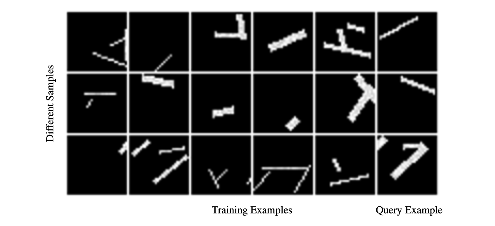

> 본 포스트는 University of Freiburg · Charité Berlin · Bosch Center for Artificial Intelligence의 **Samuel Müller**, Noah Hollmann, Sebastian Pineda, Josif Grabocka, Frank Hutter가 ICLR 2022에 발표한 논문 *Transformers Can Do Bayesian Inference* (arXiv:2112.10510v7 [cs.LG], 2024년 8월 13일 개정판)를 바탕으로, 베이지안 추론과 메타-학습에 익숙하지 않은 독자도 논리적 흐름을 따라갈 수 있도록 재구성한 것입니다. 본문 1–8절과 부록 A–H(증명 · 학습 세부사항 · 실험 설정 · 표 3–7)를 함께 다룹니다.

## 논문 정보 (Paper Information)

* **제목**: *Transformers Can Do Bayesian Inference*
* **저자**: Samuel Müller, Noah Hollmann, Sebastian Pineda, Josif Grabocka, Frank Hutter
* **소속**:
  * University of Freiburg — Samuel Müller, Sebastian Pineda, Josif Grabocka, Frank Hutter
  * Charité Berlin — Noah Hollmann
  * Bosch Center for Artificial Intelligence — Frank Hutter
* **출처**: ICLR 2022 (Published as a conference paper), arXiv:2112.10510v7 [cs.LG], 2024년 8월 13일
* **코드**: 코드와 학습된 PFN이 `https://github.com/automl/TransformersCanDoBayesianInference`에 공개되어 있습니다.
* **키워드**: Prior-Data Fitted Networks(PFN), 사후예측분포(posterior predictive distribution, PPD), 베이지안 추론(Bayesian inference), in-context learning, 트랜스포머(Transformer), Riemann 분포(Riemann distribution), 가우시안 과정(Gaussian process), 베이지안 신경망(Bayesian neural network), 소수샷 학습(few-shot learning)

## 한 줄 요약 (TL;DR)

> **"사전분포에서 데이터셋을 샘플링할 수만 있으면, 트랜스포머를 지도학습으로 훈련시켜 단 한 번의 순전파로 베이지안 사후예측분포를 근사하게 만들 수 있다."**
>
> **베이지안 추론**은 **사전지식(prior knowledge)을 명시적으로 주입**하고 **모델의 불확실성(uncertainty)을 정확히 포착**하게 해 주지만, 대부분의 사전분포에서 사후예측분포는 **계산 불가능(intractable)**하고, MCMC는 비정규화 사후분포에, VI는 결합밀도값에 대한 접근을 요구합니다. PFN은 사전분포에서 가상의 데이터셋을 반복해 뽑고, 그중 하나의 레이블을 가린 뒤(masking) 나머지 데이터를 조건으로 그 값을 맞히도록 학습하는데, 이 **Prior-Data NLL**이 참 PPD와 근사 사이의 기대 KL 발산과 상수만큼만 다르다는 것이 이론적 근거입니다(Insight 1, Corollary 1.1). 위치 인코딩을 뺀 트랜스포머와 회귀용 **Riemann 분포**를 결합한 PFN은 학습 후 실제 데이터셋과 **질의점(query point)**을 입력받아 단일 순전파로 예측하는 **in-context learning(맥락 내 학습)**을 수행하며, GP를 거의 완벽하게 모방하고 하이퍼-사전분포 GP와 BNN에서 기존 방법보다 200배 이상 빠르게 추론합니다. 나아가 아키텍처에 대한 사전분포를 얹은 PFN-BNN은 소규모 표 형식 데이터셋에서 튜닝 없이 모든 베이스라인을 앞서고, 55줄짜리 직선 필기 사전분포는 Omniglot 소수샷 분류에서 최신 기법과 대등한 성능을 냅니다.

---

## 초록 (Abstract)

PFN의 핵심 주장을 먼저 요약하면 다음과 같습니다.

- **동작 요건이 극히 약합니다.** PFN이 동작하기 위해 필요한 유일한 조건은, **지도학습 과제(task)들에 대한 사전분포에서 샘플링할 수 있는 능력**뿐입니다. 이는 기존 베이지안 근사 방법들이 요구하는 조건(비정규화 사후분포에 대한 접근 등)보다 훨씬 완화된 것입니다.
- **목표의 재정의.** 사후분포 근사라는 목표를, **집합값 입력(set-valued input)을 갖는 지도학습 분류 문제**로 바꿉니다. 즉, 사전분포에서 과제를 뽑고 → 데이터점과 레이블을 뽑고 → 하나의 레이블을 가린 뒤 → 나머지를 조건으로 그 값을 확률적으로 예측하도록 학습합니다.
- **단일 순전파 추론.** 학습이 끝난 PFN은 새로운 과제의 샘플 집합을 입력받아, **단 한 번의 순전파로 임의의 다른 데이터점에 대한 확률적 예측**을 수행합니다.
- **성능과 속도.** PFN은 가우시안 과정(GP)을 거의 완벽하게 모방할 수 있으며, 계산 불가능한 문제에 대해서도 효율적인 베이지안 추론을 가능하게 합니다. 여러 설정에서 기존 방법 대비 **200배 이상의 속도 향상**을 보였습니다.
- **범용성.** GP 회귀, 베이지안 신경망(BNN), 소규모 표 형식 데이터 분류, 소수샷 이미지 분류 등 매우 다양한 영역에서 강력한 결과를 얻었습니다.

![Figure: PFN의 전체 파이프라인을 요약한 그림입니다. 왼쪽에서는 사전분포 $p(\mathcal{D})$로부터 $K$개의 가상 데이터셋 $\mathcal{D}^{(i)}$를 샘플링하고, 각 데이터셋을 학습용 부분 $\mathcal{D}^{(i)}_{train}$과 홀드아웃 테스트점 $(x^{(i)}_{test}, y^{(i)}_{test})$로 나눕니다. 오른쪽 위 상자에서는 음의 로그가능도 $-\sum_i \log q_\theta(y^{(i)}_{test}\mid x^{(i)}_{test}, \mathcal{D}^{(i)}_{train})$를 최소화하여 PFN을 학습시킵니다. 아래쪽 화살표("PFN with parameters $\theta^*$")를 따라 내려간 오른쪽 아래 상자에서는 학습이 끝난 파라미터 $\theta^*$를 가진 PFN에 왼쪽 아래 상자의 실제 학습 데이터 $\mathcal{D}_{train}$과 테스트 입력 $x_{test}$를 넣어, 단일 순전파로 $q_{\theta^*}(y_{test}\mid x_{test}, \mathcal{D}_{train}) \approx p(y_{test}\mid x_{test}, \mathcal{D}_{train})$, 즉 참 사후예측분포의 근사를 얻습니다.](./images/figure_pfn_overview.png)

---

## 1. 서론 (Introduction)

### 1.1 문제 설정: 작은 데이터로의 전이

지난 10년간 딥러닝 아키텍처를 사용한 지도학습은 **대량의 학습 데이터가 존재하는** 과제에서 큰 진전을 이루었습니다(Vaswani et al., 2017; He et al., 2016; Krizhevsky et al., 2012). 따라서 머신러닝의 중요한 과제는 이 성공을 **데이터가 적은 소규모 설정으로 전이**하는 것입니다.

이 논문이 제안하는 접근은, **유연하고 교체 가능한(flexible and replaceable) 사전분포**를 갖는 사후분포 근사 모델을 딥러닝으로 구축하는 것입니다. 이 방식의 매력은 사전분포를 지정하는 일이 곧 **지도학습 과제의 샘플링 방식(sampling scheme)을 정의하는 것**만큼 간단해진다는 데 있습니다.

### 1.2 왜 베이지안 추론인가

딥러닝의 대규모 데이터에서의 성공은 신경망이 **임의의 함수를 근사할 수 있는 표현력**에서 기인합니다. 하지만 여전히 사전지식을 인코딩할 필요가 있습니다. 그 방법으로는 다음이 있습니다.

- **모델 아키텍처를 통한 주입**: 예를 들어 합성곱 신경망(CNN, LeCun et al., 1989)
- **정칙화(regularizer)를 통한 주입**: 예를 들어 데이터 증강(data augmentation)

그렇지 않으면 **공짜 점심 없음 정리(No Free Lunch Theorem, Wolpert & Macready, 1997)**에 따라, 모든 예측 문제를 잘 푸는 만능 방법은 존재하지 않습니다. 그래서 소규모 과제마다 특화된 알고리즘들이 다수 개발되어 왔습니다. 다만 사전 정보를 머신러닝 모델에 인코딩하는 일 자체가 어려울 수 있습니다.

모델에 편향(bias)을 부여하는 잘 정의된 방법이 바로 **베이지안 추론**입니다. 베이지안 추론의 토대는 **실제 응용에서 나타날 데이터의 분포에 대한 가정**이며, 이 가정이 곧 데이터가 특정 모델을 따를 확률에 대한 **사전믿음(prior belief)**을 형성합니다. 예를 들어 데이터가 신경망(BNN, MacKay, 1992), 다항식, 가우시안 혼합의 가능도, 혹은 사전 정의된 프로그래밍 언어의 무작위 코드(Solomonoff, 1997)에 의해 생성되었다는 사전분포를 구현할 수 있습니다.

베이지안 추론을 예측에 사용할 때의 장점은 다음 네 가지입니다.

1. **이론적 타당성**: 사전분포 $p(t)$가 실제와 맞는 설정에서 원리적으로 유효합니다.
2. **가능도 반영**: 서로 다른 사건들의 실제 가능도(likelihood)를 더 잘 설명합니다.
3. **좋은 보정(calibration)**: 예측 확률이 잘 보정되어 있습니다.
4. **해석 가능성**: 사전분포가 모델의 기대(expectation)를 기술하므로 해석 가능합니다.

그러나 결정적 단점이 있습니다. **주어진 사전분포에 대해 사후예측분포를 구하는 것은 대부분의 경우 계산 불가능**하다는 점입니다(Blei et al., 2017; MacKay, 1992).

### 1.3 PFN의 등장

PFN은 이러한 베이지안 모델을 근사하기 위한 방법입니다(Figure 1).

- 지도학습 과제(또는 함수)에 대한 **대표적 사전분포**가 주어졌다고 가정합니다. 이것이 우리의 **귀납적 편향(inductive bias)**을 제공합니다.
- PFN을 학습하기 위해, **전체 데이터셋을 표현하는 집합값 입력**을 사용하는 지도학습을 수행합니다. 사전분포에서 메타-학습 과제를 반복 샘플링하고, 데이터점과 레이블 집합을 뽑고, 하나의 레이블을 가린 뒤, 나머지 집합값 입력을 조건으로 그 값을 확률적으로 예측하도록 학습합니다.
- 실제 데이터셋이 주어지면, 그것을 테스트점과 함께 PFN에 넣어 **해당 테스트점에 대한 예측 분포**를 얻습니다. 이것이 바로 **in-context learning**입니다.

이 논문이 보이듯, 이 분포는 **정확한 베이지안 사후예측**을 근사합니다. 저자들은 PFN 자체의 학습(training)과 구분하여, 이 예측 단계를 **(베이지안) 추론(inference)**이라 부릅니다.

핵심적으로, PFN은 **샘플링만 가능하면 어떤 사전분포에 대해서도 사후예측분포를 근사**할 수 있게 해줍니다. 이는 다른 베이지안 근사법들의 표준 가정에 비해 매우 약한 요건입니다. 덕분에 현재의 도구로는 근사하기 매우 어려운 사전분포까지 포함해, 많은 사전분포를 간단하게 근사할 수 있습니다.

### 1.4 기여 (Contributions)

- 사후예측분포(PPD) 근사를 위해 트랜스포머를 성공적으로 활용하는 **아키텍처적 변경**을 제시합니다. 여기에는 회귀 과제를 위한 **새로운 예측 분포(Riemann distribution)**가 포함됩니다. 제안 방법은 단순하고 저렴하며 광범위한 사전분포에 적용 가능합니다.
- PFN이 GP와 BNN의 PPD를 **MCMC(NUTS)나 SVI(Bayes-by-Backprop, Blundell et al., 2015)보다 몇 자릿수(orders of magnitude) 빠르게** 근사할 수 있음을 보입니다. (5절의 실측으로는 200배에서 10,000배에 이릅니다.)
- PFN이 실제 과제에 영향을 줄 수 있음을 보입니다. (i) **아키텍처에 대한 사전분포를 갖는 BNN**을 PFN 위에 구현하여, 소규모 표 형식 데이터 벤치마크에서 튜닝 없이 단일 순전파로 모든 베이스라인을 능가합니다. (ii) 단순한 **필기(handwriting) 사전분포**로 Omniglot에서 소수샷 학습을 가능하게 합니다.

---

## 2. 배경 (Background)

### 2.1 대규모 데이터로부터의 지식 전이

이 논문은 **대량의 데이터를 활용해, 이후 소량의 데이터만 가용한 과제에서 강력한 성능**을 내는 것을 다룹니다. 이러한 접근의 성공 사례로는 이미지 데이터에 대한 비지도 모델의 미세조정(fine-tuning), 대규모 언어 코퍼스 학습, 언어 모델을 위한 프롬프트 설계 등이 있습니다. 다만 **PFN이 사용하는 모든 데이터는 인위적으로 생성된(artificially generated)** 것이라는 결정적 차이가 있습니다.

### 2.2 메타-학습과 뉴럴 프로세스

**메타-학습(meta-learning, 또는 learning-to-learn)**에서는 학습용 데이터셋들의 집합으로부터 검증용 데이터셋들의 집합으로 학습 방법을 일반화하려 합니다. PFN과 유사하게, **단일 순전파로 학습하는 법을 배우는** 연구 분야가 존재합니다(Santoro et al., 2016 등). 최근에는 **(조건부) 뉴럴 프로세스(Conditional Neural Processes)**가 메타-학습을 위해 제안되었습니다. 이 방법들은 확률 과정(stochastic process)으로서의 아키텍처 구성에 초점을 둡니다.

모델 아키텍처와 예측 분포가 다르다는 점 외에, 기존 메타-학습과 PFN의 결정적 차이는 다음과 같습니다.

- PFN은 학습 문제를 **직접 설정**하고, 그로부터 **즉석에서(on-the-fly) 생성되는 인위적 데이터셋**을 샘플링합니다.
- 그 결과 PFN은 단지 "학습하는 법을 배우는" 데 그치지 않고, **베이지안 추론을 수행하는 법을 배운다**는 것을 이론적으로 보일 수 있습니다.

### 2.3 베이지안 사후예측분포(PPD)의 정의

이 연구의 관심사는 지도학습 문제에 대한 **베이지안 사후예측**입니다. 즉, 임의 크기 $n$의 지도학습 데이터셋

$$
\mathcal{D} = \{(x_i, y_i)\}_{i=1}^{n}
$$

을 바탕으로 새로운 입력 $x$에 대한 출력 $y$를 모델링합니다. 이를 베이지안적으로 다루기 위해, **잠재변수(latent variable)이자 과제(task)인 $t$에 대한 사전분포 $p(t)$**를 도입합니다.

이제 **베이즈 정리(Bayes' Theorem)**를 사용하여 사후분포 $p(t \mid \mathcal{D})$를 정의할 수 있습니다.

$$
p(t \mid \mathcal{D}) = \frac{p(\mathcal{D} \mid t)\, p(t)}{p(\mathcal{D})}
$$

예측에서 결정적으로 중요한 분포인 **사후예측분포(Posterior Predictive Distribution, PPD)**는 다음과 같이 유도됩니다.

$$
p(y \mid x, \mathcal{D}) = \int_{t} p(y \mid x, t)\, p(t \mid \mathcal{D})\, dt \tag{1}
$$

#### 식 (1)의 의미 단계별 설명

- 우리가 알고 싶은 것은 **과제 $t$가 무엇인지 확정하지 않은 상태에서**의 예측 분포 $p(y \mid x, \mathcal{D})$입니다.
- 만약 과제 $t$를 안다면, 예측은 $p(y \mid x, t)$로 주어집니다(가능도 모델).
- 하지만 데이터 $\mathcal{D}$만 관측했을 뿐 $t$는 불확실하므로, $t$에 대한 우리의 믿음 $p(t \mid \mathcal{D})$로 **가중 평균(주변화, marginalization)**합니다.
- 즉 식 (1)은 "가능한 모든 과제 $t$에 대해, 그 과제가 참일 확률 $p(t\mid\mathcal{D})$을 가중치로 하여 예측 $p(y\mid x,t)$를 평균낸 것"입니다. 이 적분이 바로 **불확실성을 정직하게 반영하는 베이지안 예측**의 본질입니다.

일부 경우(예: 가우시안 과정)에는 PPD $p(y\mid x, \mathcal{D})$를 **닫힌 형식(closed form)**으로 얻을 수 있지만, 대부분은 근사만 가능합니다.

### 2.4 사후분포를 근사하는 두 가지 전통적 방법

전통적으로는 먼저 사후분포 $p(t\mid\mathcal{D})$를 근사하고, 이를 바탕으로 PPD를 근사합니다. 사후분포 근사에는 대표적으로 두 부류가 있습니다.

- **마르코프 연쇄 몬테카를로(Markov Chain Monte Carlo, MCMC)**: NUTS(Hoffman et al., 2014) 등이 대표적이며, **정확하지만 때때로 매우 느린** 근사를 제공합니다. MCMC는 비정규화 사후분포 $f(t\mid\mathcal{D},x) \propto p(t\mid\mathcal{D},x)$에 대한 접근을 요구합니다.
- **변분 추론(Variational Inference, VI)**: 사후분포를 **다루기 쉬운 분포**(예: 인수분해된 정규분포)로 근사합니다. VI는 결합밀도 $p(t, \mathcal{D})$의 밀도값에 대한 접근을 요구합니다.

즉, MCMC와 VI 모두 계산하기 어려울 수 있는 양들에 대한 접근을 필요로 합니다.

### 2.5 시뮬레이션 기반 추론과의 관계

관련된 또 다른 연구 흐름은 **분할상환 시뮬레이션 기반 추론(amortized simulation-based inference)**, 특히 **뉴럴 사후분포 추정(neural posterior estimation)**입니다. 이 흐름은 앞서 일반 확률 프로그램(Ritchie et al., 2016)과 시퀀스(Ortega et al., 2019)에도 적용된 바 있습니다. 여기서의 목표는 $p(t, X)$로부터의 샘플로 학습하여 사후분포 $p(t \mid X)$를 근사하는 모델을 찾는 것입니다(여기서 $X$는 단일 벡터인 경우가 많습니다).

- **공통점**: PFN과 시뮬레이션 기반 추론 모두 **오직 사전분포로부터의 샘플만** 사용합니다.
- **차이점**: 기존 시뮬레이션 기반 추론은 데이터의 기저 모델이 알려진 시뮬레이션에 초점을 둡니다. 반면 PFN은 **사후분포를 결코 명시적으로 인스턴스화하지 않고 PPD를 직접 모델링**하며, 이를 **일반적 사전분포를 갖는 대규모 데이터셋**에 적용합니다.

---

## 3. PFN을 이용한 PPD 근사 (PPD Approximation with PFNs)

### 3.1 모델과 학습 알고리즘

파라미터화된 모델 $q_\theta$를 생각합니다. 이 모델은 데이터셋 $\mathcal{D} = \{(x_i, y_i)\}_{i=1}^{n}$과 질의 $x$를 입력으로 받아, 질의 $x$에 대한 $y$의 **가능한 값들에 대한 분포**를 예측합니다. 이러한 모델로는 다양한 신경망 아키텍처가 가능하며, 이 논문에서는 **트랜스포머(Vaswani et al., 2017)의 변형**을 사용합니다. 이 모델을 사전분포에서 뽑은 샘플에 대한 **교차 엔트로피(cross-entropy)**로 학습시킵니다.

학습 절차는 아래 알고리즘으로 정리됩니다.

```
Algorithm 1: Fitting Prior-Data로 PFN 모델 학습하기
────────────────────────────────────────────────────────
입력 : 데이터셋에 대한 사전분포 p(D) (샘플링 가능), 뽑을 샘플 수 K
출력 : PPD를 근사하는 모델 q_θ

신경망 q_θ 초기화;
for j ← 1 to K do
    사전분포에서 데이터셋 샘플링: D ∪ {(x_i, y_i)}_{i=1}^{m} ~ p(D);
    확률적 손실 근사 계산:  ℓ̄_θ = Σ_{i=1}^{m} ( -log q_θ(y_i | x_i, D) );
    확률적 경사하강으로 θ 갱신:  θ ← θ - η ∇_θ ℓ̄_θ;
end
────────────────────────────────────────────────────────
```

### 3.2 Prior-Data 음의 로그가능도 (Prior-Data NLL)

제안된 손실함수인 **Prior-Data Negative Log-Likelihood (Prior-Data NLL)** $\ell_\theta$는 다음과 같이 정의됩니다.

$$
\ell_\theta = \mathbb{E}_{\mathcal{D} \cup \{x, y\} \sim p(\mathcal{D})}\big[-\log q_\theta(y \mid x, \mathcal{D})\big] \tag{2}
$$

여기서 $\mathcal{D} \cup \{x, y\}$는 단순히 $p(\mathcal{D})$에서 샘플링한 크기 $|\mathcal{D}| + 1$의 데이터셋입니다. PFN은 이 $\ell_\theta$를 최소화하도록 학습됩니다. 즉, **사전분포에서 많은 데이터셋을 뽑고, 각 데이터셋에서 홀드아웃된 예시를 올바르게 예측하도록** 모델을 적합시킵니다.

**VI·MCMC와의 근본적 차이**를 정리하면 다음과 같습니다.

- PFN은 **데이터셋 샘플로부터 PPD를 직접 근사**하는 법을 배웁니다.
- 우리가 다루는 모든 경우에서 $p(\mathcal{D})$로부터 샘플링하는 것은 **단순하고 저렴**하며, 이것이 PFN이 요구하는 **유일한 조건**입니다.
- 반면 MCMC는 비정규화 사후분포에, VI는 결합밀도값에 접근해야 하는데, 이는 모두 계산이 어려울 수 있습니다.

### 3.3 이론적 보장 I — Insight 1: 손실 = 교차 엔트로피

Gordon et al. (2019)의 표준 손실 유도를 메타 수준으로 확장하면, **Prior-Data NLL을 최소화하는 것이 곧 PPD를 교차 엔트로피(그리고 KL 발산) 관점에서 근사하는 것**임을 보일 수 있습니다.

::: {.callout-note}
## Insight 1

제안된 목적함수 $\ell_\theta$는 PPD와 그 근사 $q_\theta$ 사이의 **교차 엔트로피의 기댓값**과 같다.
$$\ell_\theta = \mathbb{E}_{x, \mathcal{D} \sim p(\mathcal{D})}\big[H(p(\cdot \mid x, \mathcal{D}), q_\theta(\cdot \mid x, \mathcal{D}))\big]$$
:::

#### 증명 (단계별)

먼저 **교차 엔트로피의 정의**를 상기합니다. 두 분포 $p, q$에 대해
$$
H(p, q) = -\int p(y) \log q(y)\, dy.
$$

이제 손실 (2)를 적분 형태로 전개합니다.

$$
\ell_\theta = -\int_{\mathcal{D}, x, y} p(x, y, \mathcal{D}) \log q_\theta(y \mid x, \mathcal{D}) \tag{3}
$$

- **1단계 (결합확률의 분해).** 확률의 연쇄법칙에 의해 $p(x, y, \mathcal{D}) = p(x, \mathcal{D})\, p(y \mid x, \mathcal{D})$입니다. 이를 대입하고, $y$에 무관한 항 $p(x,\mathcal{D})$를 안쪽 적분 밖으로 빼냅니다.

$$
= -\int_{\mathcal{D}, x} p(x, \mathcal{D}) \int_{y} p(y \mid x, \mathcal{D}) \log q_\theta(y \mid x, \mathcal{D}) \tag{3'}
$$

- **2단계 (교차 엔트로피로의 인식).** 안쪽 적분 $-\int_y p(y\mid x,\mathcal{D})\log q_\theta(y\mid x,\mathcal{D})$은 정확히 교차 엔트로피 $H(p(\cdot\mid x,\mathcal{D}), q_\theta(\cdot\mid x,\mathcal{D}))$입니다.

$$
= \int_{\mathcal{D}, x} p(x, \mathcal{D})\, H\big(p(\cdot \mid x, \mathcal{D}), q_\theta(\cdot \mid x, \mathcal{D})\big) \tag{4}
$$

- **3단계 (기댓값 표기).** 마지막으로, $p(x,\mathcal{D})$에 대한 적분은 기댓값으로 표현됩니다.

$$
= \mathbb{E}_{x, \mathcal{D} \sim p(\mathcal{D})}\big[H(p(\cdot \mid x, \mathcal{D}), q_\theta(\cdot \mid x, \mathcal{D}))\big]. \quad\blacksquare
$$

따라서 우리는 **PPD의 근사**를 손에 넣었습니다. 교차 엔트로피는 $q_\theta = p$일 때 최소화되므로, $\ell_\theta$의 최소화는 $q_\theta$를 참 PPD $p$에 가깝게 만듭니다.

### 3.4 이론적 보장 II — Corollary 1.1: 손실 = KL 발산 (상수 차이)

교차 엔트로피는 KL 발산과 밀접합니다. 이를 통해 손실을 KL 발산으로 재표현할 수 있습니다.

::: {.callout-note}
## Corollary 1.1

손실 $\ell_\theta$는 사전분포 데이터 $x, \mathcal{D}$에 대한 **기대 KL 발산** $\mathbb{E}_{\mathcal{D}, x}[\mathrm{KL}(p(\cdot\mid x,\mathcal{D}), q_\theta(\cdot\mid x,\mathcal{D}))]$과 **가법적 상수(additive constant)만큼의 차이**를 갖는다.
:::

#### 증명 (부록 A)

KL 발산의 정의에서 출발합니다.

$$
\mathbb{E}_{x, \mathcal{D}}\big[\mathrm{KL}(p(\cdot \mid x, \mathcal{D}), q_\theta(\cdot \mid x, \mathcal{D}))\big] \tag{5}
$$

- **1단계 (KL의 로그비 전개).** $\mathrm{KL}(p, q) = \int p \log \frac{p}{q}$이므로, 부호를 정리하여 다음을 얻습니다.

$$
= -\mathbb{E}_{x, \mathcal{D}}\left[\int_{y} p(y \mid x, \mathcal{D}) \log \frac{q_\theta(y \mid x, \mathcal{D})}{p(y \mid x, \mathcal{D})}\right] \tag{6}
$$

- **2단계 (로그의 분리).** $\log \frac{q}{p} = \log q - \log p$를 사용하여 두 항으로 나눕니다.

$$
\begin{aligned}
= &-\mathbb{E}_{x, \mathcal{D}}\left[\int_{y} p(y \mid x, \mathcal{D}) \log q_\theta(y \mid x, \mathcal{D})\right] \\
&+ \mathbb{E}_{x, \mathcal{D}}\left[\int_{y} p(y \mid x, \mathcal{D}) \log p(y \mid x, \mathcal{D})\right]
\end{aligned} \tag{7}
$$

- **3단계 (교차 엔트로피와 엔트로피로의 인식).** 첫 항은 교차 엔트로피의 기댓값, 둘째 항은 음의 엔트로피의 기댓값입니다.

$$
= \mathbb{E}_{x, \mathcal{D}}\big[H(p(\cdot \mid x, \mathcal{D}), q_\theta(\cdot \mid x, \mathcal{D}))\big] - \mathbb{E}_{x, \mathcal{D}}\big[H(p(\cdot \mid x, \mathcal{D}))\big] \tag{8}
$$

- **4단계 (Insight 1 대입).** 첫 항은 정확히 $\ell_\theta$(Insight 1)이고, 둘째 항 $C = -\mathbb{E}_{x,\mathcal{D}}[H(\cdot\mid x,\mathcal{D})]$는 **$\theta$에 의존하지 않는 상수**입니다.

$$
= \ell_\theta + C. \quad\blacksquare \tag{9}
$$

이 따름정리는 실험에서 매우 중요합니다. **Prior-Data NLL이 참 PPD와 근사 사이의 KL 발산과 상수 차이만 갖는다**는 사실은, NLL을 곧 "**참 PPD에 얼마나 가까운가**"의 척도로 사용할 수 있게 해줍니다.

### 3.5 이론적 보장 III — Corollary 1.2: 완벽 실현 가능성

::: {.callout-note}
## Corollary 1.2

만약 $p$가 분포족 $q_\theta$의 원소라면(즉, $q_\theta = p$가 되는 $\theta$가 존재한다면), 최적해 $\theta^*$에 대해 $p(\cdot\mid x,\mathcal{D})$가 정의되는 모든 $x, \mathcal{D}$에서 $q_{\theta^*}(\cdot\mid x,\mathcal{D}) = p(\cdot\mid x,\mathcal{D})$이다.
:::

**증명 (부록 B)** $q_\theta = p$가 되는 $\theta$가 존재한다고 가정합니다. 교차 엔트로피는 두 분포가 같을 때 최소화되므로, 최적해 $\theta^*$는 **사전분포의 밀도가 양수인 부분집합**($p(x,\mathcal{D}) > 0$)에서 $q_{\theta^*}(\cdot\mid x,\mathcal{D}) = p(\cdot\mid x,\mathcal{D})$를 만족합니다. 이는 정확히 조건부가 정의되는 영역과 일치합니다. $\blacksquare$

> **[역사적 각주]** 이 발견(2024년 갱신)은 Foong et al. (2020)의 Section 3.2 Prop. 1에서 먼저 발표되었습니다.

이후 논의에서는 주어진 최적화 문제의 최적해 $\theta^* \in \arg\min_\theta \ell_\theta$를 고려합니다.

> **한 줄 요약**: 학습 손실을 줄이면 **과적합 없이** 근사가 참 사후분포에 가까워집니다. 이것이 PFN이 표준 MLE 학습과 결정적으로 다른 지점입니다(부록 D 참조).

---

## 4. 베이지안 추론을 위한 트랜스포머 개조 (Adapting the Transformer for Bayesian Inference)

이 절에서는 트랜스포머 인코더(Vaswani et al., 2017)에 기반한 효율적 아키텍처와, 회귀 문제를 위한 **새로운 회귀 헤드(regression head)**를 제안합니다.

![Figure: (a) 입력 쌍 $n=3$개와 질의 $m=2$개에 대한 트랜스포머의 동작을 시각화한 그림입니다. 각 막대는 하나의 입력 표현이고, 화살표는 각 표현이 어텐션할 수 있는 대상을 나타냅니다. 입력 예시 $(x_1,y_1),(x_2,y_2),(x_3,y_3)$는 서로 어텐션하고(파란 화살표), 질의점 $x_4, x_5$는 모든 입력 예시에 어텐션하되 서로에게는 어텐션하지 않습니다(빨간 화살표). 질의점 위의 출력 $q(\cdot\mid x_4,\mathcal{D})$, $q(\cdot\mid x_5,\mathcal{D})$가 각 질의에 대한 PPD 예측입니다. 데이터셋 $\mathcal{D}$에 대한 순열 불변성(permutation invariance)은 위치 인코딩을 제거한 데서 나오고, 이 어텐션 마스크는 서로 다른 질의점이 서로에게 의존하지 않도록 보장합니다. (b) 유계 지지집합(bounded support)을 갖는 Riemann 분포의 시각화로, 확률밀도가 막대그래프(bar plot) 형태입니다. (c) 무계 지지집합(unbounded support)의 경우로, 양 끝 막대를 적절히 스케일된 half-normal 분포로 대체한 형태입니다. (b)와 (c)의 가로축은 출력값 $y$(또는 질의의 출력 $y_q$), 세로축은 밀도(Density)이며, 회색 막대 하나가 구간 하나에 해당합니다.](./images/figure_transformer_riemann.png)

### 4.1 효율적인 아키텍처 (An Efficient Architecture)

핵심 아이디어는 **위치 인코딩(positional encoding)을 제거**하여 데이터셋 $\mathcal{D}$ 내 순서에 대한 **불변성(invariance)**을 얻는 것입니다.

- **입력/질의 인코딩**: $x$와 $y$를 인코딩하며, 모든 실험에서 단순한 **선형 계층(linear layer)**을 사용합니다. (응용에 따라 특화된 인코딩 계층도 가능합니다.)
- **순열 등변성(permutation equivariance)**: 위치 인코딩을 제거하고, $(x, y)$ 쌍을 그들의 인코딩의 **합(sum)**으로 트랜스포머에 함께 입력합니다.
- **질의점 처리**: 효율을 위해 질의점들을 함께 입력합니다. 위치가 중요한 유일한 입력이 질의점이며, 이들의 출력 위치를 해당 $y$에 대한 PPD 예측으로 사용합니다.
- **어텐션 마스크**: 서로 다른 질의점은 상호 의존하면 안 되므로, **모든 입력 예시는 다른 모든 입력 예시에 어텐션**할 수 있고, **모든 질의점은 모든 입력 예시에 어텐션**할 수 있지만 질의점끼리는 어텐션하지 못하도록 마스킹합니다(Figure 2a).

#### 학습 시 데이터셋 크기 다루기 (부록 E.1)

- 학습 중에는 전체 입력 수 $N = n + m$을 고정합니다. 여기서 $n$은 입력 수, $m$은 질의 수입니다.
- 트랜스포머가 다양한 데이터셋 크기에 대응하도록, $n$을 어떤 분포에서 샘플링합니다.
- $n$이 작으면 학습할 질의점이 더 많아지므로, **큰 $n$을 과대 표집(over-sample)**하여 각 $n$마다 학습에서 보는 질의점 수가 대략 같아지도록 합니다. 구체적으로, 각 $n \in \{0, \dots, N-1\}$을 가중치 $1/m = 1/(N-n)$으로 샘플링합니다.
- **예측 헤드**: 다중분류에는 소프트맥스, 이진분류에는 시그모이드, 회귀에는 **Riemann 분포**를 사용합니다.

### 4.2 Riemann 분포 (Riemann Distribution)

신경망으로 **연속분포를 모델링하는 것은 어렵습니다.** PFN은 대신, 신경망이 **분류(classification)에서 잘 작동한다**는 사실과 분포적 강화학습(distributional RL, Bellemare et al., 2017)의 이산화에서 영감을 받아, **이산화된 연속분포**인 **Riemann 분포**를 사용합니다.

- 이 분포의 확률밀도함수(PDF)는 **막대그래프** 형태입니다(Figure 2b).
- 이산화 구간(bucket) 집합 $\mathbf{B}$의 경계는, **사전분포 데이터에서 모든 구간이 동일한 확률**을 갖도록 선택합니다. 즉,
$$
p(y \in b) = \frac{1}{|\mathbf{B}|}, \quad \forall b \in \mathbf{B}.
$$
이 경계는 대량의 사전분포 데이터 샘플로 추정합니다.
- **무계 지지집합**이 필요한 경우, 양 끝의 마지막 막대를 적절히 스케일된 **half-normal 분포**로 대체합니다(Figure 2c).

#### Riemann 분포의 정확한 정의 (부록 E.2)

구간 집합 $\mathbf{B}$가 주어졌을 때, 각 구간 $b \in \mathbf{B}$는 다음을 만족하는 구간(interval)입니다.

$$
\bigcup_{b \in \mathbf{B}} b = [a, b], \qquad b \cap b' = \emptyset \;\; (\forall b, b' \in \mathbf{B}) \tag{28}
$$

- 최저(최고) 구간의 상한(하한)을 $l$ ($f$)로 정의하고, $y \in \mathbb{R}$을 유일한 구간 $b$로 사상하는 함수 $B(\cdot)$를 정의합니다.
- 각 구간의 폭(width)을 $w(b) = \max_{y\in b} y - \min_{y\in b} y$로 정의합니다.
- 모델이 각 구간 $b$에 대한 확률 $p_b$를 준다고 가정합니다.

**유한(finite) 지지집합의 경우**, Riemann 분포는 다음과 같습니다.

$$
p(y) = \frac{p_{b(y)}}{w(b(y))} \tag{29}
$$

여기서 구간의 폭으로 정규화하는 이유는, $p_b$가 "구간에 속할 확률" $p(y' \in b)$을 나타내는 반면, 우리가 원하는 것은 **점 밀도** $p(y = y')$이기 때문입니다. (즉, 이산 확률질량을 구간 폭으로 나누어 밀도로 환산합니다.)

**무한(infinite) 지지집합의 경우**는 다음과 같습니다.

$$
f(y_q) =
\begin{cases}
2 \cdot f_{\mathcal{N}}(y_q - l), & \text{if } y_q \leq l \\
2 \cdot f_{\mathcal{N}}(f - y_q), & \text{if } y_q \geq f \\
p_{b(y_q)}/w(b(y_q)), & \text{otherwise}
\end{cases} \tag{30}
$$

여기서 half-normal 분포들은 **확률질량의 절반이 첫(마지막) 구간의 경계 안쪽에 들어오도록** 스케일됩니다.

- 원문 식 (30)의 셋째 줄은 $p_{b(y_q)}/b(y_q)$로 인쇄되어 있습니다. 식 (29)와 같은 구간 폭 정규화로 읽어, 위에서는 $w(b(y_q))$로 나누어 적었습니다.

### 4.3 Riemann 분포의 표현력 — Theorem 1

::: {.callout-note}
## Theorem 1

유한 지지집합을 갖는 Riemann 분포 $q_{\mathbf{B}}$(여기서 $\mathbf{B}$는 구간들)는, **유한하고 거의 모든 곳에서 연속(Riemann 적분 가능)이며 완전 지지집합(full support)을 갖는** 임의의 밀도함수를 **임의의 정밀도로** 모델링할 수 있다. 즉,
$$\forall p\,\forall \epsilon\,\exists \mathbf{B}.\; \mathrm{KL}(q_{\mathbf{B}}, p) \leq \epsilon.$$
:::

#### 증명 (부록 C) — 핵심 흐름

증명은 다소 기교적이지만, **Riemann 적분의 Darboux 상/하합(upper/lower sums)**과 **Lambert W 함수**를 사용하는 우아한 논증입니다. 핵심 단계를 따라가 보겠습니다.

임의의 분포 $p$와 임의의 오차 한계 $\epsilon$이 주어졌다고 합시다. 구간 경계 $a$(최소), $b$(최대)에 대해, 위치 $y$를 그 구간 $b \in \mathbf{B}$로 사상하는 함수 $b_{\mathbf{B}}$를 생각합니다($\mathbf{B}$는 임의의 구간 집합).

**1단계 — 구간별 상/하한 정의.** 각 구간 내에서 $p$의 상한과 하한을 정의합니다. (원문은 $y$가 속한 구간을 $b_s(y)$로 적습니다.)

$$
u(y) = \sup_{y' \in b_s(y)} p(y'), \qquad l(y) = \inf_{y' \in b_s(y)} p(y') \tag{10, 11}
$$

이들의 로그 형태 $\hat{u}(y) = \log u(y)$, $\hat{l}(y) = \log l(y)$도 함께 고려합니다. 로그는 단조증가이므로 $\sup$($\inf$) 안으로 이동시킬 수 있습니다.

**2단계 — Darboux 상/하합과의 연결.** $\hat{u}$와 $\hat{l}$에 대한 적분은 정확히 $\log p$의 **Darboux 상합과 하합**을 나타냅니다. $p$가 Riemann 적분 가능하다고 가정했으므로, $\log p$ 역시 적분 가능합니다. (이유: $\log x$는 $x > 0$에서 연속이고, 연속함수와 거의 모든 곳에서 연속인 함수의 합성은 거의 모든 곳에서 연속이며, $p$의 완전 지지집합 가정으로 $x > 0$이 보장되기 때문입니다.) 따라서 다음이 성립합니다.

$$
\forall \epsilon' \, \exists \mathbf{B}.\; \int_a^b \big(\hat{u}(y) - \hat{l}(y)\big)\, dy < \epsilon'
$$

**3단계 — 핵심 양들의 정의.** 다음을 정의합니다.

$$
t = \sup_{y \in [a,b]} p(y), \qquad T = \sup_{y \in \mathbb{R}} p(y), \qquad P = p(y \in [a, b]).
$$

$\epsilon' = \log(1/P)$로 두면, $p$가 완전 지지집합을 가지므로 임의의 경계 $a, b$에 대해 $P < 1$이 되어 $\epsilon' > 0$이 보장됩니다. 이 $\mathbf{B}$에서 출발하여 부등식 (12)–(15)를 전개합니다.

$$
\int_a^b \hat{u}(y) - \hat{l}(y)\, dy < \log\frac{1}{P} \tag{12}
$$

- 양변에 양수 $t$를 곱합니다.

$$
\int_a^b t\big(\hat{u}(y) - \hat{l}(y)\big)\, dy < t \log(1/P) \tag{13}
$$

- 로그의 성질 $\hat u(y) - \hat l(y) = \log u(y) - \log l(y) = \log\frac{u(y)}{l(y)}$를 대입합니다.

$$
\int_a^b t \log \frac{u(y)}{l(y)}\, dy < t \log(1/P) \tag{14}
$$

- $[a,b]$ 안에서는 구간별 상한이 전체 상한을 넘지 못하므로 $u(y) \le t$이고, $u(y) \ge l(y)$이므로 $\log\frac{u(y)}{l(y)} \ge 0$입니다. 따라서 피적분함수의 $t$를 $u(y)$로 바꾸면 좌변이 줄어들 뿐이어서 부등식이 유지됩니다.

$$
\int_a^b u(y) \log \frac{u(y)}{l(y)}\, dy < t \log(1/P) \tag{15}
$$

**4단계 — 유효 확률분포로의 정규화.** $\int c\,u(y)\,dy = 1$이 되도록 하는 상수 $c$를 도입합니다. 즉 $c\,u(y)$가 유효한 확률분포가 되게 합니다($\int c\,u(y)\,dy = \int_a^b c\,u(y)\,dy = 1$). 양변을 조작하면 (16)–(18)을 거쳐 다음을 얻습니다.

- 양변에 양수 $c$를 곱합니다.

$$
\int_a^b c\,u(y) \log \frac{u(y)}{l(y)}\, dy < c\,t \log(1/P) \tag{16}
$$

- $\log\frac{c\,u(y)}{l(y)} = \log\frac{u(y)}{l(y)} + \log c$이므로, 양변에 $\int_a^b c\,u(y)\log c\,dy$를 더합니다.

$$
\int_a^b c\,u(y) \log \frac{c\,u(y)}{l(y)}\, dy < c\,t \log(1/P) + \int_a^b c\,u(y) \log c\, dy \tag{17}
$$

- $\int_a^b c\,u(y)\,dy = 1$이므로 마지막 항은 $\log c$가 됩니다.

$$
\int_a^b c\,u(y) \log \frac{c\,u(y)}{l(y)}\, dy < c\,t \log(1/P) + \log c \tag{18}
$$

**5단계 — KL 발산으로의 상계.** $c < 1/P$를 사용하고($1/P$는 $\int c' p(y) = 1$을 만드는 인수, $c$는 $u(y) \ge p(y)$에 대한 인수) 부등식 (19)–(26)을 전개합니다. 핵심적으로, $l(y) \le p(y)$이므로 분모를 $p(y)$로 바꿔도 부등식이 유지되어 KL 발산의 정의에 도달합니다.

- $c < 1/P$이면 $\log c < \log(1/P)$이므로 (18)의 마지막 항을 바꿉니다.

$$
\int_a^b c\,u(y) \log \frac{c\,u(y)}{l(y)}\, dy < c\,t \log(1/P) + \log(1/P) \tag{19}
$$

- 우변을 $\log(1/P)$로 묶습니다.

$$
\int_a^b c\,u(y) \log \frac{c\,u(y)}{l(y)}\, dy < (c\,t + 1) \log(1/P) \tag{20}
$$

- $P < 1$이라 $\log(1/P) > 0$이므로, $c < 1/P$를 한 번 더 써서 $c\,t\log(1/P) < \frac{t}{P}\log(1/P)$로 키우고 $\log(1/P) = -\log P$로 고쳐 씁니다.

$$
\int_a^b c\,u(y) \log \frac{c\,u(y)}{l(y)}\, dy < -t \frac{\log P}{P} - \log P \tag{21}
$$

- $t$는 $[a,b]$ 위의 상한, $T$는 $\mathbb{R}$ 전체의 상한이므로 $t \le T$이고, $-\frac{\log P}{P} > 0$이므로 $t$를 $T$로 바꿔도 부등식이 유지됩니다.

$$
\int_a^b c\,u(y) \log \frac{c\,u(y)}{l(y)}\, dy < -T \frac{\log P}{P} - \log P \tag{22}
$$

- $l(y) \le p(y)$이므로 $\log\frac{c\,u(y)}{p(y)} \le \log\frac{c\,u(y)}{l(y)}$입니다. 분모를 $p(y)$로 바꾸면 좌변이 줄어들 뿐입니다.

$$
\int_a^b c\,u(y) \log \frac{c\,u(y)}{p(y)}\, dy < -T \frac{\log P}{P} - \log P \tag{23}
$$

- $c\,u(y)$는 $[a,b]$ 밖에서 0인 확률분포이므로, 좌변은 정확히 KL 발산의 정의입니다.

$$
\mathrm{KL}(c\,u(y), p(y)) < -T \frac{\log P}{P} - \log P \tag{24}
$$

- $-\log P = -P\,\frac{\log P}{P}$로 써서 두 항을 묶습니다.

$$
\mathrm{KL}(c\,u(y), p(y)) < -(T + P) \frac{\log P}{P} \tag{25}
$$

- $P \le 1$이고 $-\frac{\log P}{P} > 0$이므로 $P$를 1로 바꿔 상계를 단순화합니다.

$$
\mathrm{KL}(c\,u(y), p(y)) < -(T + 1) \frac{\log P}{P} \tag{26}
$$

여기서 $c\,u(y)$는 유효한 막대(bar) 분포입니다.

**6단계 — Lambert W 함수로 마무리.** 이제 $-(T+1)\frac{\log P}{P} < \epsilon$이 되도록 $a, b$를 찾으면 됩니다. 이는 다음과 동치입니다.

$$
\frac{1}{P} \log \frac{1}{P} < \frac{\epsilon}{T + 1} \tag{27}
$$

여기서 **Lambert W 함수**($W_0$, $we^w = z$의 역함수)를 대입하면, $a, b$를 다음을 만족하도록 선택하면 됨을 얻습니다.

- 대입 과정: $x = \log(1/P) > 0$으로 두면 $1/P = e^{x}$이므로 (27)은 $x e^{x} < \frac{\epsilon}{T+1}$가 됩니다. $x e^{x}$는 $x > 0$에서 증가함수이고 그 역함수가 $W_0$이므로, 이는 $x < W_0\left(\frac{\epsilon}{T+1}\right)$, 곧 $P > e^{-W_0(\epsilon/(T+1))}$와 같습니다. 원문은 이 조건을 다음처럼 적습니다.

$$
p([a, b]) \geq e^{-W_0\left(\frac{\epsilon}{T+1}\right)}.
$$

이는 항상 가능한데, $W_0$는 양의 입력에 대해 $(0, \infty)$로 사상하며, $x \in (0, \infty)$에 대해 $e^{-x} < 1$이고 $e^{-x} > 0$이기 때문입니다. 따라서 임의의 $a, b$에 대해 KL 발산의 상계를 얻고, 그 상계가 $\epsilon$ 아래로 떨어지는 $a, b$를 찾을 수 있으므로 증명이 완료됩니다. $\blacksquare$

::: {.callout-tip}
## 직관적 정리

구간을 충분히 촘촘하게 나누고($\epsilon'$ 항 제어) 지지 구간 $[a,b]$를 충분히 넓게 잡으면($P \to 1$), 막대 분포로 어떤 연속밀도든 KL 의미에서 원하는 만큼 가깝게 근사할 수 있다는 것입니다.
:::

---

## 5. 사후분포 근사 연구 (Posterior Approximation Studies)

첫 번째 실험군에서는 PFN이 다음 세 경우에 베이지안 추론을 수행할 수 있는지 연구합니다.

- **계산 가능(tractable) 경우**: 하이퍼파라미터가 고정된 가우시안 과정(GP) — 참값과 비교 가능 (5.1절)
- **계산 불가능(intractable) 경우 I**: 하이퍼파라미터가 미지인 GP (5.2절)
- **계산 불가능 경우 II**: 베이지안 신경망(BNN) (5.3절)

Corollary 1.1에 따라 Prior-Data NLL은 참 PPD와 근사 사이의 KL 발산과 상수 차이만 가지므로, 이후 모든 실험에서 **방법들이 참 PPD에 얼마나 근접하는지의 척도로 NLL을 사용**합니다. PPD를 직접 근사하지 않는 방법의 경우, 식 (1)의 적분을 대규모 몬테카를로 적분으로 근사합니다. 각 실험에서 **서로 다른 샘플 데이터셋에 대한 Prior-Data NLL의 95% 신뢰구간**을 음영으로, 평균을 선으로 보고합니다.


### 5.1 가우시안 과정 근사 (Gaussian Process Approximation)

GP를 먼저 근사하는 이유는, **하이퍼파라미터가 고정된 GP의 PPD가 계산 가능**하여 우리의 근사가 참 PPD에 얼마나 가까운지 평가할 수 있기 때문입니다.

- **사전분포 생성 절차**:
  1. $N$개의 입력 $x_i$를 단위 정육면체(unit-cube)에서 균등하게 샘플링합니다.
  2. 커널 함수 $k$를 갖는 평균 0인 GP의 데이터-사전분포는, $K_{i,j} = k(x_i, x_j)$인 다변량 정규분포 $\mathcal{N}(0, K)$로 기술됩니다.
  3. 이 정규분포에서 샘플링하여 데이터셋 $\{(x_1, y_1), \dots, (x_N, y_N)\}$을 얻습니다.
- 그 후 홀드아웃된 부분집합의 $y$를 예측하도록 PFN을 학습시킵니다. 학습된 PFN은 새 데이터셋과 임의 질의점에 대한 PPD를 근사할 수 있습니다.

**결과 (Figure 3, 4a)**:

- 추정된 신뢰구간과 평균이 참값과 사실상 구분 불가능합니다(가장 두드러진 차이만 빨간 화살표로 표시).
- 저자들은 이 실험의 **인터랙티브 버전**을 공개했습니다(HuggingFace Spaces).
- 부록 Figure 7은 길이 척도(length scale)가 다른 GP에서 근사와 정확한 사후분포를 함께 그린 정성적 예시를 더 보여 주고, Figure 8은 **Attentive Neural Processes(ANP, Kim et al., 2018)**와도 비교하여 베이지안 추론에서 PFN이 분명히 우월함을 보입니다.
- 이 정성적 결과는 최대 **2000개 예시와 다중 특성**을 갖는 데이터셋으로 일반화되며(Figure 4a), 메타-학습 데이터셋을 많이 쓸수록 참 GP 사후분포에 점점 더 가깝게 근사합니다.


![Figure: (a) 고정된 GP에 대한 Prior-Data NLL을 드러난 데이터점 수 $n$(최대 2000)의 함수로 나타낸 그림입니다. GP의 PPD는 정확(exact)하므로 하한 역할을 하며, 학습에 사용한 데이터셋 수(50만~400만)가 많아질수록 PFN의 근사가 참 GP에 점점 가까워짐을 보여줍니다. 선 색은 PFN 50만(파랑) · 100만(주황) · 200만(초록) · 400만(빨강) 데이터셋 학습과 정확한 GP(보라)를 뜻합니다. (b) GP 하이퍼파라미터에 대한 혼합(mix)이 있는 경우의 Prior-Data NLL로, 이 경우 닫힌 형식 해가 없습니다. 그럼에도 PFN(400만 데이터셋 학습, 파랑)이 MLE-II(주황)나 NUTS(warmup 32스텝은 보라, 256스텝은 회색) 같은 베이스라인보다 참 PPD에 가장 가깝게 근접하며, 추론 속도는 어떤 베이스라인보다 200배 이상 빠릅니다. 두 패널 모두 가로축은 드러난 데이터점 수 $n$, 세로축은 Prior-Data NLL이고, 옅은 음영은 데이터셋 표본에 대한 95% 신뢰구간입니다.](./images/figure_nll_gp.png)

### 5.2 하이퍼-사전분포를 가진 GP 근사 (Approximating a GP with Hyper-priors)

실제 응용에서는 GP의 하이퍼파라미터에 대한 분포, 즉 **하이퍼-사전분포(hyper-priors)**를 정의하는 것이 일반적입니다. 이는 데이터점 간 상관, 함수의 매끄러움, 출력의 스케일이 응용마다 다르다는 사실을 모델링합니다.

- **단점**: 하이퍼-사전분포를 쓰면 **GP의 PPD를 더 이상 정확히 계산할 수 없습니다.**
- 이를 근사하는 두 가지 관행이 있으며, 논문은 둘 모두와 비교합니다.
  - **(i) MLE-II**: 가장 흔한 근사로, VI의 단순한 특수 경우입니다. 최대사후확률(MAP) 추정으로 적절한 하이퍼파라미터를 찾습니다. BoTorch(Balandat et al., 2020)의 적합 설정을 사용했으며, 이것이 하이퍼-사전분포에도 영감을 주었습니다.
  - **(ii) MCMC (NUTS)**: 비정규화 확률을 계산할 수 있는 임의 분포에서 샘플링하는 방법으로, 하이퍼파라미터 샘플링에도 자주 쓰입니다. 그래디언트를 이용해 해밀토니안 몬테카를로를 촉진하는 최신 알고리즘 NUTS를 사용했습니다.

**결과 (Figure 4b)**:

- PFN은 사전분포에서 두 방법보다 PPD를 훨씬 가깝게 근사합니다.
- 추론 속도는 **MLE-II보다 200배 이상, NUTS보다 1,000배~8,000배 빠릅니다.**

### 5.3 BNN 근사 (Approximating BNNs)

**베이지안 신경망(BNN)**은 베이지안 특성 덕분에 불확실성을 강력하게 모델링합니다. SVI나 확률적 경사 MCMC(NUTS 등)로 수렴 속도가 크게 개선되었지만, **계산 실현 가능성은 여전히 핵심 난제**입니다.

- **사전분포 데이터 생성**: BNN $\Phi$의 무작위 가중치를 샘플링하고, 정규분포 i.i.d. 특성 벡터 $X_i$로 $y_i := \Phi(X_i)$를 얻어 $\mathcal{D} := (X_{1:n}, y_{1:n})$을 구성합니다.
- **평가 설정**: 100개 데이터셋을 샘플링하고, 각 데이터셋마다 테스트점 $m = 200$개, 드러난 데이터점 $n = 100$개를 사용합니다.

**결과 (Figure 5)**:

- PFN은 오늘날 BNN 추론의 기본 방법들을 **계산 예산의 극히 일부만으로 능가**합니다.
- 같은 성능을 얻는 데 **Bayes-by-Backprop SVI보다 1,000배, NUTS보다 10,000배 빠릅니다.**


---

## 6. 표 형식 데이터셋에 대한 응용 (Application to Tabular Datasets)

이 절에서는 GP와 BNN에 대한 사전분포를 갖는 트랜스포머 기반 분류기를 **소규모 실제 표 형식 데이터셋**에서 평가합니다. 놀랍게도, 아래 설명할 단순한 사전분포들이 **XGBoost, Catboost를 포함한 다수의 베이스라인을 능가**하며, 특히 **불확실성 보정에서 압도적**입니다.

### 6.1 표 형식 분류를 위한 GP 사전분포

5.2절에서 설명한 하이퍼-사전분포를 갖는 GP 기반 분류 사전분포를 구축합니다. 회귀용이던 것을 분류용으로 만들기 위해, **데이터셋의 모든 타깃 $y$의 중앙값(median)을 찾아, 중앙값보다 크면 클래스 1, 아니면 0**으로 설정합니다.

### 6.2 아키텍처에 대한 BNN 사전분포 (A BNN Prior over Architectures)

PFN의 진가는 **가중치뿐 아니라 아키텍처에 대해서도 완전한 베이지안**이 될 수 있다는 데 있습니다.

- 기존에는 신경망 적합 시 적절한 아키텍처(임베딩 크기, 층 수, 활성함수 등)를 찾기 위해 자원 집약적 탐색이 필요했습니다. 이 탐색의 결과는 **아키텍처에 대한 사후분포가 아니라 점추정(point estimate)**에 불과합니다. 이는 베이지안 최적화 접근에서도 마찬가지입니다.
- 앙상블은 아키텍처 분포에 대한 거친 근사를 줄 수 있으나, 고려하는 아키텍처 수에 비례해 비용이 선형으로 증가합니다.
- 드롭아웃(dropout)도 앙상블 학습으로 볼 수 있지만, 연결성(connectivity)을 바꾸는 데에만 국한됩니다(Hara et al., 2017).
- PFN은 **모델 아키텍처 공간에 대한 사전확률을 정의**함으로써, 최적 아키텍처를 찾을 필요를 없애고 **아키텍처와 그 가중치를 단일 베이지안 추론으로 동시에 적분**합니다. 그 결과 사후분포에 아키텍처에 대한 분포가 나타납니다.

**사전분포 데이터 샘플링 알고리즘** (가중치와 아키텍처 모두에 대한 사전분포):

1. 모델 아키텍처 샘플링: $A \sim p(A)$
2. 해당 아키텍처의 가중치 샘플링: $W_{i,j} \sim p_w(\cdot)$
3. 각 데이터점 $i$와 특성 $f$에 대해 i.i.d. 특성 샘플링: $x_{i,f} \sim \mathcal{N}(0, 1)$
4. 각 $x_i$를 $A_W$로 순전파: $\{(x_i, A_W(x_i))\}_{i=1}^{N}$

타깃은 위 GP 사전분포와 동일하게 이진화합니다. 고려한 아키텍처의 자유도는 부록 G에 정리되어 있습니다.


### 6.3 데이터셋 및 모델 설정

- **데이터셋 설정**: OpenML AutoML Benchmark에서 특성 100개 초과이거나 결측값이 있는 데이터셋을 제거하여, 수치·범주형 특성을 갖는 다양한 **20개 데이터셋**을 얻었습니다. 각 데이터셋을 균형 잡힌 이진분류로 단순화하고, 데이터셋마다 100개 샘플의 부분집합 20개를 뽑아, 각 부분집합에서 **처음 30개에만 레이블을 제공**하고 나머지로 평가합니다. 모든 베이스라인과 PFN은 같은 데이터셋과 부분집합을 씁니다(데이터셋 목록은 부록 Table 3). 또한 아키텍처 사전분포 최적화를 위한 **별도의 검증 데이터셋 6개**를 정의합니다(교차검증 그리드서치의 범위 설정과 유사).
- **모델 설정**: 베이스라인은 XGBoost, Catboost, 로지스틱 회귀, K-최근접이웃(KNN), 가우시안 과정(RBF 커널), 베이지안 신경망(Bayes-by-Backprop SVI, Pyro)입니다. Catboost에는 어떤 특성이 범주형인지 추가로 알려주었습니다. PFN은 위 두 사전분포에 대해 각각 하나씩, 총 두 개를 사용했으며, **동일 모델을 서로 다른 특성 차원에 적용**할 수 있었습니다. 베이스라인은 5-겹 교차검증 그리드서치로 데이터셋마다 하이퍼파라미터를 최적화했습니다(탐색 공간은 부록 Table 6).

### 6.4 실험 결과 (Table 1)

| Metric | PFN-BNN | PFN-GP | Log. Reg. | GP | KNN | BNN | Catboost | XGB |
|:---|:---|:---|:---|:---|:---|:---|:---|:---|
| Mean rank ROC AUC | **2.786** | 3.833 | 4.690 | 5.286 | 6.214 | 5.000 | 4.833 | 3.357 |
| Loss/Tie/Win vs PFN-BNN | – | 14/1/6 | 16/1/4 | 17/0/4 | 17/1/3 | 17/1/3 | 13/1/7 | 12/2/7 |
| Wilcoxon $p$ vs PFN-BNN | – | 3.6e-13 | 3.6e-13 | 3.9e-13 | 3.6e-13 | 3.6e-13 | 1.9e-12 | 1.6e-06 |
| Expected Calibration Error | **0.025** | 0.067 | 0.157 | 0.095 | 0.093 | 0.089 | 0.157 | 0.066 |
| Benchmark Time | GPU **0:00:13** / CPU 0:04:23 | (왼쪽 칸과 공통) | 0:09:56 | 0:24:30 | 0:00:34 | 12:04:41 | 2:05:20 | 20:59:46 |

*Table 1: 30개 학습 샘플을 갖는 데이터셋 부분집합에 대한 종합 성능. 새로운 PFN-BNN이 전반적으로 가장 강력합니다. (데이터셋별 결과는 부록 Table 7)*

- Benchmark Time 행에서 원문은 두 PFN 열을 하나의 칸으로 합쳐 GPU 0:00:13, CPU 0:04:23을 함께 적고, 나머지 여섯 칸에 Log. Reg.부터 XGB까지의 시간을 차례로 적습니다. 따라서 XGB의 20:59:46이 본문의 "XGBoost가 요구하는 20시간"에, KNN의 0:00:34가 "KNN보다도 빠르다"는 서술에 대응합니다.

핵심 관찰은 다음과 같습니다.

- **성능**: PFN-GP는 최고 베이스라인과 대등하고, **PFN-BNN이 가장 강력**합니다. 여러 데이터셋에 걸친 분류기 비교의 표준 지표인 **Wilcoxon 부호순위 검정**이 21개 평가 데이터셋의 20개 부분집합 각각에 대해 평가되어, 유의미한 성능 향상을 보입니다.
- **교차검증의 내재화**: 모든 베이스라인은 교차검증으로 적절한 하이퍼파라미터를 찾지만, PFN은 하이퍼파라미터의 분포를 자연스럽게 고려하여 교차검증과 학습을 모델의 베이지안 추론 단계 안에 통합합니다.
- **속도**: PFN은 새 데이터셋에서 **단일 순전파**만 하면 되므로, GPU(Nvidia Tesla V100)에서 20개 데이터셋 전체에 **단 13초**가 걸립니다. 이는 XGBoost가 요구하는 20시간보다 **5000배 이상 빠르며**, KNN보다도 빠릅니다.
- **보정(Calibration)**: PFN은 100개 구간을 사용한 **기대 보정 오차(ECE)**가 표준 BNN이나 XGBoost 같은 앙상블(불확실성을 가장 잘 포착하는 두 베이스라인)보다도 낮아, 불확실성 예측이 매우 잘 조정되어 있음을 실험적으로 확인합니다(부록 Figure 10).

---

## 7. Few-Shot 학습에 대한 응용 (Application to Few-Shot Learning)

앞 절이 보였듯, PFN은 전통적 베이지안 설정에서 쉽게 쓸 수 없는 사전분포로도 학습할 수 있습니다. 이 절에서는 **필기 숫자·문자에 대한 사전분포**를 구축하여, Omniglot(Lake et al., 2015)에서 강력한 성능을 보입니다(PFN의 미세조정 결합).

- **필기 사전분포**: 손글씨 기호의 근사로, **무작위 직선(straight lines)을 생성**하는 사전분포를 만듭니다. 각 샘플에서 5개의 서로 다른 무작위 선 조합을 **클래스 프로토타입**으로 삼고, 각 클래스의 인스턴스마다 선의 위치에 노이즈를 가합니다. 이 사전분포를 만드는 데는 **읽기 쉬운 코드 단 55줄**이면 충분했습니다(부록 Figure 11).
- **평가 설정 (Omniglot)**: Rothfuss et al. (2021)의 설정을 따라 **5-shot 5-way 분류**(5개 클래스, 클래스당 5개 예시)를 수행합니다. Omniglot의 30개 학습 알파벳과 20개 평가 알파벳 각각의 처음 5개 클래스로 과제를 만듭니다. 합성 사전분포로 PFN을 학습한 뒤, 만들어진 30개 학습 과제로 **미세조정(fine-tuning)**합니다.
- **차별점**: 이 실험은 앞선 절들과 달리 유사 데이터셋에 대한 미세조정이 가능함을 보여줍니다. 과제 증강(task augmentation)은 쓰지 않고, 단순 선형 계층으로 이미지를 인코딩하므로 각 이미지에 **평행이동(translation)**만 적용합니다.

**결과 (Table 2)**:

| Method | Accuracy | Method | Accuracy |
|:---|:---|:---|:---|
| Vanilla BNN (Liu & Wang, 2016) | 0.795 ± 0.006 | MLAP (Amit & Meir, 2018) | 0.700 ± 0.0135 |
| MAML (Finn et al., 2017b) | 0.693 ± 0.013 | BMAML (Yoon et al., 2018) | 0.764 ± 0.025 |
| PACOH-NN (Rothfuss et al., 2021) | **0.885 ± 0.090** | PFN (this work) | **0.865 ± 0.019** |

*Table 2: Omniglot 데이터셋에 대한 메타-학습 알고리즘들의 테스트 정확도 비교. 최고 성능의 신뢰구간 내 결과는 볼드 처리.*

이 매우 어려운 버전의 Omniglot에서 PFN의 단순한 방법은 **최신 기법(SOTA)과 대등한** 결과를 냅니다.



---

## 8. 결론 및 향후 연구 (Conclusion & Future Work)

이 논문은 심층 신경망으로 **사후예측분포를 효율적으로 근사하는 새로운 방법인 PFN**을 제시하고, 다양한 과제와 사전분포에서 그 역량을 입증했습니다. 저자들이 특히 유망하다고 본 향후 연구 방향은 다음과 같습니다.

1. **새로운 사전분포 발굴**: PFN으로 이제 근사가 가능해진 새로운 사전분포를 찾는 연구.
2. **적합한 아키텍처 연구**: 본 연구는 기존 트랜스포머를 약간만 개조했으므로, 이 과제에 잘 맞는 아키텍처를 찾는 연구.
3. **대규모 확장**: PFN을 더 큰 실제 문제로 확장하는 연구.
4. **분할상환 시뮬레이션 기반 추론**: PFN을 이 설정에 활용하는 연구.

> **거시적 함의**: PFN은 "사후분포를 근사하려면 먼저 사후분포를 표현해야 한다"는 전통적 관념을 뒤집습니다. 대신 **사전분포에서 샘플링만 할 수 있으면, 지도학습으로 베이지안 추론 자체를 분할상환(amortize)할 수 있다**는 것을 보였습니다. 이는 이후 TabPFN 등 후속 연구의 직접적 토대가 되었습니다.

---

## 부록 (Appendix)

부록 A · B · C(Corollary 1.1 · 1.2와 Theorem 1의 증명)와 E.1 · E.2(효율적인 아키텍처와 Riemann 분포의 정의)는 본문 3 · 4절의 해당 위치에 통합했습니다. 아래에서는 나머지 부록을 원문 순서대로 정리합니다.

### 부록 D. 표준 MLE 학습과의 결정적 차이 (General Transformer Training Details)

- PFN의 최적화 문제는 **과적합(overfitting)을 허용하지 않습니다.** 학습 손실의 개선은 **항상 정확한 사후분포에의 근접도 개선**을 의미합니다. 더 많이 학습하면 성능과 보정이 계속 좋아집니다. (유일한 예외는 7절 소수샷 학습의 미세조정입니다.)
- 학습 세부: Adam(Kingma & Ba, 2015), warmup을 동반한 코사인 감쇠(cosine decay)를 사용했습니다. 임베딩 크기는 512(소수샷 분류만 1024)입니다. 튜닝한 하이퍼파라미터는 배치 크기와 학습률뿐이며, 학습률은 $\{10^{-5}, 10^{-4}, 3\times10^{-4}, 10^{-3}\}$에서 탐색했습니다. 학습 중 새 데이터를 생성하므로 홀드아웃 데이터에 튜닝할 필요가 없습니다.
- 배치 크기는 대개 충분히 크게 잡기만 하면 되었고, 학습률이 더 중요했습니다. 학습률은 따로 밝히지 않는 한 학습 성능을 기준으로 골랐습니다.
- 모델 성능은 대체로 학습할수록 좋아졌으므로, 학습에 쓰는 샘플 수는 계산 예산에 따라 정했고 결과에 만족하면 학습을 멈췄습니다. 어떤 PFN도 표준 GPU 한 장에서 며칠 넘게 학습하지 않았습니다.

### 부록 E.3 순열 불변성과 Riemann 분포의 효과 (Ablation Studies)


- **Riemann 분포**의 효과는 매우 뚜렷하며, **순열 불변성**의 효과는 시퀀스 길이에 따라 서서히 증가합니다.
- 각 설정마다 같은 네 가지 학습률을 탐색하고, 가장 좋은 설정을 분포에서 새로 뽑은 표본으로 평가했습니다.

### 부록 F. 5절 실험 세부사항 (Details for Section 5)

- Prior-Data NLL 그림의 오차 구간은 사전분포에서 뽑은 서로 다른 데이터셋 표본에 대한 **95% 신뢰구간**입니다.
- **5.1절 (고정 하이퍼파라미터 GP)**: GP의 기본 설정을 따랐습니다. 평균 0의 **RBF 커널**, 길이 척도 0.6, 공분산 행렬의 대각에 더한 추가 노이즈 $10^{-4}$, 출력 스케일 1입니다. Figure 7과 Figure 8의 그림에서만 길이 척도를 0.1로 줄였습니다. 예시 수가 많은 Figure 4a 실험은 입력 차원 5를, 정성적 시각화는 입력 차원 1을 썼습니다. 모든 방법에 대해 데이터셋 크기마다 평가용 데이터셋 1000개를 뽑고, 각 데이터셋에는 검증 예시가 하나씩 있습니다.
- **5.2절 (하이퍼-사전분포 GP)**: BoTorch의 *SingleTaskGP* 기본 설정(Balandat et al., 2020)을 따르되, 대각 노이즈의 분포만 바꿨습니다. 기본값은 노이즈가 매우 커서, 학습 표본 수가 늘어나도 어떤 방법에서든 NLL 개선을 보기 어렵기 때문입니다. GP는 $\nu = 2.5$인 **Matérn 커널**이며 하이퍼-사전분포는 다음과 같습니다.

| 하이퍼파라미터 | 하이퍼-사전분포 |
|:---|:---|
| 노이즈 (noise) | $\Gamma(\alpha = 0.0001, \beta = 1.0)$ |
| 출력 스케일 (output scale) | $\Gamma(\alpha = 2.0, \beta = 0.15)$ |
| 길이 척도 (length scale) | $\Gamma(\alpha = 3.0, \beta = 6.0)$ |

- 5.2절의 NUTS는 Pyro(Bingham et al., 2018) 구현을 썼습니다. 샘플링된 하이퍼파라미터 설정 하나하나를 표본 GP로 삼고, 모든 표본 GP의 출력 분포를 평균하여 PPD 근사를 얻었습니다. warmup 스텝과 rollout 스텝은 함께 늘렸으며, 예컨대 "8 (warmup) steps"는 warmup 8스텝 뒤 샘플링 8스텝을 뜻합니다. MCMC 실험만 CPU에서 돌렸는데, GPU보다 빨랐기 때문입니다. 평가용 데이터셋 구성은 5.1절과 같습니다(크기마다 1000개, 검증 예시 하나).
- **5.3절 (BNN)**: SVI(Bayes-by-Backprop)는 Blundell et al. (2015)의 설정을 따라 Adam(Kingma & Ba, 2015) 옵티마이저와 Pyro로 최적화했고, 근사 품질을 높이려고 학습 스텝 수와 평균하는 표본 수를 함께 늘렸습니다. MCMC는 Pyro의 NUTS 구현으로 샘플링된 모든 BNN의 출력 분포를 평균해 PPD를 근사했고, warmup과 rollout 스텝을 함께 늘렸으며 체인은 하나만 썼습니다. PFN과 SVI는 GPU(Nvidia Tesla V100)에서, MCMC는 CPU가 GPU보다 빨라 CPU에서 평가했습니다.

### Figure 10. 불확실성 보정 곡선 (Uncertainty Calibration Curves)


### 부록 G. 6절 실험 세부사항 (Details for Section 6)

- 평가 데이터셋의 특성 수가 가변적이어서 입력 차원도 가변적인데, PFN이 쓰는 선형 계층은 크기가 고정되어 있어 이를 그대로 받을 수 없습니다. 그래서 **최대 특성 수(60)를 고정**하고 부족한 부분은 0으로 패딩하여 확장합니다. 사전분포 학습 시 특성 수를 아키텍처와 함께 균등 샘플링하며, 입력 스케일을 일정하게 유지하기 위해 특성을 $\frac{\text{max features}}{\text{features used}}$ 배로 재조정합니다.
- **아키텍처의 자유도**: 평가한 BNN 모델들은 층 수, 층당 은닉 유닛 수, 층의 희소성(sparsity), 각 유닛에 가하는 가우시안 노이즈의 표준편차, 각 유닛의 활성함수가 서로 다른 넓은 범위의 아키텍처를 고려합니다. 이 목록은 샘플링 절차만 고치면 쉽게 늘릴 수 있습니다.
- **하이퍼-사전분포와 교차검증 범위 튜닝**: 트랜스포머 기반 방법은 데이터셋마다 따로 튜닝할 필요는 없지만, 사전분포의 하이퍼파라미터는 정해야 합니다. 이는 교차검증 그리드서치의 범위를 정하는 일과 비슷하며, 소규모 표 형식 분류처럼 비슷한 문제 전체에 재사용할 수 있습니다. 그래서 별도의 검증 데이터셋(Table 4)에서 하이퍼파라미터 탐색(그리드는 Table 5)을 수행해 모든 검증 데이터셋 평균에서 좋은 설정을 찾았고, 그 결과 **하나의 최종 하이퍼파라미터 설정과 단 하나의 트랜스포머 모델**을 모든 데이터셋에 재사용합니다. 베이스라인의 교차검증 범위(Table 6)도 같은 방식으로 정했습니다.
- **표준화**: 각 부분집합은 평균 0, 분산 1로 표준화하되, 통계량은 **모델이 보는 샘플만으로 계산**하여 테스트 집합에 의존하지 않게 합니다.
- **사전분포 적합 시간**: GP 사전분포는 100 에폭에 2:44h, BNN 사전분포는 3:14h가 걸렸으며, 이 모델은 **모든 데이터셋에 재사용**됩니다.

### 부록 H. 7절 실험 세부사항 (Details for Section 7)

- Figure 11의 함수 입력으로 지정된 하이퍼파라미터들은 그리드서치로 정했으며, 이때 Omniglot의 학습 과제들을 검증 집합으로 삼아 성능을 측정했습니다.
- 그다음 이 사전분포에서 뽑은 표본으로 모델을 PFN으로 학습시키고, 이어서 Omniglot의 학습 과제에 미세조정했습니다. 미세조정에서는 평행이동을 적용하고 기본 배치 크기 100, 학습률 $10^{-5}$를 썼으며, 학습 과제에서 500,000개 표본을 뽑은 뒤의 성능을 보고합니다.
- 앞 절들과 달리, Omniglot 벤치마크의 표준 보고 방식을 따르기 위해 신뢰구간은 미세조정된 모델의 서로 다른 표본들에 대해 구했습니다.

![Figure: 7절의 직선 획(straight stroke) 사전분포를 정의하는 파이썬 함수 `pencil_stroke_prior`(부록 Figure 11)입니다. 기본 인자는 클래스 수 2, 이미지 크기 28, 클래스당 획 수 1~3, 획 길이 5/28~20/28, 시작점 2/28~25/28, 선 굵기 1/28~4/28(모두 이미지 크기에 대한 비율), 전체 평행이동 한계 4/28, 획 끝점 흔들림 한계 2/28입니다. 앞부분은 클래스마다 획의 길이 · 시작점 · 방향(0~2π의 균등 각도)을 뽑아 클래스 프로토타입을 만들며, 획의 끝점이 이미지 밖으로 나가면 다시 뽑는데, 방향은 매 시도마다, 길이와 시작점은 첫 시도와 그 뒤 세 번에 한 번꼴로 새로 뽑습니다. 뒷부분은 클래스마다 하나의 생성 함수 g를 만드는데, g는 호출될 때마다 검은 28×28 이미지에 무작위 굵기로 프로토타입의 획을 그리되 모든 획에 같은 무작위 평행이동을, 각 획의 끝점에는 작은 무작위 흔들림을 더하고, 획 픽셀의 밝기를 200 이상 255 미만의 무작위 값으로 바꾼 뒤 반경 0.2의 가우시안 블러를 적용합니다. 손글씨의 획 구조를 이렇게 짧은 코드로 흉내 낼 수 있다는 점이, 전통적 베이지안 설정에서는 쓰기 어려운 사전분포로도 PFN을 학습시킬 수 있다는 7절 주장의 구체적인 예입니다.](./images/figure11.png)

### 부록 표 (Tables 3–7)

#### Table 3. 평가용 표 형식 데이터셋

평가에 사용된 20개 OpenML 표 형식 데이터셋 목록입니다(OpenML AutoML Benchmark에서 특성 수 $N_{features} \le 100$, 결측값 없음으로 필터링).

| Name | Number of Features | Number of Symbolic Features |
|:---|:---|:---|
| kr-vs-kp | 37 | 37 |
| credit-g | 21 | 14 |
| vehicle | 19 | 1 |
| wine | 14 | 1 |
| kc1 | 22 | 1 |
| airlines | 8 | 5 |
| bank-marketing | 17 | 10 |
| blood-transfusion-service-center | 5 | 1 |
| phoneme | 6 | 1 |
| covertype | 55 | 45 |
| numerai28.6 | 22 | 1 |
| connect-4 | 43 | 43 |
| car | 7 | 7 |
| Australian | 15 | 9 |
| segment | 20 | 1 |
| jungle_chess_2pcs_raw_endgame_complete | 7 | 1 |
| sylvine | 21 | 1 |
| MiniBooNE | 51 | 1 |
| jannis | 55 | 1 |
| helena | 28 | 1 |

#### Table 4. 검증용 데이터셋

하이퍼-사전분포와 베이스라인 교차검증의 일반 하이퍼파라미터를 찾는 데 사용된 검증 데이터셋 6개입니다.

| Name | Number of Features | Number of Symbolic Features |
|:---|:---|:---|
| haberman | 4 | 2 |
| ionosphere | 35 | 1 |
| sa-heart | 10 | 2 |
| cleve | 14 | 9 |
| four | 2 | 0 |
| german | 24 | 0 |

#### Table 5. PFN-BNN의 사전분포 하이퍼파라미터 그리드

검증 데이터셋에서 PFN-BNN을 그리드서치로 튜닝할 때 고려한 하이퍼파라미터입니다. 활성함수는 PFN 트랜스포머가 아니라 **데이터를 생성하는 BNN**의 활성함수입니다. `scaled_beta_sampler_f(a, b, max, min)`는 모수 $a, b$의 베타분포(numpy.random.beta)에서 뽑은 값을 $[0, 1]$에서 $[\max, \min]$ 범위로 늘린 뒤 정수로 반올림하는 방식이고, `beta_sampler_f(a, b)`는 늘리기와 반올림 없이 베타분포에서 뽑는 함수입니다.

| index | n | param |
|:---|:---|:---|
| prior_activations | 1 | torch.nn.Tanh |
| | 2 | torch.nn.ReLU |
| prior_dropout_sampler | 1 | lambda: 0.0 |
| | 2 | lambda: 0.5 |
| | 3 | beta_sampler_f(1.1, 1.4) |
| | 4 | beta_sampler_f(1.1, 2.0) |
| | 5 | beta_sampler_f(1.1, 4.0) |
| | 6 | beta_sampler_f(2.0, 1.4) |
| | 7 | beta_sampler_f(2.0, 4.0) |
| prior_emsize_sampler | 1 | scaled_beta_sampler_f(1.1, 1.3, 256, max_features) |
| | 2 | scaled_beta_sampler_f(1.1, 2.0, 256, max_features) |
| | 3 | scaled_beta_sampler_f(1.1, 4.0, 256, max_features) |
| | 4 | scaled_beta_sampler_f(2.0, 4.0, 100, 1+max_features) |
| prior_nlayers_sampler | 1 | lambda: 3 |
| | 2 | scaled_beta_sampler_f(1.1, 1.3, 4, 3) |
| | 3 | scaled_beta_sampler_f(1.1, 2.0, 5, 2) |
| | 4 | scaled_beta_sampler_f(1.1, 4.0, 5, 2) |
| | 5 | scaled_beta_sampler_f(2.0, 4.0, 4, 3) |
| prior_noise_std_gamma_k | 1 | range: [1.5, 5.0] |
| prior_noise_std_gamma_theta | 1 | range: [0.01, 1.0] |
| prior_sigma_gamma_k | 1 | range: [1.5, 5.0] |
| prior_sigma_gamma_theta | 1 | range: [0.01, 1.0] |

#### Table 6. 베이스라인의 교차검증 하이퍼파라미터 그리드

각 베이스라인의 교차검증에 쓴 하이퍼파라미터 값입니다(원문의 파이썬 딕셔너리 표기를 "이름: 후보값" 꼴로 풀어 적었습니다).

| Method | Hyperparameter grid |
|:---|:---|
| Log. Regr. | solver: saga · penalty: l1, l2, none · tol: 0.01, 0.0001, 1e-10 · max_iter: 500 · fit_intercept: True, False · C: 1e-05, 0.001, 0.01, 0.1, 1.0, 2.0 |
| KNN | n_neighbors (max number of samples): 1, 2, 3, 4, 5 |
| BNN | embed: 5, 10, 30, 64 · lr: 0.001, 0.0001 · num_training_steps: 400 · num_samples_for_prediction: 400 |
| GP | params_y_scale: 0.05, 0.1, 0.5, 1.0, 5.0, 10.0 · params_length_scale: 0.1, 0.5, 1.0, 2.0 |
| Catboost | learning_rate: 0.1, 0.5, 1.0 · depth: 2, 4, 7 · l2_leaf_reg: 0.0, 0.5, 1 · iterations: 10, 40, 70 · loss_function: Logloss |
| XGB | min_child_weight: 0.5, 1.0 · learning_rate: 0.02, 0.2 · subsample: 0.5, 0.8 · max_depth: 1, 2 · colsample_bytree: 0.8 · eval_metric: logloss · n_estimators: 100 |

#### Table 7. 데이터셋별 ROC AUC 비교

학습 샘플 30개를 갖는 데이터셋 부분집합에서 평가했으며, 데이터셋마다 20개 부분집합을 평가합니다. ECE는 보정 척도이고, 새 PFN-BNN이 전반적으로 가장 강력합니다. 볼드는 원문에서 각 행의 최고값으로 표시된 칸입니다.

| Dataset | PFN-BNN | PFN-GP | logistic | GP | KNN | BNN | Catboost | XGB |
|:---|:---|:---|:---|:---|:---|:---|:---|:---|
| kr-vs-kp | 0.928 | 0.897 | 0.920 | 0.886 | 0.754 | 0.843 | 0.653 | **1.000** |
| credit-g | 0.671 | **0.681** | 0.621 | 0.562 | 0.593 | 0.607 | 0.602 | 0.637 |
| vehicle | 0.562 | 0.501 | **0.601** | 0.506 | 0.527 | 0.562 | 0.525 | 0.522 |
| wine | 0.959 | **0.975** | 0.944 | 0.785 | 0.900 | 0.919 | 0.908 | 0.930 |
| kc1 | 0.614 | 0.695 | 0.730 | 0.695 | 0.666 | 0.724 | 0.708 | **0.747** |
| airlines | 0.916 | 0.896 | 0.913 | 0.873 | 0.834 | 0.907 | 0.982 | **0.985** |
| bank-market.. | 0.878 | 0.877 | 0.811 | 0.857 | 0.810 | 0.849 | **0.908** | 0.885 |
| blood-transfus.. | **0.588** | 0.576 | 0.558 | 0.577 | **0.588** | 0.555 | 0.565 | 0.531 |
| phoneme | 0.757 | 0.782 | 0.735 | **0.785** | 0.772 | 0.733 | 0.766 | **0.785** |
| covertype | **0.962** | 0.904 | 0.904 | 0.929 | 0.793 | 0.870 | 0.810 | 0.798 |
| numerai28.6 | 0.449 | 0.454 | 0.460 | **0.502** | **0.502** | 0.454 | **0.502** | 0.464 |
| connect-4 | **0.981** | 0.961 | 0.951 | 0.933 | 0.871 | 0.934 | 0.945 | 0.976 |
| car | **0.959** | 0.926 | 0.925 | 0.771 | 0.874 | 0.935 | 0.849 | 0.898 |
| Australian | **0.906** | 0.903 | 0.862 | 0.866 | 0.865 | 0.873 | 0.848 | 0.871 |
| segment | **1.000** | **1.000** | **1.000** | 0.999 | 0.985 | 0.999 | **1.000** | **1.000** |
| jungle_chess.. | 0.774 | 0.780 | 0.693 | **0.852** | 0.747 | 0.708 | 0.841 | 0.708 |
| sylvine | 0.833 | 0.791 | 0.915 | 0.708 | 0.664 | 0.785 | 0.885 | **0.929** |
| MiniBooNE | 0.855 | 0.852 | 0.821 | 0.843 | 0.850 | **0.861** | 0.818 | 0.855 |
| dionis | **0.996** | 0.977 | 0.981 | 0.982 | 0.962 | 0.987 | 0.975 | 0.991 |
| jannis | **0.654** | 0.652 | 0.570 | 0.551 | 0.569 | 0.549 | 0.603 | 0.600 |
| helena | **0.911** | 0.892 | 0.839 | 0.870 | 0.842 | 0.882 | 0.870 | 0.905 |
| Mean rank AUC | **2.786** | 3.833 | 4.690 | 5.286 | 6.214 | 5.000 | 4.833 | 3.357 |
| Win/Tie/Loss AUC vs T-BNN | 0/21/0 | 14/1/6 | 16/1/4 | 17/0/4 | 17/1/3 | 17/1/3 | 13/1/7 | 12/2/7 |
| Wilcoxon p. AUC vs T-BNN | 0.0e+00 | 3.6e-13 | 3.6e-13 | 3.9e-13 | 3.6e-13 | 3.6e-13 | 1.9e-12 | 1.6e-06 |
| Benchmark Time | GPU 0:00:13 / CPU 0:04:23 | (왼쪽 칸과 공통) | 0:09:56 | 0:24:30 | 0:00:34 | 12:04:41 | 2:05:20 | 20:59:46 |
| ECE | **0.025** | 0.067 | 0.157 | 0.095 | 0.093 | 0.089 | 0.157 | 0.066 |

- Table 7에는 Table 3에 없는 dionis가 들어 있어 데이터셋이 21개이며, 이는 6절 본문의 "21개 평가 데이터셋" 표현과 맞습니다.
- 요약 행의 PFN-BNN 열이 0/21/0, 0.0e+00(자기 자신과의 비교)인 것으로 보아 "T-BNN"은 PFN-BNN을 가리킵니다. 원문 Table 7은 이 행을 "Win/Tie/Loss"로 표기하지만, 수치는 Table 1의 "Loss/Tie/Win vs PFN-BNN" 행과 같습니다.

---

## 정리하며 (Closing Remarks)

이 논문의 논리 사슬을 한 장으로 요약하면 다음과 같습니다.

| 단계 | 내용 | 근거 |
|:---|:---|:---|
| **① 문제 설정** | 베이지안 추론은 사전지식과 불확실성을 원리적으로 다루지만, 대부분의 사전분포에서 PPD $p(y \mid x, \mathcal{D})$는 계산 불가능하고, MCMC는 비정규화 사후분포에, VI는 결합밀도값에 접근해야 한다 | §1, §2, 식 (1) |
| **② 문제의 재정의** | 사전분포에서 데이터셋을 뽑아 레이블 하나를 가리고 나머지로 맞히는 **집합 입력 지도학습**(Prior-Data NLL $\ell_\theta$)으로 바꾼다. 요구 조건은 $p(\mathcal{D})$에서의 샘플링뿐이다 | §3, Algorithm 1, 식 (2) |
| **③ 이론적 보장** | $\ell_\theta$는 PPD와 $q_\theta$의 기대 교차 엔트로피이며, 기대 KL 발산과 상수만큼만 다르다. 분포족이 PPD를 포함하면 최적해는 PPD와 일치한다 | Insight 1, Corollary 1.1 · 1.2, 부록 A · B |
| **④ 아키텍처** | 위치 인코딩 없는 트랜스포머 인코더로 순열 불변성을, 질의 간 어텐션을 막는 마스크로 질의 독립성을 얻고, 회귀에는 동일 확률 구간의 **Riemann 분포**를 쓴다 | §4, Figure 2, 부록 E.1 · E.2 |
| **⑤ 표현력** | 유한 지지 Riemann 분포는 리만 적분 가능하고 완전 지지를 갖는 임의의 밀도를 KL 의미에서 원하는 정밀도로 근사한다 | Theorem 1, 부록 C |
| **⑥ 근사 품질** | 고정 GP의 정확한 PPD에 근접하고, 하이퍼-사전분포 GP에서 MLE-II · NUTS보다 가까우면서 200배 이상 빠르며, BNN에서는 SVI보다 1,000배 · NUTS보다 10,000배 빠르게 같은 성능에 도달한다 | §5, Figures 3–5, 7–8, 부록 F |
| **⑦ 설계 선택의 검증** | 정규분포 출력 대신 Riemann 분포를 쓰는 효과가 매우 크고, 순열 불변성의 효과는 데이터셋이 커질수록 커진다 | 부록 E.3, Figure 9 |
| **⑧ 실제 과제** | 아키텍처 사전분포를 얹은 PFN-BNN이 소규모 표 형식 데이터셋에서 평균 순위 2.786 · ECE 0.025로 가장 강력하고 GPU에서 13초면 끝나며, 55줄 직선 필기 사전분포와 미세조정으로 Omniglot에서 최신 기법과 대등하다 | §6, §7, Tables 1–2, 7 |
| **⑨ 향후 과제** | 새 사전분포, 이 과제에 맞는 아키텍처, 더 큰 실제 문제로의 확장, 분할상환 시뮬레이션 기반 추론에의 활용 | §8 |

---

## 주요 참고문헌 (Selected References)

* Vaswani, A., Shazeer, N., Parmar, N., Uszkoreit, J., Jones, L., Gomez, A. N., Kaiser, Ł., & Polosukhin, I. (2017). Attention is all you need. *Advances in Neural Information Processing Systems*, 30. **(PFN의 기반인 트랜스포머 인코더)**
* Gordon, J., Bronskill, J., Bauer, M., Nowozin, S., & Turner, R. (2019). Meta-learning probabilistic inference for prediction. *ICLR*. **(Insight 1에서 메타 수준으로 확장한 표준 손실 유도)**
* Foong, A., Bruinsma, W., Gordon, J., Dubois, Y., Requeima, J., & Turner, R. (2020). Meta-learning stationary stochastic process prediction with convolutional neural processes. *Advances in Neural Information Processing Systems*, 33, 8284–8295. **(Corollary 1.2와 같은 결과를 먼저 발표 — 2024년 각주)**
* Bellemare, M. G., Dabney, W., & Munos, R. (2017). A distributional perspective on reinforcement learning. *ICML*, 449–458. **(Riemann 분포의 이산화 아이디어)**
* Hoffman, M. D., Gelman, A., et al. (2014). The no-U-turn sampler: adaptively setting path lengths in Hamiltonian Monte Carlo. *J. Mach. Learn. Res.*, 15(1), 1593–1623. **(NUTS — MCMC 베이스라인)**
* Blundell, C., Cornebise, J., Kavukcuoglu, K., & Wierstra, D. (2015). Weight uncertainty in neural network. *ICML'15*, 37, 1613–1622. **(Bayes-by-Backprop SVI — BNN 베이스라인)**
* Garnelo, M., Rosenbaum, D., Maddison, C., Ramalho, T., Saxton, D., Shanahan, M., Teh, Y. W., Rezende, D., & Eslami, S. M. A. (2018). Conditional neural processes. *ICML*, 1704–1713. **(메타-학습을 위한 (조건부) 뉴럴 프로세스)**
* Kim, H., Mnih, A., Schwarz, J., Garnelo, M., Eslami, A., Rosenbaum, D., Vinyals, O., & Teh, Y. W. (2018). Attentive neural processes. *ICLR*. **(Figure 8의 비교 대상 ANP)**
* Lueckmann, J.-M., Boelts, J., Greenberg, D., Goncalves, P., & Macke, J. (2021). Benchmarking simulation-based inference. *AISTATS*, 343–351. **(시뮬레이션 기반 추론과의 비교)**
* Rasmussen, C., & Williams, C. (2006). *Gaussian Processes for Machine Learning*. The MIT Press. **(GP와 MLE-II)**
* Balandat, M., Karrer, B., Jiang, D. R., Daulton, S., Letham, B., Wilson, A. G., & Bakshy, E. (2020). BoTorch: A framework for efficient Monte-Carlo Bayesian optimization. *Advances in Neural Information Processing Systems*, 33. **(MLE-II 적합 설정과 하이퍼-사전분포의 출처)**
* Gijsbers, P., LeDell, E., Poirier, S., Thomas, J., Bischl, B., & Vanschoren, J. (2019). An open source AutoML benchmark. *arXiv:1907.00909*. **(6절 표 형식 데이터셋의 출처)**
* Chen, T., & Guestrin, C. (2016). XGBoost: A scalable tree boosting system. *KDD '16*, 785–794. **(XGB 베이스라인)**
* Prokhorenkova, L., Gusev, G., Vorobev, A., Dorogush, A. V., & Gulin, A. (2018). CatBoost: Unbiased boosting with categorical features. *NIPS'18*, 6639–6649. **(Catboost 베이스라인)**
* Demšar, J. (2006). Statistical comparisons of classifiers over multiple data sets. *J. Mach. Learn. Res.*, 7, 1–30. **(Wilcoxon 부호순위 검정)**
* Naeini, M. P., Cooper, G. F., & Hauskrecht, M. (2015). Obtaining well calibrated probabilities using Bayesian binning. *AAAI'15*, 2901–2907. **(기대 보정 오차 ECE)**
* Lake, B. M., Salakhutdinov, R., & Tenenbaum, J. B. (2015). Human-level concept learning through probabilistic program induction. *Science*, 350(6266), 1332–1338. **(Omniglot 데이터셋)**
* Rothfuss, J., Fortuin, V., Josifoski, M., & Krause, A. (2021). PACOH: Bayes-optimal meta-learning with PAC-guarantees. *ICML*, 9116–9126. **(7절 Omniglot 평가 설정과 PACOH-NN 베이스라인)**