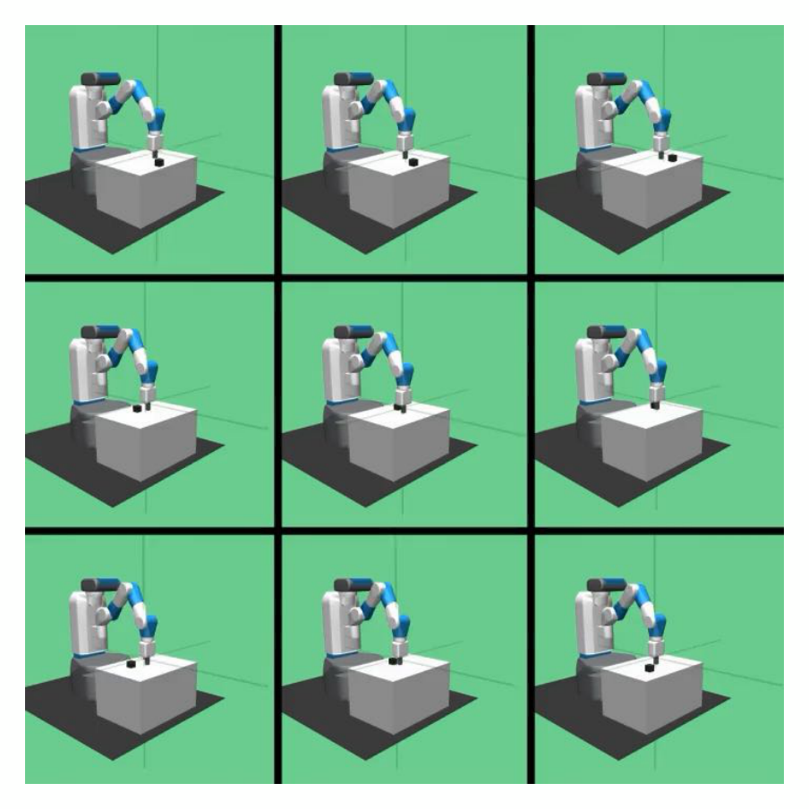

> 본 포스트는 **Youngwoon Lee** 교수님의 *Deep Reinforcement Learning* 강의 자료 중 **Lecture 10-2 — *Skill discovery*** (총 40장)을 바탕으로, 강의를 처음 듣는 독자도 논리적 흐름을 따라갈 수 있도록 재구성한 것입니다. 바로 앞의 두 데크(Lecture 09-2·10-1 *Reward learning #1·#2*)는 13·14회차 포스트에서 다룹니다. 원본 슬라이드는 영문으로 작성되어 있으며, 본문의 대섹션은 슬라이드 제목을 그대로 차용했습니다. 같은 제목이 이어지는 슬라이드(*Maximum entropy RL* 10–11쪽, *How to discover skills?* 14–16쪽, *MI-based skill discovery* 22–24쪽, *Lipschitz-constrained Skill Discovery (LSD)* 27–29쪽, *Manipulation skills of CSD* 32–34쪽, *Distance-maximizing skill discovery* 36–37쪽, *METRA* 38–39쪽)는 하나의 절로 묶었습니다. 표지와 같은 형식의 장 구분 슬라이드(5쪽 *Information-theoretic concepts*)는 대섹션으로 두지 않고 4절 도입부에서 언급했고, 제목 없이 사진 한 장만 있는 30쪽은 21절 도입부에서 글로만 다루었습니다. 슬라이드 하단의 출처 — Yu et al., *Meta-World: A Benchmark and Evaluation for Multi-Task and Meta Reinforcement Learning*, CoRL 2019 · Haarnoja et al., *Reinforcement Learning with Deep Energy-Based Policies*, ICML 2017 · Eysenbach et al., *Diversity is All You Need: Learning Skills without a Reward Function*, ICLR 2019 · Gregor et al., *Variational Intrinsic Control*, arXiv 2016 · Park et al., *Lipschitz-constrained Unsupervised Skill Discovery*, ICLR 2022 · Park et al., *Controllability-aware Unsupervised Skill Discovery*, ICML 2023 · Park et al., *METRA: Scalable Unsupervised RL with Metric-Aware Abstraction*, ICLR 2024 — 와 3쪽 영상의 출처(Stanford CS 224R 강의)는 해당 절의 본문에 옮겨 두었습니다. 본문의 대섹션 번호는 원본 슬라이드에 없는 것을 읽기 편하도록 붙인 것입니다.

## 한 줄 요약 (TL;DR)

> **"보상이 없어도 '서로 구별되게'와 '멀리 가게'라는 목표만으로 에이전트는 스스로 스킬을 배울 수 있습니다."**
>
> 지금까지의 강화학습은 원하는 과제와 보상이 주어진다고 가정했지만, **스킬 발견**은 환경 보상 없이 스킬 $\mathbf{z}$로 조건화된 정책 $\pi(\mathbf{a} \mid \mathbf{s}, \mathbf{z})$를 배웁니다. 최대 엔트로피 강화학습은 행동을 다양하게 만들 뿐 상태를 다양하게 만들지도, 그 다양성을 골라 쓰게 해 주지도 못하므로, **DIAYN**은 판별기가 스킬을 잘 맞히는 상태에 보상 $\log p(\mathbf{z} \mid \mathbf{s}')$를 주어 상태와 스킬의 **상호 정보량** $I(\mathbf{s}; \mathbf{z})$를 최대화합니다. 그러나 상호 정보량은 상태를 몇 배로 늘려도 변하지 않고 스킬이 구별되기만 하면 최댓값에 이르므로, MI 기반 방법은 조금만 움직이거나 그리퍼처럼 쉬운 것만 움직이는 스킬에 머뭅니다. **거리 최대화 스킬 발견**은 보상을 $(\phi(\mathbf{s}') - \phi(\mathbf{s}))^\top \mathbf{z}$로 바꾸고 $\phi$의 변화량을 어떤 거리로 묶느냐로 스킬의 성격을 정합니다 — 유클리드 거리(LSD)는 멀리 달리는 보행 스킬을, 제어 가능성 거리 $-\log p(\mathbf{s}' \mid \mathbf{s})$(CSD)는 물체를 움직이는 조작 스킬을, 상수 1로 묶은 시간적 거리(METRA)는 픽셀 관측에서까지 넓게 퍼지는 스킬을 얻습니다.

---

## 1. 지금까지의 강화학습 (RL So Far)

이번 강의는 새 알고리즘보다 먼저, 지금까지 배운 강화학습이 무엇을 당연하게 여겨 왔는지를 돌아보는 데서 출발합니다. 첫 본문 슬라이드(2쪽)는 세 가지 데이터 설정을 나란히 놓습니다.

| 설정 | 데이터를 모으고 쓰는 방식 | 이 시리즈에서 |
|:----|:---------------|:-----|
| **(a) 온라인 강화학습** | 현재 정책 $\pi_k$로 롤아웃을 모아 곧바로 $\pi_{k+1}$로 갱신하고, 갱신된 정책으로 다시 롤아웃한다 | 3–5회차 (정책 경사, 행위자–비평가, PPO) |
| **(b) 오프폴리시 강화학습** | 롤아웃 데이터를 버퍼 $\mathcal{D}$에 쌓아 두고 버퍼에서 정책을 갱신한다 | 6–7회차 (DQN, DDPG, TD3, SAC) |
| **(c) 오프라인 강화학습** | 임의의 정책 $\pi_\beta$로 데이터를 단 한 번 모은 뒤, 환경과 상호작용하지 않고 학습해 배포한다 | 9회차 |

세 설정은 데이터를 얼마나 재사용하느냐에서 갈리지만, 도식을 자세히 보면 공통점이 하나 있습니다. **세 도식 모두 데이터 튜플 $(\mathbf{s}_i, \mathbf{a}_i, \mathbf{s}'_i, r_i)$에 보상 $r_i$가 들어 있습니다.** 온라인이든 오프라인이든 "무엇이 좋은 행동인가"는 보상이 미리 정해 두고 있었다는 뜻입니다.

슬라이드 아래의 사진들(통 안의 물체를 집는 로봇, 목표 이미지로 지정한 당근을 집는 로봇)과 오른쪽의 세 불릿이 그 전제를 요약합니다.

* **원하는 것을 알고 있었다** (We knew what we wanted)
* **짧은 지평의 행동** (Short-horizon behaviors) — 물체 하나를 집는 것처럼 짧은 시간 안에 끝나는 행동
* **잘 정의된 과제와 보상** (Well defined tasks/rewards) — 슬라이드에서 가장 진하게 강조된 줄

세 번째 줄이 이번 강의가 걷어 내려는 가정입니다. 과제와 보상이 정의되어 있지 않다면, 에이전트는 무엇을 배울 수 있을까요?

![Figure: 지금까지의 강화학습을 세 가지 데이터 설정으로 요약한 도식과 로봇 사진들입니다. 위 줄 왼쪽의 **(a) 온라인 강화학습**에서는 지구 그림(환경)과 현재 정책 $\pi_k$가 상태·보상 $\mathbf{s}, r$과 행동 $\mathbf{a}$를 주고받는 상자(rollout(s))에서 롤아웃 데이터 $\{(\mathbf{s}_i, \mathbf{a}_i, \mathbf{s}'_i, r_i)\}$가 나와 곧바로 $\pi_{k+1}$로의 갱신(update)에 쓰이고, 갱신된 정책이 다시 롤아웃에 들어갑니다. 가운데의 **(b) 오프폴리시 강화학습**에서는 같은 데이터가 원통 모양의 버퍼 $\mathcal{D}$에 쌓이고 갱신은 버퍼에서 이루어집니다. 오른쪽의 **(c) 오프라인 강화학습**에서는 임의의 정책 $\pi_\beta$로 데이터를 단 한 번 모으고(data collected once with any policy), 점선 상자로 표시한 학습 단계(training phase)에서 버퍼만으로 $\pi$를 배운 뒤 배포(deployment)합니다. 세 도식의 데이터 튜플에 모두 보상 $r_i$가 들어 있다는 점이 이번 강의의 출발점입니다. 아래 줄은 통 안의 물체를 집는 로봇 장면들로, 왼쪽은 로봇 팔과 그 카메라 영상(472x472 Image)·작업 공간(Workspace), 가운데는 여러 통에서 동시에 진행되는 집기 장면의 격자, 오른쪽은 로봇 카메라 영상(Robot Camera)과 목표 이미지(Goal Image)를 곁들여 당근을 집는 장면(Instance grasping: grasp carrot)입니다. 오른쪽의 세 불릿(원하는 것을 알고 있었다, 짧은 지평의 행동, 가장 진하게 강조된 잘 정의된 과제와 보상)은 이 사진들이 공유하는 전제를 요약합니다.](./images/figure01_rl_so_far.png)

---

## 2. 지도 신호가 전혀 없다면? (What If We Have Zero Supervision?)

슬라이드는 질문 하나와 영상의 한 장면(Stanford CS 224R 강의 영상)만 보여 줍니다. 장난감이 흩어진 방의 놀이 매트 위에서 아기가 움직이는 장면입니다.

여기서 **지도(supervision)**는 에이전트에게 무엇을 해야 하는지 알려 주는 모든 신호를 가리킵니다. 이 시리즈에서 본 것만 꼽아도 다음과 같습니다.

* **보상 함수** — 2회차에서 MDP의 일부로 정의한 것
* **전문가 시연** — 1회차의 모방학습
* **배운 보상** — 앞의 두 데크(13–14회차)가 다루는, 목표 예시·시연·사람의 피드백·AI의 피드백에서 학습한 보상

슬라이드 제목은 이 가운데 **아무것도** 없는 경우를 묻습니다(제목에서 *zero*만 굵게 강조되어 있습니다). 아기는 누구에게서도 보상 함수나 시연을 받지 않지만, 놀면서 몸을 움직이는 법과 물건을 다루는 법을 익혀 갑니다. 강화학습 에이전트도 그렇게 할 수 있을까 — 이것이 이번 강의 전체의 질문입니다. 같은 장면은 21쪽에서 단서(disclaimer)와 함께 다시 나오는데, 그때는 답의 한계를 짚는 역할을 합니다(16절).

---

## 3. 스킬 발견 (Skill Discovery)

슬라이드는 이번 강의의 주제를 한 문장으로 정의합니다.

> **RL agent learns *skills* (options) *without* environment reward**
> (강화학습 에이전트가 환경 보상 **없이** **스킬**(옵션)을 배운다)

이 정의의 세 낱말을 하나씩 풀어 보겠습니다.

* **스킬(skill)**은 에이전트가 필요할 때 골라 쓸 수 있는 하나의 일관된 행동 방식입니다. 10절에서 보듯 스킬 $\mathbf{z}$를 입력으로 받는 정책 $\pi(\mathbf{a} \mid \mathbf{s}, \mathbf{z})$로 표현됩니다.
* 괄호 속 **옵션(option)**은 강화학습에서 여러 스텝에 걸쳐 이어지는 행동 단위를 부르는 용어로, 여기서는 스킬과 같은 뜻으로 쓰였습니다.
* 핵심은 **환경 보상 없이**입니다. 1절의 세 도식에서 $r_i$를 지운 채로 학습하겠다는 것입니다.

::: {.callout-tip}
## 이 포스트의 용어

* **스킬(skill)**, **스킬 발견(skill discovery)**: "스킬"은 원어를 소리대로 옮겼습니다. "기술"은 일상어의 뜻과 겹쳐 쓰지 않았습니다.
* **지도(supervision)**: 보상, 시연, 피드백처럼 무엇을 해야 하는지 알려 주는 신호입니다. **비지도(unsupervised)**는 그런 신호가 없다는 뜻입니다.
* **탐색(exploration)**: 6–7회차와 같이 탐색으로 옮깁니다. 12회차는 트리 탐색(search)과 구별하려고 탐험이라 했지만, 이번 회차에는 트리 탐색이 나오지 않습니다.
* **상호 정보량(mutual information)**, **스킬 표현(skill representation)**, **판별기(discriminator)**는 각각 6절, 11절, 12절에서 정의합니다.
:::

### 3.1 더 실용적인 이유

보상 없이 배운다는 목표에는 아기의 비유(2절)만이 아니라 실용적인 이유(More practical reason)도 있습니다.

* **다양한 과제를 고안하기가 까다롭다** (Coming up with diverse tasks is tricky)
* 예: 탁자 위 조작 시나리오의 과제 아이디어 (Task ideas for tabletop manipulation scenarios)

예로 든 그림은 8회차 5절에서 벤치마크로 소개한 **Meta-World**(Yu et al., CoRL 2019)의 과제 목록입니다. 같은 로봇 팔과 탁자 위에서 훈련 과제 45개와 시험 과제 5개를 정의하는데, 과제 하나하나가 "무엇을 성공으로 볼 것인가", 곧 보상까지 사람이 정해야 하는 작업입니다. 50개를 넘어 수백, 수천 개의 다양한 행동을 원한다면 이렇게 손으로 과제를 만드는 방식은 따라가지 못합니다. 에이전트가 보상 없이 다양한 행동을 스스로 찾아낸다면, 사람이 과제를 하나씩 설계하지 않고도 쓸 만한 행동의 목록을 얻을 수 있습니다. 그렇게 배운 스킬이 실제로 과제를 "우연히" 해내기도 한다는 것을 22.3절에서 확인합니다.

![Figure: 스킬 발견의 정의와 실용적인 동기를 담은 슬라이드입니다. 위의 불릿은 강화학습 에이전트가 환경 보상 없이 기울임체 **스킬**(옵션)을 배운다는 정의와, 더 실용적인 이유로 다양한 과제를 고안하기가 까다롭다는 것, 그 예로 탁자 위 조작 시나리오의 과제 아이디어를 듭니다. 아래 그림은 Meta-World 벤치마크의 과제 목록으로, 왼쪽 **Train** 아래에 5행 9열, 모두 45개의 훈련 과제(assembly, basketball, button press, coffee push, dial turn, drawer open, faucet close, hammer, peg insert side, pick place, push, reach, shelf place, soccer, sweep, window close 등)가, 오른쪽 **Test** 아래에 시험 과제 5개(bin picking, box close, door lock, door unlock, hand insert)가 장면 사진과 이름으로 나열되어 있습니다. 모든 과제가 같은 빨간 로봇 팔과 나무 탁자 위에서 물체와 목표만 바꿔 정의되어 있어, 사람이 과제를 하나씩 떠올리고 설계해야 하는 부담이 얼마나 큰지를 보여 주는 예입니다.](./images/figure03_skill_discovery_meta_world_tasks.png)

---

## 4. 엔트로피 (Entropy)

스킬이 "다양하다"고 말하려면 다양성을 재는 자가 필요합니다. 강의는 본론에 앞서 장 구분 슬라이드(5쪽 *Information-theoretic concepts*)를 두고 정보 이론의 세 도구 — 엔트로피(4절), KL 발산(5절), 상호 정보량(6절) — 를 정리합니다. 엔트로피와 KL 발산은 7회차(SAC)와 9회차(CQL·AWR)에서 이미 쓴 적이 있고, 상호 정보량은 이번 회차에 처음 나옵니다. 이번 회차에서는 목적함수 자체가 이 양들로 쓰이므로 셋 모두 정의부터 세워 둡니다.

::: {.callout-note}
## 정의: 엔트로피 (Entropy)

관측 $\mathbf{x}$에 대한 분포 $p(\mathbf{x})$의 엔트로피는

$$
H(p(\mathbf{x})) = -\mathbb{E}_{\mathbf{x} \sim p(\mathbf{x})}\big[\log p(\mathbf{x})\big]
$$

입니다. 이산 변수라면 $-\sum_{\mathbf{x}} p(\mathbf{x}) \log p(\mathbf{x})$이고, 연속 변수라면 합 대신 적분을 씁니다.
:::

정의에서 바로 읽을 수 있는 해석이 셋 있습니다.

* 슬라이드가 정의 바로 아래에 풀이한 대로(entropy — how "broad" $p(\mathbf{x})$ is) 엔트로피는 **$p(\mathbf{x})$가 얼마나 "넓게" 퍼져 있는가**를 잽니다. 오른쪽 위 그림은 분포에서 뽑은 점들이 흩어진 폭에 주황 화살표로 $H(p(\mathbf{x}))$를 붙여, 점들이 넓게 흩어질수록 엔트로피가 크다는 직관을 보여 줍니다. 다만 폭 그 자체가 엔트로피는 아니며, 셋째 불릿의 가우시안처럼 엔트로피는 폭의 로그를 따라 늘어납니다.
* $-\log p(\mathbf{x})$는 결과 $\mathbf{x}$를 보았을 때의 **놀라움(surprisal)**, 곧 정보량으로 읽을 수 있습니다. 드문 결과일수록 $p$가 작아 $-\log p$가 큽니다. 엔트로피는 이 놀라움의 **평균**이며, 이 해석은 21절의 CSD에서 다시 쓰입니다.
* 연속 분포의 예로, 7회차 21.2절에서 계산한 가우시안의 엔트로피 $\tfrac12 \log(2\pi e\, \sigma^2)$는 표준편차 $\sigma$가 클수록, 곧 분포가 넓을수록 큽니다.

### 4.1 이진 변수의 엔트로피

슬라이드 아래쪽은 가장 단순한 경우인 이진 변수 $\mathbf{x} \in \{0, 1\}$로 감을 잡습니다. $q = p(\mathbf{x} = 1)$이라 하면

$$
H(q) = -q \log_2 q - (1 - q) \log_2 (1 - q)
$$

입니다. 슬라이드의 세 경우를 대입해 보겠습니다.

| $p(\mathbf{x} = 1)$ | $\mathbf{x}$의 모습 | 계산 | 엔트로피 |
|:--|:-------|:------------|:--|
| $0$ | 항상 0 | $-0 \cdot \log_2 0 - 1 \cdot \log_2 1 = 0$ | $0$ |
| $1$ | 항상 1 | $-1 \cdot \log_2 1 - 0 \cdot \log_2 0 = 0$ | $0$ |
| $0.5$ | 반은 0, 반은 1 | $-0.5 \cdot (-1) - 0.5 \cdot (-1) = 1$ | $1$ |

여기서 $0 \cdot \log 0$은 극한 $\lim_{q \to 0^+} q \log q = 0$에 따라 0으로 둡니다. 슬라이드가 "엔트로피 = 1"이라고 쓴 것은 로그의 밑을 2로, 곧 단위를 **비트(bit)**로 잡았다는 뜻입니다. 자연로그라면 같은 값이 $\ln 2 \approx 0.693$입니다.

$H$가 $q = 0.5$에서 최댓값을 갖는다는 것은 미분으로 확인할 수 있습니다. $\frac{d}{dq}(q \log_2 q) = \log_2 q + \frac{1}{\ln 2}$를 두 항에 쓰면

$$
\frac{dH}{dq} = \Big(-\log_2 q - \frac{1}{\ln 2}\Big) + \Big(\log_2 (1 - q) + \frac{1}{\ln 2}\Big) = \log_2 \frac{1 - q}{q}
$$

입니다. 이 값은 $q = 1/2$에서 0이고, 한 번 더 미분한 $\frac{d^2 H}{dq^2} = -\frac{1}{\ln 2 \; q(1 - q)}$는 $0 < q < 1$에서 항상 음수이므로 $H$는 오목 함수이고 $q = 1/2$이 유일한 최댓점입니다. **결과를 가장 예측하기 어려운 분포가 엔트로피가 가장 큰 분포**라는 것이 슬라이드 왼쪽 아래의 위로 볼록한 아치 모양 곡선의 뜻이며, 이 성질은 15.1절에서 "균등한 사전 분포가 $H(\mathbf{z})$를 최대화한다"로 일반화됩니다.

![Figure: 엔트로피의 정의와 직관을 정리한 슬라이드입니다. 왼쪽 위의 식은 관측 $\mathbf{x}$에 대한 분포 $p(\mathbf{x})$의 엔트로피를 $H(p(\mathbf{x})) = -\mathbb{E}_{\mathbf{x} \sim p(\mathbf{x})}\lbrack \log p(\mathbf{x})\rbrack$로 정의하고, 그 아래 줄은 첫 낱말 entropy만 **주황**으로 칠하고, 엔트로피가 $p(\mathbf{x})$가 얼마나 '넓게' 퍼져 있는지를 잰다고 풀이합니다. 오른쪽 위 그림은 가로축 $\mathbf{x}$ 위에 그린 **초록 곡선** $p(\mathbf{x})$와 그 분포에서 뽑은 **연초록 점**(표본)들이고, 그 아래의 **주황 양방향 화살표** $H(p(\mathbf{x}))$가 표본이 넓게 흩어질수록 엔트로피가 크다는 직관을 나타냅니다. 왼쪽 아래 그래프는 이진 변수 $X$의 엔트로피 $H(X)$(세로축, 0–1)를 $\Pr(X = 1)$(가로축, 0–1)의 함수로 그린 **파란 곡선**으로, 양 끝에서 0이고 가운데 0.5에서 최댓값 1에 이르는, 위로 볼록한 아치 모양입니다. 오른쪽의 세 줄은 그 곡선의 세 점 — $p(\mathbf{x} = 1) = 0$이면 $\mathbf{x}$는 항상 0이라 엔트로피 0, $p(\mathbf{x} = 1) = 1$이면 항상 1이라 엔트로피 0, $p(\mathbf{x} = 1) = 0.5$이면 반반이라 엔트로피 1 — 을 말로 풀어 줍니다.](./images/figure04_entropy.png)

---

## 5. KL 발산 (KL-Divergence)

슬라이드는 KL 발산을 "두 분포 $p(\mathbf{x})$와 $q(\mathbf{x})$ 사이의 거리"로 소개합니다.

::: {.callout-note}
## 정의: KL 발산 (Kullback–Leibler Divergence)

$$
D_{\mathrm{KL}}\big(p(\mathbf{x}) \,\Vert\, q(\mathbf{x})\big) = \mathbb{E}_{\mathbf{x} \sim p(\mathbf{x})}\Big[\log \frac{p(\mathbf{x})}{q(\mathbf{x})}\Big]
$$
:::

슬라이드는 기댓값의 첨자 $\mathbf{x} \sim p(\mathbf{x})$에 주황 밑줄을 긋고 "**$p$가 큰 곳에서 $q$가 작으면 발산이 크다**"고 적습니다. 기댓값을 $p$로 취하므로 로그 비 $\log(p/q)$는 $p$가 큰 곳에서 크게 가중됩니다. 그런 곳에서 $q$가 작으면 로그 비가 커지고, 그 큰 값이 큰 가중치를 받습니다. 반대로 $p$가 거의 0인 곳에서는 $q$가 무엇이든 발산에 거의 기여하지 않습니다.

### 5.1 KL 발산은 0 이상이다

"거리"라고 부르려면 적어도 0 이상이어야 합니다. 로그가 오목 함수라는 사실, 곧 옌센 부등식(Jensen's inequality) $\mathbb{E}[\log X] \le \log \mathbb{E}[X]$에서

$$
\begin{aligned}
-D_{\mathrm{KL}}(p \,\Vert\, q) &= \mathbb{E}_{\mathbf{x} \sim p}\Big[\log \frac{q(\mathbf{x})}{p(\mathbf{x})}\Big] \le \log \mathbb{E}_{\mathbf{x} \sim p}\Big[\frac{q(\mathbf{x})}{p(\mathbf{x})}\Big] \\
&= \log \sum_{\mathbf{x}:\, p(\mathbf{x}) > 0} q(\mathbf{x}) \;\le\; \log 1 = 0
\end{aligned}
$$

이므로 $D_{\mathrm{KL}}(p \,\Vert\, q) \ge 0$입니다. 등호는 첫 부등식에서 $q/p$가 ($p > 0$인 곳에서) 상수이고, 둘째 부등식에서 $q$의 질량이 모두 $p > 0$인 곳에 있어 그 상수가 1이 될 때, 곧 $p = q$일 때만 성립합니다. 이 부등식은 6절(상호 정보량은 0 이상), 15.1절(균등 분포의 엔트로피가 최대), 15.4절(판별기로 얻는 하한)의 증명에 모두 쓰입니다.

::: {.callout-warning}
## KL 발산은 진짜 거리가 아닙니다

슬라이드는 "거리(distance)"라고 부르지만, 일반적으로 $D_{\mathrm{KL}}(p \,\Vert\, q) \ne D_{\mathrm{KL}}(q \,\Vert\, p)$이고 삼각 부등식도 성립하지 않습니다. 그래서 "발산(divergence)"이라는 이름이 붙었고, **어느 쪽을 앞에 두느냐**가 아래의 순방향·역방향 차이를 만듭니다.
:::

### 5.2 순방향 KL과 역방향 KL

$p$가 주어진 목표 분포이고 $q$가 우리가 고를 수 있는 분포라고 합시다. 슬라이드는 최적화 대상인 $q(\mathbf{x})$를 빨간 글씨로 칠하고 두 방향의 최소화를 비교합니다. 정의를 풀어 쓰면 차이가 바로 보입니다.

$$
\begin{aligned}
D_{\mathrm{KL}}(p \,\Vert\, q) &= \underbrace{\mathbb{E}_{p}[\log p(\mathbf{x})]}_{q\text{와 무관}} - \mathbb{E}_{p}[\log q(\mathbf{x})] \\
D_{\mathrm{KL}}(q \,\Vert\, p) &= \underbrace{\mathbb{E}_{q}[\log q(\mathbf{x})]}_{-H(q)} - \mathbb{E}_{q}[\log p(\mathbf{x})]
\end{aligned}
$$

두 줄에서 $q$에 달린 부분만 남기면 다음과 같습니다.

* **순방향 KL(forward KL) 최소화** $\min_q D_{\mathrm{KL}}(p \,\Vert\, q)$는 $\max_q \mathbb{E}_{p}[\log q(\mathbf{x})]$, 곧 $p$에서 뽑은 데이터에 대한 **최대 우도 추정(maximum likelihood estimation)**과 같습니다. $p$가 큰 곳에서 $q$가 0에 가까우면 $\log q \to -\infty$가 큰 가중치를 받으므로, $q$는 $p$의 질량이 있는 곳이면 어디든 확률을 깔아 두어야 합니다. 슬라이드의 표현으로 "**$p$가 큰 곳에서 $q$를 키운다**", 곧 **모드 포괄(mode covering)**입니다.
* **역방향 KL(reverse KL) 최소화** $\min_q D_{\mathrm{KL}}(q \,\Vert\, p)$는 $\max_q \big(\mathbb{E}_{q}[\log p(\mathbf{x})] + H(q)\big)$와 같습니다. 이번에는 기댓값을 $q$로 취하므로, $q$가 확률을 둔 곳에서 $p$가 작으면 큰 벌점을 받지만 $p$의 봉우리 하나를 통째로 비워 두는 데는 벌점이 없습니다. 그래서 $q$는 $p$의 봉우리 하나에 자리를 잡습니다. 슬라이드의 표현으로는 "**$q$가 큰 곳에서 $p$를 키운다**"인데, $p$는 고정되어 있으므로 $q$가 큰 곳에서 $p$도 크도록 $q$를 옮긴다는 뜻이며, 곧 **모드 추구(mode seeking)**입니다. $H(q)$ 항은 $q$가 한 점으로 쪼그라들지 않게 막아 줍니다.

여기서 **모드(mode)**는 분포의 봉우리를 뜻합니다(7회차 22절의 "봉우리"). 슬라이드의 1차원 그림이 이 차이를 그대로 보여 줍니다. 봉우리가 둘인 보라색 $p$에 봉우리가 하나인 초록색 $q$를 맞추면, 순방향에서는 $q$가 두 봉우리 사이에 넓게 퍼져 둘 다 덮고, 역방향에서는 $q$가 왼쪽 봉우리에만 겹칩니다.

| | 순방향 KL $D_{\mathrm{KL}}(p \,\Vert\, q)$ | 역방향 KL $D_{\mathrm{KL}}(q \,\Vert\, p)$ |
|:------|:-----------|:-----------|
| 기댓값을 취하는 분포 | $p$ (목표) | $q$ (근사) |
| 같은 문제 | $\max_q \mathbb{E}_p[\log q]$ (최대 우도) | $\max_q \mathbb{E}_q[\log p] + H(q)$ |
| 크게 벌점을 받는 곳 | $p$는 큰데 $q$가 작은 곳 | $q$는 큰데 $p$가 작은 곳 |
| 봉우리 하나짜리 $q$로 다봉 $p$를 맞추면 | 봉우리 사이에 넓게 퍼짐 (**모드 포괄**) | 봉우리 하나에 붙음 (**모드 추구**) |

이 시리즈에서 두 방향을 모두 만난 적이 있습니다.

* 1회차 4.2절은 $\ell_2$ 손실(등분산 가우시안 정책의 음의 로그 우도)로 학습한 행동 복제(behavioral cloning)가 다봉 시연의 **모드를 평균 낸다**고 경고했습니다. 최대 우도는 곧 순방향 KL 최소화이므로, 그것이 바로 모드 포괄입니다.
* 7회차 24.2절의 보충 유도는 SAC의 정책 목적을 $\alpha\, D_{\mathrm{KL}}\big(\pi(\cdot \mid \mathbf{s}) \,\Vert\, \exp(Q(\mathbf{s}, \cdot)/\alpha)/Z(\mathbf{s})\big)$ 꼴로 다시 썼습니다. 근사하는 쪽인 정책 $\pi$가 앞에 놓인 역방향 KL이므로, 가우시안 정책은 볼츠만 분포의 봉우리 하나를 따라가는 모드 추구를 하게 됩니다.

![Figure: KL 발산의 정의와 두 방향의 최소화를 비교한 슬라이드입니다. 위의 식 $D_{KL}(p(\mathbf{x}) \Vert q(\mathbf{x})) = \mathbb{E}_{\mathbf{x} \sim p(\mathbf{x})}\lbrack \log p(\mathbf{x})/q(\mathbf{x})\rbrack$에서 기댓값의 첨자 $\mathbf{x} \sim p(\mathbf{x})$에 **주황 밑줄**이 그어져 있고, 그 아래 주황 글씨가 'p가 큰 곳에서 q가 작으면 발산이 크다'고 풀이합니다. 아래 왼쪽은 **순방향 KL** $D_{KL}(p \Vert q)$의 최소화로, 최적화 대상인 $q(\mathbf{x})$가 **빨간 글씨**로 강조되어 있고, 1차원 그림에서는 봉우리가 하나인 **초록색** $q(\mathbf{x})$가 봉우리가 둘인 **보라색** $p(\mathbf{x})$의 두 봉우리를 모두 덮도록 넓게 퍼져 있습니다(주황 글씨: 모드 포괄, p가 큰 곳에서 q를 키운다). 아래 오른쪽은 **역방향 KL** $D_{KL}(q \Vert p)$의 최소화로, 초록색 $q(\mathbf{x})$가 보라색 $p(\mathbf{x})$의 왼쪽 봉우리 하나에만 겹쳐 있고 오른쪽 봉우리는 비워 둡니다(주황 글씨: 모드 추구, q가 큰 곳에서 p를 키운다). 두 패널의 2차원 등고선 그림은 $p(\mathbf{x})$(보라 화살표)의 두 봉우리를 청록 계열의 동심원으로, $q(\mathbf{x})$(초록 화살표)를 그 사이의 주황–보라 계열 동심원으로 그린 것인데, 두 패널에서 사실상 같은 그림이어서 두 방향의 차이는 1차원 그림으로 읽어야 합니다.](./images/figure05_kl_divergence_forward_reverse.png)

---

## 6. 상호 정보량 (Mutual Information)

세 번째 도구는 두 변수가 서로에 대해 얼마나 알려 주는지를 잽니다.

::: {.callout-note}
## 정의: 상호 정보량 (Mutual Information)

$$
\begin{aligned}
I(\mathbf{x}; \mathbf{y}) &= D_{\mathrm{KL}}\big(p(\mathbf{x}, \mathbf{y}) \,\Vert\, p(\mathbf{x}) p(\mathbf{y})\big) \\
&= \mathbb{E}_{(\mathbf{x}, \mathbf{y}) \sim p(\mathbf{x}, \mathbf{y})}\Big[\log \frac{p(\mathbf{x}, \mathbf{y})}{p(\mathbf{x}) p(\mathbf{y})}\Big] \\
&= H(p(\mathbf{y})) - H(p(\mathbf{y} \mid \mathbf{x})) \\
&= H(p(\mathbf{x})) - H(p(\mathbf{x} \mid \mathbf{y}))
\end{aligned}
$$
:::

첫 줄이 정의입니다. $\mathbf{x}$와 $\mathbf{y}$가 독립이라면 결합 분포가 $p(\mathbf{x}) p(\mathbf{y})$로 쪼개질 것이므로, 상호 정보량은 **실제 결합 분포가 "독립인 척한 분포"에서 얼마나 먼가**를 KL로 잰 것입니다. 둘째 줄은 KL의 정의를 그대로 대입한 것입니다.

### 6.1 엔트로피 차이로의 유도

셋째 줄은 한 단계를 거칩니다. 곱셈 법칙 $p(\mathbf{x}, \mathbf{y}) = p(\mathbf{x})\, p(\mathbf{y} \mid \mathbf{x})$를 로그 안에 넣으면 $p(\mathbf{x})$가 약분되어

$$
\begin{aligned}
I(\mathbf{x}; \mathbf{y}) &= \mathbb{E}\Big[\log \frac{p(\mathbf{y} \mid \mathbf{x})}{p(\mathbf{y})}\Big] \\
&= -\mathbb{E}\big[\log p(\mathbf{y})\big] + \mathbb{E}\big[\log p(\mathbf{y} \mid \mathbf{x})\big] \\
&= H(p(\mathbf{y})) - H(p(\mathbf{y} \mid \mathbf{x}))
\end{aligned}
$$

이 됩니다. 기댓값은 모두 $(\mathbf{x}, \mathbf{y}) \sim p(\mathbf{x}, \mathbf{y})$에 대한 것입니다. 여기서 슬라이드가 $H(p(\mathbf{y} \mid \mathbf{x}))$라고 쓴 **조건부 엔트로피(conditional entropy)**는 $\mathbf{x}$ 하나를 고정했을 때의 엔트로피를 다시 $\mathbf{x}$에 대해 평균 낸 것입니다.

$$
H(p(\mathbf{y} \mid \mathbf{x})) = \mathbb{E}_{\mathbf{x} \sim p(\mathbf{x})}\Big[-\mathbb{E}_{\mathbf{y} \sim p(\mathbf{y} \mid \mathbf{x})}\big[\log p(\mathbf{y} \mid \mathbf{x})\big]\Big] = -\mathbb{E}_{(\mathbf{x}, \mathbf{y})}\big[\log p(\mathbf{y} \mid \mathbf{x})\big]
$$

곱셈 법칙을 $p(\mathbf{x}, \mathbf{y}) = p(\mathbf{y})\, p(\mathbf{x} \mid \mathbf{y})$로 쓰면 같은 과정이 넷째 줄을 줍니다. 셋째 줄과 넷째 줄이 같다는 것은 상호 정보량이 **대칭**이라는 뜻입니다.

### 6.2 성질과 직관

정의와 유도에서 뒤에 쓰일 성질 세 가지가 나옵니다.

* **$I \ge 0$이고, $I = 0$은 독립일 때만**: 첫 줄이 KL이므로 5.1절에서 바로 나옵니다.
* **불확실성의 감소**: $H(\mathbf{y}) - H(\mathbf{y} \mid \mathbf{x})$는 "$\mathbf{x}$를 알기 전 $\mathbf{y}$의 불확실성"에서 "$\mathbf{x}$를 안 뒤에 남는 불확실성"을 뺀 것, 곧 $\mathbf{x}$가 $\mathbf{y}$에 대해 알려 주는 정보의 양입니다.
* **상한**: $\mathbf{y}$가 이산 변수이면($\mathbf{x}$는 연속이어도 됩니다) 조건부 엔트로피 $H(\mathbf{y} \mid \mathbf{x})$도 0 이상이므로 $I(\mathbf{x}; \mathbf{y}) \le H(\mathbf{y})$이고, $\mathbf{x}$를 보면 $\mathbf{y}$가 완전히 정해질 때 등호가 성립합니다($\mathbf{y}$가 연속이면 미분 엔트로피가 음수일 수 있어 이 상한이 보장되지 않습니다). 이 상한이 17.1절에서 MI 기반 스킬 발견의 한계를 설명하는 열쇠가 됩니다.

슬라이드 아래쪽의 두 예는 이 직관을 확인하는 질문입니다(High mutual information (MI)?).

* **$\mathbf{x}$: 내일 비가 온다, $\mathbf{y}$: 내일 거리가 젖는다** — 비가 올지 모르는 상태에서는 거리가 젖을지도 불확실하지만($H(\mathbf{y})$가 크고), 비가 오는지 알면 거리가 젖을지가 거의 정해집니다($H(\mathbf{y} \mid \mathbf{x})$가 작습니다). 그 차가 크므로 **상호 정보량이 높습니다**.
* **$\mathbf{x}$: 내일 비가 온다, $\mathbf{y}$: 내일 화성에서 생명체를 발견한다** — 비가 오든 말든 화성 소식의 불확실성은 그대로입니다. $H(\mathbf{y} \mid \mathbf{x}) = H(\mathbf{y})$이므로 **상호 정보량은 0**입니다.

오른쪽의 두 산점도가 같은 대비를 그림으로 보여 줍니다. 위쪽은 점들이 오른쪽 위로 올라가는 띠를 이루어 $\mathbf{x}$를 알면 $\mathbf{y}$의 범위가 좁혀지고(높은 MI, 종속), 아래쪽은 점들이 $\mathbf{x}$와 상관없이 같은 높이에 흩어져 있어 $\mathbf{x}$가 $\mathbf{y}$에 대해 아무것도 알려 주지 않습니다(낮은 MI, 독립). 그림의 띠는 직선 모양이지만, 상호 정보량은 분포 전체로 정의되므로 상관계수와 달리 **비선형 관계까지** 잡아냅니다.

![Figure: 상호 정보량의 정의와 직관을 정리한 슬라이드입니다. 왼쪽 위의 네 줄짜리 식은 $I(\mathbf{x}; \mathbf{y})$를 결합 분포와 주변 분포의 곱 사이의 KL 발산으로 정의한 뒤, 그것을 기댓값으로 풀어 쓰고, 다시 두 가지 엔트로피의 차 $H(p(\mathbf{y})) - H(p(\mathbf{y} \mid \mathbf{x}))$와 $H(p(\mathbf{x})) - H(p(\mathbf{x} \mid \mathbf{y}))$로 바꿔 씁니다. 왼쪽 아래는 '상호 정보량이 높은가?'라는 질문과 두 예 — $\mathbf{x}$: 내일 비가 온다, $\mathbf{y}$: 내일 거리가 젖는다 / $\mathbf{x}$: 내일 비가 온다, $\mathbf{y}$: 내일 화성에서 생명체를 발견한다 — 입니다. 오른쪽의 두 산점도는 가로축 $\mathbf{x}$, 세로축 $\mathbf{y}$ 위에 찍은 **초록 점**들로, 위쪽은 점들이 오른쪽 위로 올라가는 띠를 이루며 '높은 MI: x와 y가 종속'이라는 설명이, 아래쪽은 점들이 x와 상관없이 같은 높이에 흩어져 '낮은 MI: x와 y가 독립'이라는 설명이 붙어 있습니다. 첫 번째 예가 위쪽 산점도에, 두 번째 예가 아래쪽 산점도에 해당합니다.](./images/figure06_mutual_information.png)

---

## 7. (복습) 최대 엔트로피 강화학습 ((Recap) Maximum Entropy RL)

정보 이론의 도구를 갖추었으니, 강의는 그 도구를 이미 썼던 알고리즘으로 돌아갑니다. 7회차 21절에서 SAC의 출발점으로 본 **최대 엔트로피 강화학습**입니다. 이번에는 첫 불릿부터 관점이 다릅니다.

> **"entropy bonus" encourages diverse behaviors!**
> ("엔트로피 보너스"는 다양한 행동을 장려한다!)

7회차가 엔트로피 보너스를 엡실론 탐욕을 대신하는 연속 행동 공간의 탐색 장치로 소개했다면, 이번 회차는 같은 장치를 **다양성**의 장치로 읽습니다. 슬라이드가 나란히 놓은 두 목적함수는 7회차와 같습니다. 기존 강화학습의 목적함수는 보상의 합

$$
\mathbb{E}_{\tau \sim \pi_\theta(\tau)}\Big[\sum_t r(\mathbf{s}_t, \mathbf{a}_t)\Big]
$$

이고, 최대 엔트로피 강화학습의 목적함수는 매 스텝 보상에 그 상태에서의 정책 엔트로피를 온도 $\alpha$로 가중해 더한

$$
\mathbb{E}_{\tau \sim \pi_\theta(\tau)}\Big[\sum_t r(\mathbf{s}_t, \mathbf{a}_t) + \alpha H\big(\pi(\cdot \mid \mathbf{s}_t)\big)\Big]
$$

입니다. 둘째 불릿대로 정책이 "엔트로피"(정책의 무작위성)도 최대화하도록 학습하며, 슬라이드는 정책의 엔트로피를 다음과 같이 씁니다.

$$
H(\pi) = \mathbb{E}_{\tau \sim \pi(\tau)}\big[-\log \pi(\mathbf{a}_t \mid \mathbf{s}_t)\big]
$$

두 표기 — 상태별 엔트로피 $H(\pi(\cdot \mid \mathbf{s}_t))$와 궤적에 대한 기댓값 $H(\pi)$ — 는 반복 기댓값으로 이어집니다. 궤적에서 $\mathbf{s}_t$가 정해진 뒤에 $\mathbf{a}_t \sim \pi(\cdot \mid \mathbf{s}_t)$이므로

$$
\begin{aligned}
\mathbb{E}_{\tau \sim \pi(\tau)}\big[-\log \pi(\mathbf{a}_t \mid \mathbf{s}_t)\big]
&= \mathbb{E}_{\mathbf{s}_t}\Big[\mathbb{E}_{\mathbf{a}_t \sim \pi(\cdot \mid \mathbf{s}_t)}\big[-\log \pi(\mathbf{a}_t \mid \mathbf{s}_t)\big]\Big] \\
&= \mathbb{E}_{\mathbf{s}_t}\big[H(\pi(\cdot \mid \mathbf{s}_t))\big]
\end{aligned}
$$

이고, 정책의 엔트로피는 곧 **방문한 상태에서의 행동 엔트로피의 평균**입니다. 최대 엔트로피가 다양하게 만드는 것이 **행동**이라는 이 사실이 9절의 논의에서 결정적입니다.

슬라이드의 출처는 Haarnoja et al., *Reinforcement Learning with Deep Energy-Based Policies*, ICML 2017로, 7회차가 인용한 SAC 논문과 제1저자가 같은 논문입니다. 8절의 그림들도 같은 출처입니다.

![Figure: 7회차의 최대 엔트로피 강화학습을 다시 꺼낸 복습 슬라이드입니다. 첫 불릿은 굵은 글씨의 '엔트로피 보너스'가 다양한 행동을 장려한다는 문장이고, 그 아래 두 하위 불릿이 기존 강화학습 목적함수 $\mathbb{E}_{\tau \sim \pi_\theta(\tau)}\lbrack \sum_t r(\mathbf{s}_t, \mathbf{a}_t)\rbrack$와 굵은 글씨로 강조한 최대 엔트로피 강화학습 목적함수 — 같은 합 안에 $\alpha H(\pi(\cdot \mid \mathbf{s}_t))$를 더한 것 — 를 위아래로 나란히 놓습니다. 둘째 불릿은 정책이 '엔트로피'(정책의 무작위성)를 최대화하도록 학습한다는 것이고, 하위 불릿이 정책의 엔트로피를 $H(\pi) = \mathbb{E}_{\tau \sim \pi(\tau)}\lbrack -\log \pi(\mathbf{a}_t \mid \mathbf{s}_t)\rbrack$로 정의합니다. 두 목적함수의 차이가 엔트로피 항 하나뿐이라는 점이 한눈에 보이도록 배치되어 있어, 뒤에서 '행동의 다양성'과 '스킬의 다양성'을 구분하는 논의의 기준점이 됩니다.](./images/figure07_recap_maximum_entropy_rl.png)

---

## 8. 최대 엔트로피 강화학습 (Maximum Entropy RL)

같은 제목의 두 슬라이드(10–11쪽)가 엔트로피 보너스가 주는 이점을 말과 그림으로 정리합니다.

### 8.1 하나의 해만 아는 정책의 위험

10쪽은 7회차 22절에서 본 슬라이드와 같은 내용입니다.

* 해를 하나만 아는 정책은 **국소 최적**에 빠지기 쉽고 환경 변화에 **강건하지 않습니다**.
* 엔트로피 최대화는 서로 다른 해의 여러 **봉우리(modes)**를 붙잡는 데 도움이 됩니다.
    * $(+)$ 다양한 해를 배우면 정책이 강건해집니다.
    * $(+)$ 이는 탐색도 촉진합니다!

미로 그림이 첫 문장을 구체화합니다. 왼쪽 미로에서 네 다리 로봇은 가운데 가로 벽의 위쪽으로 돌아 목표(파란 ×)에 가는 길 하나만 알면 충분합니다. 오른쪽 미로처럼 목표 앞에 세로 벽이 새로 생기면 위쪽 길은 막히고, 가로 벽 아래로 돌아 올라가는 길만 남습니다. 처음 환경에서 두 길의 반환값이 비슷했다면, 두 길 모두에 확률을 나누어 실어 둔 정책은 바뀐 환경에서 이미 아래쪽 길을 알고 있습니다. 반환값이 비슷한 해가 여럿일 때 하나에 몰아주기보다 나누어 싣는 쪽의 엔트로피가 크므로, 엔트로피 보너스가 바로 그런 분산 투자를 장려합니다.

### 8.2 탐색, 미세조정, 강건성

11쪽은 세 가지 이점을 장면으로 보여 줍니다(출처: Haarnoja et al., ICML 2017).

| 이점 | 장면 | 장면에서 읽을 수 있는 것 |
|:-----|:-----------|:-----------|
| **탐색** (Exploration) | 빨간 벽 미로의 왼쪽에 네 다리 로봇, 오른쪽에 파란 목표가 있는 두 장면 | 10쪽의 미로처럼 여러 길을 시도해 볼 여지 |
| **미세조정 가능성** (Fine-tunability) | "사전 학습: 보상 = 속도(방향 무관)" 아래 무작위 초기화 / DDPG / 소프트 Q-학습(Soft Q-learning) | DDPG의 로봇들은 한곳에 몰리고, 소프트 Q-학습의 로봇들은 여러 방향으로 퍼짐 |
| **강건성** (Robustness) | 노란 블록을 쥔 로봇 팔이 빨간 블록 더미 옆에 있는 사진 | 한 장면만으로는 드러나지 않음 |

가운데 패널이 가장 많은 것을 말해 줍니다. 사전 학습의 보상이 "어느 방향이든 빠르기만 하면 된다"이므로, 최적의 행동은 한 방향이 아니라 **모든 방향**에 걸쳐 있습니다. 무작위 시드 25개로 학습한 DDPG(7회차의 결정적 정책, 탐색을 위해 행동에 잡음을 더함)의 로봇들은 가운데 위쪽 좁은 곳에 뭉쳐 있는 반면, 같은 수의 시드로 학습한 소프트 Q-학습의 로봇들은 여러 방향으로 흩어져 있습니다. 소프트 Q-학습은 이 비교에서 최대 엔트로피 목적함수를 쓰는 쪽입니다. 여러 방향을 품은 정책은 나중에 "특정 방향으로 달려라"라는 과제를 받았을 때 그 방향의 행동을 이미 갖고 있으므로 미세조정의 출발점으로 좋다는 것이 패널 제목의 뜻으로 읽힙니다.

강의에서는 세 패널 모두 영상이었을 것으로 보이며, PDF에는 각 영상의 한 장면만 남아 있습니다. 그리고 이 장점들이 그대로 "다양한 스킬"이 되지는 않는다는 것이 다음 절의 문제 제기입니다.

![Figure: 최대 엔트로피 강화학습의 세 가지 이점을 장면으로 보여 주는 슬라이드입니다. 왼쪽 **Exploration**(탐색) 아래의 두 장면은 빨간 벽으로 된 같은 미로를 비스듬히 위에서 본 것으로, 왼쪽에 네 다리 로봇이, 오른쪽 안쪽에 파란 정사각형(목표)이 있습니다. 가운데 **Fine-tunability**(미세조정 가능성)는 검은 바탕 위에 '사전 학습: 보상 = 속도(방향 무관)', '궤적 하나당 로봇 하나'라는 설명과 세 칸을 담고 있는데, 무작위 초기화(Random initialization) 칸에는 가운데에 로봇 하나가, DDPG(무작위 시드 25개, 행동에 잡음 추가) 칸에는 가운데 위쪽 좁은 곳에 뭉친 로봇들이, 소프트 Q-학습(무작위 시드 25개) 칸에는 가운데에서 여러 방향으로 흩어진 로봇들이 있습니다. 오른쪽 **Robustness**(강건성)는 노란 블록을 쥔 빨강·검정 로봇 팔이 빨간 블록 더미 옆에 있는 사진입니다. PDF에는 각 영상의 한 장면만 남아 있어, 이 그림에서 직접 읽을 수 있는 차이는 미세조정 패널에서 로봇들이 퍼진 정도, 곧 최대 엔트로피로 학습한 정책이 여러 방향의 해를 함께 품는다는 점입니다.](./images/figure09_maxent_exploration_finetuning_robustness.png)

---

## 9. 다양한 스킬 학습하기 (Learning Diverse Skills)

슬라이드는 질문으로 시작합니다.

> **Why can't we just use MaxEnt RL?**
> (최대 엔트로피 강화학습을 그대로 쓰면 왜 안 되는가?)

슬라이드가 내놓는 답은 두 가지입니다.

### 9.1 행동 엔트로피는 상태 엔트로피가 아니다

* **행동(action)** 엔트로피는 **상태(state)** 엔트로피와 같지 않다.
    * 에이전트는 매우 다른 행동을 하고도 비슷한 상태에 도달할 수 있다.

7절에서 보았듯 최대 엔트로피 강화학습이 키우는 것은 방문한 상태에서의 **행동** 분포의 엔트로피 $\mathbb{E}_{\mathbf{s}}[H(\pi(\cdot \mid \mathbf{s}))]$입니다. 그런데 우리가 원하는 "다양한 행동 방식"은 에이전트가 **어디에 가는가**, 곧 방문하는 상태의 분포 $p(\mathbf{s})$의 엔트로피 $H(p(\mathbf{s}))$에 가깝고, 둘은 전혀 다른 양입니다. 슬라이드 오른쪽 위 사진의 네 다리 로봇은 등을 대고 뒤집힌 채 다리를 허공으로 쳐들고 있습니다. 관절에 어떤 토크를 무작위로 주어도 몸통은 제자리에 누워 있으므로, 행동 엔트로피는 높아도 상태는 거의 변하지 않습니다.

### 9.2 확률적이지만 제어할 수 없다

* 최대 엔트로피 정책은 확률적이지만 **제어할 수 없다**(not controllable).
    * 직관적으로 우리는 **고정된 $\mathbf{z}$ 안에서는 다양성이 낮고, $\mathbf{z}$들 사이에서는 다양성이 높기**를 원한다.

최대 엔트로피 정책 $\pi(\mathbf{a} \mid \mathbf{s})$의 다양성은 매번 무작위로 나오는 잡음이어서, "이번에는 왼쪽으로 가는 행동"을 골라 쓸 수 없습니다. 그래서 슬라이드는 정책에 **스킬 인덱스(skill index)** $\mathbf{z}$(빨간 글씨)를 하나 더 넣습니다.

$$
\pi(\mathbf{a} \mid \mathbf{s}) \quad\longrightarrow\quad \pi(\mathbf{a} \mid \mathbf{s}, \mathbf{z})
$$

$\mathbf{z}$를 넣은 뒤 원하는 성질은 두 가지입니다.

* $\mathbf{z}$를 **고정**하면 정책은 일관된 한 가지 행동 방식을 보여야 합니다(낮은 다양성, 곧 예측 가능성).
* $\mathbf{z}$를 **바꾸면** 행동 방식이 확실히 달라져야 합니다(높은 다양성, 곧 서로 구별됨).

다양성이 정책 안의 잡음이 아니라 $\mathbf{z}$라는 **손잡이**에 실리는 셈입니다. 가운데 미로 그림에서 같은 스킬의 여러 궤적은 한 줄기로 모이고(고정된 $\mathbf{z}$ 안에서 낮은 다양성), 다섯 스킬은 대체로 서로 다른 통로로 갈라집니다($\mathbf{z}$들 사이에서 높은 다양성). 다만 스킬 3과 4는 거의 같은 왼쪽 통로를 따라가므로, 실제로 학습된 스킬이 상태 공간을 완벽하게 나누어 갖지는 않는다는 것도 함께 보입니다.

::: {.callout-important}
## 설계 원칙: 다른 스킬은 상태 공간의 다른 영역을 방문해야 한다

슬라이드 맨 아래 문장(Intuition: different **skills** should visit different **state-space regions**)이 이번 강의 전반부의 설계 원칙입니다. 출처는 Eysenbach et al., *Diversity is All You Need: Learning Skills without a Reward Function*, ICLR 2019입니다. 15.3절에서 이 직관이 상호 정보량의 분해식 $I(\mathbf{s}; \mathbf{z}) = H(\mathbf{s}) - H(\mathbf{s} \mid \mathbf{z})$로 그대로 옮겨진다는 것을 봅니다.
:::

![Figure: 최대 엔트로피 강화학습만으로는 다양한 스킬을 얻을 수 없는 이유를 정리한 슬라이드입니다. 왼쪽 불릿은 '왜 최대 엔트로피 강화학습을 그대로 쓸 수 없는가?'에 두 가지로 답합니다 — 행동 엔트로피는 상태 엔트로피와 같지 않아 에이전트가 매우 다른 행동을 하고도 비슷한 상태에 도달할 수 있다, 그리고 최대 엔트로피 정책은 확률적이지만 기울임체로 강조한 '제어할 수 없는' 정책이므로 직관적으로는 고정된 z 안에서는 다양성이 낮고 z들 사이에서는 다양성이 높기를 바란다. 오른쪽 위 사진은 체커보드 바닥 위에 등을 대고 뒤집혀 다리를 허공으로 쳐든 네 다리 로봇으로, 행동은 제멋대로여도 몸은 제자리에 있는 첫 번째 이유의 예입니다. 오른쪽의 두 식 $\pi(\mathbf{a} \mid \mathbf{s})$와 $\pi(\mathbf{a} \mid \mathbf{s}, \mathbf{z})$에서 **빨간** $\mathbf{z}$를 **주황 화살표**가 '스킬 인덱스'로 가리킵니다. 가운데 미로 그림은 같은 출발점에서 나온 다섯 스킬 $\pi(\mathbf{a} \mid \mathbf{s}, 0)$–$\pi(\mathbf{a} \mid \mathbf{s}, 4)$의 궤적을 색으로 구분한 것으로, 스킬 0(**연두**)은 위쪽으로, 1(**주황**)은 오른쪽 블록을 돌아 오른쪽 아래 구석으로, 2(**보라**)는 아래쪽을 거쳐 오른쪽 아래 구석으로 가고, 3(**파랑**)과 4(**청록**)는 거의 같은 왼쪽 통로로 갑니다. 같은 스킬의 여러 궤적은 한데 모이고 다른 스킬끼리는 대체로 다른 영역으로 갈라진다는 것이, 맨 아래 문장 '다른 스킬은 상태 공간의 다른 영역을 방문해야 한다'의 그림입니다.](./images/figure10_learning_diverse_skills.png)

---

## 10. 스킬 정책 (Skill Policy $\pi(\mathbf{a} \mid \mathbf{s}, \mathbf{z})$)

스킬 정책이 무엇을 입력받아 무엇을 만들어 내는지 예로 정리하는 슬라이드입니다. 위 줄은 세 칸을 화살표로 잇습니다.

| 스킬 벡터 $\mathbf{z}$ (Skill vector) | 스킬 정책 (Skill policy) | 원하는 상태 $\mathbf{s}'$ (Desired state) |
|:------|:--------|:------|
| 전자레인지 열기 | $\pi(\mathbf{a} \mid \mathbf{s}, \text{open microwave})$ | 열린 전자레인지 |
| 가스레인지 켜기 | $\pi(\mathbf{a} \mid \mathbf{s}, \text{turn on stove})$ | 불이 켜진 가스레인지 |

곧 스킬은 "어떤 상태를 만들어 낼 것인가"로 이름 붙일 수 있고, 스킬 정책은 그 이름을 받아 해당 상태로 가는 행동을 내놓습니다. 이 "스킬 = 도달할 상태"라는 관점이 11절에서 형식화됩니다.

아래의 세 패널은 $\mathbf{z}$를 표현하는 세 가지 방식입니다.

| $\mathbf{z}$의 형태 | 예 | 그림 |
|:------|:-------|:------------|
| **이산** — 이름 또는 번호 | {"slide cabinet", "move kettle", …} 또는 {1, 2, 3, …} | 주방 로봇이 캐비닛 밀기, 주전자 옮기기, 전자레인지 열기 |
| **연속 1차원** $\mathbf{z} \in \mathbb{R}$ | 수직선 위의 점 | HalfCheetah가 수직선 왼쪽의 파란 점에서는 왼쪽으로, 오른쪽의 주황 점에서는 오른쪽으로 달림 |
| **연속 2차원** $\mathbf{z} \in \mathbb{R}^2$ | 평면 위의 점 | 휴머노이드가 $\mathbf{z}$가 놓인 사분면 쪽으로 걸어감 |

이산 스킬은 정해진 개수의 행동을 하나씩 부르는 번호표이고, 연속 스킬은 이웃한 $\mathbf{z}$끼리 비슷한 행동을 하도록 공간에 깔린 좌표입니다. 특히 오른쪽 두 패널에서는 **스킬 벡터의 방향이 곧 움직이는 방향**인데, 이 관점이 18절의 거리 최대화 스킬 발견의 출발점이 됩니다.

![Figure: 스킬 정책 $\pi(\mathbf{a} \mid \mathbf{s}, \mathbf{z})$가 하는 일을 보여 주는 슬라이드입니다. 위 줄은 왼쪽부터 스킬 벡터 $\mathbf{z}$(예: 전자레인지 열기, 가스레인지 켜기) → 스킬 정책(open microwave, turn on stove를 넣은 두 정책) → 원하는 상태 $\mathbf{s}'$(예: 열린 전자레인지, 불이 켜진 가스레인지)으로 이어지는 화살표 흐름입니다. 아래의 세 패널은 $\mathbf{z}$를 표현하는 세 방식입니다. 왼쪽은 $\mathbf{z}$가 이름의 집합 {slide cabinet, move kettle, …} 또는 번호 {1, 2, 3, …}인 이산 스킬로, 주방 로봇이 캐비닛을 밀고(Slide Cabinet), 주전자를 옮기고(Move Kettle), 전자레인지를 여는(Open Microwave) 세 장면이 있습니다. 가운데는 $\mathbf{z} \in \mathbb{R}$인 경우로, 수직선 위의 **파란 점 둘**(왼쪽)과 **주황 점 둘**(오른쪽) 아래에 HalfCheetah 스킬 $z_1$–$z_4$의 연속 동작이 그려져 있는데, $z_1$과 $z_2$는 **주황 화살표**를 따라 오른쪽으로, $z_3$과 $z_4$는 **파란 화살표**를 따라 왼쪽으로 움직이며, $z_2$는 몸을 바닥에 눕힌 채 길게, $z_4$는 짧게만 움직입니다. 오른쪽은 $\mathbf{z} \in \mathbb{R}^2$인 경우로, 좌표평면의 네 사분면에 놓인 **주황·초록·파랑·노랑 점**과 같은 색의 휴머노이드 궤적 $z_1$–$z_4$가 각각 왼쪽 위, 오른쪽 위, 왼쪽 아래, 오른쪽 아래로 뻗어 있어, 스킬 벡터의 방향이 곧 움직이는 방향이 되는 모습을 보여 줍니다.](./images/figure11_skill_policy.png)

---

## 11. 스킬은 어떻게 발견하는가 (How to Discover Skills?)

같은 제목의 세 슬라이드(14–16쪽)가 질문을 좁혀 가며 보상 함수의 모양을 정합니다.

### 11.1 다양한 행동인가, 다양한 상태인가

14쪽은 두 후보를 나란히 놓습니다.

* **다양한 행동?** — 주황 취소선으로 지워져 있습니다. 행동 엔트로피 $H(\pi(\cdot \mid \mathbf{s}))$가 높은 정책은 뒤집힌 로봇(9.1절)처럼 아무 데도 가지 않을 수 있습니다.
* **다양한 상태?** — 검은 바탕 위의 로봇을 위에서 내려다본 장면이 붙어 있습니다. 스킬마다 다른 곳에 가는 것, 곧 상태의 다양성이 목표입니다.

아래쪽의 미로 그림과 $\pi(\mathbf{a} \mid \mathbf{s}, \mathbf{z})$, 그리고 맨 아래의 직관 문장은 9절의 것을 다시 가져왔습니다.

### 11.2 상태를 스킬로 사상하기

15쪽은 스킬을 정의하는 두 조건을 적습니다.

* **서로 다른 스킬은 서로 다른 상태를 방문한다** (different skills visit different states)
* **비슷한 스킬은 비슷한 상태를 방문한다** (similar skills visit similar states)

그리고 주황 글씨로 관점을 뒤집습니다.

> **"map states to skills — reaching a state is a skill"**
> ("상태를 스킬로 사상한다 — 어떤 상태에 도달하는 것이 곧 하나의 스킬이다")

상태 공간의 점 $\mathbf{s}$를 스킬 공간의 점 $\mathbf{z}$로 보내는 함수를 **스킬 표현(skill representation)**이라 부르고 $\mathbf{z} = \phi(\mathbf{s})$로 씁니다. 그러면 스킬 $\mathbf{z}$란 "$\phi$가 $\mathbf{z}$로 보내는 상태에 도달하는 행동"이 되고, 위의 두 조건은 $\phi$의 성질로 바뀝니다. 서로 다른 상태 영역은 서로 다른 $\mathbf{z}$로, 가까운 상태는 가까운 $\mathbf{z}$로 보내야 합니다.

![Figure: 스킬을 상태에 연결하는 방식을 정의하는 슬라이드입니다. 왼쪽 위 문장은 스킬 $\mathbf{z}$를 '서로 다른 스킬은 서로 다른 상태를, 비슷한 스킬은 비슷한 상태를 방문하도록' 정의한다고 말하고, 오른쪽 위에는 12쪽의 다섯 스킬 미로 그림이 작게 놓여 있습니다. 가운데 **주황 글씨**는 '상태를 스킬로 사상한다 — 어떤 상태에 도달하는 것이 곧 하나의 스킬이다'입니다. 아래 그림에서는 오른쪽 상자(State $\mathbf{s}$)에 흩어진 다섯 색의 점(초록, 주황, 연녹색, 파랑, 자주)이 **회색 점선 화살표**를 따라 왼쪽 상자(Skill $\mathbf{z}$)의 같은 색 점으로 옮겨지며, 그 사상이 아래에 적힌 스킬 표현 $\mathbf{z} = \phi(\mathbf{s})$입니다. 상태 공간에서 서로 가까이 붙어 있는 연녹색과 파랑 점이 스킬 공간에서도 가까이 놓이도록 그려져 있어, '비슷한 스킬은 비슷한 상태'라는 조건이 사상 $\phi$의 성질로 옮겨진다는 것을 보여 줍니다.](./images/figure13_map_states_to_skills.png)

### 11.3 스킬 정책의 목표

16쪽은 같은 그림에 스킬 정책을 더합니다. $\phi$가 상태에서 스킬로 가는 사상이라면, 스킬 정책 $\pi(\mathbf{a} \mid \mathbf{s}, \mathbf{z})$는 **스킬에서 상태로** 가는 방향입니다. $\mathbf{z}$를 받아 $\phi(\mathbf{s}') \approx \mathbf{z}$인 상태 $\mathbf{s}'$으로 에이전트를 데려가야 합니다. 그래서 슬라이드는 스킬 정책의 목표를 이렇게 씁니다.

$$
\text{minimize } \lVert \phi(\mathbf{s}') - \mathbf{z} \rVert \quad = \quad \text{maximize } p(\mathbf{z} \mid \phi(\mathbf{s}'))
$$

두 표현이 같은 이유는 $p(\mathbf{z} \mid \phi(\mathbf{s}'))$를 가우시안으로 놓아 보면 보입니다. 스킬 공간이 $d$차원이고 $p(\mathbf{z} \mid \phi(\mathbf{s}')) = \mathcal{N}(\mathbf{z};\, \phi(\mathbf{s}'),\, \sigma^2 I)$라면

$$
\log p(\mathbf{z} \mid \phi(\mathbf{s}')) = -\frac{1}{2\sigma^2} \lVert \phi(\mathbf{s}') - \mathbf{z} \rVert^2 - \frac{d}{2} \log(2\pi\sigma^2)
$$

이므로, 로그 확률을 키우는 것은 거리를 줄이는 것과 정확히 같습니다(둘째 항은 상수). 슬라이드는 이 확률 쪽을 **주황 상자**로 감싸고 "use it for reward!"라는 화살표를 달아, 그 로그를 **보상**으로 쓰자고 제안합니다. 거리에 음수를 붙인 $-\lVert \phi(\mathbf{s}') - \mathbf{z} \rVert$도 보상이 될 수는 있지만, 확률 꼴로 두면 12절처럼 상태에서 스킬을 맞히는 분류기(판별기)로 그 값을 직접 배울 수 있다는 점이 이 선택의 이유로 읽힙니다.

정책의 $\mathbf{z}$ 자리를 가리키는 주황 주석은 "**$\phi(\mathbf{s}_g)$일 수도 있다: 목표 조건부 강화학습**"입니다. 도달하고 싶은 목표 상태 $\mathbf{s}_g$가 있다면 $\mathbf{z} = \phi(\mathbf{s}_g)$를 넣으면 되고, 그러면 스킬 정책은 9회차 12.3절(OGBench)에서 본 **목표 조건부 강화학습(goal-conditioned RL)**의 정책 $\pi(\mathbf{a} \mid \mathbf{s}, \mathbf{g})$와 같은 모양이 됩니다. 차이는 목표 조건부 강화학습에서는 목표가 상태 그 자체로 주어지는 반면, 스킬 발견에서는 어떤 $\mathbf{z}$가 어떤 상태에 대응하는지($\phi$)까지 함께 정해야 한다는 데 있습니다.

![Figure: 스킬 표현을 이용해 스킬 정책의 목표를 정하는 슬라이드입니다. 위쪽의 주황 글씨와 두 상자는 15쪽의 그림과 같고(State $\mathbf{s}$의 점들이 점선 화살표를 따라 Skill $\mathbf{z}$의 같은 색 점으로 사상됨), 이번에는 두 상자 아래에 Skill $\mathbf{z}$에서 State $\mathbf{s}$로 향하는 **검은 실선 곡선 화살표**가 더해져 스킬 정책 $\pi(\mathbf{a} \mid \mathbf{s}, \mathbf{z})$를 나타냅니다. 곧 사상 $\phi$가 상태를 스킬로 보낸다면, 스킬 정책은 반대로 스킬을 받아 그에 해당하는 상태로 데려가는 역할입니다. 정책의 $\mathbf{z}$를 아래에서 가리키는 **주황 화살표**에는 'φ(s_g)일 수도 있다: 목표 조건부 강화학습'이라는 설명이 붙어 있습니다. 왼쪽 아래는 스킬 정책의 목표를 '$\lVert \phi(\mathbf{s}') - \mathbf{z} \rVert$을 최소화' = '$p(\mathbf{z} \mid \phi(\mathbf{s}'))$를 최대화'로 적고, 뒤의 식을 **주황 상자**로 감싼 뒤 '보상으로 쓰자!'라는 주황 화살표를 달아 다음 슬라이드의 보상 함수로 넘어갑니다.](./images/figure14_goal_of_skill_policy.png)

---

## 12. 다양성을 장려하는 보상 함수 (Diversity-Promoting Reward Function)

11.3절의 확률을 보상으로 쓰면 다음과 같습니다.

::: {.callout-note}
## 다양성을 장려하는 보상과 스킬 정책의 목적함수

$$
r(\mathbf{s}', \mathbf{z}) = \log p(\mathbf{z} \mid \mathbf{s}')
$$

$$
\pi(\mathbf{a} \mid \mathbf{s}, \mathbf{z}) = \arg\max_\pi\ \mathbb{E}_{\mathbf{z}}\, \mathbb{E}_{\tau \sim \pi(\cdot \mid \mathbf{z})}\Big[\sum_t r(\mathbf{s}_{t+1}, \mathbf{z})\Big]
$$
:::

두 식에 대해 짚어 둘 점이 있습니다.

* 11.3절의 $p(\mathbf{z} \mid \phi(\mathbf{s}'))$에서 $\phi$가 빠지고 $p(\mathbf{z} \mid \mathbf{s}')$가 되었습니다. 상태에서 스킬을 맞히는 모델이 그 안에서 $\phi$에 해당하는 계산까지 한다고 보면 되고, 실제로는 이 확률을 12.2절의 판별기가 학습합니다.
* 목적함수는 평범한 강화학습 목적함수입니다. 스킬 $\mathbf{z}$를 뽑고, 그 스킬로 궤적을 굴리고, 각 스텝에 도착한 상태 $\mathbf{s}_{t+1}$에 보상 $r(\mathbf{s}_{t+1}, \mathbf{z})$를 줍니다. 보상만 바뀌었을 뿐이므로 지금까지 배운 강화학습 알고리즘으로 그대로 최적화할 수 있습니다.

### 12.1 "그 스킬에서는 그럴듯하고, 다른 스킬에서는 그럴듯하지 않은" 상태

슬라이드의 주황 주석은 이 보상이 "**$\mathbf{z}$에서는 그럴듯하지만 다른 $\mathbf{z}' \neq \mathbf{z}$에서는 그럴듯하지 않은 상태**"에 주어진다고 설명합니다. 베이즈 정리로 $p(\mathbf{z} \mid \mathbf{s}')$를 풀어 보면 이 문장이 정확히 식으로 나옵니다. 스킬 $\mathbf{z}$가 상태 $\mathbf{s}'$을 방문할 확률을 $p(\mathbf{s}' \mid \mathbf{z})$라 하고, 스킬의 사전 분포 $p(\mathbf{z})$가 균등하다고 하면

$$
\begin{aligned}
p(\mathbf{z} \mid \mathbf{s}') &= \frac{p(\mathbf{s}' \mid \mathbf{z})\, p(\mathbf{z})}{\sum_{\mathbf{z}''} p(\mathbf{s}' \mid \mathbf{z}'')\, p(\mathbf{z}'')} \\
&= \frac{p(\mathbf{s}' \mid \mathbf{z})}{p(\mathbf{s}' \mid \mathbf{z}) + \sum_{\mathbf{z}' \neq \mathbf{z}} p(\mathbf{s}' \mid \mathbf{z}')}
\end{aligned}
$$

입니다. 분자는 "$\mathbf{z}$에서 그럴듯한가", 분모의 둘째 항은 "다른 스킬에서도 그럴듯한가"이므로, 보상은 **자기 스킬만 가는 곳**에서 크고(최대 $\log 1 = 0$) 여러 스킬이 함께 가는 곳에서 작습니다. $K$개의 스킬이 모두 똑같이 방문하는 상태라면 $p(\mathbf{z} \mid \mathbf{s}') = 1/K$이고 보상은 $-\log K$입니다.

### 12.2 판별기와 함께 도는 학습 고리

참 $p(\mathbf{z} \mid \mathbf{s}')$는 현재 정책이 어떤 상태를 방문하는지에 달려 있어 미리 알 수 없습니다. 그래서 슬라이드 오른쪽 아래의 고리는 이 확률을 **판별기(discriminator)** $\hat{p}_\theta(\mathbf{z} \mid \mathbf{s}')$로 학습합니다.

1. 스킬 $\mathbf{z}$를 받은 에이전트 $\pi(\mathbf{a} \mid \mathbf{s}, \mathbf{z})$가 행동 $\mathbf{a}$를 고릅니다.
2. 환경 $p(\mathbf{s}' \mid \mathbf{s}, \mathbf{a})$가 다음 상태 $\mathbf{s}'$을 돌려줍니다.
3. 판별기가 $\mathbf{s}'$만 보고 어떤 스킬이었는지 예측합니다(predicted skill $\hat{\mathbf{z}}$).
4. 예측과 실제 스킬 $\mathbf{z}$를 비교한 값, 곧 판별기가 정답 스킬에 준 로그 확률 $\log \hat{p}_\theta(\mathbf{z} \mid \mathbf{s}')$이 보상이 됩니다(점선 양방향 화살표).

판별기는 스킬을 맞히는 **분류기**이므로 정답 스킬의 로그 확률을 키우도록 학습하고, 정책은 그 로그 확률을 보상으로 받아 키우도록 학습합니다. 두 학습자가 **같은 양을 함께 키우는** 셈이어서, 판별기가 스킬을 가르는 경계를 그으면 정책은 경계에서 자기 쪽으로 더 멀어지고, 그러면 판별기는 더 확신하게 됩니다. 왼쪽 아래 그래프가 이 고리를 그림으로 보여 줍니다. 공통 출발점에서 노란 궤적($\mathbf{z} = 1$)과 초록 궤적($\mathbf{z} = 2$)이 뻗고, 검은 점선이 둘을 가르며, 노란 화살표 방향으로 가면 $p(1 \mid \mathbf{s})$가, 초록 화살표 방향으로 가면 $p(2 \mid \mathbf{s})$가 커집니다.

::: {.callout-warning}
## 기호 주의: $\theta$와 $\phi$

슬라이드마다 같은 글자가 다른 대상을 가리킵니다.

* 17쪽(이 절): 판별기의 매개변수가 $\theta$ — $\hat{p}_\theta(\mathbf{z} \mid \mathbf{s}')$
* 18쪽(13절): 정책의 매개변수가 $\theta$($\pi_\theta$), 판별기의 매개변수가 $\phi$ — $\hat{p}_\phi(\mathbf{z} \mid \mathbf{s}_{t+1})$
* 15–16쪽과 25–37쪽: $\phi$는 매개변수가 아니라 **스킬 표현 함수** $\phi(\mathbf{s})$

이 포스트는 각 절에서 해당 슬라이드의 표기를 그대로 따릅니다. 아래 첨자로 붙은 $\phi$는 판별기의 매개변수, 함수처럼 괄호와 함께 쓰인 $\phi(\cdot)$는 스킬 표현으로 읽으면 됩니다.
:::

![Figure: 다양성을 장려하는 보상 함수와 그 학습 구조를 보여 주는 슬라이드입니다. 왼쪽 위는 16쪽의 목표($\lVert \phi(\mathbf{s}') - \mathbf{z} \rVert$ 최소화 = $p(\mathbf{z} \mid \phi(\mathbf{s}'))$ 최대화)에서 **주황 상자**로 감싼 확률이 아래로 향하는 **주황 화살표**를 따라 보상 $r(\mathbf{s}', \mathbf{z}) = \log p(\mathbf{z} \mid \mathbf{s}')$로 바뀌는 흐름입니다. 오른쪽 위의 식은 스킬 정책을 스킬과 궤적에 대한 보상 합의 기댓값을 최대화하는 정책으로 정의하고, 보상 항을 가리키는 **주황 화살표**가 그 보상이 'z에서는 그럴듯하지만 다른 z′ ≠ z에서는 그럴듯하지 않은 상태'에 주어진다고 설명합니다. 오른쪽 아래 순환도에서는 스킬 $\mathbf{z}$를 받은 에이전트(로봇 아이콘) $\pi(\mathbf{a} \mid \mathbf{s}, \mathbf{z})$가 행동 $\mathbf{a}$를 환경(지구 아이콘) $p(\mathbf{s}' \mid \mathbf{s}, \mathbf{a})$에 보내고, 환경이 돌려준 상태 $\mathbf{s}'$을 짙은 회색 상자의 판별기 $\hat{p}_\theta(\mathbf{z} \mid \mathbf{s}')$가 받아 예측한 스킬 $\hat{\mathbf{z}}$를 내놓으며, 이 예측과 실제 스킬 $\mathbf{z}$를 잇는 **점선 양방향 화살표**에 '보상'(주황 글씨)이 붙어 있습니다. 왼쪽 아래 그래프는 공통 출발점에서 뻗은 **노란** 궤적($\mathbf{z} = 1$)과 **초록** 궤적($\mathbf{z} = 2$), 그 사이를 가르는 **검은 점선**(판별기의 결정 경계)을 그린 것으로, 노란 화살표 방향으로 가면 $p(1 \mid \mathbf{s})$가, 초록 화살표 방향으로 가면 $p(2 \mid \mathbf{s})$가 커진다는 주석이 붙어 있어 두 스킬이 경계에서 서로 멀어지는 쪽으로 보상을 받는다는 것을 보여 줍니다.](./images/figure15_diversity_promoting_reward.png)

---

## 13. 다양성만 있으면 된다 (Diversity Is All You Need (DIAYN))

12절의 고리를 알고리즘으로 정리한 것이 **DIAYN**(Eysenbach et al., ICLR 2019)입니다.

::: {.callout-note}
## 알고리즘: DIAYN (슬라이드 18쪽)

1. 스킬 $\mathbf{z} \sim p(\mathbf{z})$와 초기 상태 $\mathbf{s}_0 \sim p(\mathbf{s}_0)$를 뽑는다.
2. $t = \{1, \dots, T\}$에 대해 다음을 반복한다.
    1. 행동을 뽑는다: $\mathbf{a}_t \sim \pi_\theta(\mathbf{a}_t \mid \mathbf{s}_t, \mathbf{z})$
    2. 환경을 한 스텝 진행한다: $\mathbf{s}_{t+1} \sim p(\cdot \mid \mathbf{s}_t, \mathbf{a}_t)$
    3. 보상을 계산한다: $r_t = \log \hat{p}_\phi(\mathbf{z} \mid \mathbf{s}_{t+1})$
    4. $r_t$를 최대화하도록 SAC로 $\pi_\theta$를 갱신한다.
    5. $\hat{p}_\phi$를 갱신한다.

슬라이드 왼쪽의 휘어진 화살표가 2번이 끝나면 1번으로 돌아가는 반복을 나타냅니다.
:::

단계별로 보면 다음과 같습니다.

* **1번**: 에피소드마다 스킬 하나를 뽑아 끝까지 고정합니다. $p(\mathbf{z})$는 학습하지 않는 고정 분포이며, 15.1절에서 보듯 균등 분포로 둡니다.
* **2.1–2.2번**: 평범한 롤아웃입니다. 정책이 $\mathbf{z}$를 추가 입력으로 받는다는 점만 다릅니다.
* **2.3번**: 환경 보상 자리에 판별기의 로그 확률이 들어갑니다. 1절의 데이터 튜플에서 $r_i$를 이 값으로 바꾼 것이 DIAYN의 핵심입니다.
* **2.4번**: 정책 갱신에 7회차의 **SAC**를 씁니다. SAC는 최대 엔트로피 행위자–비평가이므로, 정책은 판별기의 보상에 더해 7절의 엔트로피 보너스도 함께 받습니다. 9절에서 "최대 엔트로피만으로는 안 된다"고 한 것은 엔트로피를 버리라는 뜻이 아니라, 그 위에 스킬을 서로 구별하게 만드는 보상을 더해야 한다는 뜻으로 읽을 수 있습니다.
* **2.5번**: 판별기를 갱신합니다. 판별기는 상태에서 스킬을 맞히는 분류기이므로, 학습 데이터는 정책이 방문한 상태와 그때의 스킬의 쌍 $(\mathbf{s}_{t+1}, \mathbf{z})$이고 학습은 12.2절의 분류 학습입니다.

슬라이드는 초기 상태를 $\mathbf{s}_0$으로 뽑고 반복은 $t = 1$부터 세는데, 반복을 $t = 0, \dots, T-1$로 읽어 첫 행동을 $\mathbf{s}_0$에서 고르면 보상은 $\mathbf{s}_1, \dots, \mathbf{s}_T$에 매겨집니다.

![Figure: DIAYN 알고리즘의 단계를 적은 슬라이드입니다. 1번은 스킬 $\mathbf{z} \sim p(\mathbf{z})$와 초기 상태 $\mathbf{s}_0 \sim p(\mathbf{s}_0)$를 뽑는 것이고, 2번은 $t = \{1, \dots, T\}$ 동안 반복하는 다섯 하위 단계 — 행동 $\mathbf{a}_t \sim \pi_\theta(\mathbf{a}_t \mid \mathbf{s}_t, \mathbf{z})$를 뽑고, 환경을 한 스텝 진행해 $\mathbf{s}_{t+1} \sim p(\cdot \mid \mathbf{s}_t, \mathbf{a}_t)$를 얻고, 보상 $r_t = \log \hat{p}_\phi(\mathbf{z} \mid \mathbf{s}_{t+1})$을 계산하고, $r_t$를 최대화하도록 SAC로 $\pi_\theta$를 갱신하고, $\hat{p}_\phi$를 갱신하는 것 — 입니다. 왼쪽의 위로 휘어진 **회색 화살표**가 마지막 단계에서 1번으로 돌아가는 반복을 나타냅니다. 판별기의 매개변수가 17쪽의 $\theta$가 아니라 $\phi$로, 정책의 매개변수가 $\theta$로 적혀 있다는 점에 유의해야 하며, 이 알고리즘이 환경 보상 대신 판별기의 로그 확률을 보상으로 쓴다는 것 말고는 평범한 SAC 학습 고리라는 점이 한눈에 보입니다.](./images/figure16_diayn_algorithm.png)

---

## 14. 학습된 스킬의 예 (Example of Learned Skills)

DIAYN이 보상 없이 찾아낸 스킬들입니다.

| 환경 | 스킬 |
|:------|:--------------|
| **HalfCheetah** (두 다리 로봇) | 앞으로 걷기, 뒤로 걷기, 뒤집기(flip) |
| **Ant** (네 다리 로봇) | 왼쪽으로 이동, 오른쪽으로 이동 |
| **Mountain car** (골짜기의 자동차) | 오른쪽 언덕, 왼쪽으로 조금 이동, 왼쪽 언덕 |

보상을 하나도 주지 않았는데, HalfCheetah의 표준 과제가 보상으로 요구하는 "앞으로 달리기"가 스킬로 나타났습니다. Mountain car 그림에서 오른쪽 언덕 꼭대기의 깃발은 표준 과제의 목표 지점이므로, "오른쪽 언덕" 스킬은 그 과제가 요구하는 행동을 보상 없이 찾아낸 셈입니다. 동시에 "뒤집기"나 "왼쪽으로 조금 이동"처럼 판별기로는 다른 스킬과 잘 구별되지만 쓸모는 분명하지 않은 스킬도 섞여 있습니다. 16절의 단서가 바로 이 점을 짚습니다.

![Figure: DIAYN이 보상 없이 학습한 스킬의 예를 세 환경에서 보여 주는 슬라이드입니다. 왼쪽 **HalfCheetah** 열의 세 장면은 체커보드 바닥 위의 두 다리 로봇이 앞으로 걷기(walking forward), 뒤로 걷기(walking backward), 뒤집기(flip)를 하는 스킬입니다. 가운데 **Ant** 열의 두 장면은 네 다리 로봇이 왼쪽으로 이동(move left), 오른쪽으로 이동(move right)하는 스킬입니다. 오른쪽 **Mountain car** 열의 세 그림은 골짜기 모양의 곡선 바닥에 놓인 작은 차와 오른쪽 언덕 꼭대기의 **청록 깃발**을 그린 것으로, 각각 오른쪽 언덕(right hill), 왼쪽으로 조금 이동(move little to left), 왼쪽 언덕(left hill)이라는 이름이 붙어 있습니다. 각 장면은 영상의 한 프레임이어서 움직임 자체는 이름으로만 알 수 있지만, 사람이 보상을 설계해서 시키곤 하는 행동(앞으로 달리기, 언덕 오르기)이 보상 없이 저절로 나타났다는 점이 이 슬라이드의 요점입니다.](./images/figure17_diayn_learned_skills.png)

---

## 15. 상호 정보량과의 연결 (Connection to Mutual Information)

DIAYN의 보상은 그럴듯한 휴리스틱처럼 보이지만, 사실 이 보상으로 학습하는 것은 6절의 상호 정보량을 최대화하는 것입니다. 슬라이드는 12절의 두 식을 다시 적고 그 아래에 분해식 하나를 놓습니다.

$$
I(\mathbf{s}, \mathbf{z}) = H(\mathbf{z}) - H(\mathbf{z} \mid \mathbf{s})
$$

두 주황 화살표가 각 항에 설명을 답니다.

* **$H(\mathbf{z})$**: 균등한 사전 분포 $p(\mathbf{z})$를 쓰면 최대가 된다 (maximized by using uniform prior $p(\mathbf{z})$)
* **$H(\mathbf{z} \mid \mathbf{s})$**: $\log p(\mathbf{z} \mid \mathbf{s})$를 최대화하면 최소가 된다 (minimized by maximizing $\log p(\mathbf{z} \mid \mathbf{s})$)

결론은 "**스킬과 상태 사이의 상호 정보량은 보상을 최대화함으로써 최대화할 수 있다**"입니다. 슬라이드는 상호 정보량을 쉼표를 써서 $I(\mathbf{s}, \mathbf{z})$로 적었지만 6절의 $I(\mathbf{s}; \mathbf{z})$와 같은 양이며, 이하에서는 6절의 표기를 씁니다. 출처로는 DIAYN과 함께 Gregor et al., *Variational Intrinsic Control*, arXiv 2016이 붙어 있습니다(슬라이드의 "Gergor"는 "Gregor"의 오타로 보입니다). 두 화살표를 차례로 증명해 보겠습니다.

### 15.1 첫 항: 균등 분포가 $H(\mathbf{z})$를 최대화한다

스킬이 $K$개라면 균등 분포 $u(\mathbf{z}) = 1/K$에 대한 KL 발산은

$$
D_{\mathrm{KL}}\big(p(\mathbf{z}) \,\Vert\, u(\mathbf{z})\big) = \sum_{\mathbf{z}} p(\mathbf{z}) \log \frac{p(\mathbf{z})}{1/K} = \log K - H(p(\mathbf{z})) \;\ge\; 0
$$

이므로 $H(\mathbf{z}) \le \log K$이고, 등호는 $p(\mathbf{z}) = u(\mathbf{z})$일 때만 성립합니다(5.1절). 4.1절의 이진 엔트로피가 $q = 0.5$에서 최대였던 것의 일반화입니다. DIAYN은 $p(\mathbf{z})$를 학습하지 않고 처음부터 균등 분포로 고정하므로, 첫 항은 이미 최댓값 $\log K$에 있습니다.

### 15.2 둘째 항: 반환값이 곧 $-T \cdot H(\mathbf{z} \mid \mathbf{s})$다

스킬 $\mathbf{z}$의 정책 아래에서 보상이 매겨지는 $T$개 상태 $\mathbf{s}_1, \dots, \mathbf{s}_T$의 주변 분포를 $1/T$씩 균등하게 섞은 것을 $\rho(\mathbf{s} \mid \mathbf{z}) = \frac{1}{T}\sum_{t=0}^{T-1} p(\mathbf{s}_{t+1} = \mathbf{s} \mid \mathbf{z})$라 하고, 결합 분포 $p(\mathbf{z})\, \rho(\mathbf{s} \mid \mathbf{z})$에서의 사후 분포(posterior)를 $p(\mathbf{z} \mid \mathbf{s})$라 합시다. 판별기는 정책이 방문한 상태로 학습되므로, 판별기가 근사하는 것도 바로 이 사후 분포입니다. 그러면 12절 목적함수의 기댓값은

$$
\begin{aligned}
&\mathbb{E}_{\mathbf{z}}\, \mathbb{E}_{\tau \sim \pi(\cdot \mid \mathbf{z})}\Big[\sum_{t=0}^{T-1} \log p(\mathbf{z} \mid \mathbf{s}_{t+1})\Big] \\
&\qquad = T \cdot \mathbb{E}_{\mathbf{z} \sim p(\mathbf{z}),\ \mathbf{s} \sim \rho(\mathbf{s} \mid \mathbf{z})}\big[\log p(\mathbf{z} \mid \mathbf{s})\big] \\
&\qquad = -T \cdot H(\mathbf{z} \mid \mathbf{s})
\end{aligned}
$$

입니다. 첫 등호는 $T$개 시점의 합을 "시점을 섞은 방문 분포에 대한 기댓값의 $T$배"로 바꾼 것이고, 둘째 등호는 6.1절의 조건부 엔트로피 정의입니다. 따라서 **반환값을 키우는 것은 $H(\mathbf{z} \mid \mathbf{s})$를 줄이는 것과 같고**, 첫 항이 고정되어 있으니 곧 $I(\mathbf{s}; \mathbf{z})$를 키우는 것입니다.

### 15.3 직관과 같은 식: $H(\mathbf{s}) - H(\mathbf{s} \mid \mathbf{z})$

상호 정보량은 대칭이므로(6.1절) 반대 방향으로도 분해할 수 있습니다.

$$
I(\mathbf{s}; \mathbf{z}) = H(\mathbf{s}) - H(\mathbf{s} \mid \mathbf{z})
$$

두 항을 9.2절의 직관과 맞춰 보면 다음과 같습니다.

* **$H(\mathbf{s})$가 크다**: 모든 스킬을 합쳐 방문한 상태가 넓게 퍼져 있다는 뜻입니다. 아래 둘째 조건과 함께라면 "**$\mathbf{z}$들 사이에서 다양성이 높다**"는 뜻이 됩니다.
* **$H(\mathbf{s} \mid \mathbf{z})$가 작다**: 스킬 하나를 고정했을 때 방문하는 상태가 좁다는 뜻으로, "**고정된 $\mathbf{z}$ 안에서는 다양성이 낮다**"에 해당합니다.

첫째 항만으로는 스킬끼리 다르다고 할 수 없습니다. 모든 스킬이 똑같이 무작위로 돌아다니면 $H(\mathbf{s})$는 크지만 $H(\mathbf{s} \mid \mathbf{z})$도 똑같이 커서 상호 정보량은 0입니다. 스킬 하나하나는 좁은 곳에 머무는데 합쳐 보면 넓게 퍼져 있을 때, 곧 두 항의 차가 클 때에만 스킬마다 다른 곳에 가므로, 9.2절의 슬라이드가 말로 적은 직관은 두 항을 함께 본 이 식입니다. 상호 정보량을 최대화하는 것은 두 요구를 한꺼번에 최적화하는 것입니다.

### 15.4 판별기를 쓰면 하한을 최대화한다

실제 보상은 참 사후 분포 $p(\mathbf{z} \mid \mathbf{s})$가 아니라 학습한 판별기 $\hat{p}_\phi(\mathbf{z} \mid \mathbf{s})$로 계산합니다(13절). 둘의 차이는 상태마다의 KL 발산입니다.

$$
\begin{aligned}
&\mathbb{E}\big[\log p(\mathbf{z} \mid \mathbf{s})\big] - \mathbb{E}\big[\log \hat{p}_\phi(\mathbf{z} \mid \mathbf{s})\big] \\
&\qquad = \mathbb{E}_{\mathbf{s}}\Big[D_{\mathrm{KL}}\big(p(\mathbf{z} \mid \mathbf{s}) \,\Vert\, \hat{p}_\phi(\mathbf{z} \mid \mathbf{s})\big)\Big] \;\ge\; 0
\end{aligned}
$$

따라서

$$
I(\mathbf{s}; \mathbf{z}) = H(\mathbf{z}) + \mathbb{E}\big[\log p(\mathbf{z} \mid \mathbf{s})\big] \;\ge\; H(\mathbf{z}) + \mathbb{E}\big[\log \hat{p}_\phi(\mathbf{z} \mid \mathbf{s})\big]
$$

이고, 판별기의 로그 확률을 보상으로 쓰는 DIAYN은 상호 정보량 자체가 아니라 그 **하한(lower bound)**을 최대화합니다. 판별기가 참 사후 분포에 가까울수록 하한이 팽팽해집니다. 판별기를 학습하는 것(13절의 2.5번)은 하한을 끌어올려 참값에 붙이는 일이고, 정책을 학습하는 것(2.4번)은 그 하한을 따라 상호 정보량을 키우는 일입니다. 26절의 요약이 MI 기반 방법을 "MI를 근사하는 방법이 여럿이다(정확한 MI가 아니다)"라고 평가하는 이유가 여기에 있습니다.

::: {.callout-important}
## 15절의 결론

균등한 $p(\mathbf{z})$와 보상 $\log p(\mathbf{z} \mid \mathbf{s}')$로 스킬 정책을 학습하면 스킬과 상태 사이의 상호 정보량 $I(\mathbf{s}; \mathbf{z})$를 최대화하게 됩니다. 이 상호 정보량은 "스킬끼리는 다른 곳에, 스킬 하나는 일관된 곳에"라는 직관을 정확히 식으로 옮긴 것이며, 판별기를 쓰는 실제 알고리즘은 그 하한을 최대화합니다.
:::

---

## 16. 단서: 발견한 스킬이 의미 있다는 보장은 없다 (Disclaimer)

21쪽은 표지와 같은 배경 위에 2절의 장면을 다시 띄우고 한 문장만 적습니다.

> **Disclaimer: Discovered skills may NOT be meaningful as there is NO supervision**
> (단서: 아무 지도도 없으므로, 발견한 스킬이 의미 있다는 보장은 **없다**)

15절의 목적함수가 요구하는 것은 스킬끼리 **구별된다**는 것 하나뿐입니다. 사람에게 쓸모가 있는지, 우리가 관심 있는 행동인지는 목적함수 어디에도 들어 있지 않습니다. 14절의 "뒤집기"처럼 판별기로는 완벽하게 구별되지만 쓸모가 분명하지 않은 스킬이 나오는 것은 자연스러운 결과입니다. 지도가 없다는 것은 장점(사람의 설계가 필요 없다)이자 한계(사람의 의도도 반영되지 않는다)입니다.

이 슬라이드의 그림은 3쪽과 같아 따로 싣지 않았습니다. 다음 절은 이 한계가 MI 기반 방법에서 구체적으로 어떤 모습으로 나타나는지를 봅니다.

---

## 17. MI 기반 스킬 발견 (MI-Based Skill Discovery)

같은 제목의 세 슬라이드(22–24쪽)가 상호 정보량을 목적함수로 쓰는 방법들의 문제를 진단합니다.

### 17.1 상호 정보량은 거리를 보지 않는다

22쪽(출처: Park et al., *Controllability-aware Unsupervised Skill Discovery*, ICML 2023)은 목표부터 다시 적습니다.

> **Goal: Discover diverse skills without external supervision**
> (목표: 외부 지도 없이 다양한 스킬을 발견한다)

왼쪽 도식에서 스킬 $\mathbf{Z}$의 두 점이 화살표 $z_1$, $z_2$를 따라 상태 $\mathbf{S}$로 이어지고, 보상은 $r = I(S; Z)$입니다(이 그림은 확률 변수를 대문자로 씁니다). 오른쪽 그림 위의 식이 문제의 핵심입니다.

$$
\forall c \neq 0, \qquad I(S; Z) = I(cS; Z)
$$

상태를 몇 배로 늘리거나 줄여도 상호 정보량은 변하지 않습니다. 증명은 베이즈 정리 한 줄입니다. $d$차원 연속 상태 $S$를 $c$배한 $S_c = cS$의 밀도는 변수 변환 공식에 따라 $p_{S_c}(\mathbf{u} \mid z) = |c|^{-d}\, p_S(\mathbf{u}/c \mid z)$이고, 주변 밀도도 같은 인자 $|c|^{-d}$를 가지므로

$$
p(z \mid S_c = \mathbf{u}) = \frac{|c|^{-d}\, p_S(\mathbf{u}/c \mid z)\, p(z)}{|c|^{-d}\, p_S(\mathbf{u}/c)} = p(z \mid S = \mathbf{u}/c)
$$

입니다. $cS$를 보는 것과 $S$를 보는 것은 스킬에 대해 똑같은 정보를 주므로 $H(Z \mid cS) = H(Z \mid S)$이고, 15절의 분해 $I = H(Z) - H(Z \mid S)$에 따라 상호 정보량도 같습니다. 같은 논리가 상수배만이 아니라 임의의 가역 변환에 대해 성립합니다.

슬라이드의 오른쪽 그림이 그 결과를 보여 줍니다. 한 점에서 여러 방향으로 **짧게** 뻗은 스킬 집합과 같은 방향들로 **길게** 뻗은 스킬 집합이 "같은 MI를 갖는 두 스킬 집합"입니다. 상호 정보량은 상태로 스킬을 얼마나 잘 **맞힐 수 있는가**만 재고, 스킬들이 얼마나 **멀리** 떨어져 있는가는 재지 않습니다.

여기에 6.2절의 상한이 더해집니다. 스킬이 $K$개인 이산 스킬에서는

$$
I(S; Z) = H(Z) - H(Z \mid S) \;\le\; H(Z) \;\le\; \log K
$$

이고, 상태를 보고 스킬을 완벽하게 맞힐 수 있으면($H(Z \mid S) = 0$, 균등한 $p(Z)$) 상호 정보량은 이미 최댓값입니다. 판별기는 작은 차이만으로도 스킬을 구별할 수 있으므로, 스킬들이 서로 구별되는 순간 더 멀리 갈 이유가 사라집니다. 슬라이드의 결론이 이것입니다.

> **What can go wrong? — Maximizing MI does NOT encourage skills to cover diverse states**
> (무엇이 잘못될 수 있는가? — MI 최대화는 스킬이 다양한 상태를 덮도록 장려하지 **않는다**)

![Figure: MI 기반 스킬 발견의 목표와 그 맹점을 보여 주는 슬라이드입니다. 위의 '목표: 외부 지도 없이 다양한 스킬을 발견한다' 아래 왼쪽 도식은 **회색 상자**(스킬 $\mathbf{Z}$) 안의 두 점에서 곡선 화살표 $z_1$, $z_2$가 뻗어 **노란 상자**(상태 $\mathbf{S}$) 안의 서로 다른 두 곳을 가리키는 그림이고, 그 오른쪽에 보상 $r = I(S; Z)$가 적혀 있습니다. 오른쪽 그림은 '모든 c ≠ 0에 대해 I(S; Z) = I(cS; Z)'라는 식 아래에, 한 점에서 여러 색의 짧은 선분이 별 모양으로 뻗은 작은 그림과 같은 방향들로 훨씬 길게 뻗은 큰 그림을 등호로 잇고 '같은 MI를 갖는 두 스킬 집합'이라는 설명을 붙였습니다. 색 하나가 스킬 하나이고 선분이 그 스킬이 상태 공간에서 움직인 궤적이므로, 조금 움직이는 스킬들과 멀리 움직이는 스킬들이 MI로는 구별되지 않는다는 뜻입니다. 아래의 '무엇이 잘못될 수 있는가?'에 대한 답이 'MI 최대화는 스킬이 다양한 상태를 덮도록 장려하지 않는다'입니다.](./images/figure19_mi_scale_invariance.png)

### 17.2 더 멀리 가지 못한다

23쪽은 MI 기반 방법 세 가지 — **DIAYN**, **DADS**, **CIC** — 가 네 다리 로봇에서 학습한 스킬을 보여 줍니다(출처: Park et al., *Lipschitz-constrained Unsupervised Skill Discovery*, ICLR 2022). DADS와 CIC는 슬라이드에 설명 없이 이름만 나오며, 같은 제목 아래 놓여 있으므로 MI 계열의 다른 방법으로 읽으면 됩니다. 칸 하나가 스킬 하나의 장면인데, 어느 방법에서든 로봇은 다리 자세를 바꾸거나 몸을 비틀 뿐 넓은 바닥을 가로질러 가는 모습은 보이지 않습니다. 슬라이드 아래의 큰 글씨가 이를 요약합니다.

> **Cannot move further away ☹** (더 멀리 움직이지 못한다)

17.1절의 상한대로라면 자연스러운 결과입니다. 제자리에서 다리 자세만 다르게 해도 판별기는 스킬을 구별할 수 있습니다.

### 17.3 쉬운 스킬에만 몰린다

24쪽은 같은 문제를 로봇 팔 조작 환경(Fetch)에서 **DIAYN**이 학습한 스킬로 봅니다(출처: 22쪽과 같은 CSD 논문, ICML 2023). 오른쪽 위의 **로봇 그리퍼** 궤적은 3차원 공간에서 부채꼴처럼 여러 방향으로 퍼져 있지만, 오른쪽 아래의 **물체**(정육면체) 궤적은 가운데 근처에서 짧게 뻗은 선들뿐입니다.

> **Only focus on easy skills ☹** (쉬운 스킬에만 집중한다)

그리퍼는 에이전트의 행동이 곧바로 움직이는 대상이라 **제어하기 쉽고**, 물체는 그리퍼로 정확히 건드려야만 움직이므로 **제어하기 어렵습니다**. 스킬을 서로 구별되게 만드는 데는 그리퍼를 서로 다른 곳에 두는 것으로 충분하므로, 상호 정보량은 굳이 어려운 물체 조작을 요구하지 않습니다. 우리가 로봇에게 바라는 행동은 대개 물체를 다루는 쪽인데도 말입니다.

::: {.callout-important}
## MI 기반 스킬 발견이 놓치는 두 가지

* **거리**: 상호 정보량은 상태의 크기 조정에 불변이고 (이산 스킬이면) $\log K$에서 포화되므로, 작지만 구별되는 움직임으로 충분합니다(17.1–17.2절).
* **난이도**: 구별되기만 하면 되므로, 쉬운 차원(그리퍼)은 크게 움직이고 어려운 차원(물체)은 조금밖에 움직이지 않습니다(17.3절).

18–20절의 LSD가 첫째를, 21절의 CSD가 둘째를 겨냥합니다.
:::

---

## 18. 더 동적인 스킬은 어떻게 배우는가 (How to Learn More Dynamic Skills?)

해법의 방향은 25쪽(출처: Park et al., *Lipschitz-constrained Unsupervised Skill Discovery*, ICLR 2022)의 첫 줄에 있습니다.

* 상태의 **변화**(거리)를 고려하자 (Take changes in states (distance) into account)
    * $\log p(\mathbf{z} \mid \mathbf{s}')$: 목표 상태에 도달하기 (DIAYN)
    * $(\phi(\mathbf{s}') - \phi(\mathbf{s})) \cdot \mathbf{z}$: 방향 $\mathbf{z}$를 따라 **갈 수 있는 한 멀리** 움직이기

두 보상의 차이는 무엇을 보느냐에 있습니다. DIAYN의 보상은 도착한 상태 $\mathbf{s}'$ 하나만 보고 "어느 스킬의 영역인가"를 묻지만, 새 보상은 한 스텝의 **변화** $\mathbf{s} \to \mathbf{s}'$을 스킬 공간으로 옮긴 벡터 $\phi(\mathbf{s}') - \phi(\mathbf{s})$를 보고 그것이 스킬 벡터 $\mathbf{z}$와 얼마나 같은 방향인지를 묻습니다. 슬라이드의 그림이 "이 둘을 정렬하라(align these two)"고 표시한 두 화살표가 바로 $\phi(\mathbf{s}') - \phi(\mathbf{s})$와 $\mathbf{z}$입니다. 강의는 이런 방법들을 **거리 최대화 스킬 발견(distance-maximizing skill discovery)**이라고 부릅니다.

내적을 크기와 각도로 풀면 보상이 무엇을 요구하는지가 드러납니다.

$$
(\phi(\mathbf{s}') - \phi(\mathbf{s}))^\top \mathbf{z} = \lVert \phi(\mathbf{s}') - \phi(\mathbf{s}) \rVert \, \lVert \mathbf{z} \rVert \cos\theta
$$

$\cos\theta$를 키우려면 $\mathbf{z}$ 방향으로 움직여야 하고(정렬), $\lVert \phi(\mathbf{s}') - \phi(\mathbf{s}) \rVert$를 키우려면 많이 움직여야 합니다(거리). 여기서 $\theta$는 두 벡터 사이의 각도로, 정책의 매개변수가 아닙니다. 한 에피소드의 보상을 모두 더하면 가운데 항들이 상쇄되어

$$
\sum_{t=0}^{T-1} \big(\phi(\mathbf{s}_{t+1}) - \phi(\mathbf{s}_t)\big)^\top \mathbf{z} = \big(\phi(\mathbf{s}_T) - \phi(\mathbf{s}_0)\big)^\top \mathbf{z}
$$

가 됩니다. 반환값은 출발점에서 끝점까지 스킬 공간에서 $\mathbf{z}$ 방향으로 이동한 (부호 있는) 거리에 $\lVert \mathbf{z} \rVert$를 곱한 값으로, $\lVert \mathbf{z} \rVert = 1$이면 **$\mathbf{z}$ 방향으로 이동한 거리** 그 자체입니다. 한 스텝 보상이 $\log 1 = 0$에서 포화되는 DIAYN과 달리, 이 반환값에는 그 자체로 정해진 상한이 없습니다. 더 멀리 갈수록 계속 더 많이 받습니다.

| | DIAYN: $\log p(\mathbf{z} \mid \mathbf{s}')$ | 거리 최대화: $(\phi(\mathbf{s}') - \phi(\mathbf{s}))^\top \mathbf{z}$ |
|:-----|:-----------|:-----------|
| 보는 것 | 도착한 상태 $\mathbf{s}'$ | 한 스텝의 변화 $\mathbf{s} \to \mathbf{s}'$ |
| $\mathbf{z}$의 역할 | 도달할 영역의 이름 | 움직일 방향 |
| 한 스텝 보상의 최댓값 | $0$ (판별기가 확신할 때) | 제약이 없으면 한계 없음 |
| 에피소드 반환값 | 스킬을 맞힌 정도의 합 | $\mathbf{z}$ 방향으로 이동한 거리의 $\lVert \mathbf{z} \rVert$배 |

10절의 연속 스킬 그림(HalfCheetah와 휴머노이드가 $\mathbf{z}$의 방향으로 움직이던 그림)이 바로 이 보상이 만드는 스킬의 모습입니다.

![Figure: 더 동적인 스킬을 위한 아이디어를 제시하는 슬라이드입니다. 위의 불릿은 상태의 **변화**(거리)를 고려하자는 것이고, 두 하위 불릿이 두 보상을 대비합니다 — $\log p(\mathbf{z} \mid \mathbf{s}')$는 목표 상태에 도달하기(DIAYN), $(\phi(\mathbf{s}') - \phi(\mathbf{s})) \cdot \mathbf{z}$는 방향 $\mathbf{z}$를 따라 갈 수 있는 한 멀리 움직이기. 오른쪽의 주황 글씨가 뒤의 방식을 '거리 최대화 스킬 발견'이라고 부릅니다. 아래 그림의 오른쪽 상자(State $\mathbf{s}$)에서 **자주색 점** $\mathbf{s}$와 **초록 점** $\mathbf{s}'$이 점선 화살표를 따라 왼쪽 상자(Skill $\mathbf{z}$)의 두 점으로 사상되고, 왼쪽 상자 안에는 자주색 점에서 초록 점으로 향하는 화살표 $\phi(\mathbf{s}') - \phi(\mathbf{s})$와 그 옆의 화살표 $\mathbf{z}$가 그려져 있으며, 두 **주황 화살표**가 이 둘을 가리키며 '이 둘을 정렬하라'고 적혀 있습니다. 스킬 벡터를 목적지가 아니라 움직일 방향으로 읽는다는 전환이 이 그림의 요점입니다.](./images/figure22_distance_maximizing_objective.png)

---

## 19. 유클리드 거리 최대화 스킬 발견 (Euclidean Distance-Maximizing Skill Discovery)

18절의 보상을 그대로 쓰면 곧바로 문제가 생깁니다. 슬라이드는 문제와 해법을 한 불릿 아래에 적습니다.

* $\pi(\mathbf{a} \mid \mathbf{s}, \mathbf{z})$와 $\phi(\mathbf{s})$를 함께 학습해 $(\phi(\mathbf{s}') - \phi(\mathbf{s})) \cdot \mathbf{z}$를 최대화한다.
    * **$\phi(\mathbf{s})$가 무한히 커질 수 있다!**
    * $\phi(\mathbf{s})$가 $\mathbf{s}$에서의 거리를 반영하도록 규제한다: $\lVert \phi(\mathbf{s}') - \phi(\mathbf{s}) \rVert \le \lVert \mathbf{s}' - \mathbf{s} \rVert$

### 19.1 왜 무한히 커지는가

$\phi$도 학습 대상이라는 점이 문제입니다. 어떤 $\phi$로 기대 보상 $J(\phi) = \mathbb{E}\big[(\phi(\mathbf{s}') - \phi(\mathbf{s}))^\top \mathbf{z}\big]$이 양수가 되었다면, $\phi$를 $c > 1$배한 $c\phi$로 바꾸면

$$
J(c\phi) = \mathbb{E}\big[(c\phi(\mathbf{s}') - c\phi(\mathbf{s}))^\top \mathbf{z}\big] = c\, J(\phi)
$$

가 됩니다. $c \to \infty$이면 보상도 한없이 커지므로, 에이전트가 조금도 더 움직이지 않아도 $\phi$가 스스로를 부풀리는 것만으로 보상이 커집니다. 17.1절의 상호 정보량이 크기 조정에 **무감각**해서 문제였다면, 이 보상은 크기 조정에 **지나치게 민감**해서 문제입니다.

### 19.2 거리 제약: 1-립시츠 $\phi$

해법은 $\phi$가 스킬 공간에서 만드는 변화가 상태 공간의 실제 변화를 넘지 못하게 묶는 것입니다.

::: {.callout-note}
## 제약: 1-립시츠 스킬 표현

모든 상태 쌍 $\mathbf{s}, \mathbf{s}'$에 대해

$$
\lVert \phi(\mathbf{s}') - \phi(\mathbf{s}) \rVert \le \lVert \mathbf{s}' - \mathbf{s} \rVert
$$

가 성립하도록 $\phi$를 제한합니다. 10회차 17.1절에서 학습된 모형을 다룰 때 본 **립시츠 연속성(Lipschitz continuity)**에서 상수가 1인 경우로, 이런 $\phi$를 **1-립시츠**라고 합니다.
:::

이 제약 아래에서는 코시–슈바르츠 부등식(Cauchy–Schwarz inequality)과 제약을 차례로 써서

$$
(\phi(\mathbf{s}') - \phi(\mathbf{s}))^\top \mathbf{z} \;\le\; \lVert \phi(\mathbf{s}') - \phi(\mathbf{s}) \rVert \, \lVert \mathbf{z} \rVert \;\le\; \lVert \mathbf{s}' - \mathbf{s} \rVert \, \lVert \mathbf{z} \rVert
$$

를 얻습니다. 18절의 상쇄 합에 같은 논리를 적용하면 에피소드 반환값 $(\phi(\mathbf{s}_T) - \phi(\mathbf{s}_0))^\top \mathbf{z}$도 $\lVert \mathbf{s}_T - \mathbf{s}_0 \rVert \, \lVert \mathbf{z} \rVert$를 넘지 못합니다. 이제 보상을 키우는 유일한 방법은 **상태 공간에서 실제로 멀리 움직이는 것**입니다. 슬라이드 오른쪽의 주황 글씨가 이를 한 줄로 적습니다.

> **maximizing $\lVert \phi(\mathbf{s}') - \phi(\mathbf{s}) \rVert$ → maximizing $\lVert \mathbf{s}' - \mathbf{s} \rVert$** — Euclidean distance
> ($\lVert \phi(\mathbf{s}') - \phi(\mathbf{s}) \rVert$의 최대화 → $\lVert \mathbf{s}' - \mathbf{s} \rVert$의 최대화 — 유클리드 거리)

$\phi$의 변화량을 키우려면 상태의 **유클리드 거리**를 키워야 한다는 뜻입니다. 이것이 이 방법의 이름에 "유클리드 거리"가 들어간 이유이며, 21절과 24절에서 이 자리에 다른 거리를 넣는 변형들을 봅니다.

![Figure: 유클리드 거리 최대화 스킬 발견을 정의하는 슬라이드입니다. 첫 불릿은 $\pi(\mathbf{a} \mid \mathbf{s}, \mathbf{z})$와 $\phi(\mathbf{s})$를 함께 학습해 $(\phi(\mathbf{s}') - \phi(\mathbf{s})) \cdot \mathbf{z}$를 최대화한다는 것이고, 두 하위 불릿은 그러면 $\phi(\mathbf{s})$가 무한히 커질 수 있다는 문제와, 그래서 $\phi(\mathbf{s})$가 $\mathbf{s}$에서의 거리를 반영하도록 $\lVert \phi(\mathbf{s}') - \phi(\mathbf{s}) \rVert \le \lVert \mathbf{s}' - \mathbf{s} \rVert$로 규제한다는 해법입니다(부등호와 우변이 **주황색**). 오른쪽의 주황 글씨는 이 제약 아래에서는 φ의 변화량을 최대화하는 것이 곧 상태의 변화량을 최대화하는 것이 되며, 그 거리가 **유클리드 거리**라고 설명합니다. 아래 그림은 25쪽(18절)의 그림과 같아, 스킬 공간에서 두 점의 차이 $\phi(\mathbf{s}') - \phi(\mathbf{s})$를 스킬 벡터 $\mathbf{z}$에 정렬시키는 구조는 그대로 두고 $\phi$에 거리 제약만 더한다는 것을 보여 줍니다.](./images/figure23_euclidean_distance_constraint.png)

---

## 20. 립시츠 제약 스킬 발견 (Lipschitz-Constrained Skill Discovery (LSD))

같은 제목의 세 슬라이드(27–29쪽)가 19절의 아이디어를 구현한 **LSD**(Park et al., ICLR 2022)의 알고리즘과 결과를 보여 줍니다.

### 20.1 알고리즘

::: {.callout-note}
## 알고리즘: LSD (슬라이드 27쪽, 원 논문의 Algorithm 1)

스킬 정책 $\pi$와 표현 함수 $\phi$를 초기화한다. 수렴하지 않은 동안 다음을 반복한다.

1. **스킬 궤적 수집**: 에폭당 에피소드 수만큼, $p(z)$에서 스킬 $z$를 뽑고 $\pi(\cdot \mid \cdot, z)$와 $z$로 궤적(에피소드) $\tau$를 수집한다.
2. **보상 붙이기**: 보상 $r^{\mathrm{LSD}}(s_t, a_t, s_{t+1}) = (\phi(s_{t+1}) - \phi(s_t))^\top z$를 계산한다(원 논문의 식 (8)).
3. **$\phi$와 $\pi$ 갱신**: 스펙트럼 정규화(spectral normalization) 아래에서 식 (8)을 최대화하도록 SGD로 $\phi$를 갱신하고, SAC로 $\pi$를 갱신한다.
:::

슬라이드의 알고리즘 상자는 논문에서 그대로 가져온 것이라 기호가 굵은 글씨가 아니고, 식 번호 (8)도 논문의 번호입니다. 오른쪽의 색 글씨 — 스킬 궤적 수집, 보상 붙이기, $(\phi(\mathbf{s}') - \phi(\mathbf{s})) \cdot \mathbf{z}$를 최대화하도록 $\phi$와 $\pi$ 갱신 — 가 세 부분을 요약합니다. DIAYN(13절)과 나란히 놓으면 구조가 같습니다. 판별기 자리에 $\phi$가, 로그 확률 자리에 내적이 들어갔을 뿐, 둘 다 보상을 정하는 함수와 그 보상을 최대화하는 SAC 정책을 번갈아 갱신합니다.

#### 스펙트럼 정규화가 1-립시츠를 보장하는 이유

19.2절의 제약은 "모든 상태 쌍"에 대한 조건이라 손실 함수에 그대로 넣기 어렵습니다. 알고리즘은 대신 $\phi$를 이루는 신경망의 구조로 제약을 만족시킵니다. 행렬 $W$로 표현되는 선형층은

$$
\lVert W\mathbf{u} - W\mathbf{v} \rVert = \lVert W(\mathbf{u} - \mathbf{v}) \rVert \le \sigma_{\max}(W)\, \lVert \mathbf{u} - \mathbf{v} \rVert
$$

를 만족합니다. $\sigma_{\max}(W)$는 $W$의 가장 큰 특이값(singular value), 곧 $W$가 벡터를 늘릴 수 있는 최대 배율입니다. **스펙트럼 정규화**는 각 층의 가중치 $W$를 이 특이값으로 나눈 $W / \sigma_{\max}(W)$로 바꾸어 이 배율을 1로 만듭니다. 여기에 세 가지 사실을 더하면 신경망 전체가 1-립시츠가 됩니다.

* ReLU 같은 활성화 함수는 $|\max(0, a) - \max(0, b)| \le |a - b|$처럼 거리를 늘리지 않습니다.
* 편향은 두 입력에 같은 값을 더하므로 차이에 영향을 주지 않습니다.
* 립시츠 상수는 함수를 합성할 때 곱해지므로, 모든 층이 1-립시츠이면 전체도 1-립시츠입니다.

결국 SGD는 $\phi$를 자유롭게 움직여 식 (8)을 키우되, 구조상 19.2절의 제약을 벗어날 수 없습니다.

#### 평가

알고리즘 아래의 주황 상자는 평가 두 줄입니다.

* **보행 과제에서 매우 잘 작동한다!** (Works very well in locomotion tasks!)
* **한계: 유클리드 거리가 우리가 관심 있는 행동과 꼭 대응하지는 않는다** (Limitation: The Euclidean distance does not necessarily correspond to the behaviors of our interests)

상태 벡터의 유클리드 거리는 모든 좌표를 같은 무게로 셉니다. 몸통의 위치가 크게 바뀌는 것도, 관절 하나가 크게 꺾이는 것도, 그리퍼가 허공에서 크게 움직이는 것도 좌표의 변화량만 같으면 같은 거리입니다. 보행처럼 "몸통이 멀리 가는 것"이 곧 원하는 행동인 경우에는 잘 맞지만, 원하는 행동이 상태의 일부 좌표(예: 물체의 위치)에만 걸려 있으면 유클리드 거리는 그것을 따로 대접하지 않습니다.

![Figure: 립시츠 제약 스킬 발견(LSD)의 알고리즘 상자와 평가 상자입니다. 위의 Algorithm 1은 스킬 정책 $\pi$와 표현 함수 $\phi$를 초기화한 뒤 수렴할 때까지, 에폭당 에피소드 수만큼 스킬 $z \sim p(z)$를 뽑아 $\pi(\cdot \mid \cdot, z)$로 궤적 $\tau$를 수집하고(**연한 주황 배경**, 오른쪽 주황 글씨 '스킬 궤적 수집'), 보상 $r^{\mathrm{LSD}}(s_t, a_t, s_{t+1}) = (\phi(s_{t+1}) - \phi(s_t))^\top z$(논문의 식 (8), 번호는 빨간색)를 계산하며(**연한 초록 배경**, '보상 붙이기'), 스펙트럼 정규화 아래에서 식 (8)을 최대화하도록 SGD로 $\phi$를, SAC로 $\pi$를 갱신합니다(**연한 파랑 배경**, 'φ와 π를 갱신해 (φ(s′) − φ(s))·z를 최대화'). 아래의 **주황 테두리 상자**는 이 방법이 보행 과제에서 매우 잘 작동한다는 평가와, 밑줄 친 유클리드 거리가 우리가 관심 있는 행동과 꼭 대응하지는 않는다는 한계를 함께 적어, 다음 슬라이드들의 결과를 읽는 기준을 미리 줍니다.](./images/figure24_lsd_algorithm.png)

### 20.2 보행 스킬

28쪽은 LSD가 보행 환경에서 학습한 스킬입니다. 위의 2×4 칸은 HalfCheetah, 아래 왼쪽의 3×3 칸은 네 다리 로봇(Ant)의 스킬 장면이고, 오른쪽 아래 그래프는 네 다리 로봇의 몸통 궤적입니다. 원점에서 출발한 궤적들이 거의 모든 방향으로 반지름 50–60까지 뻗어 원 하나를 채웁니다. 17.2절에서 MI 기반 방법들이 "더 멀리 가지 못했던" 같은 로봇이, 17.1절 그림의 큰 별처럼 사방으로 멀리 가는 스킬을 얻은 것입니다.

### 20.3 여전히 쉬운 스킬에 몰린다

29쪽은 LSD를 17.3절과 같은 로봇 팔 환경에 적용한 결과로, 출처는 CSD 논문(Park et al., ICML 2023)입니다. 그리퍼 궤적은 DIAYN보다 훨씬 크게 휘어 돌며 넓은 영역을 덮지만, 물체 궤적은 오히려 몇 개 되지 않습니다.

> **Still focus on easy skills ☹** (여전히 쉬운 스킬에 집중한다)

20.1절의 한계가 그대로 나타난 것입니다. 그리퍼를 크게 움직이는 것도 유클리드 거리를 키우는 방법이고, 그쪽이 물체를 움직이는 것보다 훨씬 쉽습니다. 유클리드 거리는 17절의 첫째 문제(거리)는 풀었지만 둘째 문제(난이도)는 풀지 못했습니다.

---

## 21. 제어 가능성을 고려한 스킬 발견 (Controllability-Aware Skill Discovery (CSD))

29쪽과 31쪽 사이의 30쪽에는 제목도 글도 없이 사진 한 장만 있습니다. 장난감 자동차와 트럭이 잔뜩 흩어진 마룻바닥에 아이가 엎드려 작은 자동차를 손으로 밀고 있는 사진입니다(스톡 사진의 워터마크가 있어 이 포스트에는 싣지 않았습니다). 앞뒤 슬라이드를 이어 보면, 우리가 바라는 "의미 있는 행동"은 자기 몸을 흔드는 것이 아니라 아이가 장난감을 밀듯 **주변의 물체를 움직이는 것**이라는 점을 보여 주려는 그림으로 읽힙니다.

31쪽은 그 방향의 해법인 **CSD**(Park et al., *Controllability-aware Unsupervised Skill Discovery*, ICML 2023)를 두 불릿으로 소개합니다.

* 제어하기 쉬운 상태와 제어하기 어려운 상태가 무엇인지 학습한다: $-\log p(\mathbf{s}' \mid \mathbf{s})$
* 제어하기 어려운 상태를 바꿀 때 보상을 더 준다

::: {.callout-note}
## CSD의 목적함수

$$
\begin{gathered}
\max\ \mathbb{E}\big[(\phi(\mathbf{s}') - \phi(\mathbf{s}))^\top \mathbf{z}\big] \\
\text{s.t.}\quad \forall \mathbf{s}, \mathbf{s}', \ \ \lVert \phi(\mathbf{s}') - \phi(\mathbf{s}) \rVert \le -\log p(\mathbf{s}' \mid \mathbf{s})
\end{gathered}
$$
:::

### 21.1 드문 전이일수록 먼 거리

목적함수는 LSD와 같고, 제약의 우변만 유클리드 거리 $\lVert \mathbf{s}' - \mathbf{s} \rVert$에서 $-\log p(\mathbf{s}' \mid \mathbf{s})$로 바뀌었습니다. $p(\mathbf{s}' \mid \mathbf{s})$는 학습한 모형이 "상태 $\mathbf{s}$ 다음에 $\mathbf{s}'$이 나올 확률"을 매긴 값이고, $-\log p(\mathbf{s}' \mid \mathbf{s})$는 4절에서 정의한 **놀라움**, 곧 그 전이가 얼마나 드문가입니다. 슬라이드 오른쪽의 두 회색 불릿이 함의를 적습니다.

| 전이 | $p(\mathbf{s}' \mid \mathbf{s})$ | 허용되는 $\lVert \phi(\mathbf{s}') - \phi(\mathbf{s}) \rVert$ | 받을 수 있는 보상 |
|:-------|:---|:-----|:---|
| **어려운 전이** (hard transition) | 작다 | 크다 | 많다 |
| **쉬운 전이** (easy transition) | 크다 | 작다 | 적다 |

19.2절과 같은 논리로 에피소드 전체를 묶으면, 각 스텝에서 코시–슈바르츠 부등식과 제약을 쓴 뒤 더해서

$$
\begin{aligned}
\big(\phi(\mathbf{s}_T) - \phi(\mathbf{s}_0)\big)^\top \mathbf{z}
&\le \lVert \mathbf{z} \rVert \sum_{t=0}^{T-1} \big(-\log p(\mathbf{s}_{t+1} \mid \mathbf{s}_t)\big) \\
&= \lVert \mathbf{z} \rVert \Big(-\log \prod_{t=0}^{T-1} p(\mathbf{s}_{t+1} \mid \mathbf{s}_t)\Big)
\end{aligned}
$$

를 얻습니다. 반환값의 상한은 궤적 전체의 놀라움에 $\lVert \mathbf{z} \rVert$를 곱한 값이고, 궤적 전체의 놀라움은 학습한 모형이 보기에 그 궤적의 전이들이 얼마나 일어나기 어려운가입니다. 보상을 많이 받으려면 **드문 전이를 일으키는 궤적**을 만들어야 합니다.

### 21.2 거리가 학습과 함께 바뀐다

아래의 세 십자 그림은 이 제약이 학습 중에 어떻게 작용하는지 보여 줍니다. 십자 전체가 상태 공간 $\mathcal{S}$이고, 세로 막대는 그리퍼(Gripper) 축, 가로 막대는 물체(Object) 축이며, 막대의 길이는 그 축으로 움직였을 때 셈해지는 거리, **파란 영역** $\mathcal{Z}$는 스킬이 덮는 부분으로 읽힙니다.

1. **처음에는 같은 보상** (equal reward initially): 모형이 아직 아무것도 모를 때는 두 축의 거리가 같습니다. 이때 스킬은 LSD와 마찬가지로 움직이기 쉬운 그리퍼 축만 덮습니다(세로 막대만 파랗습니다).
2. **제어하기 쉬운 상태에는 보상이 줄어든다** (less reward for easy-to-control states): 그리퍼를 이리저리 움직이는 전이가 데이터에 흔해지면 모형이 그 전이에 높은 확률을 매기고, $-\log p$가 작아져 그리퍼 축의 거리가 줄어듭니다(세로 막대가 절반쯤으로 짧아집니다). 반면 가로 막대(물체 축)는 처음보다 1.4배쯤 길게 그려져 있어, 드문 물체 전이에 셈해지는 거리는 오히려 늘어난다는 뜻으로 읽힙니다.
3. **제어하기 어려운 상태를 바꾸는 법을 배운다** (learn to change hard-to-control states): 이제 보상을 더 받을 수 있는 곳은 물체를 움직이는 드문 전이이므로, 스킬이 물체 축까지 덮게 됩니다(가로 막대도 파랗게 채워집니다).

17.3절과 20.3절의 "쉬운 스킬에만 몰린다"는 문제를, 쉬운 것은 **흔해지는 순간 값이 떨어지도록** 거리를 정의해서 푸는 셈입니다.

::: {.callout-warning}
## 식을 읽을 때의 주의

연속 상태에서 $p(\mathbf{s}' \mid \mathbf{s})$는 확률 밀도이므로 1보다 클 수 있고, 그러면 $-\log p(\mathbf{s}' \mid \mathbf{s})$가 음수가 되어 제약을 만족할 수 없습니다. 슬라이드의 식은 "드문 전이일수록 스킬 공간에서 더 먼 거리를 허용한다"는 방향을 보여 주는 개략적인 형태로 읽는 것이 안전합니다. 또한 그림의 세 단계처럼 $p(\mathbf{s}' \mid \mathbf{s})$는 학습 중에 계속 바뀌므로, LSD의 거리와 달리 CSD의 거리는 고정되어 있지 않습니다.
:::

![Figure: 제어 가능성을 고려한 스킬 발견(CSD)의 아이디어를 정리한 슬라이드입니다. 위의 두 불릿은 제어하기 쉬운 상태와 어려운 상태를 학습하고(오른쪽 **주황** 식 $-\log p(\mathbf{s}' \mid \mathbf{s})$), 제어하기 어려운 상태를 바꿀 때 보상을 더 준다는 것이며, 그 아래 **주황 식**은 모든 $\mathbf{s}, \mathbf{s}'$에 대해 $\lVert \phi(\mathbf{s}') - \phi(\mathbf{s}) \rVert \le -\log p(\mathbf{s}' \mid \mathbf{s})$라는 제약 아래 $\mathbb{E}\lbrack (\phi(\mathbf{s}') - \phi(\mathbf{s}))^T \mathbf{z}\rbrack$를 최대화하는 문제입니다. 그 아래 오른쪽의 두 회색 불릿은 어려운 전이 → 작은 $p(\mathbf{s}' \mid \mathbf{s})$ → 큰 φ 변화량, 쉬운 전이 → 큰 $p(\mathbf{s}' \mid \mathbf{s})$ → 작은 φ 변화량이라는 함의를 적습니다. 아래의 세 십자 도형은 왼쪽 위 사진의 로봇 팔 환경을 그린 것으로, 세로 막대가 그리퍼(Gripper) 축, 가로 막대가 물체(Object) 축인 상태 공간 $\mathcal{S}$이고 **파란 영역** $\mathcal{Z}$가 스킬이 덮는 부분입니다. 왼쪽 '처음에는 같은 보상'에서는 세로 막대(그리퍼)만 파랗게 채워져 있고, 가운데 '제어하기 쉬운 상태에는 보상이 줄어든다'에서는 세로 막대가 절반쯤으로 짧아지고 가로 막대는 처음보다 길어지며, 오른쪽 '제어하기 어려운 상태를 바꾸는 법을 배운다'에서는 가로 막대(물체)까지 파랗게 채워져, 학습이 진행되며 스킬이 쉬운 그리퍼 축에서 어려운 물체 축으로 옮겨 가는 과정을 보여 줍니다.](./images/figure27_csd_controllability.png)

---

## 22. CSD의 조작 스킬 (Manipulation Skills of CSD)

같은 제목의 세 슬라이드(32–34쪽, 출처: Park et al., ICML 2023)가 CSD의 조작 결과를 보여 줍니다.

### 22.1 스킬 장면

32쪽은 로봇 팔 환경에서 CSD가 학습한 아홉 스킬의 장면입니다. 칸마다 그리퍼가 검은 정육면체를 붙잡거나 그 바로 옆에 있고, 정육면체가 놓인 자리가 칸마다 다릅니다. 정지 화면만으로는 17.3절·20.3절의 장면과 차이가 잘 드러나지 않으므로, 다음 그림의 물체 궤적과 함께 읽어야 합니다.

### 22.2 물체를 얼마나 움직였는가

33쪽은 세 가지 조작 환경 — **FetchPush**(밀기), **FetchSlide**(미끄러뜨리기), **FetchPickAndPlace**(집어 옮기기) — 에서 네 방법의 **물체** 궤적을 비교합니다.

| 방법 | 물체 궤적 |
|:-----|:--------------|
| **CSD** | 세 환경 모두에서 궤적이 칸 전체를 빽빽하게 덮어 색 덩어리처럼 보인다 |
| **LSD** | 가운데 근처의 성긴 선 몇십 개 |
| **DIAYN** | 가운데 근처의 성긴 선 몇십 개 |
| **DADS** | 선이 가장 적다 |

다만 FetchSlide 행은 다릅니다. LSD·DIAYN·DADS 칸에는 가운데보다 왼쪽, 약 (1.0, 0.75)에 원 모양의 빈자리가 있고, LSD와 DIAYN에서는 그 둘레에서 긴 선 수십 개가 몇 갈래의 다발(LSD는 왼쪽 위·왼쪽 아래, DIAYN은 네 방향)로 칸 가장자리 가까이까지 뻗지만 다발 사이는 비어 있으며, DADS에서는 열 개 남짓한 선만 뻗습니다. 제어하기 어려운 물체를 실제로, 그리고 다양하게 움직이는 스킬을 CSD만 많이 얻었다는 것이 이 그림의 요점이며, 21.2절의 메커니즘이 실제로 작동한다는 증거입니다.

![Figure: 세 가지 로봇 팔 조작 환경에서 물체의 궤적을 방법별로 비교한 그림입니다. 행은 위에서부터 **FetchPush**, **FetchSlide**, **FetchPickAndPlace**이고 각 행의 왼쪽에 환경 장면(초록 배경, 로봇 팔, 탁자 위의 물체와 빨간 목표점)이 있습니다. 열은 왼쪽부터 **CSD (ours)**, **LSD**, **DIAYN**, **DADS**이며, 각 칸은 가로 0.5–2.0, 세로 0–1.5인 평면 위에 물체의 궤적을 스킬마다 다른 색으로 그린 것입니다. CSD 열의 세 칸은 궤적이 칸 전체를 빽빽하게 덮어 무지개색 덩어리처럼 보이는 반면, LSD·DIAYN·DADS 열에서는 대체로 가운데 근처의 성긴 선들만 보이고, FetchSlide 행에서도 가운데보다 왼쪽의 원 모양 빈자리 둘레에서 LSD·DIAYN의 긴 선 수십 개가 몇 갈래 다발로 뻗을 뿐 다발 사이는 비어 있습니다. 제어하기 어려운 물체를 넓은 범위로 움직이는 스킬을 CSD만 얻었다는 것이 이 그림의 요점입니다.](./images/figure29_csd_fetch_object_coverage.png)

### 22.3 주방에서 우연히 해낸 과제들

34쪽은 네 방법이 주방(Kitchen) 환경에서 학습한 스킬이 열세 가지 과제를 얼마나 해냈는지 비교합니다. 슬라이드에서는 잘려 보이지 않지만, PDF에 들어 있는 원본 그림에는 왼쪽 장면 아래에 "(a) Kitchen environment", 막대그래프 아래에 "**(b) Coincidental task success rate**"라는 캡션이 붙어 있습니다. 스킬은 과제 보상 없이 학습되었으므로, 이 성공률은 비지도로 배운 스킬이 그 과제를 **우연히** 달성한 비율입니다.

* **Overall** (하늘색 테두리): 세로축이 성공한 과제 수입니다. 눈금에 맞춰 읽으면 CSD 약 9, DIAYN 약 4, LSD 약 2.5, DADS 거의 0입니다.
* **과제별 성공률**: 네 개의 버너(BottomLeftBurner, BottomRightBurner, TopLeftBurner, TopRightBurner), 두 캐비닛(HingeCabinet, SlideCabinet), 다섯 가지 주전자 과제(KettleBottomRight, KettleFall, KettleLift, KettleTopLeft, KettleTopRight), 조명 스위치(LightSwitch), 전자레인지(Microwave)입니다.

CSD는 열세 과제 모두에서 0보다 큰 막대를 가지며, 열한 과제에서 가장 높고 나머지 두 과제에서는 다른 방법과 높이가 같습니다(HingeCabinet의 LSD 약 0.25, TopLeftBurner의 DIAYN 약 0.75). CSD만 성공한 과제는 KettleBottomRight 하나입니다. 과제별 막대를 눈으로 읽어 더해 보면 Overall 막대와 맞아떨어지므로(CSD는 열세 막대의 합이 약 9.2), Overall은 과제별 성공률의 합, 곧 기대되는 성공 과제 수로 읽을 수 있습니다.

3.1절에서 "과제를 하나씩 설계하지 않고도 쓸 만한 행동의 목록을 얻는다"는 기대를 적었는데, 이 그래프는 그 기대가 어느 정도 실현된다는 것을 보여 줍니다. 물체를 다루는 쪽으로 다양해진 스킬이 주방 물체를 조작하는 과제를 보상 없이 상당수 해냅니다.

![Figure: 주방(Kitchen) 환경에서 CSD, LSD, DIAYN, DADS의 스킬이 과제를 달성한 정도를 비교한 막대그래프입니다. 맨 왼쪽은 주방 장면(가스레인지와 버너, 주전자, 캐비닛, 전자레인지 앞의 로봇 팔)이고, **하늘색 테두리**로 강조한 **Overall** 그래프는 세로축이 성공한 과제 수(# successful tasks, 0·5·10 눈금)로, CSD(**빨강**)가 약 9로 가장 높고 DIAYN(**보라**) 약 4, LSD(**파랑**) 약 2.5, DADS(**청록**)는 거의 0입니다. 나머지 열세 개의 작은 그래프는 세로축이 성공률(Success rate)인 과제별 결과로, 네 버너(BottomLeftBurner, BottomRightBurner, TopLeftBurner, TopRightBurner), 두 캐비닛(HingeCabinet, SlideCabinet), 다섯 주전자 과제(KettleBottomRight, KettleFall, KettleLift, KettleTopLeft, KettleTopRight), LightSwitch, Microwave입니다. 막대 위의 검은 세로선은 오차 막대입니다. CSD의 빨간 막대가 열세 과제 모두에 서 있고 열한 과제에서 가장 높으며(나머지 두 과제는 공동 1위), KettleBottomRight에서는 CSD만 막대가 있어, 물체를 움직이는 쪽으로 다양해진 스킬이 과제 보상 없이도 주방 과제를 많이 해낸다는 것을 보여 줍니다.](./images/figure30_csd_kitchen_success.png)

---

## 23. CSD의 보행 스킬 (Locomotion Skills of CSD)

35쪽은 CSD를 보행 환경에 적용한 결과입니다.

* **Ant**: CSD의 몸통 궤적은 원점에서 여러 방향으로 뻗은 팔이 여덟 개가 넘는 별 모양이고, LSD는 세 방향으로 뻗으며, DIAYN과 DADS는 원점 근처의 작은 점입니다.
* **Half Cheetah**: 스킬 번호(Skill index, 1–16)마다 막대 하나를 그렸고, 가로축은 눈금(−60에서 60까지)만 있지만 이동 거리로 읽힙니다. CSD에는 양쪽으로 50 이상 가는 긴 막대가 여럿 있고, LSD에도 긴 막대가 몇 개 있으며, DIAYN의 막대는 모두 짧고 DADS는 0 근처에 몰려 있습니다.

CSD의 거리는 물체 조작을 겨냥해 설계되었지만, CSD는 보행에서도 LSD 못지않게 멀리, 그리고 더 여러 방향으로 가는 스킬을 얻었습니다. 오른쪽의 4×4 칸은 CSD가 학습한 Ant 스킬의 장면들입니다.

---

## 24. 거리 최대화 스킬 발견 (Distance-Maximizing Skill Discovery)

같은 제목의 두 슬라이드(36–37쪽, 출처: Park et al., *METRA: Scalable Unsupervised RL with Metric-Aware Abstraction*, ICLR 2024)가 지금까지의 방법을 하나의 틀로 묶고 마지막 변형을 소개합니다.

### 24.1 하나의 목적함수, 세 가지 거리

$$
\text{maximize} \quad (\phi(\mathbf{s}') - \phi(\mathbf{s})) \cdot \mathbf{z}
$$

목적함수는 공통이고, $\lVert \phi(\mathbf{s}') - \phi(\mathbf{s}) \rVert$를 무엇으로 묶느냐만 다릅니다.

| 방법 | 제약 | 스킬이 최대화하는 것 |
|:------|:-----------|:---------|
| **LSD** (유클리드 거리) | $\lVert \phi(\mathbf{s}') - \phi(\mathbf{s}) \rVert \le \lVert \mathbf{s}' - \mathbf{s} \rVert$ | 상태 공간의 유클리드 거리 |
| **CSD** (제어 가능성 거리, controllability-aware distance) | $\lVert \phi(\mathbf{s}') - \phi(\mathbf{s}) \rVert \le -\log p(\mathbf{s}' \mid \mathbf{s})$ | 드문 전이의 확률 |
| **METRA** (시간적 거리, temporal distance) | $\lVert \phi(\mathbf{s}') - \phi(\mathbf{s}) \rVert \le 1$ | 시간적 거리 |

CSD 행의 "드문 전이의 확률을 최대화"는 슬라이드 표현(skills maximize probability of rare transitions)을 옮긴 것으로, 21.1절에서 본 대로, 학습한 모형이 드물다고 보는 전이를 스킬이 **일으키는** 쪽으로 학습된다는 뜻입니다.

마지막 줄이 새 내용입니다. 슬라이드는 "**이것도 된다!**(You can even do this!)"라며 우변을 상수 1로 두고, 주황 주석으로 이것이 **시간적 거리**(예: 어떤 상태에 닿기까지 필요한 행동의 수)를 나타낸다고 설명합니다.

### 24.2 상수 1이 시간적 거리가 되는 이유

여기서 $\mathbf{s}$와 $\mathbf{s}'$은 한 번의 전이로 이어진 **이웃한** 두 상태로 읽어야 합니다. 모든 한 스텝 전이에서 스킬 공간의 이동이 1을 넘지 못한다면, $k$스텝 만에 $\mathbf{s}_0$에서 $\mathbf{s}_k$로 가는 임의의 경로에 대해 삼각 부등식으로

$$
\lVert \phi(\mathbf{s}_k) - \phi(\mathbf{s}_0) \rVert \;\le\; \sum_{i=0}^{k-1} \lVert \phi(\mathbf{s}_{i+1}) - \phi(\mathbf{s}_i) \rVert \;\le\; k
$$

입니다. 이 부등식은 어떤 경로에 대해서도 성립하므로 가장 짧은 경로에 대해서도 성립하고, 두 상태 사이의 스킬 공간 거리는 **한 상태에서 다른 상태로 가는 데 필요한 최소 스텝 수**를 넘지 못합니다. 그 최소 스텝 수를 $d_{\text{temp}}(\mathbf{s}, \mathbf{s}_g)$라 쓰면

$$
\lVert \phi(\mathbf{s}_g) - \phi(\mathbf{s}) \rVert \le d_{\text{temp}}(\mathbf{s}, \mathbf{s}_g)
$$

입니다. 그래서 $\phi$를 따라 멀리 가는 스킬은 **시간적으로 먼**, 곧 도달하는 데 많은 행동이 필요한 상태로 가는 스킬이 됩니다. 유클리드 거리는 상태 벡터의 좌표가 무엇을 뜻하는지에 따라 달라지지만, 시간적 거리는 "몇 번의 행동이 필요한가"로만 정의되므로 상태를 어떤 형태로 관측하든 같은 의미를 가집니다. 다음 슬라이드가 METRA를 **픽셀** 관측에서 시험하는 것도 이런 성질과 맞닿아 있습니다.

![Figure: 거리 최대화 스킬 발견의 세 가지 거리를 하나의 틀로 정리한 슬라이드입니다. 맨 위의 공통 목적함수 '$(\phi(\mathbf{s}') - \phi(\mathbf{s})) \cdot \mathbf{z}$ 최대화' 아래에, 제약의 우변(**주황**)만 바꾼 세 줄이 놓여 있습니다. 유클리드 거리(LSD)는 우변이 $\lVert \mathbf{s}' - \mathbf{s} \rVert$이고 스킬이 상태 공간의 유클리드 거리를 최대화하며, 제어 가능성 거리(CSD)는 우변이 $-\log p(\mathbf{s}' \mid \mathbf{s})$이고 스킬이 드문 전이의 확률을 최대화합니다. 마지막 줄 '이것도 된다!'는 우변을 상수 1로 둔 제약으로, 그 위의 주황 글씨와 아래로 향한 주황 화살표가 이것이 시간적 거리(예: 어떤 상태에 닿기까지 필요한 행동의 수)를 나타낸다고 설명하며, 스킬은 시간적 거리를 최대화합니다. 세 방법이 목적함수는 같고 '무엇을 거리로 볼 것인가'만 다르다는 것이 이 슬라이드의 요점입니다.](./images/figure32_three_distance_metrics.png)

### 24.3 METRA와 다른 비지도 방법의 비교

37쪽은 중괄호로 묶인 두 무리, 곧 **비지도 스킬 발견**(Unsupervised skill discovery) 방법(LSD, DIAYN, DADS, CIC)과 **비지도 탐색**(Unsupervised exploration) 방법(ICM, RND, APT, APS, P2E/Disag, LBS)에 METRA를 견줍니다. 비지도 탐색 방법들은 슬라이드에 설명 없이 이름만 나오며, 그림에서 궤적이 스킬별 색 없이 검은색 한 가지로 그려져 있습니다. 행은 상태를 입력으로 받는 Ant·HalfCheetah와 **픽셀**(빨간 글씨)을 입력으로 받는 Quadruped·Humanoid·Kitchen입니다.

| 행 (입력) | METRA | LSD | DIAYN·DADS·CIC | 비지도 탐색 방법 |
|:-------|:------|:------|:------|:------|
| **Ant** (상태) | 사방으로 길게 뻗음 | 사방으로 길게 뻗음 | 원점의 점, CIC는 원점 근처 | 원점 주위의 작은 덩어리 (LBS는 그래프 없음) |
| **HalfCheetah** (상태) | 양쪽으로 긴 가로선 | 가로선 몇 개 | 0 근처의 세로 띠 | 0 근처의 세로 띠 (LBS는 그래프 없음) |
| **Quadruped** (픽셀) | 사방으로 뻗음 | 원점 근처의 작은 점 | 원점 근처의 작은 점 (DADS는 그래프 없음) | 원점 주위의 덩어리 |
| **Humanoid** (픽셀) | 좌우로 길게 뻗음 | 원점 근처의 작은 점 | 원점 근처의 작은 점 (DADS는 그래프 없음) | 원점 주위의 덩어리 |
| **Kitchen** (픽셀) | 여섯 과제 중 다섯에 막대 | 네 과제에 막대 | DIAYN은 K 하나(약 0.25), CIC는 K(약 0.5)와 0.1 남짓한 막대 셋 (DADS는 그래프 없음) | 방법마다 다름 |

몇 가지를 짚어 두겠습니다.

* **상태 입력에서는 LSD도 멀리 갑니다.** Ant에서는 METRA처럼 사방으로 칸 가장자리까지 뻗고, HalfCheetah에서는 METRA보다 짧고 수도 적지만 긴 가로선이 있습니다. 차이는 픽셀 입력에서 납니다. Quadruped·Humanoid 행에서 METRA를 뺀 스킬 발견 방법은 모두 원점 근처의 점으로 쪼그라듭니다(Kitchen 행에서는 LSD도 네 과제에 0.5–0.6 정도의 막대가 있습니다). 상태 벡터에서는 유클리드 거리가 몸통의 위치 변화를 담지만, 픽셀 관측에서는 이미지 사이의 거리여서 몸통이 멀리 갔는지와 잘 맞지 않는다는 것으로 해석할 수 있습니다. 24.2절의 시간적 거리는 이런 문제가 없습니다.
* **비지도 탐색 방법들은 이리저리 돌아다니지만 원점 근처를 벗어나지 못합니다.** Quadruped·Humanoid 행에서는 METRA를 뺀 스킬 발견 방법의 점보다 넓게 퍼지지만, Ant 행에서는 METRA·LSD에 비해 훨씬 좁은 덩어리입니다. 궤적이 스킬별 색 없이 검은색 한 가지로 그려진 것으로 보아 스킬로 나뉘지 않은 채 비교된 것으로 읽히며, 그렇다면 "방향 $\mathbf{z}$로 가라"처럼 골라 쓸 수도 없습니다.
* **Kitchen**의 가로축 약어 K, M, LS, HC, SC, BB는 34쪽의 과제 이름에 비추어 각각 주전자(Kettle), 전자레인지(Microwave), 조명 스위치(Light Switch), 경첩 캐비닛(Hinge Cabinet), 미닫이 캐비닛(Slide Cabinet), 아래쪽 버너(Bottom Burner)로 읽힙니다. METRA는 BB를 뺀 다섯 과제에 막대가 있고 SC는 1.0에 닿지만, 과제에 따라서는 비지도 탐색 방법의 막대가 더 높기도 합니다(예: LS와 BB의 P2E/Disag).

![Figure: METRA를 다른 비지도 방법들과 비교한 표 형태의 큰 그림입니다. 맨 위의 불릿은 METRA의 제약 $\lVert \phi(\mathbf{s}') - \phi(\mathbf{s}) \rVert \le 1$(시간적 거리)입니다. 열은 왼쪽부터 **METRA**(빨간 글씨), 중괄호로 묶은 비지도 스킬 발견 방법 LSD·DIAYN·DADS·CIC, 그리고 비지도 탐색 방법 ICM·RND·APT·APS·P2E/Disag·LBS이고, 행은 위에서부터 Ant(상태 입력), HalfCheetah(상태 입력), Quadruped(픽셀 입력), Humanoid(픽셀 입력), Kitchen(픽셀 입력)이며 '픽셀'이 **빨간 글씨**로 강조되어 있습니다. 위의 네 행은 몸통의 궤적을 그린 것으로, METRA 열에서는 여러 색의 궤적이 원점에서 사방(HalfCheetah와 Humanoid는 좌우)으로 길게 뻗는 반면, 픽셀 입력 행에서 다른 스킬 발견 방법은 원점 근처의 작은 점으로, 비지도 탐색 방법은 원점 주위의 검은 덩어리로 남습니다(상태 입력 행에서는 LSD도 멀리 뻗습니다). 맨 아래 Kitchen 행은 여섯 과제(K, M, LS, HC, SC, BB)의 성공률(Success Rate) 막대그래프이며, DADS 열은 픽셀 입력 행이 비어 있고 LBS 열은 상태 입력 행이 비어 있습니다. 픽셀 관측에서도 넓게 퍼지는 스킬을 얻는 것은 METRA뿐이라는 것이 이 그림의 요점입니다.](./images/figure33_metra_comparison.png)

---

## 25. METRA가 학습한 스킬 (METRA)

같은 제목의 두 슬라이드(38–39쪽)는 METRA가 **픽셀 관측만으로** 학습한 스킬의 장면입니다.

* **38쪽**: 네 다리 로봇(Quadruped)을 위에서 본 장면이 4×4 칸에 두 장씩 들어 있습니다.
* **39쪽**: 주방(Kitchen)을 위에서 내려다본 장면이 6×4 칸에 두 장씩 들어 있고, 칸마다 로봇 팔의 위치와 자세가 다릅니다.

두 슬라이드 모두 강의에서는 영상이었을 것으로 보이며, PDF에는 한 장면씩만 남아 있습니다. 정지 화면이라 스킬이 얼마나 멀리 가는지, 어떤 과제를 해내는지는 보이지 않으므로, 이동 범위와 과제 성공률은 24.3절 그림의 Quadruped(픽셀) 행과 Kitchen(픽셀) 행에서 확인할 수 있습니다.

---

## 26. 스킬 발견 요약 (Summary of Skill Discovery)

마지막 슬라이드는 강의 전체를 한 문장과 두 열로 요약합니다.

> **Takeaway: we can learn "some behaviors" with NO supervision**
> (핵심: **아무** 지도 없이도 "어떤 행동들"은 배울 수 있다)

"어떤 행동들"에 따옴표가 붙어 있는 것은 16절의 단서 — 그 행동들이 우리가 원하는 행동이라는 보장은 없다 — 를 다시 떠올리게 합니다. 두 열은 기호와 색으로 장점(초록 +), 절충점(주황 ~), 단점(빨강 −)을 나눕니다.

| | **상호 정보량 최대화 스킬 발견** | **거리 최대화 스킬 발견** |
|:---|:------------|:------------|
| **+** (장점) | MI를 최대화해 **서로 구별되는** 스킬을 발견한다 (15절) | 넓은 상태를 덮는 **동적인** 스킬을 발견한다 (18–20절) |
| **~** (절충점) | MI를 근사하는 방법이 여럿이다 — 정확한 MI가 아니다 (15.4절) | 어떤 거리든 쓸 수 있다 — 도메인 지식이 필요할 수 있다 (24절) |
| **−** (단점) | 작은(그러나 다양한) 상태 변화만으로도 MI를 최대화할 수 있다 (17절) | **정적인** 스킬은 배우지 못할 수 있다 |

대부분은 앞에서 다루었고, 거리 최대화 쪽의 단점 하나만 새 내용입니다. 특정 자세를 유지하거나 제자리에 머무는 **정적인 스킬(static skill)**을 생각해 봅시다. 상태가 바뀌지 않으면 $\phi(\mathbf{s}') - \phi(\mathbf{s}) = \mathbf{0}$이므로 보상은 매 스텝 정확히 0이고, $\mathbf{z}$ 방향으로 조금이라도 움직이는 스킬은 양의 보상을 받습니다. 거리 최대화의 목적함수는 움직임 자체에 값을 매기므로, "움직이지 않는 것"이 목적인 행동에는 보상을 줄 수 없습니다. 반대로 MI 기반 방법은 서로 구별되는 상태에 머무르기만 해도 보상을 받으므로 정적인 스킬을 배울 수 있지만, 대신 멀리 가지 못합니다. 두 열의 장단점이 서로 거울처럼 맞물려 있는 셈입니다.

"어떤 거리든 쓸 수 있다"는 24.1절의 표가 보여 준 유연성입니다. 유클리드 거리는 보행에 맞았고(20절), 제어 가능성 거리는 조작에 맞았으며(22절), 시간적 거리는 픽셀 관측에서도 작동했습니다(24.3절). 다만 과제에 맞는 거리를 고르는 것 자체가 사람의 판단, 곧 도메인 지식을 요구할 수 있습니다. 비지도라는 이름 아래에서도 "무엇이 먼가"라는 정의에는 설계자의 선택이 들어갑니다.

---

## 정리하며 (Closing Remarks)

이번 강의의 논리 사슬을 한 장으로 요약하면 다음과 같습니다.

| 단계 | 내용 | 근거 |
|:------|:------------------|:-----|
| **① 출발점** | 온라인·오프폴리시·오프라인 강화학습은 모두 보상이 정의된 과제를 전제한다. 스킬 발견은 환경 보상 없이 스킬 정책 $\pi(\mathbf{a} \mid \mathbf{s}, \mathbf{z})$를 배우며, 다양한 과제를 손으로 설계하기 어렵다는 실용적 이유도 있다 | 1–3절 |
| **② 도구** | 엔트로피는 분포의 넓이, KL 발산은 두 분포의 비대칭적 차이(순방향은 모드 포괄, 역방향은 모드 추구), 상호 정보량은 결합 분포와 독립 분포의 KL이자 $H(\mathbf{y}) - H(\mathbf{y} \mid \mathbf{x})$이다 | 4–6절 |
| **③ 최대 엔트로피로는 부족** | 엔트로피 보너스는 탐색·미세조정·강건성을 주지만, 행동 엔트로피는 상태 엔트로피가 아니고 그 다양성을 골라 쓸 수 없다. 다양성을 스킬 $\mathbf{z}$에 실어야 한다 | 7–10절 |
| **④ 스킬 = 도달할 상태** | 스킬 표현 $\mathbf{z} = \phi(\mathbf{s})$로 상태를 스킬에 사상하고, 스킬 정책은 $\phi(\mathbf{s}') \approx \mathbf{z}$인 상태로 간다. 거리 최소화는 가우시안 아래에서 $p(\mathbf{z} \mid \phi(\mathbf{s}'))$ 최대화와 같다 | 11절 |
| **⑤ DIAYN** | 보상 $\log p(\mathbf{z} \mid \mathbf{s}')$는 그 스킬만 가는 상태에서 크며, 판별기와 SAC 정책을 번갈아 학습한다 | 12–14절 |
| **⑥ 상호 정보량** | 균등한 $p(\mathbf{z})$와 이 보상으로 $I(\mathbf{s}; \mathbf{z}) = H(\mathbf{z}) - H(\mathbf{z} \mid \mathbf{s})$를 최대화하며, 판별기를 쓰면 그 하한을 최대화한다 | 15절 |
| **⑦ 단서와 MI의 한계** | 지도가 없으므로 발견한 스킬이 의미 있다는 보장은 없다(스킬 발견 전체의 단서). MI는 크기 조정에 불변이고 (이산 스킬이면) $\log K$에서 포화되어 멀리 가지 못하며, 쉬운 그리퍼는 크게 움직여도 물체는 조금밖에 움직이지 않는다 | 16–17절 |
| **⑧ 거리 최대화** | 보상 $(\phi(\mathbf{s}') - \phi(\mathbf{s}))^\top \mathbf{z}$의 반환값은 $\mathbf{z}$ 방향으로 이동한 거리의 $\lVert \mathbf{z} \rVert$배이며, 그 자체로는 상한이 없다 | 18절 |
| **⑨ LSD** | $\phi$가 무한히 커지는 것을 1-립시츠 제약(스펙트럼 정규화)으로 막아, 보상이 실제 유클리드 이동 거리를 따르게 한다. 보행에는 잘 맞지만 조작에서는 여전히 쉬운 스킬에 몰린다 | 19–20절 |
| **⑩ CSD** | 거리를 $-\log p(\mathbf{s}' \mid \mathbf{s})$로 바꿔 흔해진 쉬운 전이의 값을 깎고 드문 전이(물체 조작)에 보상을 몰아준다. 물체를 넓게 움직이고 주방 과제를 우연히 많이 해내며, 보행에서도 멀리 간다 | 21–23절 |
| **⑪ METRA** | 이웃 상태 사이의 $\phi$ 변화량을 1로 묶으면 스킬 공간의 거리가 시간적 거리를 넘지 못하므로, 스킬이 시간적으로 먼(도달하는 데 많은 행동이 필요한) 상태로 간다. 픽셀 관측에서도 넓게 퍼지는 스킬을 얻는다 | 24–25절 |
| **⑫ 요약** | MI 기반은 구별되는 스킬을, 거리 최대화는 동적인 스킬을 얻는다. 전자는 작은 움직임으로 만족하고, 후자는 정적인 스킬을 배우지 못할 수 있으며 거리의 선택에 도메인 지식이 필요할 수 있다 | 26절 |
