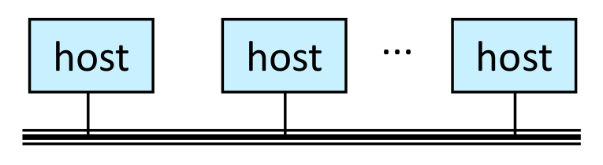

> 본 포스트는 서울대학교 컴퓨터공학부 **시스템 프로그래밍(System Programming, M1522.000800, Fall 2026)** 강의 자료 중 **16강 — *Network Programming: Computer Networks*** (총 47장, 파일 이름은 *Concepts and API*)를 바탕으로, 강의를 처음 듣는 독자도 논리적 흐름을 따라갈 수 있도록 재구성한 것입니다. 이 강의는 13–15강의 *프로세스 관리(Process Management)* 단원에 이어 새 단원 *네트워크 프로그래밍(Network Programming)*을 여는 강의입니다. 원본 슬라이드는 영문으로 작성되어 있고, 본문의 대섹션은 강의 첫머리의 개요 슬라이드(Brief introduction → The Global IP Internet → Summary)와 이를 나누는 세 장의 구분 슬라이드(*Computer Networks* · *The Global IP Internet* · *Module Summary*)를 따랐습니다. 개요 슬라이드가 *The Global IP Internet* 아래에 나열한 다섯 항목(Overview · Naming and Communication · Internet Protocol Versions 4 and v6 · Domain Name System · getaddrinfo/getnameinfo)은 슬라이드에서 별도의 구분 슬라이드 없이 이어지고 순서도 조금 다르므로(연결과 소켓 인터페이스가 DNS와 getaddrinfo 사이에 들어 있습니다), 2장의 절은 슬라이드 제목을 순서대로 따랐습니다. 슬라이드의 그림과 예제는 이 과목의 교재인 Bryant & O'Hallaron, *Computer Systems: A Programmer's Perspective* (3rd ed.) 11장의 11.1–11.4절(클라이언트-서버 모델 · 네트워크 · 전 세계 IP 인터넷 · 소켓 인터페이스)에 대응하며, 도메인 이름 나무 그림과 `hostname` · `hostinfo`의 출력에는 카네기멜론 대학교의 호스트 `whaleshark.ics.cs.cmu.edu`가 그대로 남아 있습니다. `hostinfo.c`는 슬라이드가 `…`로 생략한 첫 부분(헤더와 `MAXLINE` 정의)만 채워 그대로 컴파일되게 했고, 해당 위치에 그 사실을 밝혔습니다.

## 한 줄 요약 (TL;DR)

> **"네트워크는 상자와 선을 아래에서부터 쌓아 올린 계층이고, internet 프로토콜이 네트워크 사이의 차이를 주소와 패킷으로 덮으며, 프로그래머에게 인터넷은 IP 주소 · 도메인 이름 · 연결이라는 세 추상화와 이를 파일 디스크립터로 다루는 소켓 인터페이스로 보입니다."**
>
> 대부분의 네트워크 응용은 자원을 관리하는 서버 프로세스가 클라이언트 프로세스의 요청에 응답하는 **클라이언트-서버 모델**을 따릅니다. 네트워크는 허브(스위치)로 묶은 **이더넷 세그먼트**에서 시작해 **브리지**로 LAN이 되고, **라우터**로 서로 호환되지 않는 LAN과 WAN을 이은 **internet**이 되며, 모든 호스트와 라우터에서 도는 **프로토콜**이 통일된 주소(명명 체계)와 헤더 + 페이로드로 된 패킷(전달 메커니즘)을 제공해 데이터가 **캡슐화**된 채 네트워크를 건너게 합니다. 전 세계 IP 인터넷에서 호스트는 **네트워크 바이트 순서(빅 엔디언)**로 저장되는 32비트 **IP 주소**로 식별되고, **DNS**가 1:1이 아닌 경우까지 포함해 도메인 이름과 IP 주소의 대응을 관리하며, 두 프로세스는 **소켓 쌍**으로 유일하게 식별되는 신뢰성 있는 전이중 **TCP 연결**로 바이트 스트림을 주고받습니다. 응용 프로그램에게 소켓은 `read` · `write`로 다루는 **파일 디스크립터**이고, 소켓 주소는 16바이트짜리 `sockaddr` · `sockaddr_in` 구조체로 넘깁니다. **getaddrinfo**와 **getnameinfo**는 호스트 · 서비스 이름과 소켓 주소 구조체 사이를 재진입 가능하고 프로토콜에 독립적인 방식으로 변환하며, `hostinfo` 예제가 그 사용 패턴을 보여 줍니다.

---

## 1. 컴퓨터 네트워크 (Computer Networks)

지난 단원에서는 한 호스트 안에서 실행되는 프로세스를 다루었습니다. 이번 단원은 시야를 넓혀, **서로 다른 호스트에서 실행되는 프로세스들이 어떻게 데이터를 주고받는가**를 다룹니다. 개요 슬라이드는 이 장을 "간단한 소개(Brief introduction)"라고 부르며, 더 깊은 이해는 *컴퓨터 네트워크(Computer Networks)* 과목에 맡긴다고 밝힙니다. 그래서 이 장의 목표는 네트워크의 작동 원리를 프로그래머에게 필요한 만큼만, 즉 2장에서 소켓 인터페이스를 살펴보기 전에 갖추어야 할 그림만큼 이해하는 것입니다.

![Figure: 1장의 구분 슬라이드에 실린 그림으로, 여러 호스트를 묶어 건물 하나 규모의 네트워크를 이룬 모습입니다. 하늘색 상자 **host**(호스트)들은 선으로 노란 **hub**(허브)에 연결되고, 위쪽의 두 허브는 분홍 **bridge**(브리지) **X**에, 아래쪽의 두 허브는 브리지 **Y**에 각각 **100 Mb/s** 선으로 이어지며, X와 Y는 굵은 **1 Gb/s** 선으로 연결됩니다. 왼쪽 위 허브에 붙은 호스트 셋 가운데 맨 왼쪽이 **A**, 맨 오른쪽이 **B**이고, 오른쪽 아래 허브에 붙은 다섯 호스트 가운데 오른쪽 아래 끝이 **C**입니다. 1.4–1.5절이 이 그림의 부품을 아래에서부터 하나씩 설명하는데, 1.5절의 그림은 배치가 똑같고 허브가 스위치로, X · Y의 이름표가 bridge/switch로, 100 Mb/s가 1 Gb/s로, 브리지 사이의 1 Gb/s가 1–10 Gb/s로 바뀌었을 뿐입니다. 허브와 100 Mb/s 선으로 그린 이 그림은, 1.4절에서 보듯 허브가 스위치로 대체되기 전의 구성에 해당합니다.](./images/figure01_bridged_ethernet_hubs_divider.png)

### 1.1 클라이언트-서버 트랜잭션 (A Client-Server Transaction)

네트워크 응용 프로그램을 짜기 전에 먼저 정해야 할 것은 "누가 누구에게 무엇을 요청하는가"라는 역할 분담입니다. 슬라이드는 거의 모든 네트워크 응용이 따르는 모델 하나로 시작합니다.

* **대부분의 네트워크 응용은 클라이언트-서버 모델(client-server model)에 기반합니다.**
  * **서버 프로세스(server process)** 하나와 **클라이언트 프로세스(client process)** 하나 이상으로 이루어집니다.
  * 서버는 어떤 **자원(resource)**을 관리합니다.
  * 서버는 클라이언트를 위해 그 자원을 조작함으로써 **서비스(service)**를 제공합니다.
  * 서버는 클라이언트의 **요청(request)**이 와야 비로소 움직입니다. 슬라이드는 이것을 **자판기(vending machine)**에 비유합니다.

![Figure: 클라이언트-서버 트랜잭션의 네 단계를 나타낸 그림입니다. 연두색 타원 **Client process**(클라이언트 프로세스)와 **Server process**(서버 프로세스)가 두 개의 가로 화살표로 이어져 있습니다. 위쪽의 오른쪽 방향 화살표가 **1. Client sends request**(클라이언트가 요청을 보냄)이고, 서버는 오른쪽의 하늘색 원통 **Resource**(자원)와 양방향 화살표로 주고받으며 **2. Server handles request**(서버가 요청을 처리함)를 수행합니다. 아래쪽의 왼쪽 방향 화살표가 **3. Server sends response**(서버가 응답을 보냄)이고, 마지막으로 왼쪽의 **4. Client handles response**(클라이언트가 응답을 처리함)로 끝납니다. 아래의 회색 메모는 클라이언트와 서버가 **호스트 위에서 실행되는 프로세스**이며, 두 프로세스가 같은 호스트에 있을 수도 다른 호스트에 있을 수도 있다는 점을 덧붙입니다. 번호가 그림을 시계 방향으로 한 바퀴 도는 데서 보듯, 트랜잭션은 언제나 클라이언트의 요청으로 시작해 클라이언트의 처리로 끝납니다.](./images/figure02_client_server_transaction.png)

| 단계 | 주체 | 하는 일 |
|:---|:---|:---|
| **1. 요청 보내기** (Client sends request) | 클라이언트 | 서비스가 필요해지면 서버에 요청을 보냅니다 |
| **2. 요청 처리** (Server handles request) | 서버 | 요청을 해석하고, 자신이 관리하는 자원을 그에 맞게 조작합니다 |
| **3. 응답 보내기** (Server sends response) | 서버 | 처리 결과를 클라이언트에 돌려보내고, 다음 요청을 기다립니다 |
| **4. 응답 처리** (Client handles response) | 클라이언트 | 받은 응답으로 필요한 일을 합니다 |

* 이 네 단계의 묶음을 **클라이언트-서버 트랜잭션(client-server transaction)**이라고 부릅니다. 데이터베이스의 트랜잭션처럼 원자성 같은 성질을 보장한다는 뜻은 아니고, 클라이언트와 서버가 차례로 수행하는 단계들을 가리킬 뿐입니다.
* **자판기 비유**: 자판기는 손님이 동전을 넣고 버튼을 누르기(요청) 전에는 아무것도 하지 않고, 요청이 오면 음료를 꺼내(처리) 내어 줍니다(응답). 서버도 먼저 나서서 일을 시작하지 않고 요청에 반응할 뿐이며, 응답을 보낸 뒤에는 다시 다음 손님을 기다립니다.

::: {.callout-tip}
## 클라이언트와 서버는 기계가 아니라 프로세스입니다

그림 아래의 메모대로 클라이언트와 서버는 **호스트(host) 위에서 실행되는 프로세스**입니다. 일상에서는 "서버"라는 말로 서버 프로그램이 도는 기계를 가리키기도 하지만, 이 모델에서 클라이언트와 서버는 13강에서 다룬 바로 그 프로세스입니다. 두 프로세스는 서로 다른 호스트에 있을 수도, **같은 호스트**에 있을 수도 있으며, 어느 경우든 프로그램을 짜는 방식은 같습니다.
:::

### 1.2 네트워크 호스트의 하드웨어 구성 (Hardware Organization of an (OLD) Network Host)

클라이언트와 서버가 서로 다른 호스트에 있다면, 데이터는 호스트의 어느 부품을 거쳐 밖으로 나갈까요?

![Figure: 예전 방식 네트워크 호스트의 하드웨어 구성도입니다. 왼쪽 위 테두리 상자 **CPU chip** 안에서는 **register file**(레지스터 파일)과 **ALU**가 두 개의 굵은 화살표로 데이터를 주고받고, 레지스터 파일은 아래의 **Bus interface**(버스 인터페이스)와 이어집니다. 버스 인터페이스는 **system bus**(시스템 버스)를 통해 가운데의 **I/O bridge**(입출력 브리지)에, 입출력 브리지는 **memory bus**(메모리 버스)를 통해 오른쪽의 **main memory**(주 메모리)에 연결됩니다. 입출력 브리지 아래로는 좌우로 뻗은 긴 화살표 **I/O bus**(입출력 버스)가 있고, 여기에 **USB controller**(마우스 · 키보드), **graphics adapter**(모니터), **disk controller**(디스크)가 각각 굵은 화살표로 매달려 있습니다. 오른쪽 **Expansion slots**(확장 슬롯)에는 빈 슬롯 두 칸이 있고, 그 옆 칸에서 분홍 화살표가 내려와 분홍색 **network adapter**(네트워크 어댑터)에 닿으며, 어댑터는 그 아래의 분홍 상자 **network**(네트워크)와 양방향 화살표로 연결됩니다. 네트워크 관련 부품만 분홍색으로 강조한 이 그림이 말하려는 것은, 네트워크 어댑터가 다른 입출력 장치와 똑같이 입출력 버스에 붙은 장치이고 따라서 호스트에게 네트워크는 또 하나의 입출력 장치라는 점입니다.](./images/figure03_network_host_hardware_organization.png)

* 네트워크 어댑터는 디스크 컨트롤러나 USB 컨트롤러처럼 **입출력 버스에 붙는 장치**이며, 그림에서는 입출력 버스의 **확장 슬롯(expansion slot)**에 꽂혀 있습니다. 호스트의 입장에서 네트워크는 **데이터를 내보내고 받아들이는 또 하나의 입출력 장치**입니다.
* 네트워크에서 받은 데이터는 어댑터에서 입출력 버스와 메모리 버스를 건너 주 메모리로 복사되고(보통 CPU를 거치지 않는 DMA 전송으로), 보낼 데이터는 반대로 메모리에서 어댑터로 복사됩니다.
* 이 관점은 2.8절의 소켓으로 이어집니다. 3강에서 본 유닉스의 원칙 "모든 것은 파일이다(everything is a file)"에 따라, 네트워크라는 입출력 장치도 결국 파일 디스크립터로 다루게 됩니다.
* 제목의 **(OLD)**는 이 그림의 버스 구성이 예전 방식이라는 표시입니다. 세부 구성은 달라졌어도 "네트워크 어댑터는 입출력 장치의 하나"라는 요점은 그대로입니다.

### 1.3 네트워크의 계층 (Computer Networks)

::: {.callout-note}
## 정의 (Network, internet, Internet)

* **네트워크(network)**는 **지리적 근접성에 따라 조직된, 상자(장비)와 선(전선)의 계층적 시스템**입니다.
* **인터네트워크(internetwork)**, 줄여서 **internet**은 **서로 연결된 네트워크들의 집합**입니다.
* 대문자 "I"로 쓰는 **전 세계 IP 인터넷(the Global IP Internet)**은 소문자 "i"로 쓰는 internet 가운데 **가장 유명한 한 예**입니다.
:::

네트워크는 범위에 따라 다음처럼 나뉩니다.

| 종류 | 범위 | 예 |
|:---|:---|:---|
| **SAN** (System Area Network) | 클러스터나 기계실 | 스위치 이더넷(Switched Ethernet), 인피니밴드(Infiniband), 슈퍼컴퓨팅용 Quadrics QSW 등 |
| **LAN** (Local Area Network) | 건물 하나나 캠퍼스 | **이더넷(Ethernet)**이 가장 대표적입니다 |
| **WAN** (Wide Area Network) | 나라 하나나 전 세계 | 예를 들어 고속 광섬유 회선으로 연결된 LAN들 |

* 위에서 아래로 갈수록 범위가 넓어집니다. "계층적"이라는 말은 작은 네트워크들이 모여 더 큰 네트워크를 이룬다는 뜻이고, 1.4–1.7절이 그렇게 쌓아 올리는 과정을 따라갑니다.
* 이 글도 둘을 구별해, 일반 개념은 소문자 **internet**으로, 전 세계 IP 인터넷은 **인터넷**으로 적겠습니다.
* 슬라이드는 이제 internet을 **바닥부터(from the ground up)** 쌓아 올려 봅니다.

### 1.4 가장 낮은 층위: 이더넷 세그먼트 (Lowest Level: Ethernet Segment)


* **이더넷 세그먼트(Ethernet segment)**는 여러 **호스트**가 전선(꼬임쌍선, twisted pair)으로 **허브(hub)** 하나에 연결된 것입니다.
* 범위는 방 하나나 건물의 한 층 정도입니다.

**동작 방식**

* **각 이더넷 어댑터는 고유한 48비트 주소, 즉 MAC 주소(MAC address)를 가집니다.** 예를 들어 `00:16:ea:e3:54:e6`처럼 두 자리 16진수 여섯 묶음으로 적으며, 16진수 한 자리가 4비트이므로 길이와 주소의 가짓수는 다음과 같습니다.

$$
6\ \text{묶음} \times 2\ \text{자리} \times 4\ \text{비트} = 48\ \text{비트}, \qquad 2^{48} = 281{,}474{,}976{,}710{,}656 \approx 2.8 \times 10^{14}
$$

* **호스트는 프레임(frame)이라는 덩어리 단위로 다른 호스트에게 비트를 보냅니다.** 프레임의 앞부분인 헤더에는 보내는 쪽과 받는 쪽의 주소, 프레임 길이 같은 정보가 들어가고, 그 뒤에 실어 나르는 데이터(페이로드)가 이어집니다.
* **허브는 각 포트로 들어온 모든 비트를 다른 모든 포트로 그대로(slavishly) 복사합니다** — 즉 **방송(broadcasting)**합니다.
  * 그래서 **모든 호스트가 모든 비트를 봅니다.** 각 어댑터는 모든 프레임을 받지만, 목적지 주소가 자기 것(또는 모두에게 보내는 브로드캐스트 주소)인 프레임만 실제로 읽어 호스트에 넘깁니다.
  * **참고**: 허브(혹은 리피터, repeater)는 이제 거의 사라졌습니다. **스위치(switch)**가 허브를 대신할 만큼 싸졌기 때문이고, 그 결과 **더 이상 방송하지 않습니다**. 스위치는 목적지 호스트가 어느 포트에 있는지 학습한 뒤에는 프레임을 그 포트로만 보내므로, 다른 호스트는 대개 그 프레임을 보지 못합니다. 아직 학습하지 못한 목적지로 가는 프레임과 브로드캐스트 프레임만은 들어온 포트를 뺀 다른 모든 포트로 내보냅니다.

### 1.5 다음 층위: 브리지로 연결된 이더넷 세그먼트 (Next Level: Bridged Ethernet Segment)

![Figure: 브리지로 연결된 이더넷 세그먼트입니다. 1장 첫머리 그림과 배치가 같지만 장비와 속도가 바뀌었습니다. 하늘색 **host**들은 노란 **switch**(스위치) 네 개에 나뉘어 붙어 있고, 위의 두 스위치는 분홍 **bridge/switch** **X**에, 아래의 두 스위치는 **bridge/switch** **Y**에 각각 **1 Gb/s** 선으로 연결되며, X와 Y는 굵은 **1-10 Gb/s** 선으로 이어집니다. 호스트 **A**와 **B**는 왼쪽 위 스위치에, **C**는 오른쪽 아래 스위치에 붙어 있습니다. 스위치와 X · Y가 모두 어느 호스트가 어느 포트 쪽에 있는지를 학습해 두었다가 프레임을 필요한 포트로만 복사하므로, A에서 B로 가는 프레임은 왼쪽 위 스위치 안에서 끝나 X에 닿지 않고, A에서 C로 가는 프레임처럼 위쪽과 아래쪽 세그먼트 사이를 오가는 프레임만 X와 Y 사이의 굵은 선을 탑니다. 그 굵은 선의 속도가 가장 높게 적힌 것은 위쪽(X 쪽) 세그먼트들과 아래쪽(Y 쪽) 세그먼트들 사이를 오가는 트래픽이 모두 이 한 줄로 모이기 때문입니다.](./images/figure05_bridged_ethernet_segment_switches.png)

* 여러 세그먼트를 **브리지(bridge)**로 이으면 건물 전체나 캠퍼스 규모로 넓어집니다.
* **브리지는 어느 호스트가 어느 포트 쪽에서 닿을 수 있는지를 영리하게 학습한 뒤, 프레임을 필요한 포트로만 선택적으로 복사합니다.**

그림의 A, B, C로 따라가 보겠습니다.

| 프레임 | 지나가는 길 | X–Y 사이의 굵은 선 |
|:---|:---|:---|
| **A → B** | A와 B는 같은 왼쪽 위 스위치에 붙어 있으므로 그 스위치 안에서 전달이 끝납니다 | 타지 않습니다 |
| **A → C** | 왼쪽 위 스위치 → X → Y → 오른쪽 아래 스위치 → C. X는 이 프레임을 Y 쪽 포트로만, Y는 C가 있는 스위치 쪽 포트로만 복사합니다 | 탑니다 |

* 허브로 그린 1장 첫머리 그림에서는 A의 프레임이 허브를 통해 X에도 도착합니다. 그래도 X는 B가 그 프레임이 들어온 바로 그 포트 쪽에 있다는 것을 배워 두었으므로, 다른 포트로 복사하지 않고 버립니다.
* 이렇게 다른 세그먼트로 건너갈 필요가 없는 프레임은 그 세그먼트 밖으로 나가지 않으므로 대역폭이 절약됩니다. X와 Y 사이의 굵은 선에도 X 쪽과 Y 쪽 사이를 실제로 건너야 하는 프레임만 실립니다.
* X와 Y의 이름표가 "bridge/switch"인 것은, 오늘날에는 스위치가 브리지의 역할(포트별 학습과 선택적 복사)까지 함께 맡기 때문입니다.

### 1.6 LAN의 개념도 (Conceptual View of LANs)



* 허브 · 브리지 · 전선을 일일이 그리면 복잡해지므로, 흔히 **LAN 전체를 호스트들이 매달린 한 가닥의 선**으로 단순하게 그립니다.

### 1.7 다음 층위: internet (Next Level: internets)


* **서로 호환되지 않는(incompatible) 여러 LAN도 라우터(router)라는 특수한 컴퓨터로 물리적으로 연결할 수 있습니다.**
* 이렇게 연결된 네트워크들을 **internet**이라고 부릅니다. 군용 네트워크(military nets), 기업의 인트라넷(intranets) 등이 그 예입니다.
* 슬라이드가 그림 아래에 단 메모대로 **LAN 1과 LAN 2(그림의 왼쪽 LAN과 오른쪽 LAN)는 전혀 다른, 서로 호환되지 않는 네트워크일 수 있습니다.** 예를 들면 이더넷과 와이파이(Wifi), FDDI, T1 회선(T1-links), DSL 등입니다.
* 라우터는 자신이 연결된 네트워크마다 그 네트워크에 맞는 어댑터(포트)를 하나씩 가집니다. 그림에서 왼쪽 라우터는 왼쪽 LAN과 WAN에, 가운데 라우터는 두 WAN에, 오른쪽 라우터는 WAN과 오른쪽 LAN에 걸쳐 있습니다.

### 1.8 internet의 논리적 구조 (Logical Structure of an internet)


* **internet은 네트워크들의 임시변통(ad hoc) 상호 연결입니다.**
  * **정해진 위상(topology)이 없습니다.** 그림의 타원들도 규칙 없이 겹쳐 있습니다.
  * 라우터와 링크의 **용량이 천차만별**입니다.
* **패킷은 네트워크들을 건너뛰며(hopping) 출발지에서 목적지로 전달됩니다.**
  * 라우터가 한 네트워크에서 다른 네트워크로 가는 **다리** 역할을 합니다. 그림의 라우터 여섯 개가 모두 두 타원이 겹친 자리에 놓인 것이 이것을 나타냅니다.
  * **패킷마다 다른 경로를 탈 수 있습니다.** 그림의 위쪽 경로는 라우터 2개를, 아래쪽 경로는 라우터 4개를 거칩니다.
* 이 그림은 강의의 표지와 2장의 구분 슬라이드에도 다시 쓰입니다.

### 1.9 internet 프로토콜이라는 개념 (The Notion of an internet Protocol)

* **문제**: 서로 호환되지 않는 LAN과 WAN을 가로질러 어떻게 비트를 보낼 수 있을까요? 1.7절의 메모처럼 LAN들은 서로 호환되지 않는 네트워크일 수 있고, 그러면 호스트에 주소를 붙이는 방식도 프레임의 모양도 서로 다를 수 있습니다.
* **해법**: 모든 호스트와 라우터에서 **프로토콜 소프트웨어(protocol software)**를 실행합니다.

::: {.callout-note}
## 정의 (Protocol)

**프로토콜(protocol)**은 호스트와 라우터가 데이터를 네트워크에서 네트워크로 옮길 때 **어떻게 협력해야 하는지를 정한 규칙의 집합**입니다. 프로토콜은 서로 다른 네트워크 사이의 **차이를 매끄럽게 덮어 줍니다**.
:::

### 1.10 internet 프로토콜이 하는 일 (What Does an internet Protocol Do?)

프로토콜이 네트워크 사이의 차이를 덮는 방법은 두 가지 서비스로 요약됩니다.

| 제공하는 것 | 내용 | 덮어 주는 차이 |
|:---|:---|:---|
| **명명 체계 (naming scheme)** | 호스트 주소의 **통일된 형식**을 정하고, 각 호스트(와 라우터)에 그 형식의 internet 주소를 **적어도 하나** 부여해 유일하게 식별합니다 | LAN마다 다른 주소 형식 |
| **전달 메커니즘 (delivery mechanism)** | 데이터를 묶어 보내는 **표준 전송 단위**, 즉 **패킷(packet)**을 정합니다 | LAN마다 다른 프레임 형식 |

* 패킷은 **헤더(header)**와 **페이로드(payload)**로 이루어집니다.
  * **헤더**: 패킷 크기, 출발지 주소와 목적지 주소 같은 정보를 담습니다.
  * **페이로드**: 출발지 호스트가 보낸 데이터 비트를 담습니다.

$$
\text{패킷} = \underbrace{\text{헤더}}_{\text{크기, 출발지·목적지 주소}} + \underbrace{\text{페이로드}}_{\text{보낼 데이터}}
$$

* 헤더의 목적지 주소는 명명 체계가 정한 internet 주소이므로 두 서비스는 서로 맞물려 있습니다. 라우터는 LAN의 종류와 상관없이 헤더의 목적지 주소만 보고 패킷을 어디로 보낼지 정할 수 있습니다.
* 주소가 "적어도 하나"인 것은 1.8절 그림의 라우터처럼 여러 네트워크에 동시에 걸친 장비가 있기 때문입니다. 그런 장비는 보통 연결된 네트워크마다 주소를 하나씩 가집니다.

### 1.11 internet을 거쳐 데이터 보내기 (Transferring Data Over an internet)

이제 1.10절의 두 서비스가 실제로 어떻게 쓰이는지, LAN1의 호스트 A에서 실행되는 클라이언트가 LAN2의 호스트 B에서 실행되는 서버로 데이터를 보내는 과정으로 확인해 보겠습니다.

![Figure: 호스트 A의 클라이언트가 라우터를 거쳐 호스트 B의 서버로 데이터를 보내는 과정입니다. 왼쪽 하늘색 영역이 **LAN1**, 오른쪽 하늘색 영역이 **LAN2**이고, 가운데 아래의 분홍 영역이 두 LAN에 걸친 **Router**(라우터)입니다. 호스트 A에서는 데이터가 위에서부터 **client** → **protocol software**(프로토콜 소프트웨어) → **LAN1 adapter**로, 호스트 B에서는 **LAN2 adapter** → **protocol software** → **server**로 흐르며(슬라이드는 호스트 B 안의 두 화살표를 server에서 아래쪽으로, 즉 실제 흐름과 반대로 그렸으므로 이 부분은 화살표가 아니라 번호 (6) → (7) → (8)을 따라 읽어야 합니다), 라우터 안에는 **LAN1 adapter**와 **LAN2 adapter**, 그 사이의 **protocol software**가 있습니다. 가로 세 줄 선은 각 LAN의 전선입니다. 번호 (1)–(8)이 붙은 가로 상자가 각 단계에서 데이터의 모양으로, 노란 **data**에 노란 **PH**(internet 패킷 헤더)와 하늘색 **FH1**(LAN1 프레임 헤더) 또는 초록색 **FH2**(LAN2 프레임 헤더)가 붙어 있습니다. (2)의 위쪽 중괄호는 data와 PH를 묶어 **internet packet**(internet 패킷)이라 부르고, 아래쪽 중괄호는 셋 전체를 **LAN1 frame**(LAN1 프레임)이라 부르며, (5) 위의 중괄호는 data · PH · FH2를 **LAN2 frame**이라 부릅니다. 이 그림의 핵심은 (2)부터 (7)까지 PH는 한 번도 바뀌지 않는 반면, 프레임 헤더는 라우터 안의 (4)와 (5) 사이에서 FH1이 FH2로 바뀐다는 점입니다.](./images/figure09_transferring_data_encapsulation.png)

| 단계 | 위치 | 데이터의 모양 | 일어나는 일 |
|:---|:---|:---|:---|
| **(1)** | 호스트 A | data | 클라이언트가 시스템 호출로, 보낼 데이터를 자기 가상 주소 공간에서 커널로 넘깁니다 |
| **(2)** | 호스트 A | data + PH + FH1 | 프로토콜 소프트웨어가 데이터에 **internet 패킷 헤더(PH)**를 붙여 internet 패킷을 만들고, 다시 **LAN1 프레임 헤더(FH1)**를 붙여 LAN1 프레임을 만듭니다. PH에는 internet 호스트 B가, FH1에는 라우터가 목적지로 적힙니다 |
| **(3)** | LAN1 | data + PH + FH1 | LAN1 어댑터가 프레임을 네트워크로 내보냅니다 |
| **(4)** | 라우터 | data + PH + FH1 | 라우터의 LAN1 어댑터가 프레임을 읽어 라우터의 프로토콜 소프트웨어에 넘깁니다 |
| **(5)** | 라우터 | data + PH + FH2 | 프로토콜 소프트웨어가 PH의 목적지 주소를 보고 패킷을 LAN2로 보내기로 정한 뒤, 옛 FH1을 떼어 내고 호스트 B를 목적지로 하는 새 **LAN2 프레임 헤더(FH2)**를 붙입니다 |
| **(6)** | LAN2 | data + PH + FH2 | 라우터의 LAN2 어댑터가 프레임을 LAN2로 내보냅니다 |
| **(7)** | 호스트 B | data + PH + FH2 | 호스트 B의 LAN2 어댑터가 프레임을 읽어 프로토콜 소프트웨어에 넘깁니다 |
| **(8)** | 호스트 B | data | 프로토콜 소프트웨어가 FH2와 PH를 떼어 내고, 서버가 시스템 호출로 읽을 때 데이터를 서버에 건넵니다 |

* **캡슐화(encapsulation)**: (2)에서 보듯 LAN1 프레임의 페이로드는 internet 패킷이고, internet 패킷의 페이로드가 진짜 사용자 데이터입니다. 이렇게 한 단위를 다른 단위 안에 싸서 보내는 것이 서로 다른 네트워크를 잇는 핵심 착상입니다.
* **PH는 끝까지 그대로, FH는 LAN마다 새로**: (2)부터 (7)까지 PH는 바뀌지 않지만, 프레임 헤더는 라우터를 지나며 FH1에서 FH2로 바뀝니다. 프레임 헤더는 한 LAN 안에서 다음 장비까지만 의미가 있고, internet 패킷 헤더는 출발지에서 최종 목적지까지 의미가 있기 때문입니다. 다만 이것은 그림의 추상화 수준에서 그렇다는 뜻이고, 실제 IPv4 라우터는 출발지 · 목적지 주소는 그대로 두되 TTL과 헤더 체크섬 같은 일부 필드를 홉마다 갱신합니다.
* 라우터가 (5)에서 목적지 주소로 나갈 곳을 정할 때는 보통 **라우팅 테이블(routing table)**을 참조합니다. 이 테이블을 어떻게 만들고 유지하는지가 다음 절의 질문 가운데 하나입니다.
* 그림은 헤더를 데이터의 오른쪽에 그렸지만, 헤더는 이름 그대로 실제 전송에서 데이터 **앞에** 붙는 머리말입니다. 선 위를 지나가는 순서로 적으면 FH1, PH, data입니다.

### 1.12 남은 문제들 (Other Issues)

슬라이드는 지금까지의 설명이 몇 가지 중요한 질문을 **얼버무리고(glossing over)** 넘어갔다고 스스로 밝힙니다. 오른쪽 열은 이 질문들이 어떤 장치로 다루어지는지를 짚은 참고입니다.

| 질문 | 참고 |
|:---|:---|
| 네트워크마다 최대 프레임 크기가 다르면? (슬라이드의 표현으로는 segmentation) | 큰 패킷을 잘게 나누어 보내야 합니다. IP에서는 이를 단편화(fragmentation)라고 부릅니다 |
| 라우터는 프레임을 어디로 보낼지 어떻게 아는가? | 1.11절의 라우팅 테이블 |
| 네트워크 위상이 바뀌면 라우터는 어떻게 알게 되는가? | 라우터끼리 경로 정보를 주고받아 라우팅 테이블을 갱신합니다 |
| 패킷을 잃어버리면? | 2.1절에서 보듯 IP 자체는 신뢰성을 보장하지 않고, 그 위의 TCP가 신뢰성을 제공합니다 |

* 이런 질문들은 **컴퓨터 네트워킹(computer networking)**이라는 시스템 분야가 다룹니다. 강의는 여기서 멈추고, 프로그래머의 관점으로 넘어갑니다.

---

## 2. 전 세계 IP 인터넷 (The Global IP Internet)

2장의 구분 슬라이드는 1.8절의 internet 그림을 다시 보여 주며 시작합니다. 이제 그 일반 개념의 가장 유명한 구현체, 전 세계 IP 인터넷을 프로그래머의 눈으로 봅니다. 2.1–2.2절이 개요 슬라이드의 개관(Overview), 2.3절이 이름과 통신(Naming and Communication), 2.4절이 IPv4와 IPv6, 2.6절이 DNS, 2.9–2.11절이 getaddrinfo/getnameinfo에 해당합니다.

### 2.1 대문자 인터넷 (The Global IP Internet (upper case))

* 인터넷은 internet의 **가장 유명한 예**입니다.
* **TCP/IP 프로토콜 계열(TCP/IP protocol family)**에 기반합니다.

| 프로토콜 | 기반 | 전달하는 것 | 범위 | 신뢰성 |
|:---|:---|:---|:---|:---|
| **IP** (Internet Protocol) | — | 패킷(**데이터그램**, datagram) | **호스트에서 호스트로** (host-to-host) | 신뢰할 수 없음 (unreliable) |
| **UDP** | IP | 데이터그램 | **프로세스에서 프로세스로** (process-to-process) | 신뢰할 수 없음 |
| **TCP** (Transmission Control Protocol) | IP | **연결(connection)** 위의 **바이트 스트림(byte stream)** | 프로세스에서 프로세스로 | **신뢰할 수 있음** (reliable) |

* **IP**는 1.10절의 두 서비스, 즉 **기본적인 명명 체계**와 **신뢰할 수 없는 전달 능력**을 제공합니다. "신뢰할 수 없다"는 것은 패킷이 도중에 사라지거나 중복될 수 있고, IP가 그것을 복구하려 하지 않는다는 뜻입니다.
* **UDP**는 IP를 이용해 데이터그램을 호스트가 아닌 **프로세스**까지 전달합니다. 신뢰성이 없다는 점은 IP와 같습니다.
* **TCP**는 IP를 이용해 프로세스 사이에 **신뢰할 수 있는 바이트 스트림**을 **연결** 위에서 제공합니다. 1.12절의 "패킷을 잃어버리면?"에 대한 답이 바로 이 계층입니다.
* 프로그램은 **유닉스 파일 I/O와 소켓 인터페이스(sockets interface) 함수들을 섞어 써서** 인터넷에 접근합니다(2.8절).

::: {.callout-warning}
## UDP의 U는 "Unreliable"이 아니라 "User"입니다

슬라이드는 UDP를 *Unreliable Datagram Protocol*로 풀어 쓰지만, UDP를 정의한 표준 문서 RFC 768의 공식 이름은 ***User Datagram Protocol***입니다. 슬라이드의 풀이가 강조하려는 성질, 즉 **UDP가 전달을 보장하지 않는다**는 점 자체는 맞으므로 내용을 이해하는 데는 문제가 없습니다. 다만 다른 자료에서 UDP를 찾아볼 때는 공식 이름을 쓰는 것이 좋습니다.
:::

### 2.2 인터넷 응용의 하드웨어 · 소프트웨어 구성 (Hardware and Software Organization of an Internet Application)

![Figure: 인터넷 응용 하나가 클라이언트 호스트와 서버 호스트에서 어떤 층으로 이루어지는지 보여 주는 그림입니다. 왼쪽 하늘색 기둥이 **Internet client host**(인터넷 클라이언트 호스트), 오른쪽 기둥이 **Internet server host**(인터넷 서버 호스트)이고, 각 기둥은 위에서부터 노란 **client** 또는 **server**, 연두색 **TCP/IP**, 연두색 **Network adapter**(네트워크 어댑터)의 세 칸으로 이루어지며, 두 어댑터는 맨 아래의 분홍 띠 **Global IP Internet**(전 세계 IP 인터넷)에 양방향 화살표로 연결됩니다. 가운데 글씨는 칸의 정체를 밝혀, 맨 위 칸은 **user code**(사용자 코드), 가운데 칸은 **kernel code**(커널 코드)라고 적습니다. 빨간 점선 두 줄은 칸 사이의 경계로, 위의 점선은 **sockets interface (system calls)**(소켓 인터페이스, 곧 시스템 호출), 아래의 점선은 **hardware interface (interrupts)**(하드웨어 인터페이스, 곧 인터럽트)입니다. 응용 프로그램이 직접 다루는 것은 맨 위의 경계인 소켓 인터페이스뿐이고, 프로토콜과 하드웨어는 그 아래에서 커널이 맡는다는 것이 이 그림의 요점입니다.](./images/figure10_internet_application_hw_sw_organization.png)

* 클라이언트와 서버는 **사용자 코드**로, TCP/IP 프로토콜은 **커널 코드**로 실행됩니다.
* 사용자 코드와 커널 코드 사이의 경계는 **소켓 인터페이스**이고, 그 정체는 **시스템 호출(system call)**입니다. 14강에서 본 대로 시스템 호출은 의도적인 예외인 트랩(trap)으로 구현되며, 사용자 코드가 커널에 일을 맡기는 통로입니다.
* 커널 코드와 네트워크 어댑터 사이의 경계는 **하드웨어 인터페이스**이고, 그 정체는 **인터럽트(interrupt)**입니다. 어댑터가 프레임을 받으면 인터럽트로 CPU에 알리고, 커널의 TCP/IP 코드가 그것을 처리합니다. 14강에서 입출력 장치가 일으키는 비동기 예외로 다룬 바로 그 인터럽트입니다.
* 그래서 클라이언트가 보낸 데이터는 사용자 코드 → (시스템 호출) → 커널의 TCP/IP → 어댑터 → 인터넷 → 어댑터 → (인터럽트) → 커널의 TCP/IP → (시스템 호출) → 서버 순서로 흐릅니다. 1.11절의 (1)과 (8)이 시스템 호출 경계를 건너는 단계입니다.

### 2.3 프로그래머가 보는 인터넷 (A Programmer's View of the Internet)

프로그래머에게 인터넷은 다음 세 문장으로 요약됩니다.

1. **호스트는 32비트 IP 주소(IP address)들의 집합에 대응됩니다.** 예: `147.46.10.129`
2. **IP 주소들의 집합은 인터넷 도메인 이름(Internet domain name)이라는 식별자들의 집합에 대응됩니다.** 예: `147.46.10.129`는 `www.snu.ac.kr`에 대응됩니다.
3. **한 인터넷 호스트의 프로세스는 연결(connection)을 통해 다른 인터넷 호스트의 프로세스와 통신할 수 있습니다.**

| 추상화 | 개요 슬라이드의 분류 | 다루는 절 |
|:---|:---|:---|
| ① IP 주소 | 이름 (Naming) | 2.5절 |
| ② 도메인 이름 | 이름 (Naming) | 2.6절 |
| ③ 연결 | 통신 (Communication) | 2.7–2.8절 |

* 이 세 문장이 개요 슬라이드의 "이름과 통신(Naming and Communication)"입니다. 뒤의 슬라이드 제목에 붙은 (1) · (2) · (3)은 이 번호를 그대로 이어받습니다.
* 사람은 `www.snu.ac.kr` 같은 이름을 기억하고, 기계는 `147.46.10.129` 같은 주소로 패킷을 보냅니다. 두 층을 잇는 것이 2.6절의 DNS이고, 그 위에서 두 프로세스를 잇는 것이 2.7절의 연결입니다.

### 2.4 IPv4와 IPv6 (Aside: IPv4 and IPv6)

* 32비트 주소를 쓰는 원래의 인터넷 프로토콜을 **IPv4**(Internet Protocol Version 4)라고 부릅니다.
* 1996년, **IETF**(Internet Engineering Task Force)가 **128비트 주소**를 쓰는 **IPv6**(Internet Protocol Version 6)를 내놓았습니다. IPv4의 **후계자**로 의도된 것입니다.
* 그러나 2025년 현재에도 인터넷 트래픽은 여전히 IPv4로 실려 다니며, 2025년 4월 기준으로 Google 서비스에 IPv6로 접속하는 사용자는 약 48%입니다.
* 이 강의는 **IPv4에 집중**하되, **프로토콜에 독립적인(protocol-independent)** 네트워크 코드를 쓰는 법을 보여 줍니다. 그 도구가 2.9절의 getaddrinfo입니다.

주소 길이가 네 배로 늘면 주소의 가짓수는 다음처럼 달라집니다.

$$
\begin{aligned}
\text{IPv4}: \quad 2^{32} &= 4{,}294{,}967{,}296 \approx 4.3 \times 10^{9} \\
\text{IPv6}: \quad 2^{128} &= 2^{96} \times 2^{32} \approx (7.9 \times 10^{28}) \times 2^{32} \approx 3.4 \times 10^{38}
\end{aligned}
$$

* IPv4의 주소는 약 43억 개로, 인터넷에 연결되는 기기의 수에 비하면 넉넉하지 않습니다. IPv6는 그 $2^{96} \approx 7.9 \times 10^{28}$배의 주소를 제공합니다.

### 2.5 IP 주소 ((1) IP Addresses)

* 32비트 IP 주소는 **IP 주소 구조체(IP address struct)**에 저장됩니다.

```c
/* Internet address structure */
struct in_addr {
    uint32_t  s_addr; /* network byte order (big-endian) */
};
```

* **IP 주소는 메모리에 언제나 네트워크 바이트 순서(network byte order), 즉 빅 엔디언(big-endian) 바이트 순서로 저장됩니다.**
* 이 규칙은 IP 주소에만 해당하지 않습니다. **패킷 헤더에 담겨 한 기계에서 다른 기계로 전달되는 모든 정수**에 일반적으로 적용됩니다. 예를 들어 인터넷 연결을 식별하는 데 쓰는 **포트 번호**(2.7절)도 그렇습니다.

왜 이런 규칙이 필요한지는 바이트 순서가 다른 기계를 떠올리면 분명해집니다. 2.5.1절의 주소 `128.2.194.242`, 즉 $\mathtt{0x8002C2F2}$를 담은 `struct in_addr`의 네 바이트는 메모리에 다음 순서로 놓입니다.

| 메모리 주소 | `a` | `a+1` | `a+2` | `a+3` |
|:---|:---|:---|:---|:---|
| 바이트 | `0x80` | `0x02` | `0xC2` | `0xF2` |

* 가장 큰 자리의 바이트(`0x80`)가 가장 낮은 주소에 오는 것이 빅 엔디언입니다.
* 그런데 x86-64처럼 **리틀 엔디언(little-endian)**인 기계에서 이 `s_addr`을 그냥 `uint32_t`로 읽으면, 가장 낮은 주소의 바이트를 가장 작은 자리로 해석하므로

$$
\mathtt{0x80} + \mathtt{0x02} \cdot 2^{8} + \mathtt{0xC2} \cdot 2^{16} + \mathtt{0xF2} \cdot 2^{24} = \mathtt{0xF2C20280}
$$

  이 되어 원래 값 $\mathtt{0x8002C2F2}$와 전혀 다른 수가 됩니다. 기계마다 다른 해석을 막으려면 선 위를 오가는 정수의 바이트 순서를 하나로 정해 두어야 하고, 그 약속이 네트워크 바이트 순서입니다. 슬라이드에는 나오지 않지만 유닉스는 이 변환을 위해 `htonl` · `htons`(호스트 → 네트워크, 32비트 · 16비트)와 그 역인 `ntohl` · `ntohs`를 제공하며, 리틀 엔디언 기계에서는 이 함수들이 바이트를 뒤집습니다.

#### 2.5.1 점으로 구분한 십진 표기 (Dotted Decimal Notation)

* 관례상 32비트 IP 주소의 **각 바이트를 십진수로 적고 마침표(.)로 구분**합니다. 슬라이드는 각 바이트와 그에 대응하는 십진수를 같은 계열의 색으로 칠해 짝을 보여 줍니다.

| | 첫째 바이트 | 둘째 바이트 | 셋째 바이트 | 넷째 바이트 |
|:---|:---|:---|:---|:---|
| 16진수 | `80` | `02` | `C2` | `F2` |
| 십진수 | 128 | 2 | 194 | 242 |

$$
\begin{aligned}
\mathtt{0x8002C2F2} &= 128 \cdot 2^{24} + 2 \cdot 2^{16} + 194 \cdot 2^{8} + 242 = 2{,}147{,}664{,}626 \\
&\longrightarrow\quad 128.2.194.242 \quad (\text{점으로 구분한 십진 표기})
\end{aligned}
$$

* 바이트마다 0–255 사이의 수 하나가 되므로, 점으로 구분한 각 자리는 255를 넘지 않습니다.
* 슬라이드는 IP 주소와 이 표기 사이의 변환에 뒤에서 설명할 **getaddrinfo**와 **getnameinfo**를 쓰라고 합니다(2.9–2.10절).

### 2.6 인터넷 도메인 이름 ((2) Internet Domain Names)

`128.2.210.175` 같은 숫자는 사람이 기억하기 어렵습니다. 그래서 인터넷은 주소와 별도로, 사람이 읽기 쉬운 **도메인 이름(domain name)**의 체계를 둡니다.

![Figure: 인터넷 도메인 이름 계층의 일부를 나무로 그린 그림입니다. 맨 위 **unnamed root**(이름 없는 뿌리) 아래로 **.net**, **.edu**, **.gov**, **.com**이 이어지는데, 오른쪽 빨간 글씨대로 이 줄이 **First-level domain names**(1단계 도메인 이름)입니다. 그 아래 줄인 **Second-level domain names**(2단계)에는 .edu 아래의 **mit**, **cmu**, **berkeley**와 .com 아래의 **amazon**이, **Third-level domain names**(3단계)에는 cmu 아래의 **cs**, **ece**와 amazon 아래의 **www**가 있습니다. cs 아래로는 **ics**와 **pdl**이, 다시 그 아래로 **whaleshark**와 **www**가 이어집니다. 말단 이름 아래의 숫자는 그 이름에 대응하는 IP 주소로, www.amazon.com은 176.32.98.166, whaleshark.ics.cs.cmu.edu는 128.2.210.175, www.pdl.cs.cmu.edu는 128.2.131.66입니다. 도메인 이름을 오른쪽에서 왼쪽으로 읽으면 이 나무를 뿌리에서 아래로 내려가는 경로가 된다는 것이 이 그림의 요점입니다.](./images/figure11_domain_name_hierarchy.png)

* 도메인 이름은 **계층 구조**를 이루며, 이름을 **오른쪽에서 왼쪽으로** 읽으면 나무를 뿌리에서 아래로 내려가는 경로가 됩니다. 예를 들어 `whaleshark.ics.cs.cmu.edu`는 edu → cmu → cs → ics → whaleshark입니다.
* 그림에서 IP 주소가 함께 적힌 이름 세 개를 정리하면 다음과 같습니다.

| 도메인 이름 | IP 주소 | 깊이 |
|:---|:---|:---|
| `www.amazon.com` | 176.32.98.166 | 3단계 |
| `whaleshark.ics.cs.cmu.edu` | 128.2.210.175 | 5단계 |
| `www.pdl.cs.cmu.edu` | 128.2.131.66 | 5단계 |

* 같은 `www`라도 `www.amazon.com`과 `www.pdl.cs.cmu.edu`는 서로 다른 가지에 있으므로 다른 이름입니다. 이름이 겹치지 않으려면 같은 부모 아래에서만 서로 다르면 되고, 그래서 각 기관이 자기 가지 아래의 이름을 독립적으로 붙일 수 있습니다.

#### 2.6.1 도메인 이름 시스템 (Domain Name System, DNS)

* 인터넷은 IP 주소와 도메인 이름 사이의 **대응(mapping)**을 **DNS**라는 거대한 **전 세계적 분산 데이터베이스(distributed database)**에 유지합니다.
* 개념적으로 프로그래머는 DNS 데이터베이스를 수백만 개의 **호스트 항목(host entry)**의 모음으로 볼 수 있습니다.
  * 각 호스트 항목은 **도메인 이름들의 집합과 IP 주소들의 집합 사이의 대응**을 정의합니다.
  * 수학적으로 말하면, 호스트 항목은 도메인 이름과 IP 주소들의 **동치류(equivalence class)**입니다.

"동치류"라는 표현을 풀어 보면 이렇습니다. 도메인 이름과 IP 주소를 모두 모은 집합에서 "두 원소가 같은 호스트 항목에 속한다"는 관계 $\sim$를 생각합시다. 이 관계는 **반사적**(모든 원소는 자기 자신과 같은 항목에 속함)이고, **대칭적**($x \sim y$이면 $y \sim x$)이며, **추이적**($x \sim y$이고 $y \sim z$이면 $x \sim z$)이므로 동치 관계이고, 그 동치류 하나하나가 호스트 항목입니다. 같은 동치류에 든 이름과 주소는 모두 같은 호스트를 가리키는 서로 다른 표현이라는 뜻이며, 다음 절의 예들은 이 동치류의 크기와 모양이 제각각이라는 것을 보여 줍니다.

#### 2.6.2 DNS 대응의 성질 (Properties of DNS Mappings)

DNS 대응의 성질은 **`dig`** 프로그램으로 살펴볼 수 있습니다. 슬라이드의 출력은 간결하게 다듬은 것입니다(Output edited for brevity). `dig`의 답변 한 줄은 다섯 칸으로 읽습니다.

| 칸 | 예: `localhost. 1200 IN A 127.0.0.1` | 뜻 |
|:---|:---|:---|
| 이름 | `localhost.` | 레코드가 붙은 도메인 이름(소유자 이름). 보통은 조회한 이름이지만, 별칭을 따라간 답에서는 정식 이름이 옵니다. 끝의 점은 이름 없는 뿌리를 뜻합니다 |
| TTL | `1200` | 이 답을 캐시에 보관해도 되는 시간(초) |
| 클래스 | `IN` | 인터넷(Internet) 클래스 |
| 유형 | `A` | 레코드 종류. `A`는 IPv4 주소, `CNAME`은 정식 이름(canonical name) |
| 값 | `127.0.0.1` | 레코드의 내용 |

**localhost와 hostname**

```text
linux> dig localhost
localhost. 1200    IN      A       127.0.0.1
```

* 모든 호스트에는 로컬로 정의된 도메인 이름 **`localhost`**가 있고, 이 이름은 언제나 **루프백 주소(loopback address)** `127.0.0.1`에 대응됩니다. 루프백 주소로 보낸 데이터는 네트워크로 나가지 않고 같은 호스트 안으로 되돌아오므로, 1.1절의 메모처럼 클라이언트와 서버가 같은 호스트에 있을 때 쓸 수 있습니다.

```text
linux> hostname
whaleshark.ics.cs.cmu.edu
```

* 로컬 호스트의 **실제 도메인 이름**은 **`hostname`**으로 알 수 있습니다. 슬라이드의 예제를 실행한 호스트는 2.6절 그림의 말단에 있던 바로 그 `whaleshark.ics.cs.cmu.edu`입니다.

**이름과 주소의 대응 방식**

슬라이드의 나머지 예들을 대응의 모양으로 분류하면 다음과 같습니다.

| 경우 | 예 | 호스트 항목(동치류)의 모양 |
|:---|:---|:---|
| **1:1** — 이름 하나와 주소 하나 | `cse.snu.ac.kr` → 147.46.92.174 | 이름 1개, 주소 1개 |
| **n:1** — 여러 이름이 같은 주소로 | `cs.mit.edu`, `eecs.mit.edu` → 18.25.0.23 | 이름 2개, 주소 1개 |
| **n:m** — 여러 이름이 여러 주소로 | `www.twitter.com`, `twitter.com` → 104.244.42.1 · .65 · .129 · .193 | 이름 2개, 주소 4개 |
| **주소 없음** — 유효한 이름이지만 주소가 없음 | `ics.cs.cmu.edu` | 이름 1개, 주소 0개 |

가장 단순한 경우는 도메인 이름과 IP 주소가 1:1로 대응하는 것입니다.

```text
linux> dig cse.snu.ac.kr
cse.snu.ac.kr. 20941   IN      A       147.46.92.174
```

여러 도메인 이름이 같은 IP 주소에 대응할 수도 있습니다.

```text
linux> dig cs.mit.edu
cs.mit.edu.  1728    IN      CNAME   eecs.mit.edu.
linux> dig eecs.mit.edu
eecs.mit.edu. 1792    IN      A       18.25.0.23
```

* **CNAME**은 **정식 이름(canonical name)**입니다. `cs.mit.edu`는 `eecs.mit.edu`의 **별칭(alias)**이므로, 첫 조회의 답에 실린 레코드는 주소가 아니라 "이 이름의 정식 이름은 `eecs.mit.edu.`"라는 CNAME 레코드이고, 주소 `18.25.0.23`은 그 정식 이름의 A 레코드입니다. 실제 `dig` 출력에서는 DNS 서버가 CNAME을 따라가 이 A 레코드까지 한 번에 돌려주지만, 슬라이드는 출력을 줄이면서 두 조회로 나누어 보였습니다.

여러 도메인 이름이 여러 IP 주소에 대응할 수도 있습니다.

```text
linux> dig www.twitter.com
twitter.com.   1289    IN      A       104.244.42.1
twitter.com.   1289    IN      A       104.244.42.129
twitter.com.   1289    IN      A       104.244.42.65
twitter.com.   1289    IN      A       104.244.42.193
linux> dig twitter.com
twitter.com.   1208    IN      A       104.244.42.1
twitter.com.   1208    IN      A       104.244.42.193
twitter.com.   1208    IN      A       104.244.42.129
twitter.com.   1208    IN      A       104.244.42.65
```

* `www.twitter.com`을 물었는데 답의 이름 칸이 `twitter.com.`인 것은 `www.twitter.com`이 `twitter.com`의 별칭이기 때문이며, 슬라이드는 그 사이의 CNAME 줄을 생략했습니다.
* 두 이름 모두 같은 네 주소에 대응하지만, 두 조회에서 **네 주소의 순서가 다릅니다**. DNS 서버는 같은 레코드들의 순서를 조회마다 돌리거나 섞어서 내놓는 경우가 많고(라운드 로빈 DNS, round-robin DNS), 클라이언트는 보통 앞의 주소부터 시도하므로 요청이 여러 서버로 나뉩니다.

유효한 도메인 이름인데 어떤 IP 주소에도 대응하지 않는 경우도 있습니다.

```text
linux> dig ics.cs.cmu.edu
*** Can't find ics.cs.cmu.edu: No answer
```

* `ics.cs.cmu.edu`는 2.6절 그림에서 `whaleshark`의 부모로 등장하는 이름입니다. 도메인 계층의 중간 마디는 그 아래 이름들을 묶는 이름일 뿐, 반드시 어떤 호스트를 가리키지는 않습니다.
* 참고로 이 오류 문구는 `nslookup`의 출력 형식이고, `dig`로 같은 이름을 조회하면 오류 문구 대신 답변 레코드가 0개인(`ANSWER: 0`) 응답이 돌아옵니다. 어느 쪽이든 이 이름에는 주소가 없다는 뜻입니다.
* 이 출력들은 슬라이드를 만들 때의 결과입니다. DNS의 대응은 고정된 것이 아니어서, 지금 같은 명령을 실행하면 TTL은 물론 주소가 달라져 있을 수 있습니다.

::: {.callout-important}
## 이름과 주소는 1:1이 아닙니다

하나의 도메인 이름이 주소 여러 개에, 여러 이름이 주소 하나에 대응할 수 있고, 주소가 하나도 없는 이름도 있습니다. 그래서 2.9절의 getaddrinfo는 주소 하나가 아니라 **주소들의 목록(연결 리스트)**을 돌려주고, 클라이언트는 그 목록의 주소를 차례로 시도합니다.
:::

### 2.7 인터넷 연결 ((3) Internet Connections)

* 클라이언트와 서버는 **(TCP) 연결(connection)** 위로 **바이트 스트림(stream of bytes)**을 주고받으며 통신합니다. 각 연결은 다음 성질을 가집니다.

| 성질 | 뜻 |
|:---|:---|
| **점대점(point-to-point)** | 한 쌍의 프로세스를 잇습니다 |
| **전이중(full-duplex)** | 데이터가 **양방향으로 동시에** 흐를 수 있습니다 |
| **신뢰성(reliable)** | 출발지가 보낸 바이트 스트림은 결국 목적지에 **보낸 순서 그대로** 도착합니다 |

::: {.callout-note}
## 정의 (Socket, Socket address, Port)

* **소켓(socket)**은 **연결의 끝점(endpoint)**입니다.
* **소켓 주소(socket address)**는 **`IP주소:포트`** 쌍(`IPaddress:port`)입니다.
* **포트(port)**는 **프로세스를 식별하는 16비트 정수**입니다.
:::

* 16비트이므로 포트 번호는 $0$부터 $2^{16} - 1 = 65535$까지입니다.
* IP 주소가 호스트를 가리킨다면, 포트는 그 호스트 안에서 연결의 끝에 있는 프로세스를 가리킵니다. 그래서 소켓 주소 하나가 "어느 호스트의 어느 프로세스"를 한 번에 지정합니다.

| 포트의 종류 | 정해지는 방식 | 예 |
|:---|:---|:---|
| **임시 포트(ephemeral port)** | 클라이언트가 연결을 요청할 때 **클라이언트 쪽 커널이 자동으로** 배정합니다 | 2.7.2절 그림의 51213 |
| **잘 알려진 포트(well-known port)** | 서버가 제공하는 어떤 **서비스**에 결부되어 있습니다 | 웹 서버의 80 |

#### 2.7.1 잘 알려진 포트와 서비스 이름 (Well-known Ports and Service Names)

* 널리 쓰이는 서비스에는 **잘 알려진 포트**가 영구히 배정되어 있고, 그에 대응하는 **잘 알려진 서비스 이름(well-known service name)**이 있습니다.

| 서버 | 포트/서비스 이름 |
|:---|:---|
| echo 서버 | `7/echo` |
| ssh 서버 | `22/ssh` |
| 이메일 서버 | `25/smtp` |
| 웹 서버 | `80/http` |

* 잘 알려진 포트와 서비스 이름 사이의 대응은 각 리눅스 기계의 **`/etc/services`** 파일에 들어 있습니다. 2.9절의 getaddrinfo가 `service` 인자로 포트 번호뿐 아니라 `http` 같은 서비스 이름도 받을 수 있는 것은 이런 대응표가 있기 때문입니다.

#### 2.7.2 연결의 해부 (Anatomy of a Connection)

연결은 양 끝점의 소켓 주소 쌍, 즉 **소켓 쌍(socket pair)**으로 **유일하게 식별됩니다**.

$$
(\,\text{cliaddr:cliport},\ \ \text{servaddr:servport}\,)
$$

![Figure: 클라이언트와 웹 서버 사이의 연결 하나를 해부한 그림입니다. 왼쪽 회색 상자는 클라이언트 호스트로 연두색 타원 **Client**를 담고, 오른쪽 회색 상자는 서버 호스트로 연두색 타원 **Server (port 80)**을 담습니다. 두 타원의 가장자리에 붙은 검은 점이 각 쪽의 소켓, 즉 연결의 끝점이고, 그 사이의 굵은 양방향 화살표가 연결입니다. 위의 글씨는 각 소켓의 주소로, **Client socket address**는 128.2.194.242:51213, **Server socket address**는 208.216.181.15:80이며, 화살표 아래의 **Connection socket pair**(연결 소켓 쌍)는 이 둘을 묶은 (128.2.194.242:51213, 208.216.181.15:80)입니다. 아래의 **Client host address**와 **Server host address**는 각 호스트의 IP 주소입니다. 색은 같은 값을 짝지어 주어, 빨강은 클라이언트 호스트 주소, 초록은 클라이언트 포트, 금색은 서버 호스트 주소, 보라는 서버 포트입니다. 맨 아래 메모대로 **51213**은 커널이 배정한 임시 포트이고 **80**은 웹 서버에 결부된 잘 알려진 포트입니다.](./images/figure12_anatomy_of_connection_socket_pair.png)

* 서버 쪽 소켓 주소 `208.216.181.15:80`은 이 웹 서버에 연결하는 모든 클라이언트에게 같습니다. 그래도 연결들이 서로 구별되는 것은 클라이언트 쪽 절반(호스트 주소와 커널이 배정한 임시 포트)이 연결마다 다르기 때문입니다. 같은 클라이언트 호스트에서 두 번째 연결을 열면 커널이 다른 임시 포트를 배정하므로, 소켓 쌍이 달라집니다.

#### 2.7.3 포트로 서비스 구별하기 (Using Ports to Identify Services)


* 한 서버 호스트에서 여러 서버 프로세스가 동시에 서비스할 수 있습니다. 같은 IP 주소로 들어온 요청을 **포트 번호로 구별해** 해당 서버 프로세스에 넘기는 것은 **커널**입니다.
* 2.7.2절 그림에서 클라이언트 호스트의 주소였던 `128.2.194.242`가 여기서는 서버 호스트의 주소로 쓰였는데, 두 그림은 서로 독립된 예일 뿐입니다.

### 2.8 소켓 인터페이스 (Sockets Interface)

* **소켓 인터페이스(sockets interface)**는 **유닉스 I/O와 함께 쓰여 네트워크 응용을 만드는 시스템 수준 함수들의 집합**입니다.
* 1980년대 초, 초기 버전의 인터넷 프로토콜을 담은 **버클리 유닉스 배포판(Berkeley distribution of Unix)**의 일부로 만들어졌습니다.
* 지금은 모든 현대 시스템에서 쓸 수 있습니다. 슬라이드는 유닉스 계열, Windows, OS X, iOS, Android, ARM을 꼽습니다.

#### 2.8.1 소켓 (Sockets)

* 소켓이란 무엇일까요?
  * **커널에게** 소켓은 **통신의 끝점(endpoint of communication)**입니다.
  * **응용 프로그램에게** 소켓은 네트워크에서 읽고 네트워크로 쓸 수 있게 해 주는 **파일 디스크립터**입니다.
  * **기억하세요**: 네트워크를 포함한 모든 유닉스 I/O 장치는 **파일로 모델링됩니다**. 3강에서 "모든 것은 파일이다"를 정리할 때 그 목록에 네트워크 소켓이 이미 들어 있었습니다.
* 클라이언트와 서버는 **소켓 디스크립터(socket descriptor)를 읽고 쓰는 것으로** 서로 통신합니다.


* 일반 파일 I/O와 소켓 I/O의 **주된 차이는 응용 프로그램이 디스크립터를 "여는" 방법**에 있습니다. 일반 파일은 `open` 한 번으로 디스크립터를 얻지만, 소켓 디스크립터는 2.8.3절의 흐름처럼 `socket` · `bind` · `listen` · `accept`나 `socket` · `connect` 같은 소켓 함수들로 얻습니다. 일단 얻고 나면 `read`와 `write`로 다루는 것은 같습니다.
* 2.1절에서 프로그램이 "유닉스 파일 I/O와 소켓 인터페이스 함수들을 섞어 써서" 인터넷에 접근한다고 한 것이 바로 이 구조입니다. 4강에서 표준 I/O는 네트워크 소켓의 입출력에 적합하지 않다고 정리했던 것도, 소켓 위의 입출력에는 유닉스 I/O를 쓴다는 이 맥락과 이어집니다.

#### 2.8.2 소켓 주소 구조체 (Socket Address Structures)

**범용 소켓 주소 (generic socket address)**

```c
struct sockaddr {
  uint16_t  sa_family;    /* Protocol family */
  char      sa_data[14];  /* Address data.  */
};
```

* **`connect`, `bind`, `accept`의 주소 인자**에 쓰입니다.
* 이 구조체가 필요한 것은 오로지 **소켓 인터페이스가 설계될 당시 C에 범용 포인터(`void *`)가 없었기 때문**입니다. 그래서 여러 종류의 주소 구조체를 받아야 하는 함수들이 공통으로 `struct sockaddr *`를 받도록 정해졌습니다.
* 형 변환을 편하게 하려고 **Stevens 관례(Stevens convention)**를 따라 `typedef struct sockaddr SA;`로 줄여 씁니다. *UNIX Network Programming*의 저자 W. Richard Stevens의 이름을 딴 관례입니다.


**인터넷용 소켓 주소 (Internet-specific socket address)**

```c
struct sockaddr_in  {
  uint16_t        sin_family;  /* Protocol family (always AF_INET) */
  uint16_t        sin_port;    /* Port num in network byte order */
  struct in_addr  sin_addr;    /* IP addr in network byte order */
  unsigned char   sin_zero[8]; /* Pad to sizeof(struct sockaddr) */
};
```

* 소켓 주소 인자를 받는 함수에 넘길 때는 **`(struct sockaddr_in *)`를 `(struct sockaddr *)`로 형 변환해야** 합니다.
* `sin_family`에는 IPv4 주소 계열을 뜻하는 `AF_INET`이 들어가고, `sin_port`와 `sin_addr`는 2.5절의 규칙대로 **네트워크 바이트 순서**로 저장됩니다.

![Figure: 인터넷용 소켓 주소 구조체 struct sockaddr_in의 메모리 배치로, 앞 그림과 같은 16바이트 칸 위에 필드를 겹쳐 그린 것입니다. 맨 앞의 분홍 두 칸은 **AF_INET** 값이 들어가는 주소 계열 필드로, 아래 이름표대로 범용 구조체에서는 **sa_family**, 인터넷용 구조체에서는 **sin_family**라고 부르는 같은 자리입니다. 그 뒤로 하늘색 두 칸이 **sin_port**(포트 번호), 연두색 네 칸이 **sin_addr**(IP 주소)이고, 마지막 흰 칸 여덟 개는 0으로 채운 **sin_zero**입니다. 중괄호 **Family Specific**은 앞 그림과 똑같이 뒤쪽 14바이트를 가리키므로, 포트 2바이트와 주소 4바이트, 채움 8바이트가 범용 구조체의 sa_data 14바이트 자리를 정확히 채운다는 것을 알 수 있습니다. 두 구조체의 크기와 첫 필드의 자리가 같기 때문에 sockaddr_in의 포인터를 sockaddr의 포인터로 형 변환해 넘길 수 있습니다.](./images/figure16_sockaddr_in_layout.png)

두 구조체의 크기를 필드별로 더해 보면 이 설계가 분명해집니다.

$$
\begin{aligned}
\texttt{sizeof(struct sockaddr)} &= \underbrace{2}_{\mathtt{sa\_family}} + \underbrace{14}_{\mathtt{sa\_data}} = 16 \\
\texttt{sizeof(struct sockaddr\_in)} &= \underbrace{2}_{\mathtt{sin\_family}} + \underbrace{2}_{\mathtt{sin\_port}} + \underbrace{4}_{\mathtt{sin\_addr}} + \underbrace{8}_{\mathtt{sin\_zero}} = 16
\end{aligned}
$$

* `sin_zero[8]`은 오로지 크기를 `struct sockaddr`과 맞추기 위한 채움 바이트입니다. $16 - (2 + 2 + 4) = 8$이기 때문입니다.
* 두 구조체가 첫 2바이트에 주소 계열을 둔다는 약속 덕분에, `struct sockaddr *`를 받은 함수는 먼저 `sa_family`를 보고 나머지 바이트를 어떤 구조체로 해석할지 정할 수 있습니다. 구조체의 실제 크기는 주소 길이 인자(getaddrinfo가 주는 `ai_addrlen` 등)로 함께 넘기므로, IPv6용 `sockaddr_in6`(28바이트)처럼 16바이트보다 큰 구조체도 같은 방식으로 넘길 수 있습니다. 첫 필드를 공통의 꼬리표로 삼는 이 방식은, 범용 포인터가 없던 C에서 여러 형을 한 인터페이스로 받기 위한 관용구입니다.

#### 2.8.3 소켓 인터페이스의 흐름 (Sockets Interface)

이제 클라이언트와 서버가 소켓 함수들을 어떤 순서로 부르는지 한 장의 지도로 봅니다.

![Figure: 소켓 인터페이스로 짠 클라이언트와 서버가 함수를 부르는 순서를 다섯 단계로 나누어 보여 주는 흐름도입니다. 연두색 상자가 함수 호출이고, 실선 화살표는 실행 순서와 세션 안에서 오가는 데이터(한쪽의 write → 상대의 read)를, 점선 화살표는 연결 요청(connect → accept)과 연결의 끝을 알리는 EOF(close → read)를 나타냅니다. 왼쪽 열이 **Client**, 오른쪽 열이 **Server**입니다. 회색 둥근 상자가 단계를 묶는데, **1. Start server**(서버 시작)는 서버의 **getaddrinfo → socket → bind → listen → accept**를, **2. Start client**(클라이언트 시작)는 클라이언트의 **getaddrinfo → socket → connect**를 묶으며, connect에서 accept로 가는 점선이 **Connection request**(연결 요청)입니다. **3. Exchange data**(데이터 교환)의 분홍 상자 **Client / Server Session**(클라이언트/서버 세션) 안에서는 클라이언트의 **write**가 서버의 **read**로, 서버의 **write**가 클라이언트의 **read**로 이어지고, 양쪽 바깥으로 되돌아가는 화살표가 이 주고받기의 반복을 나타냅니다. **4. Disconnect client**(클라이언트 연결 끊기)에서 클라이언트가 **close**를 부르면 점선 **EOF**가 서버의 **read**에 닿고, **5. Drop client**(클라이언트 내보내기)에서 서버는 **close**를 부른 뒤 오른쪽의 긴 화살표를 따라 **accept**로 돌아가 다음 클라이언트의 연결 요청을 기다립니다(**Await connection request from next client**). 단계 번호가 서버부터 매겨진 것은 서버가 먼저 listen까지 마쳐 연결 요청을 받을 수 있는 상태여야 클라이언트의 connect가 성공하기 때문입니다.](./images/figure17_sockets_interface_stages.png)

| 단계 | 쪽 | 호출 | 하는 일 |
|:---|:---|:---|:---|
| **1. 서버 시작** (Start server) | 서버 | `getaddrinfo` → `socket` → `bind` → `listen` → `accept` | 자기 소켓 주소를 준비하고, 소켓을 만들어 그 주소에 묶은(bind) 뒤 연결 요청을 받을 수 있는 상태로 만들고(listen), `accept`에서 요청을 기다립니다 |
| **2. 클라이언트 시작** (Start client) | 클라이언트 | `getaddrinfo` → `socket` → `connect` | 서버의 소켓 주소를 얻고 소켓을 만든 뒤, `connect`로 연결을 요청합니다 |
| **3. 데이터 교환** (Exchange data) | 양쪽 | `write` ⇄ `read` | 클라이언트가 쓰면 서버가 읽고, 서버가 쓰면 클라이언트가 읽기를 되풀이합니다 |
| **4. 클라이언트 연결 끊기** (Disconnect client) | 클라이언트 | `close` | 클라이언트가 연결을 닫으면 서버 쪽 `read`가 **EOF**를 받습니다 |
| **5. 클라이언트 내보내기** (Drop client) | 서버 | `read`(EOF) → `close` → `accept` | 서버는 EOF를 보고 이 연결을 닫은 뒤, 다음 클라이언트의 연결 요청을 기다리러 `accept`로 돌아갑니다 |

* 서버가 `listen`을 마친 뒤 도착한 연결 요청은 커널이 큐에 쌓아 두고, `accept`가 하나씩 꺼내 갑니다. 그래서 클라이언트의 `connect`는 서버가 마침 `accept`에서 기다리고 있지 않아도 성공할 수 있습니다.
* 이 슬라이드는 각 함수가 **어느 쪽에서 어떤 순서로** 불리는지를 보여 주는 지도이고, `socket` · `bind` · `listen` · `accept` · `connect`의 인자와 반환값은 다루지 않습니다.
* 3단계의 세션에서 오가는 것은 결국 `read`와 `write`, 즉 3–5강의 유닉스 I/O입니다. 2.8.1절의 말대로 소켓이 남다른 것은 디스크립터를 "여는" 1–2단계뿐입니다.
* 4–5단계의 **EOF**는 파일 끝에서 `read`가 0을 돌려주는 것과 같은 방식으로 연결의 끝을 알립니다. 서버는 그 연결만 닫고 다시 `accept`로 돌아가므로, 한 서버가 여러 클라이언트를 차례로 맞을 수 있습니다.
* 다음 슬라이드는 단계 상자를 걷어 낸 같은 그림에서 양쪽 맨 위의 **getaddrinfo** 상자만 파란색으로 칠해, 이어지는 주제가 이 함수임을 예고합니다.

### 2.9 호스트와 서비스 변환: getaddrinfo (Host and Service Conversion: getaddrinfo)

흐름도의 첫 상자인 getaddrinfo는 클라이언트와 서버 모두가 가장 먼저 부르는 함수입니다.

* **getaddrinfo**는 **호스트 이름, 호스트 주소, 포트, 서비스 이름의 문자열 표현을 소켓 주소 구조체로 바꾸는 현대적인 방법**입니다.
  * 낡은(obsolete) 함수인 `gethostbyname`과 `getservbyname`을 대체합니다.
* **장점**
  * **재진입 가능(reentrant)**합니다. 즉 스레드를 쓰는 프로그램에서도 안전하게 쓸 수 있습니다.
  * **이식성 있는 프로토콜 독립적 코드(portable protocol-independent code)**를 쓸 수 있게 해 줍니다. IPv4와 IPv6 모두에서 동작합니다.
* **단점**
  * 다소 복잡합니다.
  * 다행히 대부분의 경우에는 몇 가지 사용 패턴만으로 충분합니다.

"재진입 가능"이 장점으로 꼽히는 이유는 옛 함수들과 비교하면 보입니다. 옛 함수들은 결과를 함수 안의 정적(static) 영역에 담아 그 포인터를 돌려주므로, 두 스레드가 동시에 부르면 한쪽의 결과가 다른 쪽에 덮어써질 수 있습니다. getaddrinfo는 결과를 호출마다 새로 할당한 연결 리스트로 돌려주므로 이런 문제가 없고, 그 대가로 다 쓴 리스트를 `freeaddrinfo`로 직접 해제해야 합니다.

```c
int getaddrinfo(const char *host,            /* Hostname or address */
                const char *service,         /* Port or service name */
                const struct addrinfo *hints,/* Input parameters */
                struct addrinfo **result);   /* Output linked list */

void freeaddrinfo(struct addrinfo *result);  /* Free linked list */

const char *gai_strerror(int errcode);       /* Return error msg */
```

* `host`와 `service`가 주어지면, getaddrinfo는 **addrinfo 구조체들의 연결 리스트**를 가리키는 `result`를 돌려줍니다. 각 addrinfo 구조체는 대응하는 **소켓 주소 구조체**를 가리키고, **소켓 인터페이스 함수들에 넘길 인자**를 담고 있습니다.
* 도우미 함수
  * **`freeaddrinfo`**는 연결 리스트 **전체**를 해제합니다.
  * **`gai_strerror`**는 오류 코드를 오류 메시지로 바꿉니다. getaddrinfo는 실패하면 0이 아닌 오류 코드를 반환값으로 돌려주므로, 그 코드를 이 함수에 넘겨 사람이 읽을 수 있는 문자열을 얻습니다.

| 인자 | 방향 | 뜻 |
|:---|:---|:---|
| `host` | 입력 | 호스트 이름(도메인 이름) 또는 점으로 구분한 십진 주소 |
| `service` | 입력 | 포트 번호 또는 서비스 이름(2.7.1절의 `http` 등) |
| `hints` | 입력 | 돌려받을 결과를 좁히는 조건(2.11절 예제에서 사용) |
| `result` | 출력 | 결과 연결 리스트의 첫 노드를 가리키는 포인터를 받을 자리 |

#### 2.9.1 getaddrinfo가 돌려주는 연결 리스트 (Linked List Returned by getaddrinfo)

![Figure: getaddrinfo가 돌려주는 결과의 자료 구조입니다. 왼쪽 위 상자 **result**가 가운데 열의 첫 번째 **addrinfo structs**(addrinfo 구조체)를 가리키고, 세 구조체는 각자의 **ai_next** 칸에서 나온 꺾인 화살표로 다음 구조체를 가리키며 연결 리스트를 이룹니다. 마지막 구조체의 ai_next 자리에는 **NULL**이 있어 리스트의 끝을 표시합니다. 각 구조체 맨 위의 연두색 칸은 그림에서 생략한 나머지 필드들이고, **ai_addr** 칸은 오른쪽 **Socket address structs**(소켓 주소 구조체) 열의 연두색 상자를 하나씩 가리킵니다. **ai_canonname**은 첫 번째 구조체에만 있어 왼쪽의 연두색 상자(정식 호스트 이름 문자열)를 가리키고, 두 번째와 세 번째 구조체에서는 그 자리가 **NULL**입니다. 리스트의 노드마다 소켓 주소가 하나씩 달려 있으므로, 클라이언트와 서버는 이 리스트를 따라가며 주소를 하나씩 시도하면 됩니다.](./images/figure18_getaddrinfo_linked_list.png)

* **클라이언트**: 이 리스트를 따라가며 각 소켓 주소를 차례로 시도하다가, **`socket`과 `connect` 호출이 성공하면** 멈춥니다.
* **서버**: 리스트를 따라가다 **`socket`과 `bind` 호출이 성공하면** 멈춥니다.
* 결과가 리스트인 이유는 2.6.2절에서 본 것처럼 이름 하나가 여러 주소에 대응할 수 있고, IPv4 주소와 IPv6 주소가 함께 돌아올 수도 있기 때문입니다. 그중 어떤 주소는 지금 닿지 않을 수도 있으므로, 하나가 실패하면 다음 것을 시도합니다.

#### 2.9.2 addrinfo 구조체 (addrinfo Struct)

```c
struct addrinfo {
    int              ai_flags;     /* Hints argument flags */
    int              ai_family;    /* First arg to socket function */
    int              ai_socktype;  /* Second arg to socket function */
    int              ai_protocol;  /* Third arg to socket function  */
    char            *ai_canonname; /* Canonical host name */
    size_t           ai_addrlen;   /* Size of ai_addr struct */
    struct sockaddr *ai_addr;      /* Ptr to socket address structure */
    struct addrinfo *ai_next;      /* Ptr to next item in linked list */
};
```

* getaddrinfo가 돌려주는 각 addrinfo 구조체에는 **`socket` 함수에 그대로 넘길 수 있는 인자들**이 들어 있습니다.
* 또 **`connect`와 `bind` 함수에 그대로 넘길 수 있는 소켓 주소 구조체**를 가리킵니다.

| 필드 | 쓰이는 곳 |
|:---|:---|
| `ai_family`, `ai_socktype`, `ai_protocol` | `socket` 함수의 첫째 · 둘째 · 셋째 인자 |
| `ai_addr`, `ai_addrlen` | `connect` · `bind`에 넘길 소켓 주소 구조체와 그 크기 |
| `ai_canonname` | 정식 호스트 이름(2.6.2절의 CNAME이 가리키는 그 이름). `hints`의 `ai_flags`에 `AI_CANONNAME`을 주었을 때만 채워지며, 표준이 보장하는 자리는 리스트의 첫 노드입니다. 리눅스의 glibc는 2.9.1절 그림처럼 나머지 노드를 `NULL`로 두지만, macOS는 모든 노드에 채웁니다 |
| `ai_next` | 리스트의 다음 노드, 마지막 노드에서는 `NULL` |
| `ai_flags` | `hints`로 넘길 때 getaddrinfo의 동작을 바꾸는 플래그 |

* 그래서 getaddrinfo를 쓰면 주소 구조체를 직접 채우고 바이트 순서를 맞추는 일 없이, 받은 노드의 필드를 그대로 소켓 함수에 넘기면 됩니다. IPv4인지 IPv6인지도 이 필드들이 담고 있으므로 코드가 프로토콜에 독립적이 됩니다. 2.4절에서 예고한 "프로토콜 독립적인 코드"가 바로 이것입니다.

### 2.10 호스트와 서비스 변환: getnameinfo (Host and Service Conversion: getnameinfo)

* **getnameinfo**는 getaddrinfo의 **역**으로, **소켓 주소를 대응하는 호스트와 서비스로** 바꿉니다.
  * 낡은 함수인 `gethostbyaddr`과 `getservbyport`를 대체합니다.
  * **재진입 가능하고 프로토콜에 독립적**입니다.

```c
int getnameinfo(const SA *sa, socklen_t salen, /* In: socket addr */
                char *host, size_t hostlen,    /* Out: host */
                char *serv, size_t servlen,    /* Out: service */
                int flags);                    /* optional flags */
```

* 입력은 소켓 주소 `sa`(2.8.2절의 `SA`, 즉 `struct sockaddr`)와 그 크기 `salen`이고, 결과는 호출자가 마련한 버퍼 `host`(크기 `hostlen`)와 `serv`(크기 `servlen`)에 문자열로 채워집니다. 결과를 담을 버퍼를 호출자가 넘기므로 정적 영역이 필요 없고, 그래서 재진입 가능합니다.
* 호스트와 서비스 가운데 하나가 필요 없으면 그 버퍼를 `NULL`, 크기를 0으로 넘깁니다. 2.11절 예제가 서비스 쪽을 이렇게 비웁니다.
* `flags`로 동작을 바꿀 수 있습니다. 예를 들어 `NI_NUMERICHOST`를 주면 도메인 이름을 찾는 대신 점으로 구분한 십진 주소를 돌려줍니다.

### 2.11 변환 예제: hostinfo (Conversion Example)

`hostinfo`는 명령줄로 받은 도메인 이름에 대응하는 IPv4 주소를 모두 출력하는 프로그램으로, getaddrinfo로 이름을 소켓 주소 리스트로 바꾸고 getnameinfo로 각 주소를 다시 점으로 구분한 십진 표기로 바꿉니다.

```c
/* 슬라이드가 "…"로 생략한 첫 부분:
   아래 헤더들과 MAXLINE 정의를 채워 넣었다 */
#include <stdio.h>
#include <stdlib.h>
#include <string.h>
#include <sys/types.h>
#include <sys/socket.h>
#include <netdb.h>
#define MAXLINE 8192

int main(int argc, char **argv)
{
    struct addrinfo *p, *listp, hints;
    char buf[MAXLINE];
    int rc, flags;

    /* Get a list of addrinfo records */
    // 쓰지 않는 필드는 모두 0이어야 하므로 먼저 통째로 지운다
    memset(&hints, 0, sizeof(struct addrinfo));
    hints.ai_family = AF_INET;       /* IPv4 only */
    hints.ai_socktype = SOCK_STREAM; /* Connections only */
    // service 자리는 NULL: 호스트의 주소만 묻는다
    if ((rc = getaddrinfo(argv[1], NULL, &hints, &listp)) != 0) {
        fprintf(stderr, "getaddrinfo error: %s\n", gai_strerror(rc));
        exit(1);
    }

    /* Walk the list and display each IP address */
    flags = NI_NUMERICHOST; /* Display address instead of name */
    // ai_next가 NULL이 될 때까지 리스트를 따라간다
    for (p = listp; p; p = p->ai_next) {
        // 서비스 이름은 필요 없으므로 serv 버퍼는 NULL, 크기는 0
        getnameinfo(p->ai_addr, p->ai_addrlen,
                    buf, MAXLINE, NULL, 0, flags);
        printf("%s\n", buf);
    }

    /* Clean up */
    freeaddrinfo(listp);    // 리스트 전체를 한 번에 해제

    exit(0);
}
```

`MAXLINE`은 슬라이드에 정의가 보이지 않는 상수여서, 교재의 `csapp.h`가 쓰는 값 8192로 정의했습니다. 이렇게 보충한 코드는 그대로 컴파일되며, `./hostinfo localhost`를 실행하면 `127.0.0.1`을 출력합니다.

| 단계 | 코드 | 설명 |
|:---|:---|:---|
| **① 힌트 준비** | `memset`, `ai_family`, `ai_socktype` | `hints`를 통째로 0으로 만든 뒤 필요한 필드만 채웁니다. getaddrinfo는 `hints`의 다른 필드도 읽으므로, 쓰레기 값이 남아 있으면 엉뚱한 조건이 걸립니다 |
| **② 조회** | `getaddrinfo(argv[1], NULL, …)` | `service` 자리에 `NULL`을 넘겨 호스트의 주소만 묻습니다. 반환값이 0이 아니면 `gai_strerror`로 메시지를 출력하고 끝냅니다 |
| **③ 순회와 출력** | `for (p = listp; p; p = p->ai_next)` | 리스트를 끝까지 따라가며 각 노드의 소켓 주소를 getnameinfo에 넘깁니다. `NI_NUMERICHOST` 덕분에 `buf`에는 도메인 이름이 아니라 점으로 구분한 십진 주소가 담깁니다 |
| **④ 정리** | `freeaddrinfo(listp)` | 리스트 전체를 해제합니다 |

* **`AF_INET`**: IPv4 주소만 받습니다. 이 줄을 빼면 IPv6 주소도 함께 돌아올 수 있습니다.
* **`SOCK_STREAM`**: 연결에 쓸 수 있는 주소만 받습니다. 이 값을 0으로 두면 같은 주소가 소켓 종류(스트림 · 데이터그램 등)마다 한 번씩 되풀이되어 돌아올 수 있습니다. 예를 들어 macOS에서 이 힌트 없이 `localhost`를 조회하면 `127.0.0.1`이 데이터그램용과 스트림용으로 두 번 나옵니다. `SOCK_STREAM`으로 제한하면 주소 하나에 노드가 하나씩이라 출력에 중복이 없습니다.
* 2.5.1절에서 슬라이드가 "IP 주소와 점으로 구분한 십진 표기 사이의 변환에는 getaddrinfo와 getnameinfo를 쓰라"고 한 것이 바로 ③의 사용법입니다. 바이트 순서를 직접 뒤집거나 바이트를 십진수로 바꾸는 코드가 한 줄도 없습니다.

#### 2.11.1 hostinfo 실행 (Running hostinfo)

```text
whaleshark> ./hostinfo localhost
127.0.0.1

whaleshark> ./hostinfo whaleshark.ics.cs.cmu.edu
128.2.210.175

whaleshark> ./hostinfo twitter.com
199.16.156.230
199.16.156.38
199.16.156.102
199.16.156.198
```

| 실행 | 결과 | 앞에서 본 것과의 대응 |
|:---|:---|:---|
| `localhost` | 127.0.0.1 | 2.6.2절: localhost는 언제나 루프백 주소에 대응합니다 |
| `whaleshark.ics.cs.cmu.edu` | 128.2.210.175 | 2.6절 그림에서 whaleshark 아래에 적힌 주소와 같습니다 |
| `twitter.com` | 주소 4개 | 2.6.2절: 이름 하나가 여러 주소에 대응합니다 |

* 마지막 실행이 주소를 네 줄 출력하는 것은 getaddrinfo가 돌려준 리스트에 노드가 네 개 있었다는 뜻입니다. 2.9.1절 그림의 리스트가 실제로 어떻게 쓰이는지 보여 줍니다.
* `twitter.com`의 주소들이 2.6.2절의 `dig` 출력(104.244.42.x)과 다른 것은 두 출력을 서로 다른 시점에 얻었기 때문으로 보입니다. 같은 이름이라도 조회하는 시점에 따라 다른 주소들을 돌려받을 수 있습니다.

---

## 3. 요약 (Summary)

*Module Summary* 구분 슬라이드 뒤에 이어지는 요약은 다음과 같습니다.

* **컴퓨터 네트워크**
  * 서로 다른 호스트 사이의 **클라이언트-서버 통신**을 가능하게 합니다.
  * **internet 프로토콜**은 서로 다른 네트워크 사이의 통신을 가능하게 합니다.
  * **핵심 서비스**
    * **명명 체계(naming scheme)**: 호스트에 어떻게 주소를 붙이는가?
    * **전달 메커니즘(delivery mechanism)**: 패킷은 어떤 형식인가?
* **전 세계 IP 인터넷**
  * **IP/TCP/UDP** 프로토콜에 기반합니다.
  * 호스트는 **IP 주소**로 식별합니다 — IPv4는 32비트 주소, IPv6는 128비트 주소입니다.
  * **도메인 이름 시스템(DNS)**이 사람이 읽기 쉬운 도메인 이름을 IP 주소에 대응시킵니다.

요약 슬라이드는 개념 쪽만 정리하고 있지만, 강의의 후반부인 소켓 인터페이스와 getaddrinfo · getnameinfo는 이 개념들을 프로그램에서 다루는 도구입니다.

---

## 정리하며 (Closing Remarks)

이번 강의의 논증 사슬을 단계별로 압축하면 다음과 같습니다.

| 단계 | 내용 | 근거 |
|:---|:---|:---|
| **① 클라이언트-서버 모델** | 네트워크 응용은 자원을 관리하는 서버 프로세스와 요청하는 클라이언트 프로세스 사이의 요청 → 처리 → 응답 → 처리 트랜잭션으로 이루어진다 | A Client-Server Transaction |
| **② 네트워크도 입출력 장치** | 네트워크 어댑터는 입출력 버스에 붙는 장치이므로, 호스트에게 네트워크는 또 하나의 데이터 출입구다 | Hardware Organization of an (OLD) Network Host |
| **③ 아래에서 위로 쌓기** | 허브(스위치)로 묶은 이더넷 세그먼트 → 브리지로 이은 LAN → 라우터로 이은 internet 순으로 쌓이며, 브리지는 포트별로 학습해 필요한 곳으로만 프레임을 복사한다 | Ethernet Segment, Bridged Ethernet Segment, internets |
| **④ 위상 없는 연결** | internet은 위상도 용량도 제각각인 네트워크들의 임시변통 연결이며, 패킷은 라우터를 건너뛰며 전달되고 패킷마다 다른 경로를 탈 수 있다 | Logical Structure of an internet |
| **⑤ 프로토콜의 두 서비스** | 모든 호스트와 라우터가 같은 프로토콜 소프트웨어를 돌려, 통일된 주소(명명 체계)와 헤더 + 페이로드 패킷(전달 메커니즘)으로 네트워크 사이의 차이를 덮는다 | The Notion of an internet Protocol, What Does an internet Protocol Do? |
| **⑥ 캡슐화** | 데이터는 internet 패킷으로, 다시 LAN 프레임으로 싸여 전달되며, 패킷 헤더의 주소는 끝까지 유지되고 프레임 헤더는 LAN마다 새로 붙는다 | Transferring Data Over an internet |
| **⑦ IP · UDP · TCP** | IP는 호스트 사이의 신뢰할 수 없는 데이터그램을, UDP는 프로세스 사이의 신뢰할 수 없는 데이터그램을, TCP는 프로세스 사이의 신뢰할 수 있는 바이트 스트림 연결을 제공한다 | The Global IP Internet (upper case) |
| **⑧ 계층의 경계** | 사용자 코드와 커널의 TCP/IP 사이는 시스템 호출(소켓 인터페이스)이, 커널과 어댑터 사이는 인터럽트가 잇는다 | Hardware and Software Organization of an Internet Application |
| **⑨ IP 주소** | 호스트는 32비트(IPv4) 또는 128비트(IPv6) IP 주소로 식별되고, 주소는 네트워크 바이트 순서(빅 엔디언)로 저장되며, IPv4 주소는 점으로 구분한 십진 표기로 적는다 | Aside: IPv4 and IPv6, (1) IP Addresses, Dotted Decimal Notation |
| **⑩ 도메인 이름과 DNS** | DNS는 이름과 주소의 동치류(호스트 항목)를 담은 분산 데이터베이스이고, 대응은 1:1, n:1, n:m, 주소 없음까지 제각각이다 | (2) Internet Domain Names, DNS, Properties of DNS Mappings |
| **⑪ 연결과 소켓 쌍** | TCP 연결은 점대점 · 전이중 · 신뢰성을 가지며 소켓 쌍으로 유일하게 식별되고, 커널은 포트 번호로 요청을 서버 프로세스에 가른다 | (3) Internet Connections, Anatomy of a Connection, Using Ports to Identify Services |
| **⑫ 소켓 = 파일 디스크립터** | 응용에게 소켓은 `read` · `write`로 다루는 파일 디스크립터이며, 다른 점은 디스크립터를 여는 방법(socket · bind · listen · accept / socket · connect)뿐이고, 주소는 16바이트 `sockaddr` / `sockaddr_in`으로 넘긴다 | Sockets, Socket Address Structures, Sockets Interface |
| **⑬ 프로토콜 독립적 변환** | getaddrinfo는 이름 · 서비스를 소켓 주소 리스트로, getnameinfo는 소켓 주소를 이름 · 서비스로 바꾸며, 둘 다 재진입 가능하고 IPv4 · IPv6 모두에서 동작한다 — `hostinfo`가 그 사용 패턴이다 | getaddrinfo, addrinfo Struct, getnameinfo, Conversion Example |
